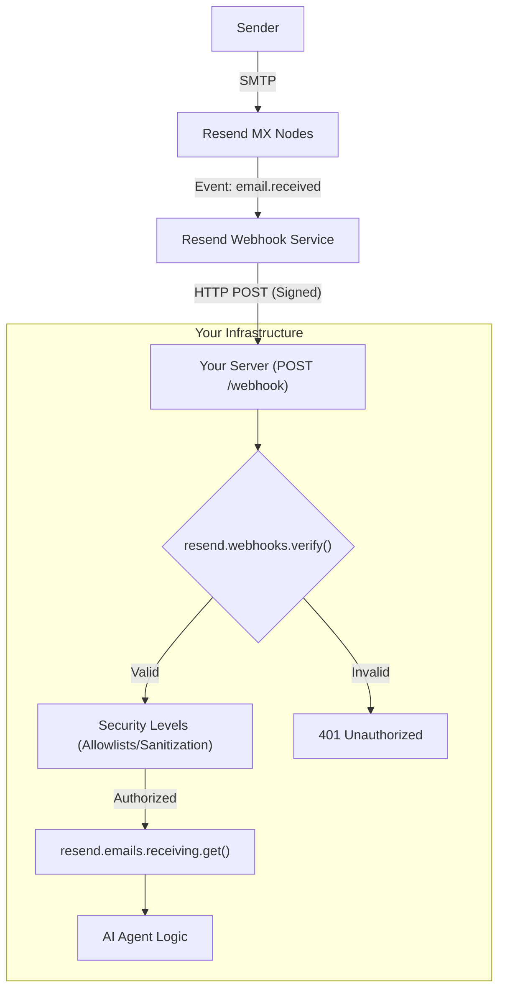
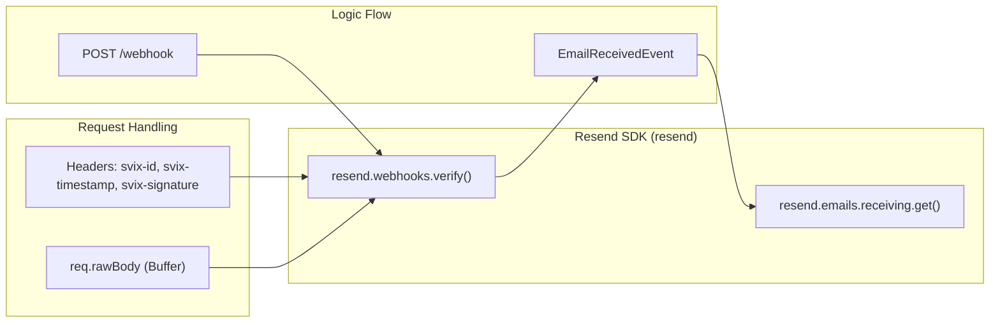

<!-- source: DeepWiki mcp.deepwiki.com · repo resend/resend-skills · page 3.1 Inbound Email Pipeline & Webhook Setup · fetched 2026-10-26 -->

# Inbound Email Pipeline & Webhook Setup

<details>
<summary>Relevant source files</summary>

The following files were used as context for generating this wiki page:

- [skills/agent-email-inbox/SKILL.md](skills/agent-email-inbox/SKILL.md)
- [skills/agent-email-inbox/references/security-levels.md](skills/agent-email-inbox/references/security-levels.md)
- [skills/agent-email-inbox/references/webhook-setup.md](skills/agent-email-inbox/references/webhook-setup.md)

</details>


This page provides a technical guide for establishing a secure, real-time inbound email pipeline for AI agents using the Resend platform. It covers the end-to-end flow from DNS configuration to raw body capture for cryptographic verification.

## Architecture Overview

Resend utilizes a webhook-based architecture for inbound emails. Unlike polling-based systems, this event-driven approach ensures the AI agent only consumes resources when an email is actually received [skills/agent-email-inbox/SKILL.md:58-65]().

### Data Flow Diagram

The following diagram illustrates the path of an email from the sender to the agent's logic.

**Email Inbound Pipeline**

Sources: [skills/agent-email-inbox/SKILL.md:69-75](), [skills/agent-email-inbox/references/webhook-setup.md:83-96]()

## Domain & MX Configuration

To receive emails, you must configure a domain to point its Mail Exchange (MX) records to Resend.

### 1. Managed vs. Custom Domains
*   **Resend-Managed:** Addresses follow the pattern `<anything>@<id>.resend.app`. No DNS setup is required [skills/agent-email-inbox/SKILL.md:132-136]().
*   **Custom Domain:** Requires a verified domain in the Resend Dashboard with "Enable Receiving" toggled on [skills/agent-email-inbox/SKILL.md:138-140]().

### 2. DNS Settings
When using a custom domain, it is recommended to use a **subdomain** (e.g., `agent.example.com`) to avoid conflicts with existing mail providers [skills/agent-email-inbox/SKILL.md:151]().

| Setting | Value | Priority |
| :--- | :--- | :--- |
| Type | MX | - |
| Host | `agent.example.com` | - |
| Value | Provided in Resend Dashboard | 10 (Lowest) |

Sources: [skills/agent-email-inbox/SKILL.md:142-153]()

## Webhook Implementation

The webhook handler must be a `POST` route capable of capturing the **raw request body** for signature verification [skills/agent-email-inbox/SKILL.md:99]().

### Implementation Map: Code Entities

This diagram maps the logical webhook steps to specific SDK functions and expected data structures.

**Webhook Logic to Code Mapping**

Sources: [skills/agent-email-inbox/references/webhook-setup.md:83-96](), [skills/agent-email-inbox/SKILL.md:79-90]()

### Signature Verification
Verification requires the `RESEND_WEBHOOK_SECRET` (prefixed with `whsec_`) obtained during webhook creation [skills/agent-email-inbox/references/webhook-setup.md:13-21]().

**Key Headers:**
*   `svix-id`: Unique message ID.
*   `svix-timestamp`: Unix timestamp.
*   `svix-signature`: Cryptographic signature [skills/agent-email-inbox/references/webhook-setup.md:87-93]().

### Next.js Implementation (App Router)
Next.js requires disabling the default body parser to access the raw bytes.

```typescript
// Example inspired by verification requirements
import { Resend } from 'resend';

const resend = new Resend(process.env.RESEND_API_KEY);

export async function POST(req: Request) {
  const payload = await req.text(); // Get raw body
  const headers = {
    'svix-id': req.headers.get('svix-id')!,
    'svix-timestamp': req.headers.get('svix-timestamp')!,
    'svix-signature': req.headers.get('svix-signature')!,
  };

  try {
    const event = resend.webhooks.verify(
      payload, 
      headers, 
      process.env.RESEND_WEBHOOK_SECRET
    );
    // Process email.received event
  } catch (err) {
    return new Response('Verification failed', { status: 400 });
  }
}
```
Sources: [skills/agent-email-inbox/references/webhook-setup.md:95-96](), [skills/agent-email-inbox/SKILL.md:79-83]()

## Local Development & Tunneling

Since Resend needs to reach your local machine, a tunneling service is required.

### Tailscale Funnel (Recommended)
Tailscale Funnel is preferred for agent development because it provides a **permanent URL** that does not change across restarts, unlike the free tier of ngrok [skills/agent-email-inbox/references/webhook-setup.md:145-154]().

*   **Command:** `sudo tailscale funnel 3000` [skills/agent-email-inbox/references/webhook-setup.md:165]()
*   **Benefit:** Survives reboots and provides valid HTTPS certificates automatically [skills/agent-email-inbox/references/webhook-setup.md:150-154]().

### ngrok (Alternative)
*   **Free Tier:** URLs change on every restart, requiring you to delete and recreate the webhook via the Resend API frequently [skills/agent-email-inbox/references/webhook-setup.md:190-193]().
*   **Command:** `ngrok http 3000` [skills/agent-email-inbox/references/webhook-setup.md:207]()

Sources: [skills/agent-email-inbox/references/webhook-setup.md:135-212]()

## Webhook Registration via API

Instead of manual configuration, register webhooks programmatically to capture the `signing_secret` in the initial response [skills/agent-email-inbox/references/webhook-setup.md:13-15]().

```typescript
const { data, error } = await resend.webhooks.create({
  endpoint: 'https://your-tunnel-url.ts.net/webhook',
  events: ['email.received'],
});

// data.signing_secret must be saved to RESEND_WEBHOOK_SECRET immediately
```
Sources: [skills/agent-email-inbox/references/webhook-setup.md:30-43]()

## Retry Behavior

Resend employs exponential backoff for failed webhook deliveries (non-2xx responses) [skills/agent-email-inbox/references/webhook-setup.md:118-130]().

| Attempt | Delay |
| :--- | :--- |
| 1 | Immediate |
| 2 | 5 seconds |
| 3 | 5 minutes |
| 7 | 10 hours |

**Note:** Emails are stored in Resend even if webhooks fail; they can be replayed manually from the dashboard [skills/agent-email-inbox/references/webhook-setup.md:132-134]().

Sources: [skills/agent-email-inbox/references/webhook-setup.md:118-134]()

---

