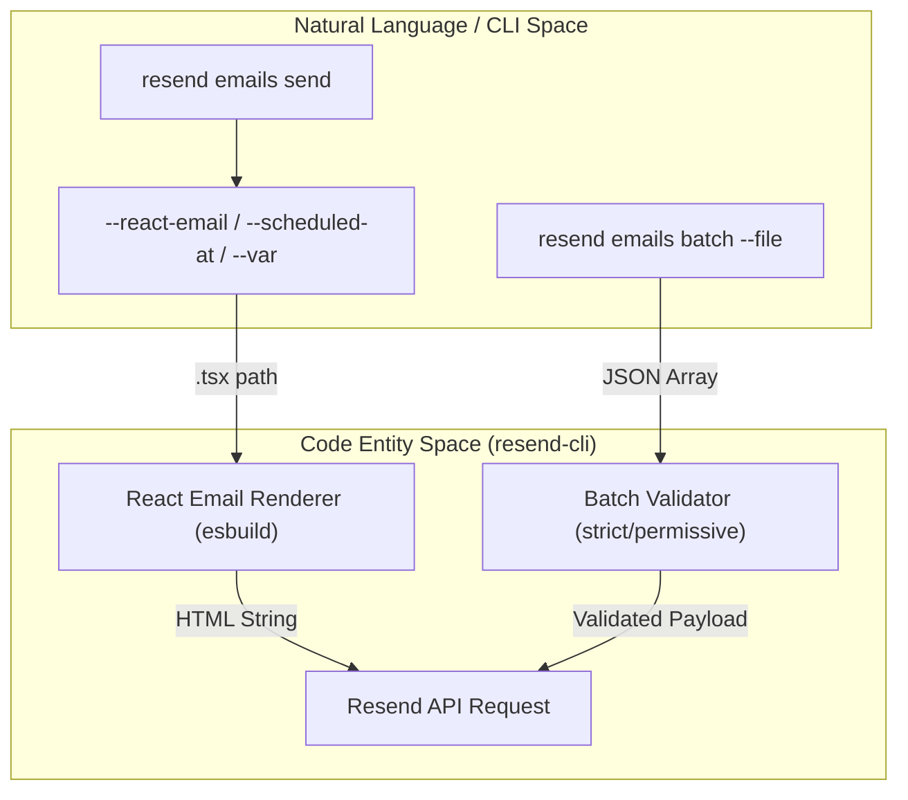
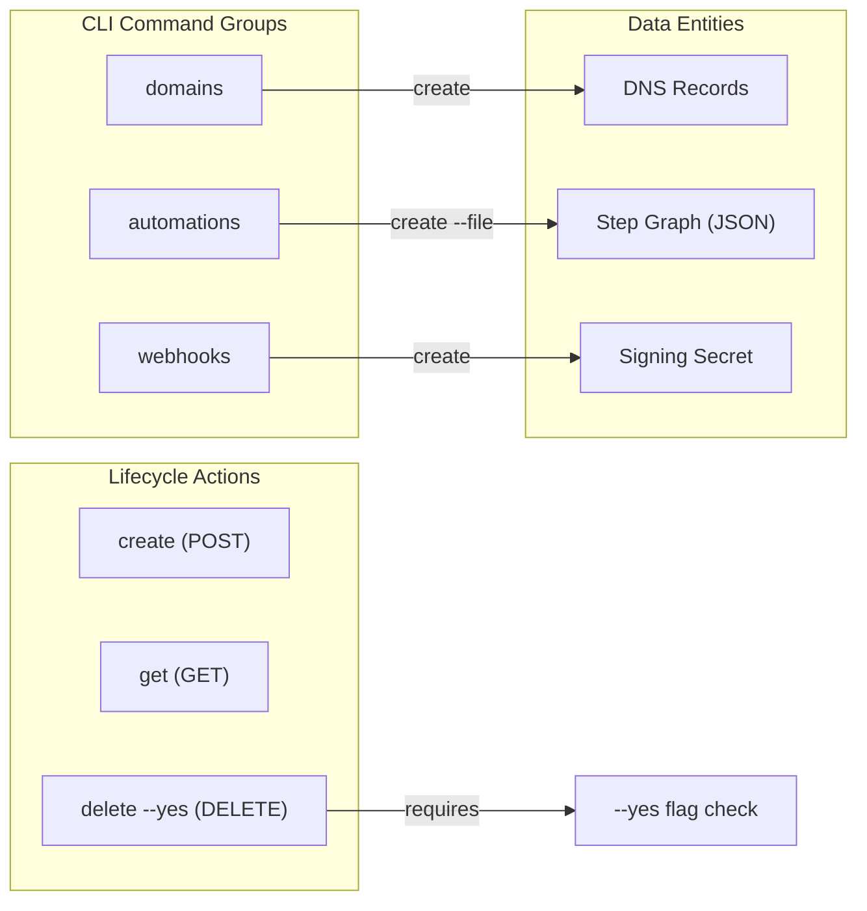

<!-- source: DeepWiki mcp.deepwiki.com · repo resend/resend-skills · page 4.1 CLI Commands Reference · fetched 2026-10-26 -->

# CLI Commands Reference

Relevant source files

The following files were used as context for generating this wiki page:

- [skills/resend-cli/SKILL.md](skills/resend-cli/SKILL.md)
- [skills/resend-cli/references/api-keys.md](skills/resend-cli/references/api-keys.md)
- [skills/resend-cli/references/auth.md](skills/resend-cli/references/auth.md)
- [skills/resend-cli/references/automations.md](skills/resend-cli/references/automations.md)
- [skills/resend-cli/references/broadcasts.md](skills/resend-cli/references/broadcasts.md)
- [skills/resend-cli/references/contact-properties.md](skills/resend-cli/references/contact-properties.md)
- [skills/resend-cli/references/contacts.md](skills/resend-cli/references/contacts.md)
- [skills/resend-cli/references/domains.md](skills/resend-cli/references/domains.md)
- [skills/resend-cli/references/emails.md](skills/resend-cli/references/emails.md)
- [skills/resend-cli/references/logs.md](skills/resend-cli/references/logs.md)
- [skills/resend-cli/references/segments.md](skills/resend-cli/references/segments.md)
- [skills/resend-cli/references/templates.md](skills/resend-cli/references/templates.md)
- [skills/resend-cli/references/topics.md](skills/resend-cli/references/topics.md)
- [skills/resend-cli/references/webhooks.md](skills/resend-cli/references/webhooks.md)
- [skills/resend-cli/references/workflows.md](skills/resend-cli/references/workflows.md)

The `resend-cli` provides a comprehensive command-line interface for managing the Resend platform. It is designed for both interactive use by developers and non-interactive use within CI/CD pipelines and AI agent environments.

## Agent Protocol & Global Behavior

The CLI implements an **Agent Protocol** to ensure reliable operation in non-TTY environments. It automatically detects when it is not running in a terminal and adjusts its behavior accordingly [skills/resend-cli/SKILL.md:101-104]().

### Non-TTY Behavior
*   **JSON Output**: The CLI defaults to JSON output; the `--json` flag is not required [skills/resend-cli/SKILL.md:103-103]().
*   **No Prompting**: The CLI will not prompt for missing information. All required flags must be provided [skills/resend-cli/SKILL.md:106-106]().
*   **Safety Flags**: All destructive operations (e.g., `delete`, `rm`) require the `--yes` flag to bypass confirmation prompts [skills/resend-cli/SKILL.md:114-114]().
*   **Exit Codes**: `0` indicates success, while `1` indicates an error [skills/resend-cli/SKILL.md:108-108]().

### Global Flags
| Flag | Description |
|------|-------------|
| `--api-key <key>` | Overrides the API key for the current command [skills/resend-cli/SKILL.md:124-124](). |
| `-p, --profile <name>` | Selects a stored authentication profile [skills/resend-cli/SKILL.md:125-125](). |
| `--json` | Forces JSON output even in interactive terminals [skills/resend-cli/SKILL.md:126-126](). |
| `-q, --quiet` | Suppresses spinners and status messages; implies `--json` [skills/resend-cli/SKILL.md:127-127](). |

**Sources:** [skills/resend-cli/SKILL.md:101-128]()

---

## Email Commands

The `emails` group handles sending, retrieving, and managing inbound (receiving) emails.

### Sending Emails
The `emails send` command supports standard text/HTML, React Email templates, and scheduling [skills/resend-cli/references/emails.md:7-32]().

*   **React Email**: Use `--react-email <path>` to bundle and render `.tsx` templates locally before sending [skills/resend-cli/references/emails.md:20-20]().
*   **Scheduling**: Use `--scheduled-at` with ISO 8601 strings or natural language (e.g., `"tomorrow at 9am"`) [skills/resend-cli/references/emails.md:26-26]().
*   **Batching**: `emails batch --file <path>` accepts a JSON array of up to 100 emails [skills/resend-cli/references/emails.md:72-94]().

### Inbound (Receiving)
Inbound emails require a domain with receiving enabled [skills/resend-cli/references/emails.md:122-124]().
*   **`emails receiving listen`**: Polls the API for new inbound messages. In non-TTY mode, it outputs NDJSON [skills/resend-cli/references/emails.md:171-183]().
*   **`emails receiving get <id>`**: Retrieves the full message, including `raw.download_url` and attachment metadata [skills/resend-cli/references/emails.md:134-140]().

### Command Entity Mapping: Email Pipeline
This diagram maps CLI command inputs to the internal processing flow for email delivery.

**Sources:** [skills/resend-cli/references/emails.md:7-94](), [skills/resend-cli/SKILL.md:152-152]()

---

## Marketing & Contact Management

These commands manage the Resend Marketing platform entities: Contacts, Segments, and Broadcasts.

### Broadcasts
Broadcasts allow bulk sending to segments.
*   **Creation**: `broadcasts create` can save as a `draft` or send immediately with the `--send` flag [skills/resend-cli/references/broadcasts.md:17-34]().
*   **Restriction**: Dashboard-created broadcasts cannot be sent via the CLI; only API/CLI-created drafts are supported [skills/resend-cli/SKILL.md:163-163]().

### Contacts & Segments
*   **Segments**: Logic-based groups of contacts. `segments contacts <id>` lists members [skills/resend-cli/references/segments.md:43-54]().
*   **Contact Properties**: Custom metadata for contacts. Note that `key` and `type` are immutable after creation [skills/resend-cli/references/contact-properties.md:17-44]().

**Sources:** [skills/resend-cli/references/broadcasts.md:1-93](), [skills/resend-cli/references/segments.md:1-54](), [skills/resend-cli/references/contact-properties.md:1-57](), [skills/resend-cli/references/contacts.md:1-101]()

---

## Infrastructure & Configuration

### Domains
Used to manage sending identities and DNS verification.
*   **`domains create`**: Returns an array of `records[]` (MX, TXT, CNAME) that must be configured at the DNS provider [skills/resend-cli/references/domains.md:21-34]().
*   **`domains verify`**: Triggers an asynchronous check of DNS records [skills/resend-cli/references/domains.md:46-54]().

### Automations & Events
Automations are DAG-based workflows triggered by Events.
*   **`events send`**: Triggers an automation run for a specific contact using a JSON `--payload` [skills/resend-cli/references/automations.md:164-173]().
*   **`automations create`**: Accepts a `--file` containing `steps` and `connections` arrays [skills/resend-cli/references/automations.md:17-27]().

### Webhooks
*   **Subscription**: `webhooks create --events all` or specific events like `email.bounced` [skills/resend-cli/references/workflows.md:163-174]().
*   **Security**: The `signing_secret` is only displayed once during creation and cannot be retrieved later [skills/resend-cli/SKILL.md:159-159]().

### CLI Logic Flow: Infrastructure Management
Mapping infrastructure commands to the Resend resource lifecycle.

**Sources:** [skills/resend-cli/references/domains.md:21-42](), [skills/resend-cli/references/automations.md:17-32](), [skills/resend-cli/SKILL.md:158-160]()

---

## Utility & Maintenance

### Auth Profiles
The CLI supports multiple API keys via profiles stored in a local config file.
*   **`auth switch <name>`**: Changes the active profile [skills/resend-cli/references/auth.md:27-31]().
*   **Resolution Order**: The CLI resolves keys in this order: `--api-key` flag > `RESEND_API_KEY` env var > Active profile [skills/resend-cli/SKILL.md:118-118]().

### Debugging
*   **`resend doctor`**: Runs a diagnostic suite checking CLI version, API connectivity, and domain status [skills/resend-cli/references/auth.md:51-56]().
*   **`resend logs get <id>`**: Retrieves full `request_body` and `response_body` for a specific API call [skills/resend-cli/references/logs.md:21-28]().

**Sources:** [skills/resend-cli/references/auth.md:1-72](), [skills/resend-cli/references/logs.md:1-36](), [skills/resend-cli/SKILL.md:118-128]()

---

