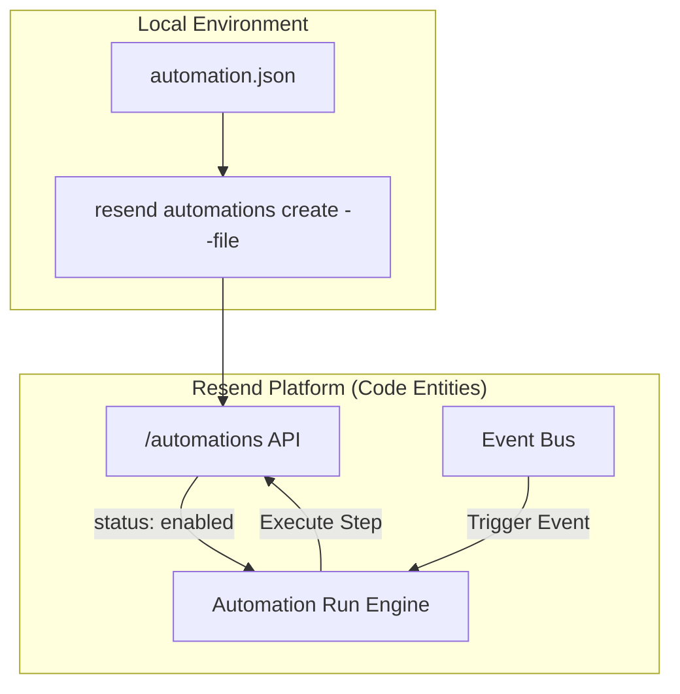
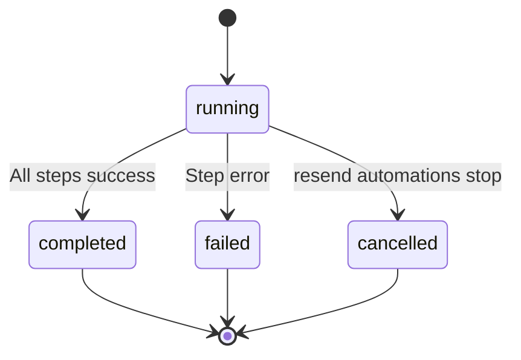

<!-- source: DeepWiki mcp.deepwiki.com · repo resend/resend-skills · page 4.2 CLI Automations, Workflows & Logs · fetched 2026-10-26 -->

# CLI Automations, Workflows & Logs

<details>
<summary>Relevant source files</summary>

The following files were used as context for generating this wiki page:

- [skills/resend-cli/SKILL.md](skills/resend-cli/SKILL.md)
- [skills/resend-cli/references/automations.md](skills/resend-cli/references/automations.md)
- [skills/resend-cli/references/logs.md](skills/resend-cli/references/logs.md)
- [skills/resend-cli/references/workflows.md](skills/resend-cli/references/workflows.md)

</details>


This page details the use of the Resend CLI for managing complex event-driven automations, triggering custom events, and inspecting platform activity through API logs. It covers the JSON-based workflow definitions, the execution lifecycle of automation runs, and the technical requirements for non-interactive environments.

## Automations and Event Graphs

Automations in Resend are represented as Directed Acyclic Graphs (DAGs) consisting of **Steps** and **Connections**. The CLI allows for full CRUD operations on these graphs using JSON payloads or local files.

### Automation Components
*   **Steps**: Discrete units of logic (e.g., sending an email, waiting for a duration).
*   **Connections**: Logical links between steps that define the execution path based on outcomes (e.g., `condition_met`, `timeout`).

### Supported Step and Connection Types
| Category | Types |
| :--- | :--- |
| **Step Types** | `trigger`, `delay`, `send_email`, `wait_for_event`, `condition` [skills/resend-cli/references/automations.md:29-29]() |
| **Connection Types** | `default`, `condition_met`, `condition_not_met`, `timeout`, `event_received` [skills/resend-cli/references/automations.md:31-31]() |

### Automation Management Flow
The following diagram illustrates the transition from a local JSON definition to a running automation on the Resend platform.

**Automation Creation and Lifecycle**

Sources: [skills/resend-cli/references/automations.md:17-31](), [skills/resend-cli/references/automations.md:57-65]()

## Managing Events

Events are the entry points for automations. The CLI facilitates defining event schemas and triggering runs by sending payloads.

### Event Operations
*   **Create/Update**: Events require a name and an optional JSON schema mapping fields to types (`string`, `number`, `boolean`, `date`) [skills/resend-cli/references/automations.md:127-132]().
*   **Reserved Names**: Event names cannot start with the `resend:` prefix, which is reserved for system events [skills/resend-cli/references/automations.md:134-134]().
*   **Sending Events**: Triggering an automation requires either a `contact_id` or an `email` address, along with a payload matching the defined schema [skills/resend-cli/references/automations.md:164-171]().

### Example: Triggering an Automation
```bash
resend events send \
  --event "user.signed_up" \
  --email "user@example.com" \
  --payload '{"plan": "pro", "source": "referral"}'
```
Sources: [skills/resend-cli/references/automations.md:164-173]()

## Inspecting Automation Runs

The CLI provides granular visibility into the execution of automations.

*   **Listing Runs**: Users can filter runs by status (`running`, `completed`, `failed`, `cancelled`) [skills/resend-cli/references/automations.md:91-102]().
*   **Run Details**: `resend automations runs get` returns the full run object, including execution details for every step in the graph [skills/resend-cli/references/automations.md:106-113]().

**Automation Run State Machine**

Sources: [skills/resend-cli/references/automations.md:87-102](), [skills/resend-cli/references/automations.md:57-65]()

## API Request Logs

The `logs` command group allows developers to debug API interactions by inspecting the raw request and response data.

### Log Access Levels
1.  **Summary View**: `resend logs list` returns high-level metadata (endpoint, method, status code, timestamp) [skills/resend-cli/references/logs.md:7-17]().
2.  **Detailed View**: `resend logs get <id>` retrieves the full `request_body` and `response_body`. This is necessary because the list view omits bodies for performance [skills/resend-cli/SKILL.md:165-165](), [skills/resend-cli/references/logs.md:21-27]().

Sources: [skills/resend-cli/references/logs.md:1-36](), [skills/resend-cli/SKILL.md:165-165]()

## Non-Interactive Workflows & NDJSON

The Resend CLI is designed for "Agent Protocol" compatibility, making it suitable for piping and CI/CD automation.

### Technical Constraints for Agents
*   **Auto-Detection**: The CLI detects non-TTY environments and automatically switches to JSON output [skills/resend-cli/SKILL.md:103-103]().
*   **Exit Codes**: Returns `0` for success and `1` for errors [skills/resend-cli/SKILL.md:108-108]().
*   **Stream Separation**: Success JSON is sent to `stdout`, while error objects (containing `message` and `code`) are sent to `stderr` [skills/resend-cli/SKILL.md:109-112]().
*   **Safety Flags**: Commands like `delete` or `rm` require the `--yes` flag in non-interactive mode to prevent hanging on confirmation prompts [skills/resend-cli/SKILL.md:114-114]().

### Piping and Automation Example
```bash
# Create an automation from a file and capture the ID using jq
AUTO_ID=$(resend automations create --file ./onboarding.json --quiet | jq -r '.id')

# Trigger the newly created automation
resend events send --event "onboarding.start" --email "newuser@example.com"
```
Sources: [skills/resend-cli/SKILL.md:101-115](), [skills/resend-cli/references/automations.md:17-27]()

---

