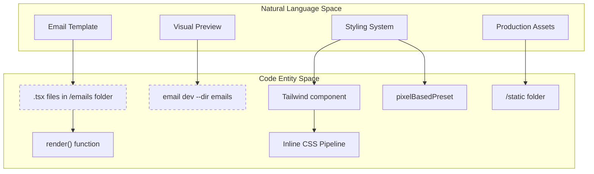
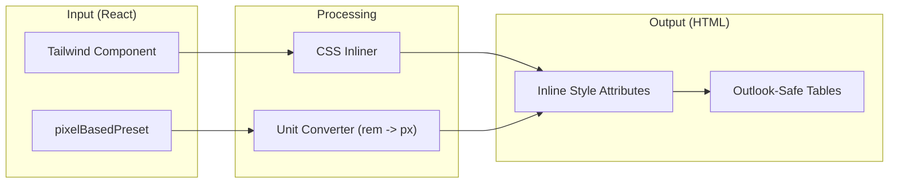

<!-- source: DeepWiki mcp.deepwiki.com · repo resend/resend-skills · page 5 React Email Skill · fetched 2026-10-26 -->

# React Email Skill

Relevant source files

The following files were used as context for generating this wiki page:

- [skills/react-email/SKILL.md](skills/react-email/SKILL.md)

The `react-email` skill provides a modern, component-based toolchain for building cross-client compatible HTML emails using React. It solves the historical difficulty of email development—characterized by nested tables and inconsistent CSS support—by providing a set of high-level primitives that render into robust, battle-tested HTML.

## Architecture Overview

The React Email ecosystem is organized into three distinct layers that handle the lifecycle of an email from design to delivery.

### 1. Component Primitives
A library of React components that abstract away the complexity of email-safe HTML. These include structural wrappers (like `Html` and `Body`), layout elements (like `Section` and `Row`), and content elements (like `Button` and `Img`).

### 2. Styling & Tooling
A development environment that includes a local preview server and a specialized Tailwind CSS integration. The `Tailwind` component, combined with the `pixelBasedPreset`, allows developers to use utility classes while ensuring the output uses pixel values and inline styles required by legacy email clients like Outlook.

### 3. Rendering & Integration
The `render()` utility transforms React components into static HTML or plain text. This output is then sent via delivery providers like Resend.

### System Entity Map

The following diagram maps natural language concepts to the specific code entities and file structures used in the React Email skill.

Sources: [skills/react-email/SKILL.md:40-53](), [skills/react-email/SKILL.md:83-85](), [skills/react-email/SKILL.md:190-198]()

## Core Components & Primitives

React Email provides a standard set of components to ensure structural integrity across clients. For a complete reference of all available components and their props, see the **[Component Library (#5.1)]** child page.

| Category | Key Components | Role |
| :--- | :--- | :--- |
| **Structure** | `Html`, `Head`, `Body` | Essential document wrappers. |
| **Layout** | `Container`, `Section`, `Row`, `Column` | Table-based layout primitives for alignment. |
| **Content** | `Heading`, `Text`, `Img`, `Button`, `Link` | Semantic elements with default email-safe styles. |
| **Utilities** | `Tailwind`, `Markdown`, `Font`, `Preview` | Advanced styling and content transformation. |

Sources: [skills/react-email/SKILL.md:153-176]()

## Styling and Layout Patterns

Email development prohibits modern CSS features like Flexbox or Grid. React Email uses a "table-first" philosophy under the hood. The `Tailwind` wrapper is the recommended way to style components, but it must be configured with the `pixelBasedPreset` to convert `rem` units to `px`, as most email clients do not support relative units.

For details on layout constraints and ready-to-use templates (e.g., Password Reset, Newsletters), see **[Styling & Layout Patterns (#5.2)]**.

Sources: [skills/react-email/SKILL.md:83-114](), [skills/react-email/SKILL.md:233-234]()

## Rendering and Delivery

To send an email, the React component must be converted to a string using the `render` function. This process can generate both the HTML version and a plain-text version for accessibility and spam filter compliance.

### Static Asset Management
Images must be hosted on a public CDN for production. The recommended pattern uses a `baseURL` variable that toggles between the local `/static` folder during development and a production URL.

For details on SSR, i18n support, and asset hosting, see **[Rendering, Sending & i18n (#5.3)]**.

Sources: [skills/react-email/SKILL.md:205-219]()

## Visual Editor

The `@react-email/editor` package allows developers to embed a WYSIWYG email editor directly into their own applications. This is useful for SaaS platforms that let users customize their own email notifications.

For details on the `EmailEditor` component and custom node extensions, see **[Visual Editor (@react-email/editor) (#5.4)]**.

Sources: [skills/react-email/SKILL.md:3-3]()

---

