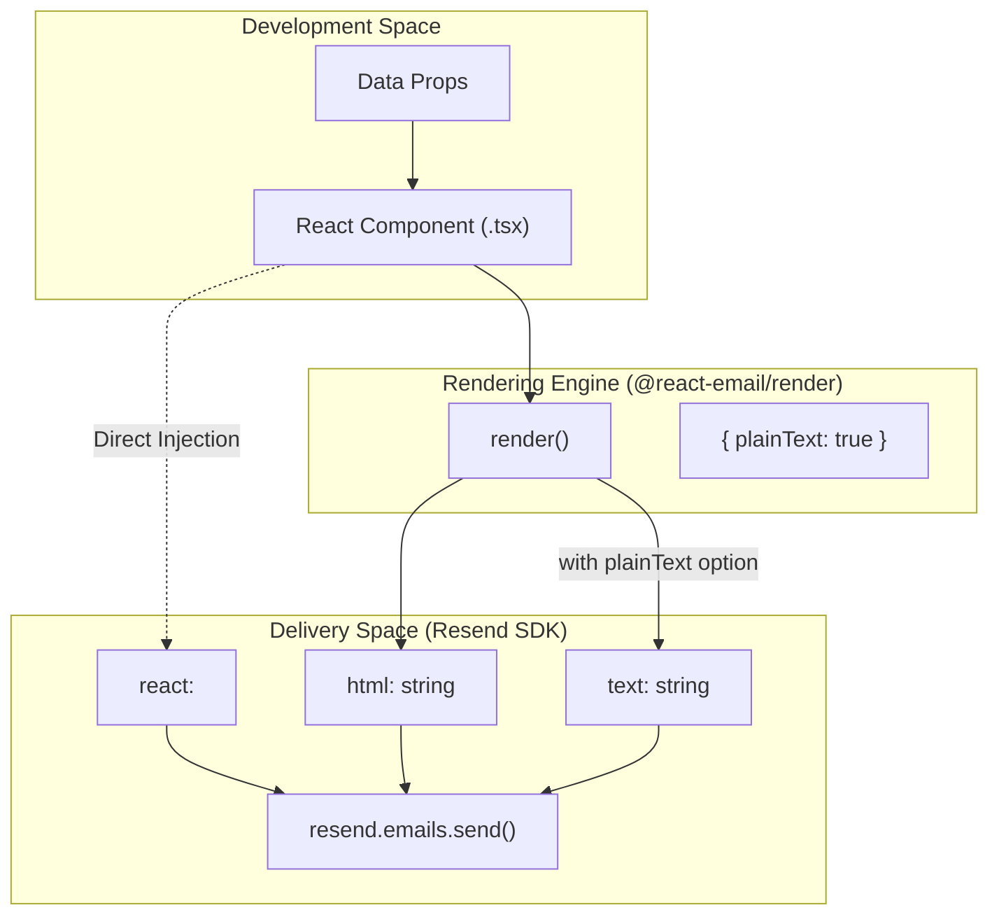
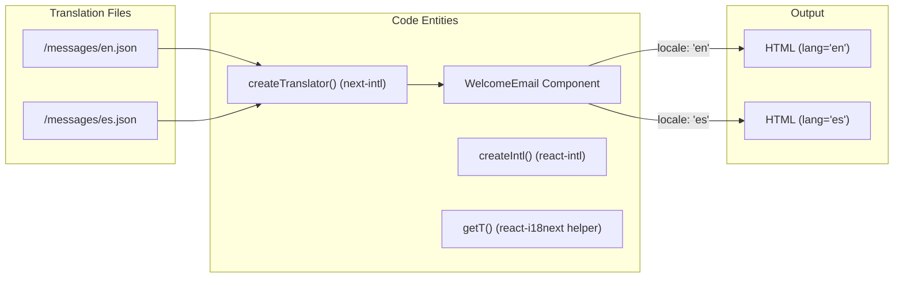

<!-- source: DeepWiki mcp.deepwiki.com · repo resend/resend-skills · page 5.3 Rendering, Sending & i18n · fetched 2026-10-26 -->

# Rendering, Sending & i18n

Relevant source files

The following files were used as context for generating this wiki page:

- [skills/react-email/references/I18N.md](skills/react-email/references/I18N.md)
- [skills/react-email/references/SENDING.md](skills/react-email/references/SENDING.md)

This section covers the lifecycle of a React Email template after authoring: from server-side rendering into HTML and plain text, to delivery via the Resend platform, and managing multi-language support (i18n) for global audiences.

## Server-Side Rendering

The `render()` function is the core utility for converting React components into the string formats required by email clients. It supports generating both the HTML structure and a fallback plain-text version.

### The render() Function
The `render()` function takes a React element and an optional configuration object. 

*   **HTML Rendering**: By default, it produces a minified HTML string compatible with major email clients [skills/react-email/references/SENDING.md:16-18]().
*   **Plain Text**: Setting the `plainText` option to `true` extracts the text content, providing a fallback for clients that do not support HTML or for better deliverability [skills/react-email/references/SENDING.md:21-21]().
*   **Pretty Output**: While not shown in all snippets, the `pretty` option can be used to format the HTML for easier debugging.

### Integration with Resend
When using the Resend SDK, manual rendering is often optional because the SDK can accept React components directly via the `react` property [skills/react-email/references/SENDING.md:32-43]().

### Rendering Data Flow
The following diagram illustrates how a React component travels from code to a delivered email.

**Template Rendering & Delivery Pipeline**

Sources: [skills/react-email/references/SENDING.md:11-50]()

---

## Static Asset Management

Emails often require external assets like images. To ensure these render correctly in the recipient's inbox, they must be hosted on a public server.

*   **The /static Folder**: Assets should be placed in a `/static` directory within the project root.
*   **Base URL Pattern**: When rendering, image paths must be absolute. Developers typically use an environment variable (e.g., `process.env.VERCEL_URL`) to prefix image `src` attributes, ensuring the email client can fetch the asset from a CDN or web server.

---

## Internationalization (i18n)

React Email supports standard i18n libraries to handle multi-language templates. The primary pattern involves dynamic imports of locale-specific JSON files within the email component.

### Supported Libraries
1.  **next-intl**: Recommended for Next.js environments using a `createTranslator` pattern [skills/react-email/references/I18N.md:16-102]().
2.  **react-intl (FormatJS)**: Ideal for complex formatting including plurals, dates (`Intl.DateTimeFormat`), and numbers (`Intl.NumberFormat`) [skills/react-email/references/I18N.md:156-209]().
3.  **react-i18next**: Best for non-Next.js apps or when granular control over the i18n instance is required [skills/react-email/references/I18N.md:239-271]().

### Implementation Pattern
Templates typically receive a `locale` prop. This prop is used to:
1.  Set the `lang` attribute on the `<Html>` component [skills/react-email/references/I18N.md:105-105]().
2.  Dynamically import the corresponding translation file [skills/react-email/references/I18N.md:98-102]().
3.  Adjust text direction (RTL support) via the `dir` attribute if necessary.

**i18n Code Entity Mapping**

Sources: [skills/react-email/references/I18N.md:30-143](), [skills/react-email/references/I18N.md:170-236](), [skills/react-email/references/I18N.md:274-288]()

### Complex Formatting
For advanced use cases, `react-intl` is preferred as it handles ICU message syntax for plurals [skills/react-email/references/I18N.md:177-177]().

| Feature | next-intl | react-intl | react-i18next |
| :--- | :--- | :--- | :--- |
| **Primary Use** | Next.js | Complex Formatting | General React |
| **Dynamic Import** | `await import()` | `await import()` | `resourcesToBackend` |
| **Helper** | `createTranslator` | `createIntl` | `getFixedT` |
| **Plurals** | Basic | ICU Support | Internal |

Sources: [skills/react-email/references/I18N.md:1-288]()

---

