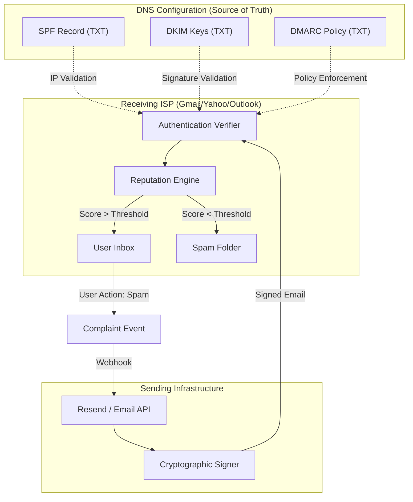

<!-- source: DeepWiki mcp.deepwiki.com · repo resend/resend-skills · page 6.1 Deliverability & Authentication · fetched 2026-10-26 -->

# Deliverability & Authentication

<details>
<summary>Relevant source files</summary>

The following files were used as context for generating this wiki page:

- [skills/email-best-practices/SKILL.md](skills/email-best-practices/SKILL.md)
- [skills/email-best-practices/references/accessibility.md](skills/email-best-practices/references/accessibility.md)
- [skills/email-best-practices/references/deliverability.md](skills/email-best-practices/references/deliverability.md)

</details>


The **Deliverability & Authentication** skill provides the technical foundation for ensuring emails reach the recipient's inbox rather than being diverted to spam folders. This involves implementing industry-standard authentication protocols (SPF, DKIM, DMARC), managing sender reputation through volume warm-up, and establishing robust feedback loops for bounces and complaints.

## Technical Architecture

The deliverability pipeline starts at the DNS layer and extends through the entire lifecycle of an email, from the initial send request to the final delivery event.

### Deliverability Data Flow



**Sources:** [skills/email-best-practices/SKILL.md:22-40](), [skills/email-best-practices/references/deliverability.md:5-37]()

## Email Authentication Standards

Authentication is mandatory for major ISPs like Gmail and Yahoo. Unauthenticated emails are frequently rejected or filtered [skills/email-best-practices/references/deliverability.md:7-8]().

### 1. SPF (Sender Policy Framework)
SPF identifies the mail servers authorized to send email on behalf of your domain.
*   **Implementation**: A TXT record added to your DNS.
*   **Recommended Value**: `v=spf1 include:amazonses.com ~all` (using `~all` for a "soft fail" during initial setup) [skills/email-best-practices/references/deliverability.md:14-18]().

### 2. DKIM (DomainKeys Identified Mail)
DKIM provides a cryptographic signature that ensures the email content hasn't been tampered with and confirms the sender's identity.
*   **Implementation**: Your email provider generates a public/private key pair; you publish the public key as a DNS TXT record [skills/email-best-practices/references/deliverability.md:20-24]().

### 3. DMARC (Domain-based Message Authentication, Reporting, and Conformance)
DMARC ties SPF and DKIM together, providing instructions to ISPs on what to do if authentication fails.
*   **Policy Rollout**: Start with `p=none` (monitoring mode) before moving to `p=quarantine` or `p=reject` [skills/email-best-practices/references/deliverability.md:30-34]().

| Protocol | Purpose | DNS Record Type |
| :--- | :--- | :--- |
| **SPF** | Authorization (Who can send) | TXT |
| **DKIM** | Integrity (Cryptographic proof) | TXT |
| **DMARC** | Enforcement (What to do on failure) | TXT |

**Sources:** [skills/email-best-practices/references/deliverability.md:9-37]()

## Sender Reputation Management

Reputation is a score assigned by ISPs based on your sending history. It is tied to both your IP address and your sending domain.

### Domain & IP Warming
New domains or IPs must gradually increase sending volume to avoid being flagged for suspicious activity [skills/email-best-practices/references/deliverability.md:59-60]().

| Week | Daily Volume Limit | Target Audience |
| :--- | :--- | :--- |
| **Week 1** | 50 - 100 | Most engaged users (e.g., active logins) |
| **Week 2** | 200 - 500 | Engaged users |
| **Week 3** | 1,000 - 2,000 | Recent signups |
| **Week 4** | 5,000 - 10,000 | Full production list |

**Sources:** [skills/email-best-practices/references/deliverability.md:61-68]()

### Infrastructure Best Practices
*   **Subdomain Segmentation**: Use dedicated subdomains for different traffic types (e.g., `t.example.com` for transactional and `m.example.com` for marketing) to protect the reputation of critical transactional emails [skills/email-best-practices/references/deliverability.md:100-101]().
*   **DNS TTL**: Use a low TTL (300s) during setup for quick changes, then increase to 3600s+ once stable [skills/email-best-practices/references/deliverability.md:102-102]().

## Handling Bounces and Complaints

Maintaining a clean list is critical for reputation. High bounce or complaint rates will lead to domain blacklisting.

### Bounce Classification

| Type | Cause | Required Action |
| :--- | :--- | :--- |
| **Hard Bounce** | Permanent (e.g., address does not exist) | Remove from list immediately [skills/email-best-practices/references/deliverability.md:82-82]() |
| **Soft Bounce** | Transient (e.g., mailbox full) | Retry with backoff (1h → 4h → 24h); remove after 3-5 failures [skills/email-best-practices/references/deliverability.md:83-83]() |

### Deliverability Thresholds

| Metric | Good | Concerning | Critical |
| :--- | :--- | :--- | :--- |
| **Bounce Rate** | < 1% | 3 - 4% | > 4% |
| **Complaint Rate** | < 0.01% | 0.02 - 0.05% | > 0.05% |

**Sources:** [skills/email-best-practices/references/deliverability.md:80-90]()

## Accessibility & Content Delivery

Deliverability also depends on the "readability" of the email by automated filters and assistive technologies.

### Mandatory Accessibility Rules
1.  **Language Declaration**: Set `lang` and `dir` on both the `<html>` tag and the direct children of the `<body>` tag [skills/email-best-practices/references/accessibility.md:7-12]().
2.  **Layout Tables**: Any `<table>` used for layout must include `role="presentation"` to prevent screen readers from announcing row/column indices [skills/email-best-practices/references/accessibility.md:34-39]().
3.  **Alt Text**: Meaningful images must have descriptive `alt` text. Decorative images must use an empty `alt=""` to be explicitly ignored [skills/email-best-practices/references/accessibility.md:103-121]().

**Sources:** [skills/email-best-practices/references/accessibility.md:5-136]()

## Troubleshooting & Verification

To verify deliverability setup, use command-line tools to inspect DNS propagation:

```bash
# Verify SPF
dig TXT yourdomain.com +short

# Verify DKIM (using 'resend' as the selector)
dig TXT resend._domainkey.yourdomain.com +short

# Verify DMARC
dig TXT _dmarc.yourdomain.com +short
```
[skills/email-best-practices/references/deliverability.md:42-53]()

If emails are still landing in spam, check the following in order:
1.  **Authentication**: Ensure SPF/DKIM/DMARC are valid [skills/email-best-practices/references/deliverability.md:107-107]().
2.  **List-Unsubscribe**: Verify the `List-Unsubscribe` header is present (required by Gmail/Yahoo) [skills/email-best-practices/references/deliverability.md:108-108]().
3.  **Reputation**: Check domain/IP against blacklists using tools like MXToolbox [skills/email-best-practices/references/deliverability.md:116-116]().

**Sources:** [skills/email-best-practices/references/deliverability.md:104-117]()

---

