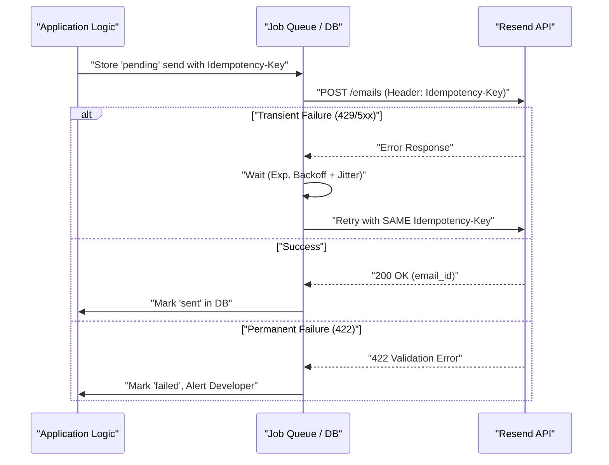
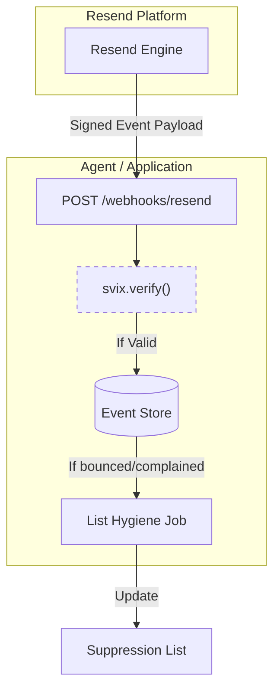

<!-- source: DeepWiki mcp.deepwiki.com · repo resend/resend-skills · page 6.4 Sending Reliability, Webhooks & Accessibility · fetched 2026-10-26 -->

# Sending Reliability, Webhooks & Accessibility

Relevant source files

The following files were used as context for generating this wiki page:

- [skills/email-best-practices/SKILL.md](skills/email-best-practices/SKILL.md)
- [skills/email-best-practices/references/accessibility.md](skills/email-best-practices/references/accessibility.md)
- [skills/email-best-practices/references/sending-reliability.md](skills/email-best-practices/references/sending-reliability.md)
- [skills/email-best-practices/references/webhooks-events.md](skills/email-best-practices/references/webhooks-events.md)

This section covers the technical implementation of production-grade email systems, focusing on fault-tolerant sending patterns, real-time event processing via webhooks, and strict adherence to email accessibility standards for both human readers and AI agents.

## Sending Reliability & Idempotency

To ensure emails are sent exactly once and handle transient failures gracefully, the system implements idempotent send patterns and structured retry logic.

### Idempotency Patterns
Idempotency prevents duplicate emails during retries. This is achieved by passing a unique `Idempotency-Key` in the request headers [skills/email-best-practices/references/sending-reliability.md:13-31]().

| Strategy | Key Generation Logic | Use Case |
| :--- | :--- | :--- |
| **Event-based** | `order-confirm-${orderId}` | Business events that should only trigger one email. |
| **Request-scoped** | `reset-${userId}-${reqId}` | Retries within a single application request context. |
| **UUID** | `crypto.randomUUID()` | General fallback; must be persisted to be reused in retries. |

*Source: [skills/email-best-practices/references/sending-reliability.md:33-41]()*

### Retry Logic & Exponential Backoff
The system distinguishes between retryable and permanent failures. Requests that fail with `429` (Rate Limit) or `5xx` (Server Error) should be retried using exponential backoff with jitter [skills/email-best-practices/references/sending-reliability.md:45-83]().

**Retry Classification:**
- **Retryable (✅):** 429 (Rate Limit), 500 (Internal Error), 503 (Service Unavailable), ETIMEDOUT, DNS failures.
- **Non-Retryable (❌):** 400 (Bad Request), 401 (Unauthorized), 422 (Validation Error).

### Reliability Data Flow
The following diagram illustrates the flow from a business event to a reliable delivery attempt.

**Reliability Sequence**

*Sources: [skills/email-best-practices/references/sending-reliability.md:59-81](), [skills/email-best-practices/references/sending-reliability.md:128-133]()*

---

## Webhook Event Processing

Webhooks allow the system to track the lifecycle of an email after it has been accepted by the API.

### Event Types
The system processes the following core events [skills/email-best-practices/references/webhooks-events.md:7-14]():
- `email.delivered`: Confirms the recipient server accepted the message.
- `email.bounced`: Indicates permanent (hard) or temporary (soft) delivery failure.
- `email.complained`: Triggered when a recipient marks the email as spam.
- `email.opened` / `email.clicked`: Engagement metrics.

### Verification and Ingestion
To ensure security, all incoming webhooks must verify the `svix` signatures provided in the headers (`svix-id`, `svix-timestamp`, `svix-signature`) using the `RESEND_WEBHOOK_SECRET` [skills/email-best-practices/references/webhooks-events.md:35-59]().

**Webhook Processing Architecture**

*Sources: [skills/email-best-practices/references/webhooks-events.md:39-59](), [skills/email-best-practices/references/webhooks-events.md:67-99]()*

---

## Email Accessibility Standards

Accessibility is a mechanical requirement for ensuring emails are readable by screen readers, translation tools, and AI agents.

### Structural Requirements
1. **Language & Direction:** Attributes `lang` and `dir` must be set on both the `<html>` tag and the direct children of `<body>` because many clients strip them from the root [skills/email-best-practices/references/accessibility.md:7-22]().
2. **Presentational Tables:** Any `<table>` used for layout (rather than data) must include `role="presentation"` to prevent screen readers from announcing row/column counts [skills/email-best-practices/references/accessibility.md:34-43]().
3. **Heading Hierarchy:** Use exactly one `<h1>` per email. Nest subheadings (`<h2>`, `<h3>`) in order without skipping levels [skills/email-best-practices/references/accessibility.md:48-60]().

### Content Requirements
- **Discernible Links:** Every `<a>` must have text. If a link contains only an image, that image's `alt` text must describe the *action* (e.g., `alt="View Order #123"`) [skills/email-best-practices/references/accessibility.md:64-79]().
- **Alt Text:** Use meaningful descriptions for informative images and empty `alt=""` for decorative elements (spacers, flourishes) [skills/email-best-practices/references/accessibility.md:103-123]().
- **Contrast Ratios:** Maintain a minimum of **4.5:1** for body text and **3:1** for large text (18pt+). Verify these against auto-inversion in dark mode clients [skills/email-best-practices/references/accessibility.md:138-147]().

### Priority Fix List
When auditing templates, issues should be addressed in this order:
1. **Critical:** Missing/misused `alt` attributes.
2. **Serious:** `lang`/`dir` duplication, `role="presentation"` on tables, missing `<title>`, contrast failures.
3. **Moderate:** Non-descriptive link text (e.g., "click here").
4. **Mild:** Heading hierarchy gaps.

*Source: [skills/email-best-practices/references/accessibility.md:148-156]()*

---
**Sources:**
- [skills/email-best-practices/SKILL.md:22-40]()
- [skills/email-best-practices/references/accessibility.md:7-156]()
- [skills/email-best-practices/references/sending-reliability.md:13-150]()
- [skills/email-best-practices/references/webhooks-events.md:7-148]()

---

