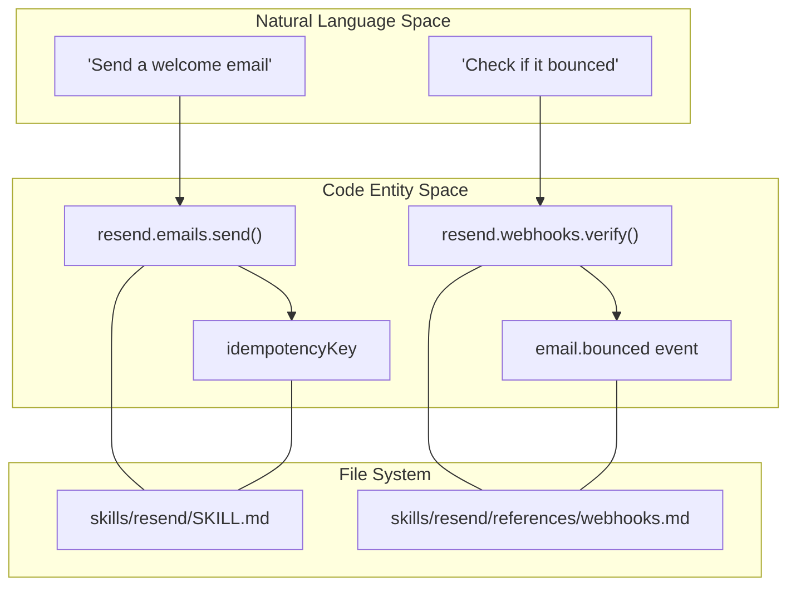
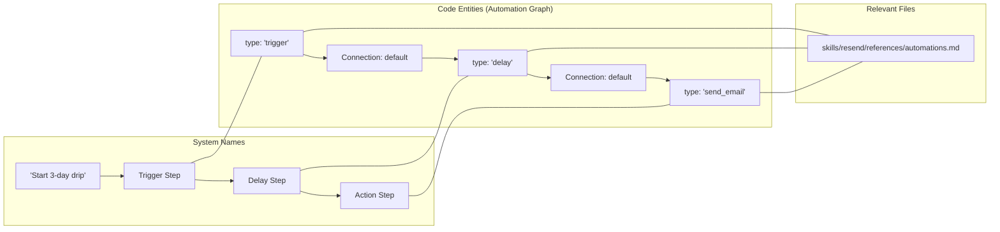

<!-- source: DeepWiki mcp.deepwiki.com · repo resend/resend-skills · page 8 Glossary · fetched 2026-10-26 -->

# Glossary

Relevant source files

The following files were used as context for generating this wiki page:

- [.claude-plugin/marketplace.json](.claude-plugin/marketplace.json)
- [.cursor-plugin/marketplace.json](.cursor-plugin/marketplace.json)
- [.gitignore](.gitignore)
- [.mcp.json](.mcp.json)
- [README.md](README.md)
- [mcp.json](mcp.json)
- [skills/agent-email-inbox/SKILL.md](skills/agent-email-inbox/SKILL.md)
- [skills/email-best-practices/SKILL.md](skills/email-best-practices/SKILL.md)
- [skills/email-best-practices/references/accessibility.md](skills/email-best-practices/references/accessibility.md)
- [skills/react-email/SKILL.md](skills/react-email/SKILL.md)
- [skills/resend-cli/SKILL.md](skills/resend-cli/SKILL.md)
- [skills/resend-cli/references/automations.md](skills/resend-cli/references/automations.md)
- [skills/resend-cli/references/error-codes.md](skills/resend-cli/references/error-codes.md)
- [skills/resend-cli/references/logs.md](skills/resend-cli/references/logs.md)
- [skills/resend-cli/references/workflows.md](skills/resend-cli/references/workflows.md)
- [skills/resend/SKILL.md](skills/resend/SKILL.md)
- [skills/resend/references/automations.md](skills/resend/references/automations.md)
- [skills/resend/references/events.md](skills/resend/references/events.md)
- [skills/resend/references/logs.md](skills/resend/references/logs.md)
- [skills/resend/references/sending/overview.md](skills/resend/references/sending/overview.md)

This glossary defines codebase-specific terms, jargon, abbreviations, and domain concepts used across the `resend-skills` repository. It serves as a technical reference for developers and AI agents to understand the underlying implementation and data structures.

## Purpose and Scope
The `resend-skills` project is a collection of AI agent plugins (skills) that bridge natural language requests to the Resend email platform. This glossary clarifies the distinction between authored and synced skills, the internal graph models for automations, and the security protocols for inbound email handling.

---

## Core Concepts & Terms

### Agent Protocol
A standardized communication contract used by the `resend-cli` to detect non-interactive environments (like CI/CD or AI agent shells). When a TTY is not detected, the CLI automatically switches to JSON output and requires specific safety flags.
*   **Implementation:** The CLI auto-detects non-TTY and outputs JSON to `stdout` for success and `stderr` for errors [skills/resend-cli/SKILL.md:101-115]().
*   **Key Requirement:** Requires the `--yes` flag for all destructive operations in non-interactive mode [skills/resend-cli/SKILL.md:158-158]().

### Automation Graph
The directed graph structure used to define event-driven workflows. It consists of `steps` (nodes) and `connections` (edges).
*   **Steps:** Each step has a unique `key`, a `type` (e.g., `trigger`, `send_email`, `delay`), and a `config` [skills/resend/references/automations.md:32-46]().
*   **Connections:** Links between steps defined by `from` and `to` keys, often with a `type` like `condition_met` or `timeout` [skills/resend/references/automations.md:57-68]().
*   **Sources:** [skills/resend/references/automations.md:28-68](), [skills/resend-cli/references/automations.md:17-32]()

### Batch Sending (Atomic)
A method for sending 2-100 distinct emails in a single API call.
*   **Atomicity:** If one email in the batch fails validation, the entire request fails [skills/resend/SKILL.md:102-102]().
*   **Constraints:** Batch sending does not support attachments or the `scheduled_at` parameter [skills/resend/SKILL.md:102-102]().
*   **CLI Usage:** Managed via `resend emails batch --file <json>` [skills/resend-cli/references/workflows.md:88-93]().

### Idempotency Key
A unique string sent in the header to prevent duplicate email sends during retries.
*   **Format:** Recommended as `<event-type>/<entity-id>` (e.g., `welcome-email/user-123`) [skills/resend/SKILL.md:110-111]().
*   **Behavior:** Sending the same key with the same payload within 24 hours returns the original response without resending [skills/resend/SKILL.md:112-114]().

### pixelBasedPreset
A configuration for the `Tailwind` component in `react-email` that converts standard Tailwind units (like `rem`) into `px`.
*   **Purpose:** Essential for email client compatibility as most clients do not support `rem` units [skills/react-email/SKILL.md:231-233]().
*   **Sources:** [skills/react-email/SKILL.md:83-94](), [skills/react-email/SKILL.md:231-233]()

### Synced Skills vs. Authored Skills
The repository contains two types of skills based on their source of truth.
*   **Authored Skills:** Skills created and maintained directly within this repo (e.g., `resend`, `agent-email-inbox`) [README.md:19-20](), [README.md:39-39]().
*   **Synced Skills:** Skills automatically mirrored from external source repositories (e.g., `resend-cli`, `react-email`). Changes to these must be made in the source repo [README.md:21-23](), [README.md:41-41]().

---

## Natural Language to Code Mapping

The following diagrams map common natural language concepts to the specific code entities and files that implement them.

### Diagram 1: Email Lifecycle Mapping
This diagram shows how a user's request to "send and track an email" moves through the system's code entities.

**Sources:** [skills/resend/SKILL.md:55-75](), [skills/resend/SKILL.md:104-115](), [skills/resend/SKILL.md:117-147]()

### Diagram 2: Automation Workflow Mapping
This diagram maps the concept of a "marketing drip campaign" to the internal Automation Graph model.

**Sources:** [skills/resend/references/automations.md:32-46](), [skills/resend/references/automations.md:57-68](), [skills/resend/references/automations.md:73-113]()

---

## Technical Abbreviations Reference

| Abbreviation | Full Term | Context in resend-skills |
| :--- | :--- | :--- |
| **MCP** | Model Context Protocol | Used to give agents tool access via the `resend-mcp` server [README.md:25-27](). |
| **NDJSON** | Newline Delimited JSON | The format used for piping data between CLI commands in scripts [skills/resend-cli/SKILL.md:103-104](). |
| **TTY** | Teletypewriter | Used to detect interactive vs. non-interactive terminal sessions for the Agent Protocol [skills/resend-cli/SKILL.md:101-104](). |
| **MX** | Mail Exchanger | DNS record required for receiving inbound emails [skills/agent-email-inbox/SKILL.md:142-151](). |
| **SPF/DKIM** | Sender Policy Framework / DomainKeys Identified Mail | DNS authentication protocols handled in deliverability best practices [skills/email-best-practices/SKILL.md:46-46](). |

---

## Inbound Email Security Levels
The `agent-email-inbox` skill defines specific security classifications for processing untrusted inbound content.

| Level | Logic | Code Pointer |
| :--- | :--- | :--- |
| **Strict** | Only allows specific `ALLOWED_SENDERS`. | [skills/agent-email-inbox/SKILL.md:25-27]() |
| **Domain** | Allows any sender from `ALLOWED_DOMAINS`. | [skills/agent-email-inbox/SKILL.md:28-30]() |
| **Sandboxed** | Processes content without executing actions directly. | [skills/agent-email-inbox/SKILL.md:3-3]() |

**Sources:** [skills/agent-email-inbox/SKILL.md:22-30](), [skills/agent-email-inbox/SKILL.md:69-75]()