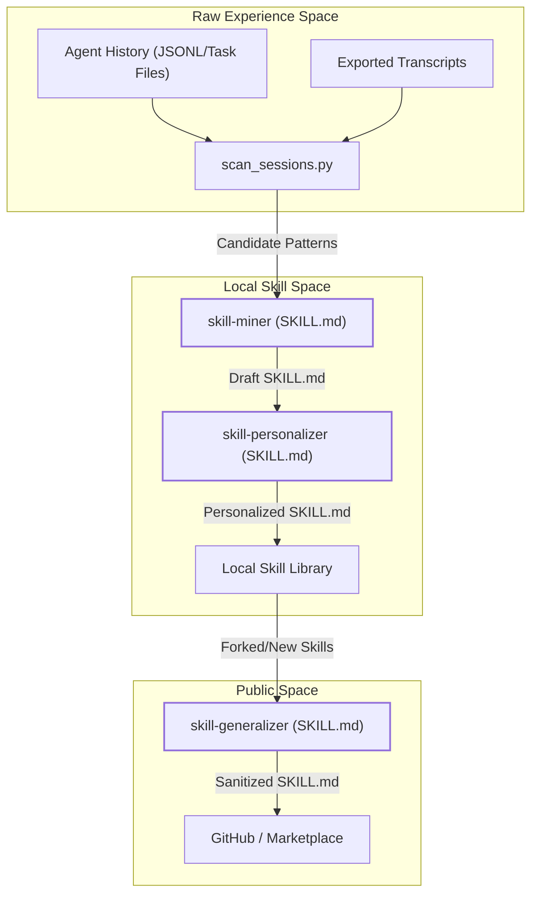
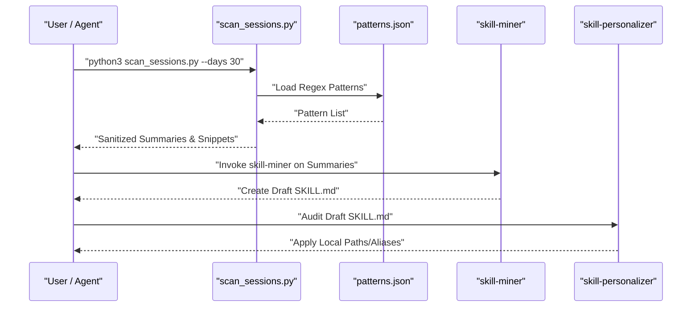

<!-- source: DeepWiki mcp.deepwiki.com · repo hqhq1025/skill-optimizer · page 1.2 Architecture & Lifecycle Pipeline · fetched 2026-10-26 -->

# Architecture & Lifecycle Pipeline

Relevant source files

The following files were used as context for generating this wiki page:

- [.claude-plugin/plugin.json](.claude-plugin/plugin.json)
- [CHANGELOG.md](CHANGELOG.md)
- [LICENSE](LICENSE)
- [llms-full.txt](llms-full.txt)
- [llms.txt](llms.txt)

The Skill Optimizer architecture is built around a three-stage lifecycle: **Mine**, **Personalize**, and **Generalize**. This pipeline transforms raw, ephemeral agent interactions into structured, high-quality, and portable `SKILL.md` artifacts [llms-full.txt:11-23](). By decoupling discovery from refinement and publication, the system ensures that skills are grounded in actual usage history before being tuned for local environments or shared with the community.

## The Three-Stage Lifecycle

The pipeline follows a linear progression for new skills, though existing skills can enter at the Personalize or Generalize stages [CHANGELOG.md:9-13]().

### 1. Mine (Discovery)
The `skill-miner` component identifies repeated workflows from coding-agent histories, archived sessions, and exported transcripts [llms.txt:9-9](). It uses a deterministic scanner to find patterns that warrant formalization into a skill [CHANGELOG.md:14-16]().

### 2. Personalize (Audit & Tuning)
The `skill-personalizer` takes a candidate or existing skill and audits it against local environmental factors. This includes tuning triggers, paths, aliases, and user-specific validation habits [llms-full.txt:18-19](). It inherits the core "optimizer" logic from previous versions to fix trigger fit and token economics [CHANGELOG.md:13-13]().

### 3. Generalize (Publication)
The `skill-generalizer` prepares skills for public distribution. It strips private data (credentials, hostnames, local paths) and ensures the skill is compatible across different agents like Codex, Claude Code, and Cursor [llms-full.txt:21-23]().

### Data Flow Overview

The following diagram illustrates the flow from raw agent logs to a finalized public skill.

**Diagram: Skill Lifecycle Data Flow**

**Sources:** [llms.txt:7-11](), [llms-full.txt:11-23](), [CHANGELOG.md:9-16]()

---

## Technical Implementation & Entity Mapping

The architecture bridges the gap between high-level lifecycle concepts and specific code entities. Each stage is implemented as a standalone `SKILL.md` package that an agent can execute [llms.txt:7-11]().

### Entity Mapping: Natural Language to Code
This table maps lifecycle concepts to their corresponding file system entities and classes.

| Lifecycle Stage | Logical Entity | Code Entity / Path |
| :--- | :--- | :--- |
| **Mine** | Session Scanner | `skills/skill-miner/scripts/scan_sessions.py` |
| **Mine** | Workflow Patterns | `skills/skill-miner/references/patterns.json` |
| **Personalize** | Audit Logic | `skills/skill-personalizer/SKILL.md` |
| **Generalize** | Publication Rules | `skills/skill-generalizer/SKILL.md` |
| **Integration** | Codex Metadata | `agents/openai.yaml` |
| **Integration** | Claude Metadata | `.claude-plugin/plugin.json` |

**Sources:** [CHANGELOG.md:14-20](), [llms.txt:23-25](), [.claude-plugin/plugin.json:1-4]()

### Detailed Pipeline Logic

The transition between stages is managed by the agent interpreting the `SKILL.md` files. The deterministic `scan_sessions.py` script serves as the entry point for the "Mine" stage, extracting data into a format the LLM can process [llms-full.txt:43-47]().

**Diagram: Code Entity Interaction**

**Sources:** [llms-full.txt:43-59](), [CHANGELOG.md:14-16](), [llms-full.txt:82-84]()

---

## Component Roles

### skill-miner
*   **Role**: Pattern Recognition.
*   **Input**: `scan_sessions.py` output, raw history, rollout summaries [llms-full.txt:15-15]().
*   **Output**: A draft `SKILL.md` with defined triggers and a workflow skeleton.
*   **Key Files**: `skills/skill-miner/SKILL.md`, `skills/skill-miner/scripts/scan_sessions.py` [llms.txt:23-23]().

### skill-personalizer
*   **Role**: Optimization & Grounding.
*   **Input**: Any `SKILL.md` (draft, forked, or existing).
*   **Audit Dimensions**: Trigger fit, undertrigger, overtrigger, user reaction, workflow completion, static quality, cross-skill conflicts, environment consistency, and token economics [llms-full.txt:19-19]().
*   **Key Files**: `skills/skill-personalizer/SKILL.md` [llms.txt:24-24]().

### skill-generalizer
*   **Role**: Sanitization & Portability.
*   **Input**: A local/personal skill.
*   **Actions**: Removes private paths, hostnames, and platform-specific assumptions [llms-full.txt:23-23]().
*   **Key Files**: `skills/skill-generalizer/SKILL.md` [llms.txt:25-25]().

**Sources:** [llms.txt:9-11](), [llms-full.txt:13-23](), [CHANGELOG.md:9-13]()

---

