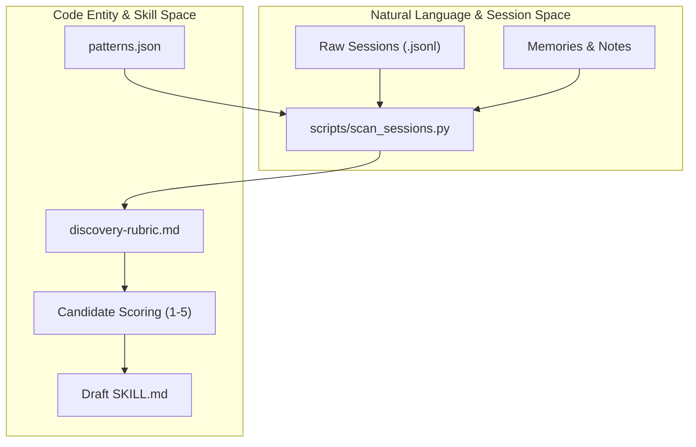
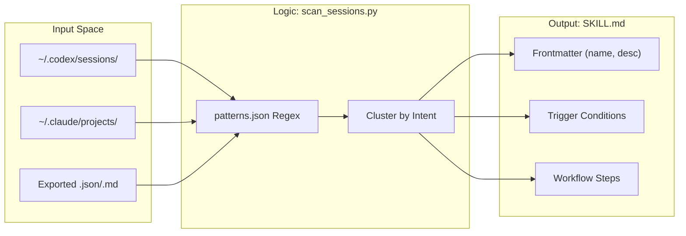

<!-- source: DeepWiki mcp.deepwiki.com · repo hqhq1025/skill-optimizer · page 2.1 skill-miner: SKILL.md & Workflow · fetched 2026-10-26 -->

# skill-miner: SKILL.md & Workflow

Relevant source files

The following files were used as context for generating this wiki page:

- [skills/skill-miner/SKILL.md](skills/skill-miner/SKILL.md)
- [skills/skill-miner/references/discovery-rubric.md](skills/skill-miner/references/discovery-rubric.md)

The `skill-miner` is the entry point of the Skill Optimizer lifecycle. Its purpose is to discover candidate skills by analyzing agent session history, archived transcripts, and repeated local work patterns. By extracting reusable techniques from real-world usage, it transforms manual, repetitive tasks into structured, documented Agent Skills.

## Overview and Trigger Conditions

The `skill-miner` is invoked when a user or team needs to move from ad-hoc task execution to a systematic automation backlog. It focuses on identifying workflows that have already occurred naturally in the user's environment.

### When To Use
*   **Session Scanning:** When a user wants to scan past coding-agent sessions for repeated workflows [skills/skill-miner/SKILL.md:14-14]().
*   **Manual Task Fatigue:** When a user suspects they are manually asking agents to perform similar tasks repeatedly [skills/skill-miner/SKILL.md:15-15]().
*   **Evidence-Based Backlog:** When a team requires a backlog of skills based on actual historical data rather than brainstorming [skills/skill-miner/SKILL.md:16-16]().
*   **Unpackaged Procedures:** When existing memories, session logs, or project notes contain recurring procedures that lack a formal package [skills/skill-miner/SKILL.md:17-17]().

**Constraint:** Do not use `skill-miner` to tune existing skills (use `skill-personalizer`) or to publish private skills (use `skill-generalizer`) [skills/skill-miner/SKILL.md:19-19]().

Sources: [skills/skill-miner/SKILL.md:1-20]()

---

## The Eight-Step Mining Workflow

The mining process follows a structured sequence to move from raw data to a draft skill.

### Mining Workflow Diagram
This diagram maps the logical workflow steps to the technical entities and scripts involved in the process.

### Workflow Steps
1.  **Locate Evidence:** Gather session JSONL files, memory summaries, repo notes, and repeated scripts [skills/skill-miner/SKILL.md:23-23]().
2.  **Sanitized Clustering:** Run `scripts/scan_sessions.py` to generate a first-pass report of activity clusters [skills/skill-miner/SKILL.md:24-24]().
3.  **Cluster Analysis:** Group work by intent, trigger phrasing, tools used, and verification patterns [skills/skill-miner/SKILL.md:25-25]().
4.  **Filtering:** Remove one-off tasks or generic coding knowledge that belongs in base models or `AGENTS.md` [skills/skill-miner/SKILL.md:26-26]().
5.  **Scoring:** Evaluate candidates based on recurrence, friction, risk, and portability [skills/skill-miner/SKILL.md:27-27]().
6.  **Drafting:** Create concise skill names, trigger descriptions, and workflow outlines for high-scoring candidates [skills/skill-miner/SKILL.md:28-28]().
7.  **Recommendation:** Determine if the skill should remain personal or be generalized for public use [skills/skill-miner/SKILL.md:29-29]().
8.  **Creation:** Build the skill folder structure and verify the frontmatter/layout [skills/skill-miner/SKILL.md:30-30]().

Sources: [skills/skill-miner/SKILL.md:21-31]()

---

## Evidence Sources & Scanning

The `skill-miner` identifies evidence across multiple agent platforms. The `scan_sessions.py` script acts as the deterministic engine for this discovery.

### Evidence Mapping
| Source | Path Example | Data Extracted |
| :--- | :--- | :--- |
| **Codex** | `~/.codex/sessions/**/*.jsonl` | User asks, tool patterns, repeated fixes [skills/skill-miner/references/discovery-rubric.md:11-11](). |
| **Claude Code** | `~/.claude/projects/**/*.jsonl` | Tool calls, skill usage, rejected workflows [skills/skill-miner/references/discovery-rubric.md:14-14](). |
| **Gemini** | `~/.gemini/` | Task files, implementation plans [skills/skill-miner/references/discovery-rubric.md:16-16](). |
| **Project Notes** | `AGENTS.md`, `CLAUDE.md` | Already documented local workflows [skills/skill-miner/references/discovery-rubric.md:19-19](). |

### Technical Implementation: scan_sessions.py
The scanner uses `references/patterns.json` to identify workflows via regex. It supports several flags for data ingestion:
*   `--days 30`: Limits the scan to recent history [skills/skill-miner/references/discovery-rubric.md:27-27]().
*   `--export`: Imports transcripts from agents without stable local history formats (e.g., Cursor, OpenCode) [skills/skill-miner/references/discovery-rubric.md:33-33]().
*   `--patterns`: Allows using a custom pattern file for personalized discovery [skills/skill-miner/references/discovery-rubric.md:39-39]().

Sources: [skills/skill-miner/references/discovery-rubric.md:5-45]()

---

## Candidate Scoring & Evaluation

Not every repeated task warrants a skill. Candidates are scored on a 1–5 scale to determine priority.

### Scoring Rubric
| Score | Meaning | Action |
| :--- | :--- | :--- |
| **5** | High-value, non-obvious, likely mishandled by vanilla agents. | Create Immediately |
| **4** | Repeated and useful with clear triggers. | Create |
| **3** | Plausible, but requires more evidence or narrower scope. | Backlog |
| **2** | Project-specific or better suited as documentation. | Skip |
| **1** | Generic, risky, or one-off. | Skip |

### Signal Detection
Strong candidates are identified by:
*   **Recurrence:** User asked for the same work at least 3 times [skills/skill-miner/references/discovery-rubric.md:50-50]().
*   **Sequencing:** Workflow requires non-obvious local judgment or multi-step sequencing [skills/skill-miner/references/discovery-rubric.md:51-51]().
*   **Agent Failure:** Agents frequently miss steps or stop before verification [skills/skill-miner/references/discovery-rubric.md:52-52]().
*   **Cross-Tooling:** Task involves multiple tools (Shell, GitHub, Browser, SSH) [skills/skill-miner/references/discovery-rubric.md:53-53]().

Sources: [skills/skill-miner/references/discovery-rubric.md:46-88]()

---

## Evidence Rules & Creation Standards

When finalizing a skill draft, the `skill-miner` must adhere to strict evidence and formatting rules to ensure privacy and utility.

### Data Flow: From Session to SKILL.md
This diagram illustrates how raw session data is filtered and structured into the final `SKILL.md` format.

### Critical Rules
*   **Privacy:** Do not expose sensitive transcript content; summarize or sanitize raw evidence [skills/skill-miner/SKILL.md:35-35]().
*   **Precision:** Avoid broad clusters like `debug` or `frontend`. Create skills only from narrow, confirmed workflows [skills/skill-miner/references/discovery-rubric.md:102-102]().
*   **Validation:** Before creating, manually inspect at least 5 positive and 3 near-miss examples to tighten trigger regexes [skills/skill-miner/references/discovery-rubric.md:44-44]().
*   **Structure:** Keep `SKILL.md` frontmatter limited to `name` and `description`. Move long examples or scripts into a `references/` or `scripts/` subfolder [skills/skill-miner/references/discovery-rubric.md:114-116]().

Sources: [skills/skill-miner/SKILL.md:32-40](), [skills/skill-miner/references/discovery-rubric.md:89-119]()

---

