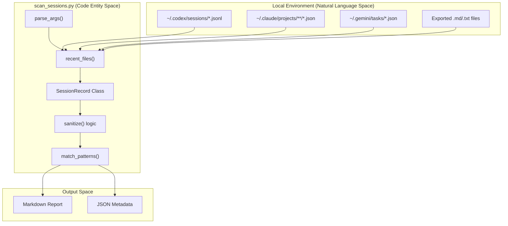
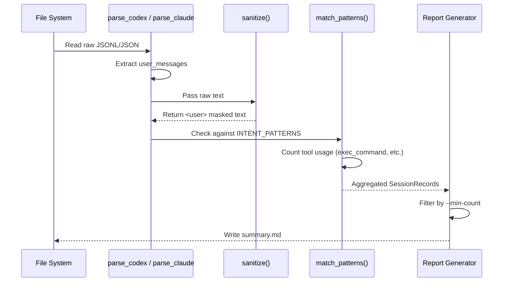

<!-- source: DeepWiki mcp.deepwiki.com · repo hqhq1025/skill-optimizer · page 2.2 scan_sessions.py: Session Scanner · fetched 2026-10-26 -->

# scan_sessions.py: Session Scanner

Relevant source files

The following files were used as context for generating this wiki page:

- [skills/skill-miner/references/patterns.json](skills/skill-miner/references/patterns.json)
- [skills/skill-miner/scripts/scan_sessions.py](skills/skill-miner/scripts/scan_sessions.py)

The `scan_sessions.py` script is a deterministic discovery tool designed to bridge the gap between raw agent activity and structured skill candidates. It functions as the primary ingestion engine for the **Mine** stage of the skill lifecycle, scanning local directories and exported transcripts to identify recurring workflow patterns.

## Purpose and Scope

The scanner does not perform full transcript exportation; instead, it emits sanitized metadata and short snippets to serve as a first-pass miner for skill candidates [skills/skill-miner/scripts/scan_sessions.py:2-6](). By analyzing the frequency of specific tool usage and intent-based keyword matching, it provides the evidence required for the `discovery-rubric.md` to score and categorize potential skills.

## Architecture and Data Flow

The script follows a linear pipeline: gathering files from multiple agent-specific directories, parsing heterogeneous formats into a unified `SessionRecord`, and finally aggregating these records into a summarized report.

### Data Ingestion Pipeline

The scanner supports a wide array of data sources, ranging from local agent databases to manual exports.

| Source Type | Default Path / Pattern | Code Entity |
| :--- | :--- | :--- |
| **Codex** | `~/.codex/sessions`, `~/.codex/memories/rollout_summaries` | `parse_codex`, `parse_rollout` |
| **Claude Code** | `~/.claude/projects`, `~/.claude/sessions` | `parse_claude_project`, `parse_claude_session` |
| **Gemini** | `~/.gemini` (Task files) | `parse_gemini_task` |
| **Generic Exports** | `.jsonl`, `.json`, `.md`, `.txt` | `parse_generic_export` |

**Data Flow Diagram**

Sources: [skills/skill-miner/scripts/scan_sessions.py:44-57](), [skills/skill-miner/scripts/scan_sessions.py:59-86](), [skills/skill-miner/scripts/scan_sessions.py:103-120]()

## Key Implementation Details

### SessionRecord Dataclass
The `SessionRecord` class is the internal representation of a coding session. It normalizes data across platforms, capturing the working directory (`cwd`), user messages, assistant responses, and a `Counter` of tool invocations [skills/skill-miner/scripts/scan_sessions.py:44-52]().

### Sanitization Logic
To ensure privacy before any LLM processing, the `sanitize()` function applies several regex-based filters:
*   **User Paths**: Replaces `/Users/username` with `/Users/<user>` [skills/skill-miner/scripts/scan_sessions.py:140]().
*   **Identifiable Info**: Masks email addresses and common API tokens (GitHub, Slack, etc.) [skills/skill-miner/scripts/scan_sessions.py:141-142]().
*   **Formatting**: Collapses whitespace and truncates long strings to 180 characters [skills/skill-miner/scripts/scan_sessions.py:143-144]().

### Pattern Matching
The scanner uses two layers of pattern matching to identify "intents":
1.  **Hardcoded Intents**: A dictionary of regexes for common operations like `review`, `debug`, `publish`, and `research` [skills/skill-miner/scripts/scan_sessions.py:20-31]().
2.  **External Patterns**: Loads `patterns.json` to identify project-specific workflows such as `codex-coproxy-recovery` or `wechat-wxcli-real-data` [skills/skill-miner/references/patterns.json:1-48]().

## CLI Reference

The script provides granular control over the scanning window and the depth of the search.

| Flag | Default | Description |
| :--- | :--- | :--- |
| `--days` | `30` | How many days back to scan for session files [skills/skill-miner/scripts/scan_sessions.py:69](). |
| `--limit` | `300` | Maximum number of files to process per source [skills/skill-miner/scripts/scan_sessions.py:70](). |
| `--min-count` | `3` | Minimum occurrences required to report a workflow pattern [skills/skill-miner/scripts/scan_sessions.py:71](). |
| `--patterns` | `patterns.json` | Path to the JSON file defining custom workflow regexes [skills/skill-miner/scripts/scan_sessions.py:81-84](). |
| `--export` | `[]` | Additional paths to scan (can be files or directories) [skills/skill-miner/scripts/scan_sessions.py:75-79](). |
| `--json` | `False` | If set, outputs raw data instead of the formatted Markdown report [skills/skill-miner/scripts/scan_sessions.py:85](). |

Sources: [skills/skill-miner/scripts/scan_sessions.py:59-86]()

## Logic Flow: Discovery to Summary

The following diagram illustrates how the script processes raw text into a prioritized list of skill candidates.

Sources: [skills/skill-miner/scripts/scan_sessions.py:139-145](), [skills/skill-miner/scripts/scan_sessions.py:169-188](), [skills/skill-miner/scripts/scan_sessions.py:20-31]()

## Output Format

By default, the script generates a Markdown report organized by **Workflow Patterns**. Each pattern includes:
*   **Frequency**: How many sessions matched the pattern.
*   **Recent Examples**: Sanitized snippets of user prompts.
*   **Associated Directories**: The `cwd` where these tasks typically occur.
*   **Tool Profile**: Common tools used during these sessions (e.g., `apply_patch` vs `tool_search`).

This output is designed to be piped directly into a `SKILL.md` creation prompt or used as the basis for the `discovery-rubric.md` evaluation.

---

