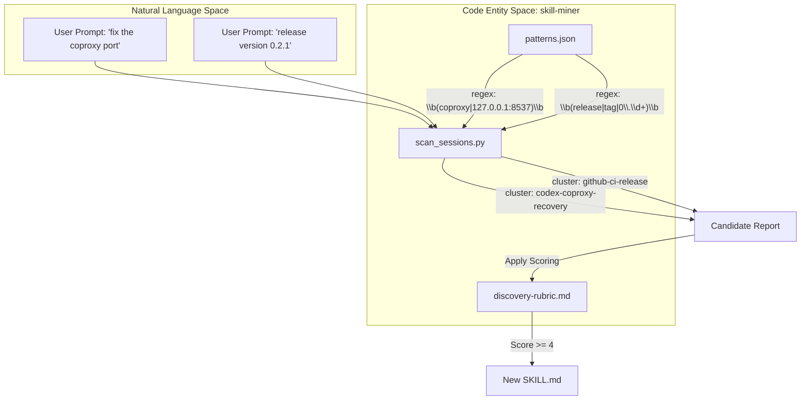
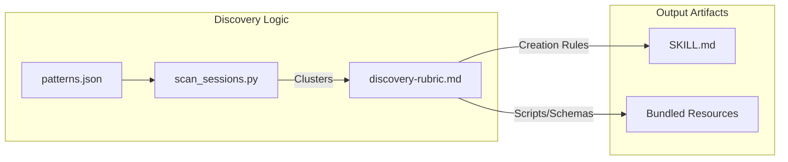

<!-- source: DeepWiki mcp.deepwiki.com · repo hqhq1025/skill-optimizer · page 2.3 skill-miner: Discovery Rubric & Patterns · fetched 2026-10-26 -->

# skill-miner: Discovery Rubric & Patterns

Relevant source files

The following files were used as context for generating this wiki page:

- [skills/skill-miner/references/discovery-rubric.md](skills/skill-miner/references/discovery-rubric.md)
- [skills/skill-miner/references/patterns.json](skills/skill-miner/references/patterns.json)

This page details the logic and configuration used by `skill-miner` to identify candidate skills within agent session histories. It focuses on the `discovery-rubric.md`, which defines the criteria for high-quality skill extraction, and `patterns.json`, which provides the regex-based engine for automated scanning.

## Discovery Rubric

The `discovery-rubric.md` serves as the authoritative guide for mining agent usage history. It defines where to look, what signals indicate a viable skill, and how to score candidates before they enter the lifecycle.

### Evidence Sources
The mining process scans a variety of local and exported data sources. Preference is given to summaries and metadata to reduce noise, with raw transcripts accessed only for validation [skills/skill-miner/references/discovery-rubric.md:5-22]().

| Source | Typical Path | What To Extract |
| :--- | :--- | :--- |
| **Codex** | `~/.codex/sessions/**/*.jsonl` | User asks, tool patterns, repeated fixes, verification habits. |
| **Claude Code** | `~/.claude/projects/**/*.jsonl` | Tool calls, rejected workflows, recurring commands. |
| **Gemini** | `~/.gemini/` | Task files, walkthroughs, implementation plans. |
| **Rollout Summaries** | `~/.codex/memories/rollout_summaries/` | Compressed memories and durable learnings. |
| **Shared Memories** | `~/.agents/memories/` | Stable preferences and repeated domains. |
| **Project Notes** | `AGENTS.md`, `CLAUDE.md` | Workflows already documented locally. |

Sources: [skills/skill-miner/references/discovery-rubric.md:9-20]()

### Candidate Signals & Scoring
Not every repeated task warrants a skill. `skill-miner` evaluates candidates based on specific signals of "non-obviousness" and failure risk [skills/skill-miner/references/discovery-rubric.md:46-63]().

**Strong Signals:**
*   Task has been requested at least 3 times [skills/skill-miner/references/discovery-rubric.md:50]().
*   Workflow requires non-obvious sequencing or local judgment [skills/skill-miner/references/discovery-rubric.md:51]().
*   Agents frequently miss steps or fail to verify [skills/skill-miner/references/discovery-rubric.md:52]().
*   The task crosses multiple tools, repos, or hosts [skills/skill-miner/references/discovery-rubric.md:53]().

**Scoring Rubric (1-5):**
*   **5 (Must Create):** Repeated, high-value, and likely to be mishandled without a skill [skills/skill-miner/references/discovery-rubric.md:81]().
*   **4 (Should Create):** Useful with clear triggers and validation steps [skills/skill-miner/references/discovery-rubric.md:82]().
*   **3 (Backlog):** Plausible but needs more evidence [skills/skill-miner/references/discovery-rubric.md:83]().
*   **1-2 (Skip):** Project-specific, generic, or risky [skills/skill-miner/references/discovery-rubric.md:84-85]().

Sources: [skills/skill-miner/references/discovery-rubric.md:46-87]()

---

## Pattern Workflow Definitions

The `patterns.json` file defines the regex patterns used by `scan_sessions.py` to cluster session data into potential skill candidates. Each entry represents a known workflow domain.

### Pattern Schema
Each pattern entry in `patterns.json` contains:
1.  **pattern**: A regex string used to match user prompts or tool outputs [skills/skill-miner/references/patterns.json:3]().
2.  **direction**: Categorizes the skill as `personal`, `public`, or `personal-to-public` (indicating it starts local but has general utility) [skills/skill-miner/references/patterns.json:4-9]().
3.  **why**: The rationale for why this specific pattern is worth tracking [skills/skill-miner/references/patterns.json:5]().
4.  **case_sensitive** (optional): Boolean flag to enforce case matching [skills/skill-miner/references/patterns.json:26]().

### Data Flow: From Patterns to Candidates
The following diagram illustrates how `patterns.json` interacts with the `scan_sessions.py` script to transform raw logs into structured clusters.

**Pattern-Based Discovery Pipeline**

Sources: [skills/skill-miner/references/patterns.json:2-27](), [skills/skill-miner/references/discovery-rubric.md:36-42]()

---

## Clustering & Implementation

### Clustering Dimensions
When `scan_sessions.py` identifies matches, it groups them by several dimensions to help the developer identify the "Core Workflow" [skills/skill-miner/references/discovery-rubric.md:64-74]():
*   **Intent:** (e.g., debug, publish, deploy).
*   **Natural Trigger Phrasing:** The user's actual shorthand.
*   **Artifacts:** Specific files, URLs, or hosts involved.
*   **Completion Pattern:** What "done" looked like in successful sessions.

### From Discovery to Creation
Once a candidate is selected, the `discovery-rubric.md` mandates a simulation of the next lifecycle steps before writing the file [skills/skill-miner/references/discovery-rubric.md:104-108]():
1.  **Personalization Check:** Identify local paths or preferences needed.
2.  **Generalization Check:** Identify which details must be parameterized for others.

**System Logic: Discovery to SKILL.md**

Sources: [skills/skill-miner/references/discovery-rubric.md:109-119](), [skills/skill-miner/references/patterns.json:1-48]()

### Creation Rules
When finalizing a discovered skill:
*   Keep frontmatter limited to `name` and `description` [skills/skill-miner/references/discovery-rubric.md:114]().
*   Use real user phrasing for trigger conditions [skills/skill-miner/references/discovery-rubric.md:115]().
*   Offload complex logic (parsing, redaction) to scripts in bundled resources rather than prose [skills/skill-miner/references/discovery-rubric.md:118]().

Sources: [skills/skill-miner/references/discovery-rubric.md:109-119]()

---

