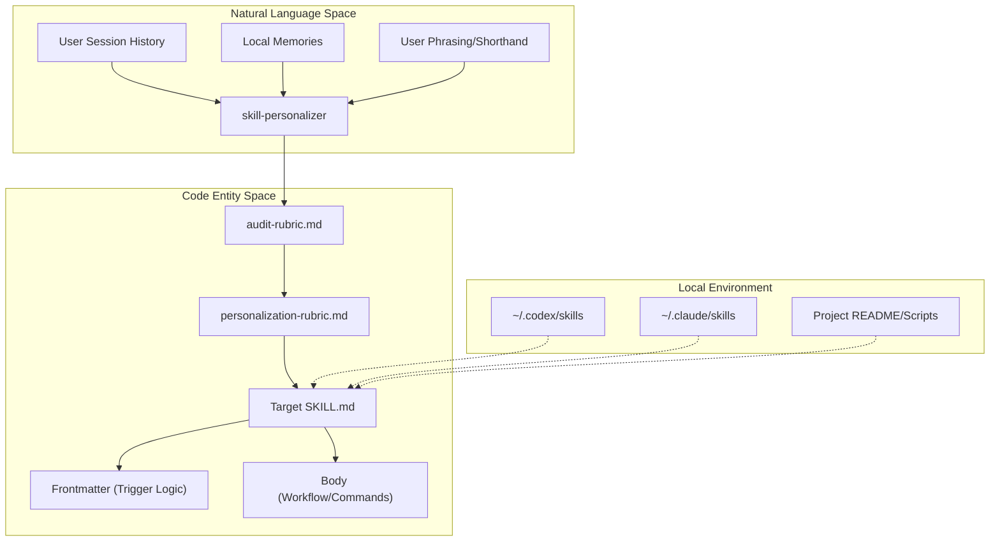
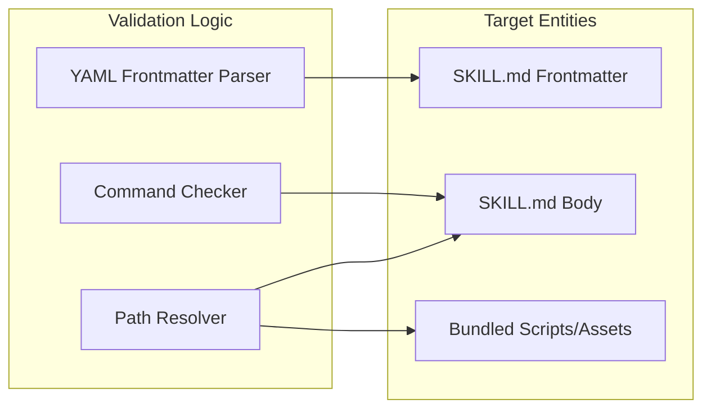

<!-- source: DeepWiki mcp.deepwiki.com · repo hqhq1025/skill-optimizer · page 3.1 skill-personalizer: SKILL.md & Workflow · fetched 2026-10-26 -->

# skill-personalizer: SKILL.md & Workflow

Relevant source files

The following files were used as context for generating this wiki page:

- [skills/skill-personalizer/SKILL.md](skills/skill-personalizer/SKILL.md)
- [skills/skill-personalizer/references/personalization-rubric.md](skills/skill-personalizer/references/personalization-rubric.md)

The `skill-personalizer` is a specialized skill designed to audit and adapt Agent Skills to a specific user's local environment. Unlike the `skill-generalizer`, which strips away local context for public release, the personalizer deepens the integration between a skill and the user's actual tools, habits, directories, and session history [skills/skill-personalizer/SKILL.md:1-10]().

## Purpose and Trigger Conditions

The `skill-personalizer` is invoked when a skill feels "generic," noisy, or misaligned with the user's actual day-to-day operations.

| Trigger Condition | Description |
| :--- | :--- |
| **New Installation** | Adapting a skill downloaded from GitHub or community repositories to local paths [skills/skill-personalizer/SKILL.md:14-14](). |
| **Trigger Friction** | The skill overtriggers (noisy), undertriggers (misses intent), or asks redundant questions [skills/skill-personalizer/SKILL.md:15-15](). |
| **Environment Alignment** | Local aliases, MCP tools, repo conventions, or specific CLI preferences need to be reflected [skills/skill-personalizer/SKILL.md:17-17](). |
| **Quality Audit** | Evaluating if an existing skill is worth keeping, needs splitting, or has conflicts [skills/skill-personalizer/SKILL.md:16-16](). |

**Sources:** [skills/skill-personalizer/SKILL.md:1-20]().

---

## Personalization Workflow

The workflow follows an eight-step process to transform a generic skill into a highly-tuned local asset.

### Workflow Execution Logic
1.  **Inspection**: Analyze the target `SKILL.md`, local memories, and session evidence [skills/skill-personalizer/SKILL.md:23-23]().
2.  **Audit**: Execute diagnostic checks using the `audit-rubric.md` to identify quality or trigger gaps [skills/skill-personalizer/SKILL.md:24-24]().
3.  **Identify Patterns**: Detect recurring phrasing, expected autonomy levels, and verification habits [skills/skill-personalizer/SKILL.md:25-25]().
4.  **Trigger Comparison**: Compare current trigger conditions against real-world user requests [skills/skill-personalizer/SKILL.md:26-26]().
5.  **Targeted Editing**: Modify only the necessary `SKILL.md` and bundled resources [skills/skill-personalizer/SKILL.md:27-27]().
6.  **Inject Local Context**: Add concrete defaults (paths, commands) and safety boundaries [skills/skill-personalizer/SKILL.md:28-28]().
7.  **Preserve Attribution**: Ensure upstream behavior is preserved and divergence is documented [skills/skill-personalizer/SKILL.md:29-29]().
8.  **Validation**: Verify the result with realistic prompts and layout checks [skills/skill-personalizer/SKILL.md:30-30]().

### Personalization Data Flow
This diagram illustrates how the `skill-personalizer` bridges Natural Language Space (user habits/history) to Code Entity Space (SKILL.md assets).

**Sources:** [skills/skill-personalizer/SKILL.md:21-31](), [skills/skill-personalizer/references/personalization-rubric.md:5-15]().

---

## Personalization Rules & Rubrics

The process is governed by strict rules to prevent "brittle" personalization that might break if the user moves to a different repository.

### Evidence Hierarchy
When personalizing, evidence must be gathered in a specific priority order to ensure accuracy:
1.  **Primary**: The target `SKILL.md` and its bundled files [skills/skill-personalizer/references/personalization-rubric.md:9-9]().
2.  **Secondary**: Installed copies in agent-specific directories (e.g., `~/.codex/skills`, `~/.claude/skills`) [skills/skill-personalizer/references/personalization-rubric.md:10-10]().
3.  **Tertiary**: Project-local metadata like `package.json`, `README.md`, or `AGENTS.md` [skills/skill-personalizer/references/personalization-rubric.md:11-11]().
4.  **Operational**: Recent shell history, logs, and session summaries [skills/skill-personalizer/references/personalization-rubric.md:12-13]().

### Core Constraints
*   **No Brittle Fallbacks**: Do not add workarounds that hide a broken local environment [skills/skill-personalizer/SKILL.md:35-35]().
*   **Broad Triggers**: Trigger descriptions should remain broad enough to catch natural variations in user phrasing [skills/skill-personalizer/SKILL.md:37-37]().
*   **Attribution**: If modifying a third-party skill, license text and upstream attribution must remain intact [skills/skill-personalizer/SKILL.md:38-38]().
*   **Explicit Defaults**: Local paths or CLIs should be explicit enough to execute but not so narrow they fail in other repositories [skills/skill-personalizer/references/personalization-rubric.md:38-38]().

**Sources:** [skills/skill-personalizer/SKILL.md:32-39](), [skills/skill-personalizer/references/personalization-rubric.md:1-15]().

---

## Validation Steps

The final step of the workflow requires validating the personalized skill against three specific scenarios.

### Validation Scenario Matrix
| Scenario | Requirement | Goal |
| :--- | :--- | :--- |
| **Direct Trigger** | Explicit request for the skill | Ensure the skill applies correctly [skills/skill-personalizer/references/personalization-rubric.md:57-57](). |
| **Natural Shorthand** | User uses nicknames/aliases | Ensure trigger tuning caught local phrasing [skills/skill-personalizer/references/personalization-rubric.md:58-58](). |
| **Neighbor Task** | Related but distinct task | Ensure the skill stays silent (no overtriggering) [skills/skill-personalizer/references/personalization-rubric.md:59-59](). |

### Technical Verification Logic
The system performs a final check on the file structure and syntax:
1.  **YAML Check**: Validate that the frontmatter parses correctly [skills/skill-personalizer/references/personalization-rubric.md:63-63]().
2.  **Path Check**: Verify referenced paths exist or are clearly marked as user-specific [skills/skill-personalizer/references/personalization-rubric.md:64-64]().
3.  **Command Check**: Ensure mentioned CLIs/tools are installed or optional [skills/skill-personalizer/references/personalization-rubric.md:65-65]().

### Validation Workflow (Code Entity Space)

**Sources:** [skills/skill-personalizer/references/personalization-rubric.md:51-67]().

---

