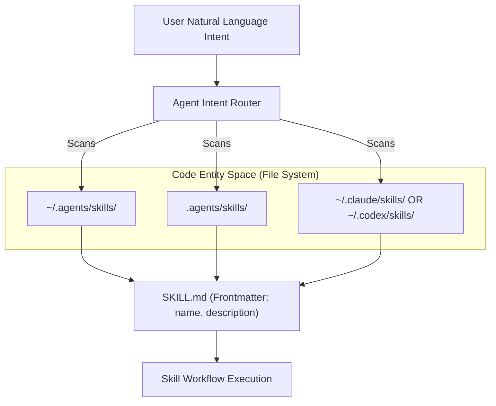
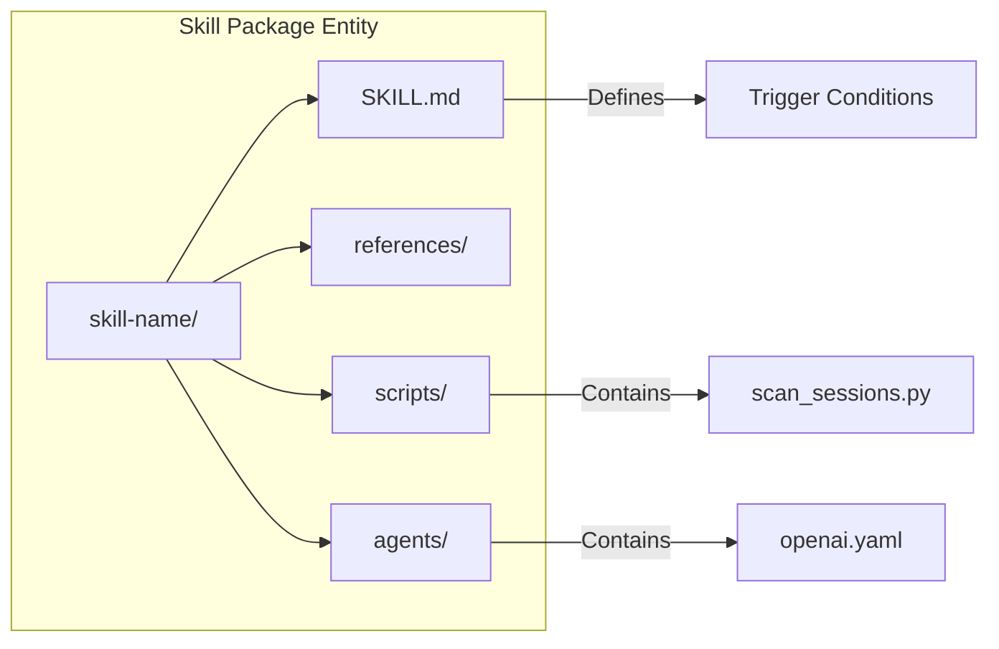

<!-- source: DeepWiki mcp.deepwiki.com · repo hqhq1025/skill-optimizer · page 5.1 Supported Agents & Install Paths · fetched 2026-10-26 -->

# Supported Agents & Install Paths

<details>
<summary>Relevant source files</summary>

The following files were used as context for generating this wiki page:

- [README.md](README.md)
- [README.zh-CN.md](README.zh-CN.md)
- [skills/skill-generalizer/references/platform-compatibility.md](skills/skill-generalizer/references/platform-compatibility.md)

</details>


The Skill Optimizer project provides a standardized framework for managing the lifecycle of agent skills. To ensure these skills are correctly discovered and executed, they must be installed in specific directory structures recognized by various AI coding agents. This page details the native support shapes, recommended installation paths, and technical implementation details for the five primary supported agents.

## Platform Support Overview

The following table summarizes the support level and directory conventions across the ecosystem.

| Agent | Support Shape | Recommended Path |
| :--- | :--- | :--- |
| **Codex** | Native Agent Skills; uses `SKILL.md` for workflows and `openai.yaml` for UI metadata. | `~/.codex/skills/` (Personal) or `.agents/skills/` (Project) |
| **Claude Code** | Native skills with support for personal, project, and plugin scopes. | `~/.claude/skills/` (Personal) or `.claude/skills/` (Project) |
| **Cursor** | Agent Skills alongside `.cursorrules`. High discovery priority for agent-based workflows. | `.agents/skills/` or `.cursor/skills/` |
| **OpenCode** | Native `skill` tool with permission governance (`allow`, `ask`, `deny`). | `~/.config/opencode/skills/` or `.opencode/skills/` |
| **Gemini CLI** | Open format support; uses `GEMINI.md` for always-on context. | `.agents/skills/` or installer-managed paths |

**Sources:** [README.md:71-82](), [skills/skill-generalizer/references/platform-compatibility.md:5-14]()

---

## Technical Implementation & Data Flow

The Skill Optimizer bridges the "Natural Language Space" (user intent) to the "Code Entity Space" (skill execution) by mapping natural language triggers defined in `SKILL.md` frontmatter to specific file system locations that agents scan during initialization.

### Skill Discovery Logic
The diagram below illustrates how an agent resolves a user request into a specific skill execution based on the installation path.

**Diagram: Skill Discovery & Resolution Flow**

**Sources:** [README.md:73-82](), [skills/skill-generalizer/references/platform-compatibility.md:7-13]()

---

## Agent-Specific Installation Guides

### 1. Codex
Codex utilizes the Agent Skills format as its primary workflow authoring format. While the logic resides in `SKILL.md`, Codex can also consume optional plugin metadata located in `agents/openai.yaml` [skills/skill-generalizer/references/platform-compatibility.md:9-9]().

*   **Personal Install:** `~/.codex/skills/`
*   **Project-Portable:** `.agents/skills/`
*   **Manual Command:**
    ```bash
    mkdir -p ~/.codex/skills
    cp -r skills/skill-miner ~/.codex/skills/
    ```
    [README.md:60-67]()

### 2. Claude Code
Claude Code supports native skills across three distinct scopes: personal, project, and plugin. It relies heavily on the `description` field in the `SKILL.md` frontmatter to decide when to apply a specific skill [skills/skill-generalizer/references/platform-compatibility.md:10-10]().

*   **Personal Install:** `~/.claude/skills/`
*   **Project Install:** `.claude/skills/`
*   **Compatibility:** Also scans `.agents/skills/` [README.md:76-76]().

### 3. Cursor
Cursor integrates Agent Skills alongside its proprietary rules and commands. For maximum portability, the project-level `.agents/skills/` path is recommended [skills/skill-generalizer/references/platform-compatibility.md:11-11]().

*   **Recommended Path:** `.agents/skills/`
*   **Cursor-Specific Path:** `.cursor/skills/`
*   **Note:** Cursor's agent will automatically discover and select relevant skills based on the context of the active project [README.md:77-77]().

### 4. OpenCode
OpenCode features a native `skill` tool that includes a permission system. Users can set permissions to `allow`, `ask`, or `deny` for specific skill executions [skills/skill-generalizer/references/platform-compatibility.md:12-12]().

*   **Global Config:** `~/.config/opencode/skills/`
*   **Project Config:** `.opencode/skills/`
*   **Cross-Compatibility:** OpenCode explicitly scans `.agents/skills/` and `.claude/skills/` paths for interoperability [skills/skill-generalizer/references/platform-compatibility.md:12-12]().

### 5. Gemini CLI
Gemini CLI follows the open Agent Skills format. It also uses a unique `GEMINI.md` file for "always-on" project context, which complements the triggered nature of `SKILL.md` files [skills/skill-generalizer/references/platform-compatibility.md:13-13]().

*   **Standard Path:** `.agents/skills/`
*   **Context File:** `GEMINI.md` (root directory)

---

## Compatibility Caveats & Best Practices

To ensure a skill remains portable across all supported agents, developers should adhere to the following architectural constraints:

### Frontmatter Conservatism
Only `name` and `description` are guaranteed to be supported across all agents. Platform-specific metadata (like Claude-specific fields or Codex `openai.yaml`) should be kept in optional auxiliary files rather than the core `SKILL.md` [skills/skill-generalizer/references/platform-compatibility.md:20-21]().

### Directory Structure Mapping
The internal layout of a skill package must follow the standard convention to be parsed correctly by the `skill-miner` and `skill-personalizer` components.

**Diagram: Skill Package Structure to Code Entities**

**Sources:** [README.md:115-117](), [skills/skill-generalizer/references/platform-compatibility.md:9-13]()

### Generalization Rules
When using `skill-generalizer` to prepare a skill for public release:
1.  **Path Sanitization:** Remove all private paths and local environment facts [README.md:129-129]().
2.  **Portability:** Ensure commands and install instructions are not agent-locked [README.md:130-130]().
3.  **Layout:** The safest public layout is `skills/<name>/SKILL.md` within the repository [README.md:81-81]().

**Sources:** [README.md:127-132](), [skills/skill-generalizer/references/platform-compatibility.md:17-24]()

---

