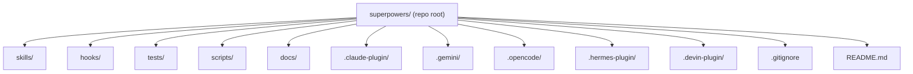
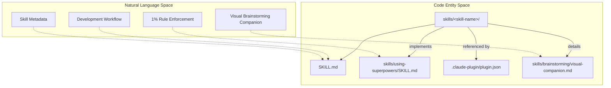
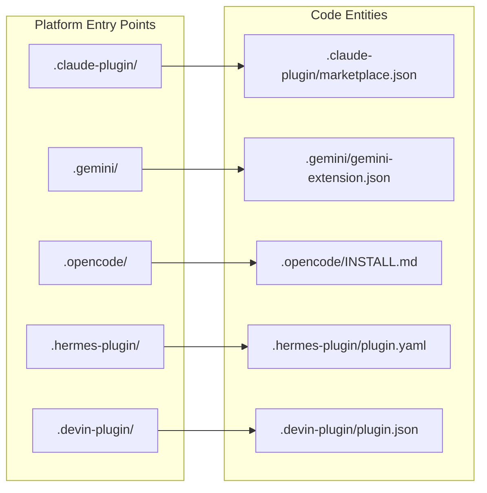

<!-- source: DeepWiki mcp.deepwiki.com · repo obra/superpowers · page 10.1 Directory Structure · fetched 2026-10-26 -->

# Directory Structure

Relevant source files

The following files were used as context for generating this wiki page:

- [.gitignore](.gitignore)
- [README.md](README.md)
- [skills/brainstorming/visual-companion.md](skills/brainstorming/visual-companion.md)

This page documents the layout of the `obra/superpowers` repository and describes the purpose of each directory. It covers platform integration files, the skills library layout, and development configuration.

---

## Top-Level Layout

The root of the repository is organized around platform-specific plugin directories (prefixed with `.`), the core skills library, and development configuration. The repository uses a multi-platform architecture where a single set of skills is exposed to various AI agents through platform-specific manifests and hooks.

**Top-level directory structure**

Sources: [README.md:1-255](), [.gitignore:1-19]()

---

## Core Skills Library

The `skills/` directory is the heart of the Superpowers system. It contains the modular units of AI guidance that define the development methodology.

### `skills/`

Each subdirectory within `skills/` represents a specific capability (e.g., `brainstorming`, `subagent-driven-development`). Every skill directory contains a `SKILL.md` file which acts as the entry point for the AI agent.

**Skill Definition Mapping**

*   **`SKILL.md`**: Contains instructions for the AI agent to execute specific workflows like `brainstorming` or `writing-plans` [README.md:35-43]().
*   **Skill Discovery**: Platforms like Claude Code use the `.claude-plugin/plugin.json` manifest to define the plugin identity and version.
*   **Meta-Skills**: The `using-superpowers` skill acts as the root of the hierarchy, enforcing the "1% rule" and providing the basic workflow instructions.
*   **`skills/brainstorming/visual-companion.md`**: Documents the usage and integration of the browser-based visual brainstorming companion, including how to start the server and interact with it [skills/brainstorming/visual-companion.md:1-119]().

Sources: [README.md:3-43](), [skills/brainstorming/visual-companion.md:1-119]()

---

## Platform Integration Directories

Superpowers integrates with a wide array of AI harnesses (Claude Code, Gemini CLI, Devin, Hermes, etc.) using specific configuration files located in hidden directories.

**Platform Entry Point Mapping**

### `.claude-plugin/`
Contains configuration for the Claude Code marketplace. The `marketplace.json` defines the plugin name, version, and source location.

### `.gemini/`
Contains `gemini-extension.json` and `GEMINI.md` for Gemini CLI integration. It handles tool mapping for Gemini-specific equivalents [README.md:161-172]().

### `.opencode/`
Contains `INSTALL.md` used for one-line plugin installation via `opencode.json` [README.md:224-232]().

### `.hermes-plugin/`
Contains the `plugin.yaml` manifest and native loader configuration for the Hermes Agent.

### `.devin-plugin/`
Supports the `devin plugins install` workflow, ensuring skills auto-trigger at session start [README.md:133-140]().

Sources: [README.md:49-255]()

---

## Development and Maintainer Tools

### `scripts/`
Contains utility scripts for project maintenance:
*   **`bump-version.sh`**: Handles multi-harness version bumping across various manifests.
*   **`lint-shell.sh`**: Performs linting on repository shell scripts to ensure cross-platform compatibility.
*   **`start-server.sh`**: Manages the lifecycle of the visual companion server, including starting it in foreground or background modes depending on the harness [skills/brainstorming/visual-companion.md:35-102]().

### `hooks/`
Contains session-start logic. For Windows users, the `SessionStart` hook is dispatched via Git Bash to avoid PowerShell or `cmd.exe` parsing errors.

### `tests/`
Contains the test suite for validating skills and platform integrations, including `run-skill-tests.sh` and helper scripts.

### `docs/`
This directory contains additional documentation, such as `README.kimi.md` for Kimi Code and `README.opencode.md` for OpenCode, providing detailed installation and usage instructions specific to those platforms [README.md:221-235]().

### `.gitignore`
Specifies intentionally untracked files to ignore, such as `.worktrees/`, `.superpowers/`, and `evals/` [.gitignore:1-19](). The `.superpowers/` directory is used for persisting mockups and session state for the visual companion [skills/brainstorming/visual-companion.md:56-58]().

Sources: [README.md:221-235](), [skills/brainstorming/visual-companion.md:35-102](), [.gitignore:1-19]()

---

## Summary of Directory Roles

| Directory/File | Role | Key Files |
|---|---|---|
| `skills/` | The core library of AI development workflows. | `SKILL.md`, `visual-companion.md` |
| `.claude-plugin/` | Claude Code marketplace and plugin configuration. | `plugin.json`, `marketplace.json` |
| `.gemini/` | Gemini CLI extension configuration. | `gemini-extension.json` |
| `.opencode/` | OpenCode specific installation and configuration. | `INSTALL.md` |
| `.devin-plugin/` | Devin CLI plugin configuration. | `plugin.json` |
| `.hermes-plugin/` | Hermes Agent plugin configuration. | `plugin.yaml` |
| `hooks/` | Scripts for session initialization and lifecycle management. | `initialize-skills.sh` |
| `scripts/` | Maintainer scripts for versioning, linting, and server management. | `bump-version.sh`, `start-server.sh` |
| `tests/` | Automated validation of skills and integrations. | `run-skill-tests.sh` |
| `docs/` | Supplementary documentation for specific platforms. | `README.kimi.md`, `README.opencode.md` |
| `.gitignore` | Specifies files and directories to be ignored by Git. | `.gitignore` |

Sources: [README.md:1-255](), [skills/brainstorming/visual-companion.md:35-102](), [.gitignore:1-19]()

---

