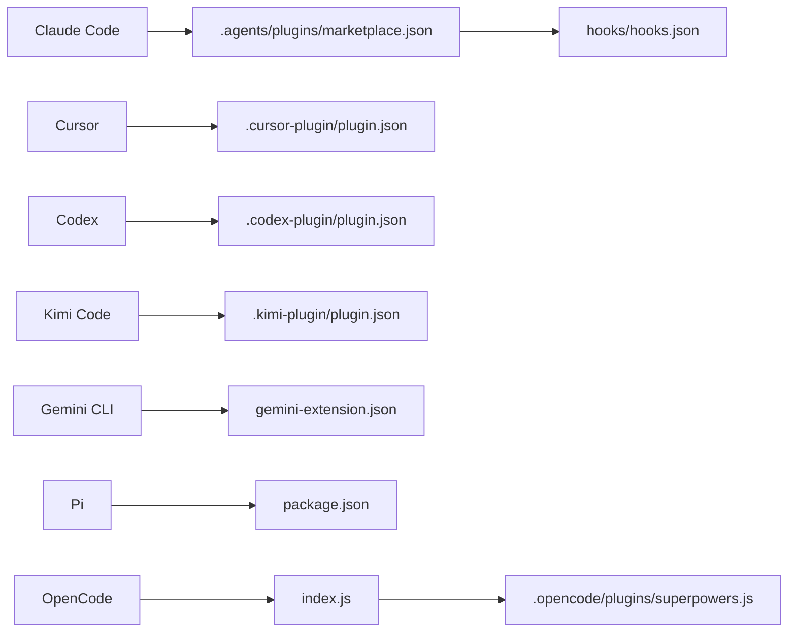
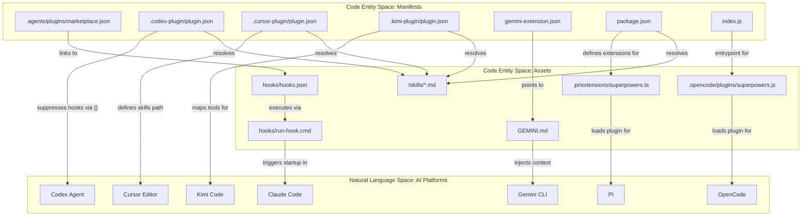

<!-- source: DeepWiki mcp.deepwiki.com · repo obra/superpowers · page 10.2 Configuration Files · fetched 2026-10-26 -->

# Configuration Files

<details>
<summary>Relevant source files</summary>

The following files were used as context for generating this wiki page:

- [.codex-plugin/plugin.json](.codex-plugin/plugin.json)
- [gemini-extension.json](gemini-extension.json)
- [index.js](index.js)
- [package.json](package.json)

</details>


This page documents the static configuration files that define how the superpowers plugin integrates with each supported AI coding platform. It covers manifest files, marketplace registration, hook wiring, and platform-specific extension definitions for Claude Code, Codex, Cursor, OpenCode, Gemini CLI, and Kimi Code.

For the runtime hook execution logic triggered by these configurations, see [10.3 Hooks System](). For the directory layout that these files live in, see [10.1 Directory Structure]().

---

## File Map

**Configuration files by role:**

Configuration file relationship to platforms:



Sources: [.cursor-plugin/plugin.json:1-23](), [gemini-extension.json:1-6](), [.codex-plugin/plugin.json:1-48](), [.agents/plugins/marketplace.json:1-20](), [.kimi-plugin/plugin.json:1-38](), [package.json:1-23](), [index.js:1-9]()

---

## `.agents/plugins/marketplace.json`

This file serves as the development marketplace manifest for Claude Code and Codex. It defines the plugin's metadata for discovery within the agentic environment.

| Field | Value | Purpose |
|---|---|---|
| `name` | `"superpowers-dev"` | Marketplace identifier [[.agents/plugins/marketplace.json:2]()] |
| `plugins[0].name` | `"superpowers"` | The specific plugin name within the marketplace [[.agents/plugins/marketplace.json:8]()] |
| `plugins[0].source.url` | `"./"` | Points to the local directory as the plugin source [[.agents/plugins/marketplace.json:11]()] |
| `plugins[0].policy.installation` | `"AVAILABLE"` | Sets availability for install [[.agents/plugins/marketplace.json:14]()] |

Sources: [.agents/plugins/marketplace.json:1-20]()

---

## `.codex-plugin/plugin.json`

The Codex manifest defines the integration for the Codex agentic framework. A critical implementation detail is the suppression of automatic hook discovery to ensure platform compatibility.

| Field | Value | Purpose |
|---|---|---|
| `name` | `"superpowers"` | Primary identifier [[.codex-plugin/plugin.json:2]()] |
| `version` | `"6.4.2"` | Current semantic version [[.codex-plugin/plugin.json:3]()] |
| `skills` | `"./skills/"` | Path for Codex to discover agentic skills [[.codex-plugin/plugin.json:23]()] |
| `hooks` | `{}` | **Critical**: Empty object to suppress `hooks/hooks.json` auto-discovery [[.codex-plugin/plugin.json:24]()] |
| `interface.capabilities` | `["Interactive", "Read", "Write"]` | Declared agent permissions [[.codex-plugin/plugin.json:31-35]()] |

**Note on Hooks Suppression:** Codex automatically looks for `hooks/hooks.json` if the `hooks` field is absent or null. Because the Claude Code `SessionStart` hook is incompatible with Codex's internal lifecycle, this manifest explicitly defines an empty object `{}` to prevent the fallback [[tests/codex/test-marketplace-manifest.sh:55-73]()].

Sources: [.codex-plugin/plugin.json:1-48](), [tests/codex/test-marketplace-manifest.sh:55-73]()

---

## `.cursor-plugin/plugin.json`

This file defines the core plugin metadata for Cursor. It identifies the plugin name, version, and provides the mapping for skills and hooks.

| Field | Value | Purpose |
|---|---|---|
| `name` | `"superpowers"` | Primary identifier for the plugin [[.cursor-plugin/plugin.json:2]()] |
| `version` | `"6.3.0"` | Current semantic version of the library [[.cursor-plugin/plugin.json:5]()] |
| `skills` | `"./skills/"` | Path to the skills directory [[.cursor-plugin/plugin.json:21]()] |
| `hooks` | `"./hooks/hooks-cursor.json"` | Cursor-specific hook definitions in camelCase [[.cursor-plugin/plugin.json:22]()] |

Sources: [.cursor-plugin/plugin.json:1-23]()

---

## `.kimi-plugin/plugin.json`

Kimi Code uses this manifest to define its integration, including a complex `skillInstructions` block that maps Superpowers generic tool requirements to Kimi-specific tools.

| Field | Value | Purpose |
|---|---|---|
| `name` | `"superpowers"` | Primary identifier [[.kimi-plugin/plugin.json:2]()] |
| `sessionStart.skill` | `"using-superpowers"` | Skill invoked at session start [[.kimi-plugin/plugin.json:23]()] |
| `skillInstructions` | *(String)* | Extensive tool mapping for `AskUserQuestion`, `TodoList`, `Agent`, etc. [[.kimi-plugin/plugin.json:25]()] |
| `interface.capabilities` | `["Interactive", "Read", "Write"]` | Permissions for the Kimi environment [[.kimi-plugin/plugin.json:31-35]()] |

Sources: [.kimi-plugin/plugin.json:1-38]()

---

## `gemini-extension.json`

Gemini CLI integration relies on an extension manifest that points to a context file used for bootstrapping the session.

| Field | Value | Purpose |
|---|---|---|
| `name` | `"superpowers"` | Extension name [[gemini-extension.json:2]()] |
| `version` | `"6.4.2"` | Extension version [[gemini-extension.json:4]()] |
| `contextFileName` | `"GEMINI.md"` | The file Gemini CLI reads for session context [[gemini-extension.json:5]()] |

Sources: [gemini-extension.json:1-6]()

---

## `hooks/hooks.json` and `run-hook.cmd`

Claude Code utilizes `hooks/hooks.json` to register lifecycle events. The plugin uses a polyglot wrapper to handle cross-platform execution.

- **`hooks/hooks.json`**: Maps `SessionStart` (matching `startup`, `clear`, or `compact`) to a command execution [[hooks/hooks.json:3-15]()].
- **`hooks/run-hook.cmd`**: A polyglot script that acts as a Windows `.cmd` batch file and a Unix `bash` script. On Windows, it attempts to locate `bash.exe` from standard Git for Windows paths or the `PATH` to execute the actual hook logic [[hooks/run-hook.cmd:1-46]()].

Sources: [hooks/hooks.json:1-17](), [hooks/run-hook.cmd:1-46]()

---

## `package.json`

The `package.json` file serves multiple purposes, primarily for Node.js-based environments like Pi and OpenCode. It defines the project's metadata, dependencies, and entry points.

| Field | Value | Purpose |
|---|---|---|
| `name` | `"superpowers"` | Package name [[package.json:2]()] |
| `version` | `"6.4.2"` | Current semantic version [[package.json:3]()] |
| `description` | `"Superpowers skills and runtime bootstrap for coding agents"` | Brief description of the package [[package.json:4]()] |
| `type` | `"module"` | Specifies the module system as ES modules [[package.json:5]()] |
| `main` | `".opencode/plugins/superpowers.js"` | The main entry point for Node.js applications, specifically for OpenCode V1 [[package.json:6]()] |
| `pi.extensions` | `["./.pi/extensions/superpowers.ts"]` | Specifies the TypeScript extension for Pi [[package.json:16-18]()] |
| `pi.skills` | `["./skills"]` | Specifies the skills directory for Pi [[package.json:19-21]()] |

Sources: [package.json:1-23]()

---

## `index.js`

This file acts as the root entry point for OpenCode V2 directory-form plugin registration. OpenCode V2 hosts require plugin entries to be directories with an `index.js` file.

```javascript
export { default } from "./.opencode/plugins/superpowers.js";
```
This exports the default module from `superpowers.js` located in the `.opencode/plugins` directory, allowing OpenCode V2 to load the plugin.

Sources: [index.js:1-9]()

---

## `.version-bump.json`

This file is used by the `bump-version.sh` script to manage version numbers across various configuration files. It lists the paths and JSONPath expressions for fields that need to be updated during a version bump.

```json
[
  { "path": "package.json", "jsonpath": "$.version" },
  { "path": ".codex-plugin/plugin.json", "jsonpath": "$.version" },
  { "path": ".cursor-plugin/plugin.json", "jsonpath": "$.version" },
  { "path": ".kimi-plugin/plugin.json", "jsonpath": "$.version" },
  { "path": "gemini-extension.json", "jsonpath": "$.version" }
]
```
Each object in the array specifies a `path` to a configuration file and a `jsonpath` expression to locate the `version` field within that file. This ensures consistent versioning across all platform-specific manifests.

Sources: [.version-bump.json:1-7]()

---

## Configuration Logic Flow

The following diagram maps how different platforms consume these files to reach the execution layer and skill discovery.



Sources: [.agents/plugins/marketplace.json:11](), [.codex-plugin/plugin.json:24](), [.cursor-plugin/plugin.json:21](), [gemini-extension.json:5](), [.kimi-plugin/plugin.json:21](), [hooks/hooks.json:9](), [tests/codex/test-marketplace-manifest.sh:70-73](), [package.json:19-21](), [index.js:9]()

---

