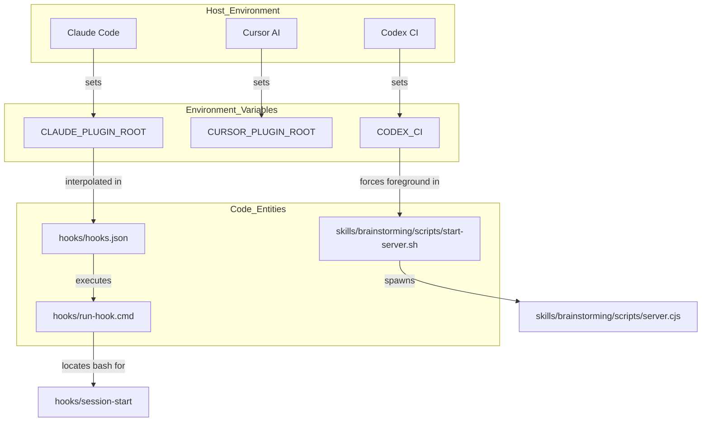
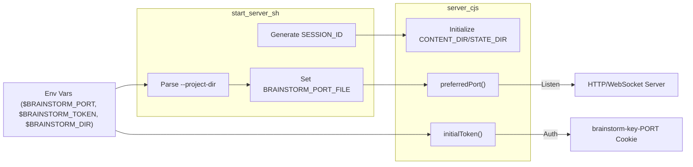

<!-- source: DeepWiki mcp.deepwiki.com · repo obra/superpowers · page 10.5 Environment Variables · fetched 2026-10-26 -->

# Environment Variables

Relevant source files

The following files were used as context for generating this wiki page:

- [README.md](README.md)
- [skills/brainstorming/scripts/server.cjs](skills/brainstorming/scripts/server.cjs)
- [skills/brainstorming/scripts/start-server.sh](skills/brainstorming/scripts/start-server.sh)
- [skills/brainstorming/visual-companion.md](skills/brainstorming/visual-companion.md)
- [tests/brainstorm-server/branding.test.js](tests/brainstorm-server/branding.test.js)

This page documents every environment variable that the Superpowers system reads, sets, or depends on. It covers variables used at runtime by hook scripts, platform plugins, the skill discovery system, and the visual brainstorming companion.

---

## Runtime Variables

These variables are set by the host platform or the user's shell and are read by the plugin at runtime to determine paths, execution context, and output formats.

### `CLAUDE_PLUGIN_ROOT`

| Property | Value |
|---|---|
| **Set by** | Claude Code (automatically, when executing hooks) |
| **Read by** | `hooks/hooks.json`, `hooks/run-hook.cmd` |
| **Type** | Absolute filesystem path |
| **Required** | Yes, when running under Claude Code |

Claude Code sets `CLAUDE_PLUGIN_ROOT` to the absolute path of the installed plugin directory before executing any hook command. The `hooks/hooks.json` configuration uses this variable to locate the polyglot wrapper for executing the `session-start` hook [hooks/hooks.json:9]().

**Sources:** [hooks/hooks.json:9]()

---

### `CURSOR_PLUGIN_ROOT`

| Property | Value |
|---|---|
| **Set by** | Cursor (automatically, when executing hooks) |
| **Read by** | `hooks/session-start` (indirectly via hook execution) |
| **Type** | Absolute filesystem path |
| **Required** | No; used for platform detection |

The `hooks/session-start` script (executed via `hooks/run-hook.cmd`) uses root path detection to determine the execution environment. In Cursor, this variable ensures the hook script can locate the mandatory `using-superpowers` meta-skill for context injection.

**Sources:** [hooks/run-hook.cmd:7-9]()

---

### `CODEX_CI`

| Property | Value |
|---|---|
| **Set by** | Codex Environment |
| **Read by** | `skills/brainstorming/scripts/start-server.sh` |
| **Type** | Boolean/String |
| **Required** | No |

When `CODEX_CI` is detected, the brainstorming server initialization script automatically switches to foreground mode [skills/brainstorming/scripts/start-server.sh:98-100](). This prevents the server from being reaped by the Codex environment's background process manager.

**Sources:** [skills/brainstorming/scripts/start-server.sh:98-100]()

---

## Brainstorming Companion Variables

The visual brainstorming companion (`skills/brainstorming/scripts/server.cjs`) and its launcher (`skills/brainstorming/scripts/start-server.sh`) use several environment variables to configure network binding, security, and lifecycle.

### Network and Binding

| Variable | Description | Default |
|---|---|---|
| `BRAINSTORM_HOST` | Interface to bind the server to [skills/brainstorming/scripts/server.cjs:100](). | `127.0.0.1` |
| `BRAINSTORM_PORT` | Explicit port for the WebSocket/HTTP server [skills/brainstorming/scripts/server.cjs:90](). | Random high port |
| `BRAINSTORM_URL_HOST` | Hostname used when generating the access URL [skills/brainstorming/scripts/server.cjs:101](). | `localhost` (if 127.0.0.1) |

### Security and State

| Variable | Description |
|---|---|
| `BRAINSTORM_TOKEN` | Per-session secret key for authentication [skills/brainstorming/scripts/server.cjs:133-135](). | Generated randomly |
| `BRAINSTORM_DIR` | Directory for session content and state files [skills/brainstorming/scripts/server.cjs:102](). | `/tmp/brainstorm` |
| `BRAINSTORM_PORT_FILE` | Path to persist the bound port for session reconnection [skills/brainstorming/scripts/server.cjs:85](). | `null` |
| `BRAINSTORM_TOKEN_FILE` | Path to persist the session token to allow browser reconnects [skills/brainstorming/scripts/server.cjs:123](). | `null` |

### Lifecycle Control

| Variable | Description |
|---|---|
| `BRAINSTORM_OWNER_PID` | PID of the parent harness. Server self-terminates if this PID disappears [skills/brainstorming/scripts/server.cjs:113](). | `null` |
| `BRAINSTORM_IDLE_TIMEOUT_MS` | Shutdown trigger (in milliseconds) if no activity is detected [skills/brainstorming/scripts/start-server.sh:79](). | 4 hours (14,400,000ms) |
| `BRAINSTORM_OPEN` | If set to `1`, the server attempts to auto-open the browser on the first screen [skills/brainstorming/scripts/start-server.sh:48](). | `null` |

**Sources:** [skills/brainstorming/scripts/server.cjs:85-113](), [skills/brainstorming/scripts/start-server.sh:48-79]()

---

## Telemetry Control

Superpowers respects privacy settings through the following variables. If any are set to a truthy value (e.g., "true", "1", "yes"), remote branding assets and telemetry are disabled [skills/brainstorming/scripts/server.cjs:112]().

- `SUPERPOWERS_DISABLE_TELEMETRY`
- `DISABLE_TELEMETRY`
- `CLAUDE_CODE_DISABLE_NONESSENTIAL_TRAFFIC`

**Sources:** [skills/brainstorming/scripts/server.cjs:107-112]()

---

## Platform Detection and Logic Flow

Environment variables drive the logic for hook execution across different OS environments. The system uses a polyglot wrapper to ensure shell scripts run correctly on Windows (via Git Bash/MSYS2) and Unix.

**Diagram: Runtime Variable Resolution and Hook Execution**

**Sources:** [hooks/hooks.json:9](), [hooks/run-hook.cmd:1-10](), [skills/brainstorming/scripts/start-server.sh:98-100]()

---

## Data Flow: Variable to Brainstorming Server

The following diagram illustrates how environment variables determine the network and security configuration of the visual companion.

**Diagram: Brainstorming Server Configuration Flow**

**Sources:** [skills/brainstorming/scripts/start-server.sh:113-124](), [skills/brainstorming/scripts/server.cjs:89-104](), [skills/brainstorming/scripts/server.cjs:132-152]()

---

## Variable Summary Table

| Variable | Platform | Set by | Purpose |
|---|---|---|---|
| `CLAUDE_PLUGIN_ROOT` | Claude Code | Host App | Defines base path for plugin assets and hooks [hooks/hooks.json:9](). |
| `BRAINSTORM_DIR` | Brainstorming | Script/User | Root for visual companion session data and logs [skills/brainstorming/scripts/server.cjs:102](). |
| `BRAINSTORM_TOKEN` | Brainstorming | Script/User | Authenticates WebSocket/HTTP requests to the companion [skills/brainstorming/scripts/server.cjs:134](). |
| `BRAINSTORM_OWNER_PID` | Brainstorming | `start-server.sh` | Watchdog PID to ensure server dies with the harness [skills/brainstorming/scripts/server.cjs:113](). |
| `CODEX_CI` | Codex | Host App | Disables backgrounding to prevent process reaping [skills/brainstorming/scripts/start-server.sh:98](). |

**Sources:** [hooks/hooks.json:9](), [skills/brainstorming/scripts/server.cjs:102-134](), [skills/brainstorming/scripts/start-server.sh:98]()

---

