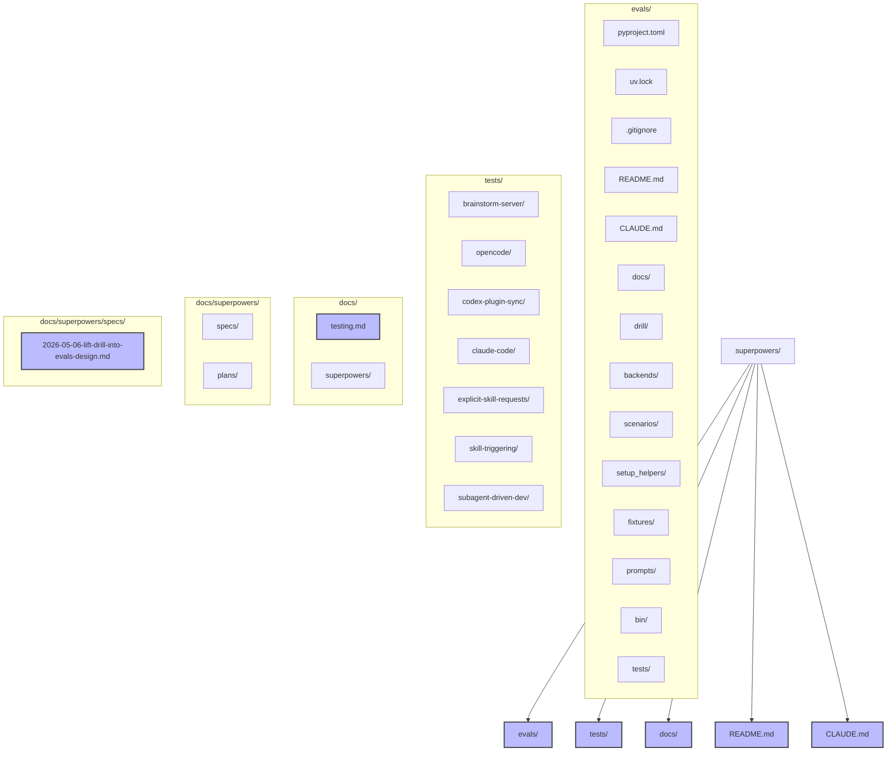

<!-- source: DeepWiki mcp.deepwiki.com · repo obra/superpowers · page 10.8 Design Specs and Plans Archive · fetched 2026-10-26 -->

# Design Specs and Plans Archive

<details>
<summary>Relevant source files</summary>

The following files were used as context for generating this wiki page:

- [docs/plans/2025-11-22-opencode-support-implementation.md](docs/plans/2025-11-22-opencode-support-implementation.md)
- [docs/plans/2026-01-17-visual-brainstorming.md](docs/plans/2026-01-17-visual-brainstorming.md)
- [docs/superpowers/plans/2026-01-22-document-review-system.md](docs/superpowers/plans/2026-01-22-document-review-system.md)
- [docs/superpowers/plans/2026-02-19-visual-brainstorming-refactor.md](docs/superpowers/plans/2026-02-19-visual-brainstorming-refactor.md)
- [docs/superpowers/plans/2026-05-06-lift-drill-into-evals.md](docs/superpowers/plans/2026-05-06-lift-drill-into-evals.md)
- [docs/superpowers/specs/2026-01-22-document-review-system-design.md](docs/superpowers/specs/2026-01-22-document-review-system-design.md)
- [docs/superpowers/specs/2026-02-19-visual-brainstorming-refactor-design.md](docs/superpowers/specs/2026-02-19-visual-brainstorming-refactor-design.md)
- [docs/superpowers/specs/2026-05-06-lift-drill-into-evals-design.md](docs/superpowers/specs/2026-05-06-lift-drill-into-evals-design.md)
- [docs/superpowers/specs/2026-06-10-strict-cost-sdd-design.md](docs/superpowers/specs/2026-06-10-strict-cost-sdd-design.md)
- [docs/superpowers/specs/2026-07-06-sdd-plan-scoped-workspace-eval-results.md](docs/superpowers/specs/2026-07-06-sdd-plan-scoped-workspace-eval-results.md)

</details>


This page serves as a guide to the `docs/superpowers/specs` and `docs/superpowers/plans` directories, which contain the historical design records and implementation plans for various features within the Superpowers codebase. These documents provide insight into the rationale, architecture, and evolution of key components such as Subagent-Driven Development (SDD), the visual companion, Git worktree policies, diagnostic tools, and platform neutrality. They are crucial for understanding the system's design philosophy and the detailed steps taken during development.

## Subagent-Driven Development (SDD) Design Evolution

The `docs/superpowers/specs` directory contains several design specifications related to the Subagent-Driven Development (SDD) workflow. These documents detail the architectural decisions, objectives, and guardrails for SDD, particularly focusing on cost optimization and quality assurance.

### Strict-Cost SDD Design

The `2026-06-10-strict-cost-sdd-design.md` [docs/superpowers/specs/2026-06-10-strict-cost-sdd-design.md:1-265]() spec outlines an experimental ladder aimed at minimizing the dollar cost per plan execution while maintaining quality. It identifies the primary cost drivers in the SDD workflow, such as the controller, implementers, and task reviewers [docs/superpowers/specs/2026-06-10-strict-cost-sdd-design.md:13-20]().

A core principle is to "cheapen mechanics, never judgment" [docs/superpowers/specs/2026-06-10-strict-cost-sdd-design.md:25](). This means that decisions requiring judgment (e.g., `BLOCKED`/`NEEDS_CONTEXT` handling, dispatch curation, review verdicts) must remain with higher-tier models or human intervention. The document proposes a ladder of changes, starting with "Plan-side crispness" (L1) [docs/superpowers/specs/2026-06-10-strict-cost-sdd-design.md:66]() to improve plan quality and reduce ambiguity, which in turn reduces review-loop counts and implementer exploration costs. This involves:
*   **Task right-sizing guidance**: Merging setup/config steps and splitting tasks only at meaningful review boundaries [docs/superpowers/specs/2026-06-10-strict-cost-sdd-design.md:89-96]().
*   **Structured `Global Constraints` section**: Mechanically extractable constraints (e.g., version floors) to ensure consistent application [docs/superpowers/specs/2026-06-10-strict-cost-sdd-design.md:97-103]().
*   **Per-task `Interfaces:` line**: Documenting exact signatures for cross-task interfaces to reduce implementer discovery time [docs/superpowers/specs/2026-06-10-strict-cost-sdd-design.md:104-108]().
*   **Per-task model-tier recommendation**: Allowing the planner to suggest model tiers for tasks, with controller override authority [docs/superpowers/specs/2026-06-10-strict-cost-sdd-design.md:109-113]().

### SDD Plan-Scoped Workspace Evaluation

The `2026-07-06-sdd-plan-scoped-workspace-eval-results.md` [docs/superpowers/specs/2026-07-06-sdd-plan-scoped-workspace-eval-results.md:1-543]() document details the evaluation results for implementing a plan-scoped workspace in SDD. The primary goal was to prevent subagents from adopting stale or foreign ledger entries, which could lead to skipping real work.

The evaluation involved scenarios where a controller resumed a plan with existing ledger entries, some of which were stale or belonged to different plans [docs/superpowers/specs/2026-07-06-sdd-plan-scoped-workspace-eval-results.md:10-35](). The "RED" rounds (pre-change) showed that while controllers generally refused to skip work based on invalid ledgers, they incurred a "forensic disambiguation tax" (extra tool calls) to verify ledger validity [docs/superpowers/specs/2026-07-06-sdd-plan-scoped-workspace-eval-results.md:58-64](). The "GREEN" round (post-change) aimed for regression safety and a measured cost comparison of the resume decision, demonstrating that the mechanism changed, but the raw tool-call count for resume decisions did not drop [docs/superpowers/specs/2026-07-06-sdd-plan-scoped-workspace-eval-results.md:77-82]().

The structural issues observed in the "RED" rounds included cross-plan collisions, overwritten briefs, and Git contamination due to a shared default path for progress tracking [docs/superpowers/specs/2026-07-06-sdd-plan-scoped-workspace-eval-results.md:66-76](). The solution involved introducing a plan-scoped ledger, where each plan maintains its own progress file within a dedicated directory, e.g., `.superpowers/sdd/2026-07-06-widget-export/progress.md` [docs/superpowers/specs/2026-07-06-sdd-plan-scoped-workspace-eval-results.md:32-34]().

### Diagram: SDD Workflow with Plan-Scoped Workspace

```mermaid
graph TD
    A[Start SDD Session] --> B{Plan A in progress?};
    B -- Yes --> C[Load Plan A Ledger];
    B -- No --> D[Start New Plan B];

    C --> E{Plan A Ledger Valid?};
    E -- Yes --> F[Resume Plan A Tasks];
    E -- No --> G[Discard Stale Plan A Ledger];

    G --> D;

    D --> H[Create Plan B Scoped Workspace];
    H --> I[Initialize Plan B Ledger];
    I --> J[Execute Plan B Tasks];

    subgraph ".superpowers/sdd/"
        K[progress.md (Legacy Flat Ledger)]
        L[2026-07-01-widget-backend/progress.md (Plan A Scoped Ledger)]
        M[2026-07-06-widget-export/progress.md (Plan B Scoped Ledger)]
    end

    style K fill:#f9f,stroke:#333,stroke-width:2px
    style L fill:#bbf,stroke:#333,stroke-width:2px
    style M fill:#bbf,stroke:#333,stroke-width:2px

    H --> L;
    H --> M;
```
Sources:
*   `docs/superpowers/specs/2026-07-06-sdd-plan-scoped-workspace-eval-results.md`

## Visual Brainstorming Companion

The visual brainstorming companion is a key feature designed to provide a browser-based interactive display for Claude, allowing users to interact with mockups and prototypes. The design and refactor plans for this component are documented in `docs/superpowers/specs` and `docs/superpowers/plans`.

### Initial Implementation Plan

The `2026-01-17-visual-brainstorming.md` [docs/plans/2026-01-17-visual-brainstorming.md:1-571]() plan outlines the initial implementation of the visual brainstorming companion. The architecture involves Claude writing HTML to a temporary file, which a local Node.js server (`lib/brainstorm-server/index.js` [docs/plans/2026-01-17-visual-brainstorming.md:16-122]()) watches and serves. User interactions are captured via WebSocket and sent to the server's stdout, which Claude then processes.

Key components include:
*   `lib/brainstorm-server/package.json` [docs/plans/2026-01-17-visual-brainstorming.md:21-32](): Defines dependencies like `chokidar`, `express`, and `ws`.
*   `lib/brainstorm-server/index.js` [docs/plans/2026-01-17-visual-brainstorming.md:16-122](): The main server logic, handling file watching, WebSocket connections, and serving HTML.
*   `lib/brainstorm-server/helper.js` [docs/plans/2026-01-17-visual-brainstorming.md:151-236](): A client-side JavaScript library injected into the served HTML to capture user events (clicks, form submissions, input changes) and send them back to the server via WebSocket.

### Refactor Design for Non-Blocking Interaction

The `2026-02-19-visual-brainstorming-refactor-design.md` [docs/superpowers/specs/2026-02-19-visual-brainstorming-refactor-design.md:1-162]() spec details a refactor to move from a blocking TUI feedback model to a non-blocking "Browser Displays, Terminal Commands" architecture. The problem identified was that the previous approach, using `wait-for-feedback.sh` and `TaskOutput(block=true)`, seized the terminal, preventing users from interacting with Claude while visual brainstorming was active [docs/superpowers/specs/2026-02-19-visual-brainstorming-refactor-design.md:7-12]().

The refactored design separates concerns:
*   **Browser**: Acts as an interactive display for mockups, allowing users to click options. Selections are recorded server-side.
*   **Terminal**: Remains the primary conversation channel, always unblocked and available for user input.

The new loop involves Claude writing an HTML file, the server detecting changes and pushing a WebSocket reload to the browser, and Claude ending its turn. On the next turn, Claude reads a new `.events` file (e.g., `$SCREEN_DIR/.events`) for browser interaction streams (clicks, selections), merging this with terminal text [docs/superpowers/specs/2026-02-19-visual-brainstorming-refactor-design.md:23-28]().

Key changes include:
*   **Deletion of `wait-for-feedback.sh`**: Replaced by the `.events` file mechanism [docs/superpowers/specs/2026-02-19-visual-brainstorming-refactor-design.md:32-35]().
*   **Addition of `.events` file**: A per-screen event stream where the server writes user interaction events as JSON objects, one per line. This file is cleared when a new HTML screen is pushed [docs/superpowers/specs/2026-02-19-visual-brainstorming-refactor-design.md:37-53]().
*   **Modifications to `index.js`**: To write user events to `.events` and clear it on new screens, and to simplify content injection [docs/superpowers/specs/2026-02-19-visual-brainstorming-refactor-design.md:57-68]().
*   **Modifications to `frame-template.html`**: To remove the feedback footer and add a selection indicator bar [docs/superpowers/specs/2026-02-19-visual-brainstorming-refactor-design.md:70-82]().
*   **Modifications to `helper.js`**: To remove blocking feedback functions and narrow click capture to `[data-choice]` elements [docs/superpowers/specs/2026-02-19-visual-brainstorming-refactor-design.md:89-109]().
*   **Update to `visual-companion.md`**: To reflect the new non-blocking flow [docs/superpowers/specs/2026-02-19-visual-brainstorming-refactor-design.md:114-125]().

### Diagram: Visual Brainstorming Refactor Data Flow

```mermaid
graph TD
    A[Claude writes HTML to SCREEN_FILE] --> B{chokidar detects change in SCREEN_FILE};
    B --> C[Server (index.js) deletes .events file];
    B --> D[Server (index.js) sends WebSocket 'reload' to Browser];
    D --> E[Browser reloads page];
    E --> F[User interacts with Browser (clicks data-choice)];
    F --> G[helper.js captures event];
    G --> H[helper.js sends event via WebSocket to Server];
    H --> I[Server (index.js) appends event to .events file];
    I --> J[Claude ends turn, prompts user in Terminal];
    K[User types feedback in Terminal] --> L[Next Claude turn];
    L --> M[Claude reads .events file];
    L --> N[Claude reads Terminal input];
    M & N --> O[Claude processes combined feedback];

    subgraph "superpowers/"
        subgraph "lib/brainstorm-server/"
            index_js[index.js]
            helper_js[helper.js]
            frame_template_html[frame-template.html]
        end
        subgraph "skills/brainstorming/"
            visual_companion_md[visual-companion.md]
        end
        subgraph "tests/brainstorm-server/"
            server_test_js[server.test.js]
        end
    end

    style index_js fill:#bbf,stroke:#333,stroke-width:2px
    style helper_js fill:#bbf,stroke:#333,stroke-width:2px
    style frame_template_html fill:#bbf,stroke:#333,stroke-width:2px
    style visual_companion_md fill:#bbf,stroke:#333,stroke-width:2px
    style server_test_js fill:#bbf,stroke:#333,stroke-width:2px

    B -- "watches" --> index_js;
    C -- "modifies" --> index_js;
    D -- "uses" --> index_js;
    G -- "uses" --> helper_js;
    H -- "uses" --> index_js;
    I -- "modifies" --> index_js;
    E -- "uses" --> frame_template_html;
    E -- "uses" --> helper_js;
    O -- "guides" --> visual_companion_md;
    index_js -- "tested by" --> server_test_js;
    helper_js -- "tested by" --> server_test_js;
    frame_template_html -- "tested by" --> server_test_js;
```
Sources:
*   `docs/superpowers/specs/2026-02-19-visual-brainstorming-refactor-design.md`
*   `docs/plans/2026-02-19-visual-brainstorming-refactor.md`
*   `docs/plans/2026-01-17-visual-brainstorming.md`

## Document Review System

The `2026-01-22-document-review-system-design.md` [docs/superpowers/specs/2026-01-22-document-review-system-design.md:1-136]() spec introduces two new review stages into the Superpowers workflow: Spec Document Review and Plan Document Review. These stages aim to ensure completeness, consistency, and readiness of documents before proceeding to the next development phase.

### Spec Document Review

This review occurs after brainstorming and before `writing-plans`. Its purpose is to verify that the design specification is complete, consistent, and ready for implementation planning [docs/superpowers/specs/2026-01-22-document-review-system-design.md:12-14](). The reviewer checks for:
*   **Completeness**: Absence of TODOs, placeholders, or incomplete sections.
*   **Coverage**: Missing error handling, edge cases, or integration points.
*   **Consistency**: Internal contradictions or conflicting requirements.
*   **Clarity**: Ambiguous requirements.
*   **YAGNI**: Unrequested features or over-engineering.

The review process is iterative: if issues are found, the brainstorming agent fixes them, and the document is re-reviewed until approved [docs/superpowers/specs/2026-01-22-document-review-system-design.md:41](). The dispatch mechanism uses the `Task` tool with a `general-purpose` subagent, guided by `skills/brainstorming/spec-document-reviewer-prompt.md` [docs/superpowers/specs/2026-01-22-document-review-system-design.md:43-44]().

### Plan Document Review

This review occurs after `writing-plans` and before implementation. Its purpose is to verify that the implementation plan is complete, matches the spec, and has proper task decomposition [docs/superpowers/specs/2026-01-22-document-review-system-design.md:46-48](). The reviewer checks for:
*   **Completeness**: Absence of TODOs, placeholders, or incomplete tasks.
*   **Spec Alignment**: Plan covers relevant spec requirements without scope creep.
*   **Task Decomposition**: Tasks are atomic, have clear boundaries, and actionable steps.
*   **Task Syntax**: Correct use of checkbox syntax (`- [ ]`).
*   **Chunk Size**: Each plan chunk is under 1000 lines.

The review is chunk-by-chunk, where each logical grouping of tasks is reviewed independently [docs/superpowers/specs/2026-01-22-document-review-system-design.md:61-62](). The reviewer receives both the plan chunk and the spec document for reference [docs/superpowers/specs/2026-01-22-document-review-system-design.md:63-67](). The dispatch mechanism is similar to the spec reviewer, using the `Task` tool with a `general-purpose` subagent, guided by `skills/writing-plans/plan-document-reviewer-prompt.md` [docs/superpowers/specs/2026-01-22-document-review-system-design.md:79]().

### Updated Workflow

The introduction of these review stages modifies the overall development workflow:

```mermaid
graph TD
    A[Brainstorming] --> B[Spec Document];
    B --> C{Spec Review Loop};
    C -- Issues Found --> B;
    C -- Approved --> D[Writing Plans];
    D --> E[Plan Document (Chunk N)];
    E --> F{Plan Review Loop (Chunk N)};
    F -- Issues Found --> E;
    F -- Approved --> G{Next Chunk?};
    G -- Yes --> E;
    G -- No --> H[Implementation];
```
Sources:
*   `docs/superpowers/specs/2026-01-22-document-review-system-design.md`
*   `docs/superpowers/plans/2026-01-22-document-review-system.md`

## Platform Neutrality and Shared Core Modules

The Superpowers system aims for platform neutrality, allowing a single skills library to work across various AI harnesses. This is achieved through a harness adaptation layer and shared core modules.

### OpenCode Support Implementation

The `2025-11-22-opencode-support-implementation.md` [docs/plans/2025-11-22-opencode-support-implementation.md:1-1095]() plan details the process of adding full OpenCode.ai support. A key architectural decision was to extract common skill discovery and parsing logic into a shared JavaScript module, `lib/skills-core.js`, which both the Codex and OpenCode implementations could utilize [docs/plans/2025-11-22-opencode-support-implementation.md:7-8]().

The `lib/skills-core.js` module [docs/plans/2025-11-22-opencode-support-implementation.md:23-80]() provides:
*   `extractFrontmatter(filePath)`: Extracts YAML frontmatter (name, description) from `SKILL.md` files [docs/plans/2025-11-22-opencode-support-implementation.md:30-75]().
*   `findSkillsInDir(dir, sourceType, maxDepth)`: Recursively finds `SKILL.md` files within a directory, extracts their frontmatter, and returns a list of skill objects [docs/plans/2025-11-22-opencode-support-implementation.md:108-151]().
*   `resolveSkillPath(skillName, superpowersDir, personalDir)`: Resolves a skill name to its file path, handling shadowing where personal skills override Superpowers skills [docs/plans/2025-11-22-opencode-support-implementation.md:190-222]().

This modular approach ensures that core logic is reused, reducing duplication and simplifying maintenance across different platforms.

### Diagram: Shared Skills Core Module

```mermaid
graph TD
    A[Codex Plugin] --> B[lib/skills-core.js];
    C[OpenCode Plugin] --> B;

    subgraph "lib/skills-core.js"
        B1[extractFrontmatter(filePath)]
        B2[findSkillsInDir(dir, sourceType, maxDepth)]
        B3[resolveSkillPath(skillName, superpowersDir, personalDir)]
    end

    B1 -- "Parses YAML" --> D[SKILL.md files];
    B2 -- "Discovers" --> D;
    B3 -- "Resolves path to" --> D;

    style B1 fill:#bbf,stroke:#333,stroke-width:2px
    style B2 fill:#bbf,stroke:#333,stroke-width:2px
    style B3 fill:#bbf,stroke:#333,stroke-width:2px
```
Sources:
*   `docs/plans/2025-11-22-opencode-support-implementation.md`

## Diagnostics and Evaluation

The `docs/superpowers/specs` directory also contains design documents related to the evaluation and testing infrastructure.

### Lifting Drill into Evals

The `2026-05-06-lift-drill-into-evals-design.md` [docs/superpowers/specs/2026-05-06-lift-drill-into-evals-design.md:1-247]() spec outlines the plan to integrate `obra/drill`, a Python skill-compliance benchmark, into the Superpowers repository under an `evals/` directory. Drill simulates LLM actors in real `tmux` sessions, runs verifiers on transcripts, and reports pass/fail per scenario [docs/superpowers/specs/2026-05-06-lift-drill-into-evals-design.md:3-5]().

The goals of this integration are:
*   Establish `evals/` as the canonical evaluation harness within Superpowers, containing the full Drill source, scenarios, fixtures, prompts, and backend configurations [docs/superpowers/specs/2026-05-06-lift-drill-into-evals-design.md:13-14]().
*   Delete redundant bash tests in `superpowers/tests/` that are fully covered by Drill scenarios [docs/superpowers/specs/2026-05-06-lift-drill-into-evals-design.md:15-16]().
*   Clearly define and document the distinct roles of `tests/` (plugin infrastructure) and `evals/` (LLM behavior with actor + verifier) [docs/superpowers/specs/2026-05-06-lift-drill-into-evals-design.md:17-18]().
*   Update top-level documentation to guide contributors to the new structure [docs/superpowers/specs/2026-05-06-lift-drill-into-evals-design.md:19]().

The `evals/` directory will contain the `drill` Python package, backends, scenarios, setup helpers, fixtures, prompts, and its own `pytest` suite [docs/superpowers/specs/2026-05-06-lift-drill-into-evals-design.md:35-53](). The `tests/` directory will retain tests for the brainstorm server, OpenCode plugin loading, Codex plugin sync verification, and other plugin infrastructure tests [docs/superpowers/specs/2026-05-06-lift-drill-into-evals-design.md:55-62]().

The `2026-05-06-lift-drill-into-evals.md` [docs/superpowers/plans/2026-05-06-lift-drill-into-evals.md:1-1374]() plan provides the detailed implementation steps for this migration, including branching, capturing the Drill SHA, using `rsync` to copy files, and verifying the copy with checksums.

### Diagram: `superpowers/` Directory Structure after `evals/` Lift


Sources:
*   `docs/superpowers/specs/2026-05-06-lift-drill-into-evals-design.md`
*   `docs/superpowers/plans/2026-05-06-lift-drill-into-evals.md`

---

