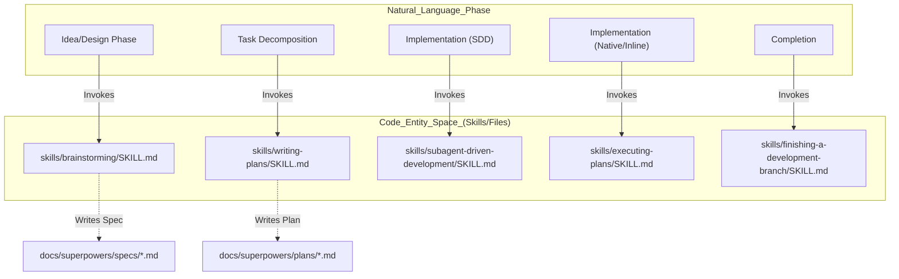
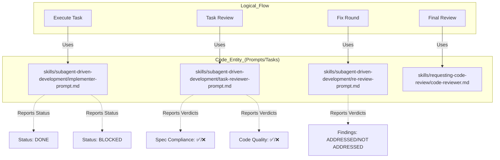

<!-- source: DeepWiki mcp.deepwiki.com · repo obra/superpowers · page 12 Glossary · fetched 2026-10-26 -->

# Glossary

Relevant source files

The following files were used as context for generating this wiki page:

- [.claude-plugin/plugin.json](.claude-plugin/plugin.json)
- [RELEASE-NOTES.md](RELEASE-NOTES.md)
- [docs/superpowers/specs/2026-06-09-sdd-task-scoped-review-dispatch-design.md](docs/superpowers/specs/2026-06-09-sdd-task-scoped-review-dispatch-design.md)
- [skills/brainstorming/spec-document-reviewer-prompt.md](skills/brainstorming/spec-document-reviewer-prompt.md)
- [skills/subagent-driven-development/SKILL.md](skills/subagent-driven-development/SKILL.md)
- [skills/subagent-driven-development/implementer-prompt.md](skills/subagent-driven-development/implementer-prompt.md)
- [skills/subagent-driven-development/re-review-prompt.md](skills/subagent-driven-development/re-review-prompt.md)
- [skills/subagent-driven-development/task-reviewer-prompt.md](skills/subagent-driven-development/task-reviewer-prompt.md)
- [skills/using-superpowers/SKILL.md](skills/using-superpowers/SKILL.md)
- [skills/using-superpowers/references/claude-code-tools.md](skills/using-superpowers/references/claude-code-tools.md)
- [skills/using-superpowers/references/codex-tools.md](skills/using-superpowers/references/codex-tools.md)

This page provides definitions for codebase-specific terms, jargon, and domain concepts used within the Superpowers system. It serves as a technical reference for onboarding engineers to understand the relationships between high-level workflow concepts and their underlying code implementations.

## Core System Terms

### Skill
A **Skill** is a modular, reusable unit of AI guidance. Unlike standard prompts, skills are structured documentation following a specific lifecycle (TDD for documentation) and are stored as `SKILL.md` files within the `skills/` directory [skills/subagent-driven-development/SKILL.md:1-4](). Each skill contains frontmatter for discovery and a body defining the process flow [skills/subagent-driven-development/SKILL.md:6-14]().

*   **Implementation:** Defined by the existence of a `SKILL.md` file in a subdirectory of `skills/` [skills/subagent-driven-development/SKILL.md:1-4]().
*   **Discovery:** The system uses the `description` field in the YAML frontmatter to determine when a skill is relevant to the current task [skills/subagent-driven-development/SKILL.md:3-3]().
Sources: [skills/subagent-driven-development/SKILL.md:1-14]()

### The 1% Rule (Mandatory Skill Check)
A core behavioral protocol requiring the AI agent to invoke a skill if there is even a "1% chance" it might apply. This is enforced by the `using-superpowers` meta-skill [skills/using-superpowers/SKILL.md:10-16]().

*   **Logic:** Enforced via the `using-superpowers` skill which establishes the hierarchy of instructions [skills/using-superpowers/SKILL.md:1-4]().
*   **Enforcement:** Agents must announce "Using [skill] to [purpose]" before proceeding [skills/using-superpowers/SKILL.md:20-25]().
Sources: [skills/using-superpowers/SKILL.md:1-25]()

### Subagent-Driven Development (SDD)
A workflow where a "controller" agent delegates individual tasks from an implementation plan to "fresh" subagents. Each subagent has an isolated context to prevent context pollution [skills/subagent-driven-development/SKILL.md:10-12]().

*   **Implementation:** Orchestrated via the `subagent-driven-development` skill [skills/subagent-driven-development/SKILL.md:6-8]().
*   **Plan-Scoped Workspace:** As of v6.4.1, plans with the same basename no longer share a workspace; each workspace now records its owning plan [RELEASE-NOTES.md:55-57]().
*   **Rulings:** Controllers are instructed to provide "Rulings" on ambiguities rather than stalling for human input, unless the action is destructive [skills/subagent-driven-development/SKILL.md:19-25]().
*   **Cost Optimization:** The per-task spec and quality reviews were merged into a single `task-reviewer-prompt.md` to reduce per-dispatch overhead [docs/superpowers/specs/2026-06-09-sdd-task-scoped-review-dispatch-design.md:55-58]().
Sources: [skills/subagent-driven-development/SKILL.md:6-25](), [RELEASE-NOTES.md:55-57](), [docs/superpowers/specs/2026-06-09-sdd-task-scoped-review-dispatch-design.md:55-58]()

### Hard-Gate
A synchronization point in the workflow that prevents the agent from proceeding to the next phase without explicit user approval.

*   **Example:** The `brainstorming` skill ensures that brainstorming finds out "why you want the thing before proposing features" and ties approval to design and planning stages [RELEASE-NOTES.md:43-44]().
Sources: [RELEASE-NOTES.md:43-44]()

### Spec/Plan Self-Review
Inline self-review checklists used to catch placeholders and inconsistencies before human review.

*   **Brainstorming:** Brainstorming reflects intent back for correction and ties approval to design and planning stages [RELEASE-NOTES.md:43-44]().
*   **Writing Plans:** Plans now carry a "Review Focus" section to catch implied inputs or failure modes not covered by task tests [RELEASE-NOTES.md:39-40](). The plan also compares its own length to the spec's to prevent it from becoming a transcript [RELEASE-NOTES.md:10-10]().
Sources: [RELEASE-NOTES.md:10-10](), [RELEASE-NOTES.md:39-40](), [RELEASE-NOTES.md:43-44]()

---

## Technical Entities & Components

### Visual Companion
A browser-based tool offered during architectural brainstorming to visualize complex designs.

*   **Implementation:** The visual companion is mentioned as part of the brainstorming skill, but its specific implementation details are not in the provided files.
Sources: No direct source for implementation details in provided files.

### Harness Adaptation Layer
The configuration and tool-mapping logic that allows the core skills library to run on multiple platforms like Claude Code, Codex, Gemini CLI, and Pi.

*   **Platform Specifics:** OpenCode 2.0.4+ is supported, with skills registering through V2's native API and bootstrap surviving continuation, restart, forks, and compaction [RELEASE-NOTES.md:62-62](). Muse uses a native plugin manifest and SessionStart hook [RELEASE-NOTES.md:63-63](). Qwen Code is added to install docs [RELEASE-NOTES.md:64-64]().
*   **Version Management:** The `plugin.json` file for Claude Code specifies the plugin's name, description, version, and keywords [.claude-plugin/plugin.json:1-20]().
Sources: [RELEASE-NOTES.md:62-64](), [.claude-plugin/plugin.json:1-20]()

### Session-Start Hook
A mechanism to inject the `using-superpowers` bootstrap at the beginning of a session.

*   **Muse:** Uses a native plugin manifest and SessionStart hook [RELEASE-NOTES.md:63-63]().
*   **OpenCode:** The bootstrap survives continuation, restart, forks, and compaction [RELEASE-NOTES.md:62-62]().
Sources: [RELEASE-NOTES.md:62-63]()

---

## Conceptual Architecture Diagrams

### From Workflow Phase to Code Entity
This diagram maps the natural language phases of development to the specific skills and files that govern them.

Title: Workflow Phase to Code Mapping

Sources: [RELEASE-NOTES.md:43-44](), [RELEASE-NOTES.md:7-12](), [skills/subagent-driven-development/SKILL.md:6-8](), [RELEASE-NOTES.md:33-34]()

### Subagent Lifecycle and Review Flow
This diagram maps the logical "Review" concept to the specific prompt files and status codes used during Subagent-Driven Development.

Title: SDD Review Logic to File Mapping

Sources: [skills/subagent-driven-development/SKILL.md:67-91](), [skills/subagent-driven-development/implementer-prompt.md:1-154](), [skills/subagent-driven-development/task-reviewer-prompt.md:1-153](), [skills/subagent-driven-development/re-review-prompt.md:1-115](), [docs/superpowers/specs/2026-06-09-sdd-task-scoped-review-dispatch-design.md:55-58]()

---

## Table of Domain Abbreviations

| Abbreviation | Full Term | Definition | Code/Context |
| :--- | :--- | :--- | :--- |
| **SDD** | Subagent-Driven Development | Delegating plan tasks to isolated sub-processes with per-task review. | [skills/subagent-driven-development/SKILL.md:6-12]() |
| **TDD** | Test-Driven Development | The Red-Green-Refactor cycle applied to both code and skill documentation. | [RELEASE-NOTES.md:51-52]() |
| **YAGNI** | You Aren't Gonna Need It | Avoiding over-engineering by building only what is explicitly requested. | [skills/subagent-driven-development/implementer-prompt.md:107-107]() |
| **DRY** | Don't Repeat Yourself | Reducing repetition in implementation plans and codebases. | [skills/subagent-driven-development/task-reviewer-prompt.md:120-120]() |
Sources: [skills/subagent-driven-development/SKILL.md:6-12](), [RELEASE-NOTES.md:51-52](), [skills/subagent-driven-development/implementer-prompt.md:107-107](), [skills/subagent-driven-development/task-reviewer-prompt.md:120-120]()