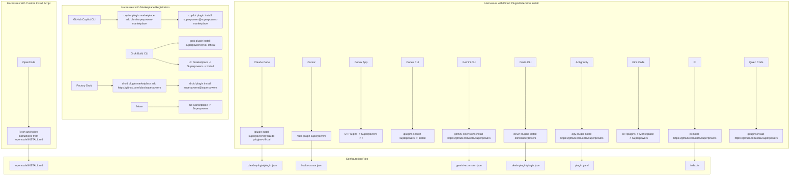
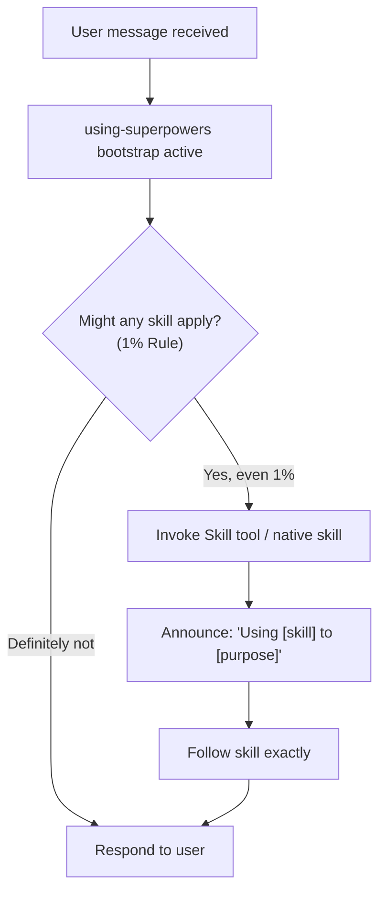

<!-- source: DeepWiki mcp.deepwiki.com · repo obra/superpowers · page 2 Getting Started · fetched 2026-10-26 -->

# Getting Started

<details>
<summary>Relevant source files</summary>

The following files were used as context for generating this wiki page:

- [README.md](README.md)
- [skills/brainstorming/visual-companion.md](skills/brainstorming/visual-companion.md)

</details>


This page guides you through installing Superpowers on your AI coding agent platform. Superpowers provides a complete software development methodology built on a set of composable "skills" and initial instructions that ensure your agent uses them [README.md:1-5](). Installation integrates the Superpowers framework with your specific environment, enabling automated workflows like TDD, systematic debugging, and subagent-driven development [README.md:24-43]().

For background on the system's purpose, see [Overview](#1). For details on the architecture, see [Architecture](#4). For how skills work after installation, see [Core Concepts](#3).

---

## Platform Overview

Superpowers supports a wide range of platforms as of v6.3.0, including Claude Code, Cursor, OpenCode, Codex, Gemini CLI, and several newer harnesses like Devin CLI and Hermes Agent [RELEASE-NOTES.md:7-9](). Installation methods range from official plugin marketplaces to native extension loaders. Note that Gemini CLI support was restored in v6.2.0 [RELEASE-NOTES.md:66]().

| Platform | Install Method | Primary Config/Entry | Detailed Guide |
|---|---|---|---|
| Claude Code | Official/Dev Marketplace | `plugin.json` | [Installing on Claude Code](#2.1) |
| Cursor | `/add-plugin` command | `hooks-cursor.json` | [Installing on Cursor](#2.2) |
| OpenCode | `opencode.json` install | `INSTALL.md` | [Installing on OpenCode](#2.3) |
| Codex | Native skill discovery | `.codex-plugin/` | [Installing on Codex](#2.4) |
| Gemini CLI | `gemini extensions install` | `gemini-extension.json` | [Installing on Gemini CLI](#2.5) |
| Devin CLI | `devin plugins install` | `plugin.json` | [Installing on Additional Harnesses](#2.6) |
| Hermes Agent | Git clone / Native loader | `plugin.yaml` | [Installing on Additional Harnesses](#2.6) |
| Pi | `pi install` | Native skills | [Installing on Additional Harnesses](#2.6) |
| Antigravity | `agy plugin install` | `session-start` hook | [Installing on Additional Harnesses](#2.6) |
| Kimi Code | Plugin marketplace | N/A | [Installing on Additional Harnesses](#2.6) |
| GitHub Copilot CLI | Marketplace | N/A | [Installing on Additional Harnesses](#2.6) |
| Grok Build CLI | Official marketplace | N/A | [Installing on Additional Harnesses](#2.6) |
| Factory Droid | Marketplace | N/A | [Installing on Additional Harnesses](#2.6) |
| Muse | Marketplace | N/A | [Installing on Additional Harnesses](#2.6) |
| Qwen Code | N/A | N/A | [Installing on Additional Harnesses](#2.6) |

Sources: [README.md:49-253](), [RELEASE-NOTES.md:3-9](), [RELEASE-NOTES.MD:64-66](), [.claude-plugin/plugin.json:1-4]()

---

## Installation Methods by Platform

Superpowers integrates with various AI coding environments, each with its own plugin or extension mechanism. The installation process typically involves a command-line instruction or interaction with a marketplace.

### "Superpowers" Plugin Installation Flow

Sources: [README.md:49-253](), [README.md:89-90](), [README.md:237-239]()

---

## Quick Installation Reference

### Claude Code
Superpowers is available via the official marketplace or the Superpowers developer marketplace [README.md:53-79]():
```bash
/plugin install superpowers@claude-plugins-official
```
For details, see [Installing on Claude Code](#2.1).

### Cursor
Install directly within the Cursor Agent chat [README.md:122-127]():
```text
/add-plugin superpowers
```
For details, see [Installing on Cursor](#2.2).

### OpenCode
Direct the agent to fetch the remote installation instructions [README.md:228-231]():
```text
Fetch and follow instructions from https://raw.githubusercontent.com/obra/superpowers/refs/heads/main/.opencode/INSTALL.md
```
For details, see [Installing on OpenCode](#2.3).

### Codex
Codex utilizes native skill discovery. In the CLI, use the plugin search [README.md:107-116]():
```bash
/plugins
# Search for: superpowers
```
For details, see [Installing on Codex](#2.4).

### Gemini CLI
Install as a native extension to enable Gemini-specific tool mapping [README.md:161-169]():
```bash
gemini extensions install https://github.com/obra/superpowers
```
For details, see [Installing on Gemini CLI](#2.5).

### Additional Harnesses (v6.x)
Integrations for Devin CLI, Hermes Agent, Pi, Antigravity, Kimi Code, Muse, Qwen Code, GitHub Copilot CLI, Grok Build CLI, and Factory Droid are supported via their respective plugin managers or direct repository installs [README.md:81-90](), [README.md:133-159](), [README.md:173-219](), [README.md:233-253](). For details, see [Installing on Additional Harnesses](#2.6).

---

## What Gets Activated After Installation

Once installed, the system enforces a mandatory skill check protocol. The `using-superpowers` bootstrap is injected into every session to shape agent behavior [README.md:247](), [CLAUDE.md:75-77](). The agent is instructed to check for relevant skills before any task using the "1% rule": if there is even a minor chance a skill applies, the agent **must** invoke it [README.md:43](), [CLAUDE.md:89-90]().

**Skill Discovery and Invocation Flow:**



Sources: [README.md:3-5](), [README.md:43](), [README.md:247](), [CLAUDE.md:75-77](), [CLAUDE.md:89-90]()

---

## Verification

After installation, start a new session and describe a task that should trigger a skill. The standard acceptance test for new harness support is [CLAUDE.md:78-82]():

> "Let's make a react todo list"

A working integration will auto-trigger the `brainstorming` skill before any code is written [CLAUDE.md:89-90](). In v6.3.0, brainstorming now scales to the task, classifying requests as spike, bounded, or architectural [RELEASE-NOTES.md:13]().

Sources: [CLAUDE.md:78-90](), [RELEASE-NOTES.md:13]()

---

## Updating

Superpowers updates are platform-dependent:

- **Claude Code**: `/plugin update superpowers`
- **Devin CLI**: `devin plugins update superpowers` [README.md:136-140]()
- **Gemini CLI**: `gemini extensions update superpowers` [README.md:164-168]()
- **Antigravity / Pi / Hermes / Qwen Code**: Re-run the install command to update from the repository [README.md:89-90](), [README.md:237-239](), [README.md:217-219]().
- **Factory Droid**: Re-run the marketplace add and plugin install commands [README.md:147-155]().
- **GitHub Copilot CLI**: Re-run the marketplace add and plugin install commands [README.md:176-184]().
- **Grok Build CLI**: Re-run the plugin install command or update via the marketplace UI [README.md:193-201]().
- **Kimi Code**: Update via the plugin manager UI or re-run the install command [README.md:207-219]().

Sources: [README.md:89-90](), [README.md:136-140](), [README.md:147-155](), [README.md:164-168](), [README.md:176-184](), [README.md:193-201](), [README.md:207-219](), [README.md:237-239]()

---

