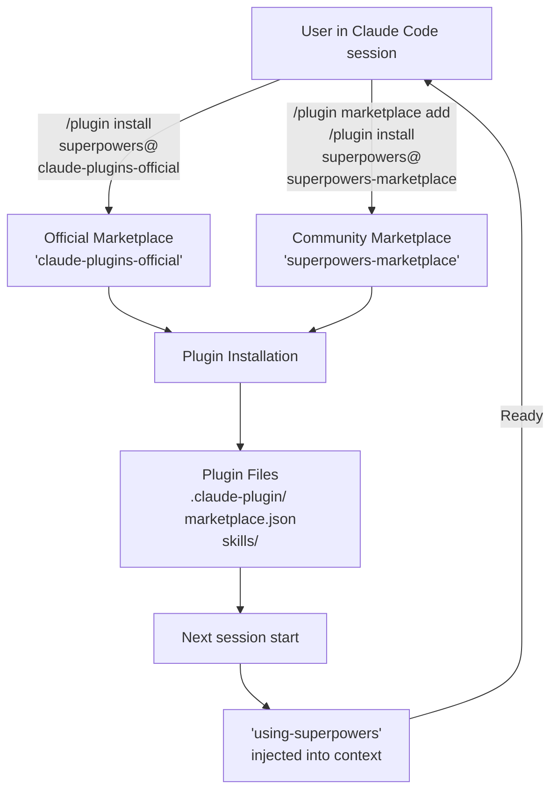
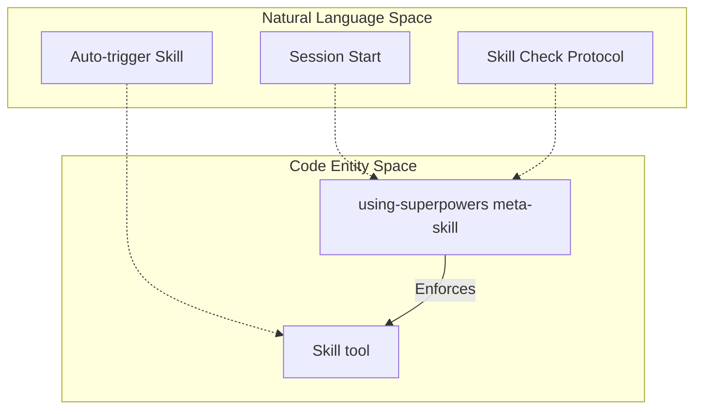
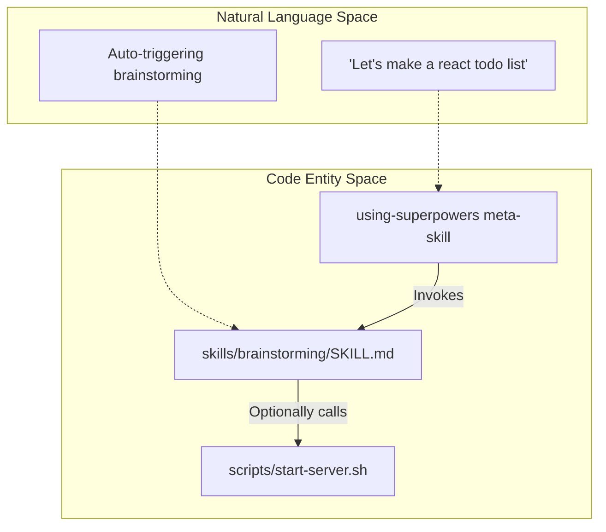

<!-- source: DeepWiki mcp.deepwiki.com · repo obra/superpowers · page 2.1 Installing on Claude Code · fetched 2026-10-26 -->

# Installing on Claude Code

<details>
<summary>Relevant source files</summary>

The following files were used as context for generating this wiki page:

- [.claude-plugin/marketplace.json](.claude-plugin/marketplace.json)
- [README.md](README.md)
- [skills/brainstorming/visual-companion.md](skills/brainstorming/visual-companion.md)

</details>


## Purpose and Scope

This page covers installation of Superpowers on Claude Code, including plugin marketplace setup, verification, and session initialization. For installation on other platforms, see [Installing on Cursor](#2.2), [Installing on OpenCode](#2.3), [Installing on Codex](#2.4), or [Installing on Gemini CLI](#2.5). For details on how Claude Code's native integration works, see [Claude Code Integration](#5.1).

## Installation Methods

Claude Code supports installation via the official Claude plugin marketplace or the Superpowers community marketplace. Both methods install the same core software development methodology defined in the repository [README.md:1-4]().

### Official Claude Marketplace

The official marketplace provides Superpowers as a verified plugin. This is the recommended path for most users [README.md:55-63]().

```bash
/plugin install superpowers@claude-plugins-official
```

### Superpowers Community Marketplace

The Superpowers marketplace provides Superpowers and other related development plugins. You can register this marketplace to access the latest development manifests [README.md:65-79](). The `marketplace.json` file defines the `superpowers` plugin with its description and version [/.claude-plugin/marketplace.json:1-20]().

```bash
/plugin marketplace add obra/superpowers-marketplace
/plugin install superpowers@superpowers-marketplace
```

**Installation Flow:**



**Sources:** [README.md:55-79](), [/.claude-plugin/marketplace.json:1-20]()

## Plugin Lifecycle and Hooks

Claude Code utilizes a hooks system to manage session lifecycles. The Superpowers plugin registers hooks that trigger on specific session events to ensure the AI agent is always aware of its available skills.

### Hook Execution Mechanism
A real integration loads the `using-superpowers` bootstrap at session start. This bootstrap is what causes skills to auto-trigger at the right moments. Without it, the skills are present on disk but never invoked [CLAUDE.md:75-77]().

| Component | Role | File Pointer |
|------------|-------------------|------------------|
| `using-superpowers` | Meta-skill for bootstrap and 1% rule | [README.md:247-247]() |
| `Skill` tool | Native tool for skill invocation | [README.md:43-43]() |

**Natural Language to Code Entity Space: Hook Lifecycle**



**Sources:** [CLAUDE.md:72-83](), [README.md:247-247](), [README.md:43-43]()

## Session Initialization and Context Injection

Once installed, the `superpowers` plugin is active in every Claude Code session. The primary mechanism for enforcement is the `using-superpowers` meta-skill. This skill establishes the "1% rule" (the mandatory skill check protocol) and defines the instruction priority hierarchy [README.md:247-247]().

The injection ensures that:
1. The agent prioritizes project-specific instructions (e.g., `CLAUDE.md`) over general Superpowers skills [CLAUDE.md:1-20]().
2. The agent uses the `Skill` tool for discovery rather than manually reading markdown files in the `skills/` directory [README.md:43-43]().

**Sources:** [README.md:247-247](), [CLAUDE.md:1-20]()

## Verification

To verify that the installation was successful, you can check the installed plugins within Claude Code:

```bash
/plugin list
```

**The Acceptance Test:**
To confirm the bootstrap is working correctly, open a clean session and send the following message:
> Let's make a react todo list

A working integration MUST auto-trigger the `brainstorming` skill before any code is written [CLAUDE.md:78-83](). The `brainstorming` skill itself can optionally use a visual companion server, which is started via `scripts/start-server.sh` [skills/brainstorming/visual-companion.md:35-40](). For Claude Code, the default mode of `start-server.sh` works, as it backgrounds the server itself [skills/brainstorming/visual-companion.md:60-64]().

**Natural Language to Code Entity Space: Verification**



**Sources:** [CLAUDE.md:72-83](), [README.md:247-247](), [skills/brainstorming/visual-companion.md:35-40](), [skills/brainstorming/visual-companion.md:60-64]()

## Update Process

To update the Superpowers plugin to the latest version available in your configured marketplace:

```bash
/plugin update superpowers
```

Updates pull the latest skill definitions and hook configurations. The system enforces a shift from legacy slash commands to direct skill invocation via the `Skill` tool [README.md:43-43]().

**Sources:** [README.md:43-43](), [README.md:136-140]()

---

