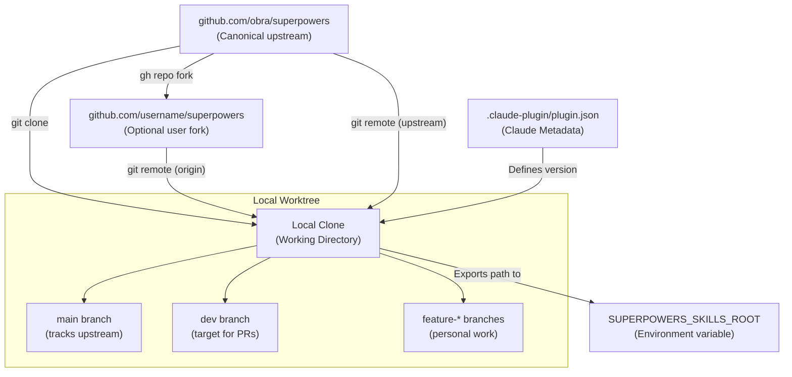
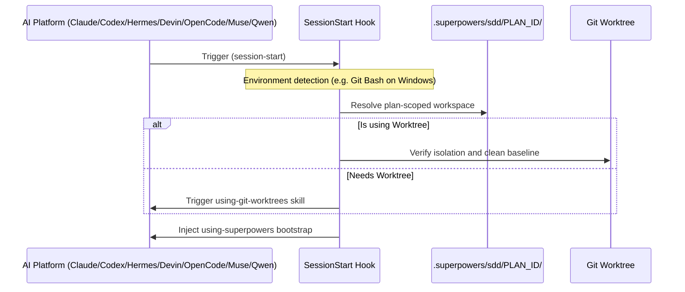
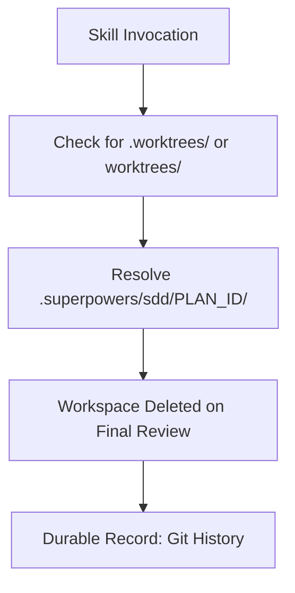

<!-- source: DeepWiki mcp.deepwiki.com · repo obra/superpowers · page 4.2 Skills Repository Management · fetched 2026-10-26 -->

# Skills Repository Management

<details>
<summary>Relevant source files</summary>

The following files were used as context for generating this wiki page:

- [.claude-plugin/plugin.json](.claude-plugin/plugin.json)
- [.gitignore](.gitignore)
- [RELEASE-NOTES.md](RELEASE-NOTES.md)

</details>


This document covers the lifecycle of the skills repository in Superpowers: initial cloning, forking, auto-updates, and branch-based development workflows. The skills repository is the primary source of truth for AI guidance, managed as a Git repository that is automatically initialized and updated across multiple platforms including Claude Code, Cursor, OpenCode, Codex, Gemini CLI, Devin CLI, and others.

For information about how skills are discovered and loaded at runtime, see [4.5. Skills Discovery and Resolution](). For platform-specific integration details, see [4.3. Multi-Platform Integration](). For the overall plugin architecture, see [4.1. Dual Repository Design]().

## Repository Architecture

The skills repository operates as an independently-versioned Git repository that is cloned and managed locally by the plugin. This separation enables community contributions through standard GitHub workflows while maintaining automatic updates for end users.

### Repository Relationships and Code Entities

The following diagram maps the high-level repository relationships to the specific configuration files and environment variables that define them in the codebase.



**Sources:** [.claude-plugin/plugin.json:1-11]()

| Component | Location | Purpose |
|-----------|----------|---------|
| Upstream Repository | `github.com/obra/superpowers` | Canonical source for all skills and plugin logic [[.claude-plugin/plugin.json:9-10]()] |
| Local Clone | Current Working Directory | The active repository where the AI is operating |
| User Fork | `github.com/username/superpowers` | Optional fork for contributions |
| Plugin Shim | `.claude-plugin/` | Claude Code specific integration metadata [[.claude-plugin/plugin.json:1-4]()] |
| Version Tracker | `plugin.json` | Hardcoded version string used for release tracking [[.claude-plugin/plugin.json:4]()] |

**Sources:** [.claude-plugin/plugin.json:1-11]()

## Initial Setup and Cloning

The system handles repository setup through platform-specific commands. Modern harnesses support direct marketplace installation or direct Git URL installation.

### Installation and Hook Flow

The system uses a `session-start` hook (where supported) to inject the `using-superpowers` bootstrap. As of v6.4.1, new harnesses like **OpenCode 2.0.4+**, **Muse**, and **Qwen Code** are supported, with their respective installation methods [[RELEASE-NOTES.md:62-65]()].



**Sources:** [RELEASE-NOTES.md:62-65]()

### Platform-Specific Metadata

Different platforms utilize different configuration files to register the skills library. The `bump-version.sh` script ensures consistency across these files [[scripts/bump-version.sh:1-12]()].

| Platform | Configuration File | Role |
|----------|--------------------|------|
| **Claude Code** | `.claude-plugin/plugin.json` | Marketplace and local plugin registration [[.claude-plugin/plugin.json:1-4]()] |
| **Muse** | Native plugin manifest | `muse plugins install ./` then `muse plugins approve superpowers` [[RELEASE-NOTES.md:63-63]()] |
| **Qwen Code** | Extension manifest | `qwen extensions install obra/superpowers` [[RELEASE-NOTES.md:64-64]()] |
| **OpenCode 2.0.4+** | Native API | Skills register through V2's native API [[RELEASE-NOTES.md:62-62]()] |

**Sources:** [.claude-plugin/plugin.json:1-4](), [RELEASE-NOTES.md:62-64](), [scripts/bump-version.sh:1-12]()

## Auto-Update and Versioning

Superpowers follows a semantic versioning strategy. Updates are delivered via Git or platform-specific plugin update commands. The current version is `6.4.2` [[.claude-plugin/plugin.json:4]()].

### Versioning Strategy and Maintenance

The repository version is synchronized across all harnesses using `scripts/bump-version.sh`. This script performs a repo-wide audit to detect version drift and ensure every manifest file is updated simultaneously [[scripts/bump-version.sh:3-9]()].

**Key Maintenance Scripts:**
- `bump-version.sh`: Updates version strings in all JSON/YAML manifests [[scripts/bump-version.sh:226-250]()].
- `sync-to-codex-plugin.sh`: Synchronizes the local checkout to the Codex plugin fork, preserving marketplace metadata [[scripts/sync-to-codex-plugin.sh:5-9]()].

**Sources:** [.claude-plugin/plugin.json:4](), [scripts/bump-version.sh:3-9](), [scripts/sync-to-codex-plugin.sh:5-9]()

## Forking and Branch-Based Development

Superpowers enforces a branch-based workflow. As of v6.4.1, significant changes were made to how development progress is tracked to prevent cross-plan contamination, and `executing-plans` was rebuilt for native execution [[RELEASE-NOTES.md:29-33]()].

### Plan-Scoped Workspaces

Scratch files for `subagent-driven-development` (SDD) are now **plan-scoped**. The workspace directory is resolved to `.superpowers/sdd/<plan-basename>/`. This prevents a follow-up plan from reading a previous plan's ledger as its own progress. As of v6.4.1, plans with the same basename no longer share a workspace; a collision gets its own directory [[RELEASE-NOTES.md:55-57]()].



**Sources:** [RELEASE-NOTES.md:55-57]()

### Contributor Requirements and Safety

The repository includes strict safety checks for branch management:
- **Worktree Removal**: The `finishing-a-development-branch` skill no longer uses `--force` by default. If untracked files are found, the skill stops and asks the user to handle them to prevent data loss.
- **Zero Dependencies**: Superpowers remains a zero-dependency plugin to ensure portability across restricted AI environments.
- **Audit Requirement**: Version bumps require a `bump-version.sh --audit` pass to ensure no undeclared files contain old version strings [[scripts/bump-version.sh:154-174]()].
- **Executable Bits**: Skills now invoke bundled scripts through their interpreter (e.g., `bash scripts/foo.sh`, `node render-graphs.js`) to ensure they work even if a packager strips executable bits [[RELEASE-NOTES.md:67-68]()].

**Sources:** [RELEASE-NOTES.md:67-68](), [scripts/bump-version.sh:154-174]()

## Directory Structure (v6.4.x)

The repository is structured to support multiple AI harnesses while keeping skills modular.

```text
/ (Repo Root)
├── .claude-plugin/          # Claude Code integration metadata
├── .superpowers/            # Persistent scratch space
│   └── sdd/                 # Plan-scoped SDD workspace [PLAN_ID/]
├── hooks/                   # Session lifecycle hooks
├── scripts/                 # Maintenance tools
│   ├── bump-version.sh      # Multi-harness version management
│   └── sync-to-codex-plugin.sh # Codex portal synchronization
├── skills/                  # THE SKILLS REPOSITORY
│   ├── brainstorming/       # Spike/Bounded/Architectural classification
│   ├── writing-plans/       # Plan-scoped task decomposition
│   └── subagent-driven-development/ # Plan-scoped SDD logic
└── tests/                   # Test suite (Fast, Integration)
```

**Sources:** [.claude-plugin/plugin.json:1-11](), [.gitignore:1-4](), [scripts/bump-version.sh:1-12]()

---

