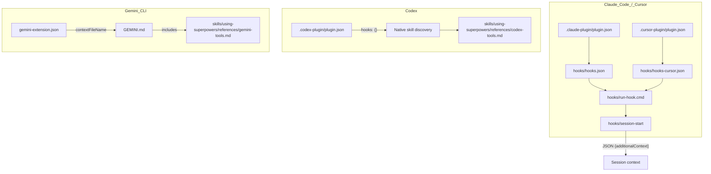
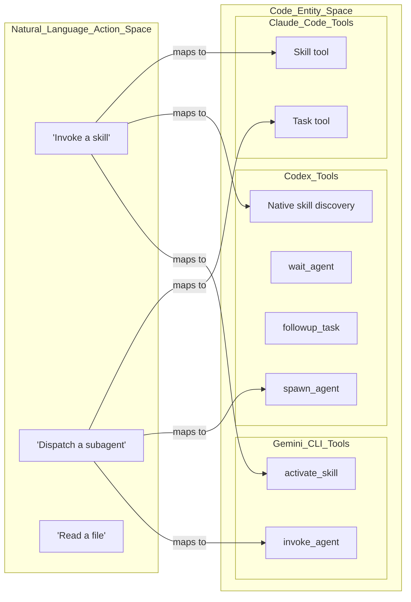

<!-- source: DeepWiki mcp.deepwiki.com · repo obra/superpowers · page 4.3 Multi-Platform Integration · fetched 2026-10-26 -->

# Multi-Platform Integration

Relevant source files

The following files were used as context for generating this wiki page:

- [docs/porting-to-a-new-harness.md](docs/porting-to-a-new-harness.md)
- [docs/windows/polyglot-hooks.md](docs/windows/polyglot-hooks.md)
- [skills/using-superpowers/SKILL.md](skills/using-superpowers/SKILL.md)
- [skills/using-superpowers/references/claude-code-tools.md](skills/using-superpowers/references/claude-code-tools.md)
- [skills/using-superpowers/references/codex-tools.md](skills/using-superpowers/references/codex-tools.md)
- [tests/hooks/test-session-start.sh](tests/hooks/test-session-start.sh)

This page describes how the Superpowers plugin hooks into each supported AI coding platform at a technical level: what files are involved, how context is injected, and what mechanism each platform uses for skill discovery. For detail on what the bootstrap content contains and how it is constructed, see [4.4](). For how skills are located on disk after bootstrap, see [4.5]().

---

## Integration Mechanism Overview

Superpowers targets multiple platforms, each with a different plugin API. The system provides a unified interface for skills while adapting to platform-specific tool names and capabilities.

| Platform | Registration | Context Injection Hook | Skill Discovery |
|---|---|---|---|
| **Claude Code** | `.claude-plugin/plugin.json` | `SessionStart` via `hooks.json` | Claude Code `Skill` tool |
| **Cursor** | `.cursor-plugin/plugin.json` | `sessionStart` via `hooks-cursor.json` | Cursor `Skill` tool |
| **Codex** | `.codex-plugin/plugin.json` | Native discovery | Native `~/.agents/skills/` scan |
| **Gemini CLI** | `gemini-extension.json` | `contextFileName` (GEMINI.md) | `activate_skill` tool |
| **Pi** | `pi-extension.json` | `session-start` extension | Native skills |
| **Antigravity** | `agy` manifest | First-message bootstrap | Native tool calls |
| **Hermes Agent** | `plugin.yaml` | `pre_llm_call` hook | `read_file` fallback |

Sources: [.claude-plugin/plugin.json:1-20](), [.cursor-plugin/plugin.json:1-23](), [.codex-plugin/plugin.json:1-48](), [docs/porting-to-a-new-harness.md:87-99](), [skills/using-superpowers/references/codex-tools.md:1-8]()

---

## How Each Platform Connects

The integration architecture bridges the gap between the platform's native environment and the shared Superpowers skill library.

Sources: [.codex-plugin/plugin.json:24-24](), [docs/windows/polyglot-hooks.md:20-31](), [docs/porting-to-a-new-harness.md:31-56](), [skills/using-superpowers/SKILL.md:52-60]()

---

## Claude Code & Cursor Integration

These platforms share a hook-based architecture using the `run-hook.cmd` polyglot dispatcher to ensure cross-platform compatibility [docs/windows/polyglot-hooks.md:20-22]().

### Polyglot Dispatcher (`run-hook.cmd`)
To support Windows (CMD.exe) and Unix (bash/sh), Superpowers uses a single generic dispatcher [docs/windows/polyglot-hooks.md:3-5]().
1. **Windows**: CMD treats the first block as batch commands. It searches for `bash.exe` (Git for Windows) in standard paths like `C:\Program Files\Git\bin\bash.exe` and executes the extensionless hook script [docs/windows/polyglot-hooks.md:66-78]().
2. **Unix**: Shells treat the CMD block as a no-op heredoc (`: << 'CMDBLOCK'`) and execute the script directly [docs/windows/polyglot-hooks.md:80-86]().

### Hook Specifics
- **Claude Code**: Uses `hooks/hooks.json` with a matcher for `startup|clear|compact` [docs/windows/polyglot-hooks.md:33-52]().
- **Cursor**: Uses `hooks/hooks-cursor.json` with a `sessionStart` matcher [docs/windows/polyglot-hooks.md:142-144]().
- **Output Shape**: The `session-start` script detects the environment and adjusts the JSON output. Claude Code expects a nested `hookSpecificOutput.additionalContext`, while Cursor expects a top-level `additional_context` [tests/hooks/test-session-start.sh:77-116]().

Sources: [docs/windows/polyglot-hooks.md:1-94](), [tests/hooks/test-session-start.sh:77-116]()

---

## Tool Mapping Layer

Skills are written using abstract actions (e.g., "dispatch a subagent") to remain harness-agnostic [docs/porting-to-a-new-harness.md:37-41](). Each harness translates these actions into native tools via a reference file in `skills/using-superpowers/references/` [docs/porting-to-a-new-harness.md:43-48]().

### Codex Tool Mapping
Codex requires specific configuration for multi-agent support, which is crucial for skills like `dispatching-parallel-agents` and `subagent-driven-development` [skills/using-superpowers/references/codex-tools.md:1-11](). This is enabled by setting `multi_agent = true` in `~/.codex/config.toml` [skills/using-superpowers/references/codex-tools.md:5-8]().

Key Codex tool mappings and behaviors:
- **Spawning**: `spawn_agent` with `fork_turns: "none"` for clean context [skills/using-superpowers/references/codex-tools.md:17-18]().
- **Fix rounds**: `followup_task` to resume implementers [skills/using-superpowers/references/codex-tools.md:25-26]().
- **Lifecycle**: V2 has no `close_agent`; children are evicted automatically [skills/using-superpowers/references/codex-tools.md:29-30]().
- **Waiting**: `wait_agent` is an event subscription, not a poll. Bounded stretches of 5-10 minutes (`timeout_ms` 300000-600000) are recommended [skills/using-superpowers/references/codex-tools.md:40-41]().
- **Model Routing**: `spawn_agent` calls must explicitly set `model` and `reasoning_effort` [skills/using-superpowers/references/codex-tools.md:63-64](). A machine-level backstop can be configured in `~/.codex/config.toml` using `default_subagent_model` and `default_subagent_reasoning_effort` [skills/using-superpowers/references/codex-tools.md:73-78]().

### Action to Code Mapping

Sources: [skills/using-superpowers/references/codex-tools.md:1-78](), [docs/porting-to-a-new-harness.md:31-56](), [skills/using-superpowers/SKILL.md:52-60]()

---

## Personal Skills and Discovery

Personal skills are stored in runtime-specific directories but follow a standardized structure: a subdirectory per skill containing a `SKILL.md` with YAML frontmatter [skills/writing-skills/SKILL.md:72-82]().

- **Claude Code**: `~/.claude/skills/` [skills/writing-skills/SKILL.md:12-12]()
- **Gemini CLI**: `~/.gemini/skills/` [skills/using-superpowers/references/gemini-tools.md:28-28]()
- **Cross-Runtime Alias**: `~/.agents/skills/` (recognized by Codex, Copilot CLI, and Gemini CLI) [skills/writing-skills/SKILL.md:12-12]()

Discovery is optimized via the `description` field in the frontmatter, which must describe *when* to use the skill rather than *what* the skill does to prevent agents from skipping the full skill body [skills/writing-skills/SKILL.md:144-158]().

Sources: [skills/writing-skills/SKILL.md:12-103](), [skills/using-superpowers/references/gemini-tools.md:28-29]()

---

