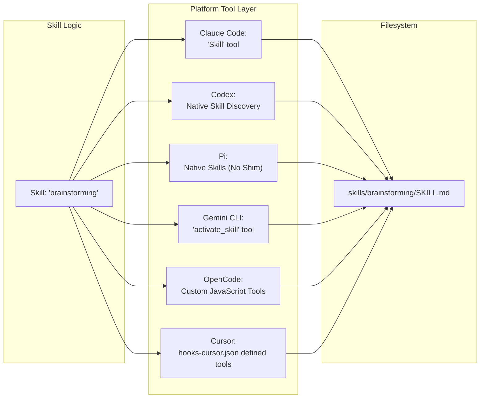

<!-- source: DeepWiki mcp.deepwiki.com · repo obra/superpowers · page 5 Platform-Specific Features · fetched 2026-10-26 -->

# Platform-Specific Features

<details>
<summary>Relevant source files</summary>

The following files were used as context for generating this wiki page:

- [README.md](README.md)
- [skills/brainstorming/visual-companion.md](skills/brainstorming/visual-companion.md)

</details>


This page documents how Superpowers integrates with different AI development platforms. Each platform has unique integration requirements, tool mappings, and configuration mechanisms, but all share the same underlying skills repository.

---

## Platform Integration Architecture

Superpowers uses a **dual repository design** where a lightweight plugin shim in each platform loads and manages a shared skills repository. The plugin manifests are platform-specific, but the skills themselves are platform-agnostic.

### Plugin Manifest Locations

| Platform | Manifest File | Installation Type |
|----------|--------------|-------------------|
| Claude Code | `.claude-plugin/plugin.json` | Official or Custom Marketplace |
| Codex | `.codex-plugin/plugin.json` | Native skill discovery / Marketplace |
| Gemini CLI | `gemini-extension.json` | Extension Install |
| Devin CLI | `plugin.json` | Repository Install |
| Hermes Agent | `plugin.yaml` | Git Clone / Native Loader |
| Kimi Code | `kimi-plugin.json` | Marketplace / Repository URL |
| Pi | `pi-extension.json` | Native package |
| Antigravity | `agy-plugin.json` | Direct Repository Install |
| Cursor | `hooks-cursor.json` | Plugin system |

**Sources:** [.claude-plugin/plugin.json:1-20](), [RELEASE-NOTES.md:7-9](), [README.md:53-255]()

### Session Initialization Flow

The following diagram bridges the high-level initialization concept to the specific shell scripts and environment detection used to inject the `using-superpowers` bootstrap context.

```mermaid
graph TB
    subgraph "NaturalLanguageSpace" ["Natural Language Space (Triggers)"]
        "User starts new session"
        "User clears history"
        "User compacts context"
    end
    
    subgraph "CodeEntitySpace" ["Code Entity Space (Hooks & Logic)"]
        HooksJSON["hooks/hooks.json<br/>Matcher: startup|clear|compact"]
        RunHook["hooks/run-hook.cmd<br/>Polyglot Wrapper"]
        SessionStart["hooks/session-start<br/>Bash Script"]
        
        subgraph "PlatformSpecificOutput" ["Platform Specific Output"]
            CC_Out["hookSpecificOutput.additionalContext"]
            Cursor_Out["additional_context"]
            Pi_Out["Pi Bootstrap Injection"]
            Agy_Out["Antigravity Startup Hook"]
            Gemini_Out["GEMINI.md Context File"]
        end
    end

    "User starts new session" --> HooksJSON
    "User clears history" --> HooksJSON
    "User compacts context" --> HooksJSON
    
    HooksJSON -->|calls| RunHook
    RunHook -->|executes| SessionStart
    
    SessionStart -->|detects CLAUDE_PLUGIN_ROOT| CC_Out
    SessionStart -->|detects CURSOR_PLUGIN_ROOT| Cursor_Out
    SessionStart -->|Pi native extension| Pi_Out
    SessionStart -->|Antigravity plugin hook| Agy_Out
    SessionStart -->|Gemini Extension| Gemini_Out
```

**Sources:** [hooks/hooks.json:1-17](), [RELEASE-NOTES.md:7-9](), [RELEASE-NOTES.md:62-63](), [README.md:81-90](), [README.md:156-169](), [README.md:233-255]()

---

## Claude Code Integration

Claude Code is the **canonical platform** for Superpowers. It uses the official Claude plugin marketplace or the Superpowers-specific marketplace at `obra/superpowers-marketplace`. Claude Code's integration includes native hooks, specific tools like `Skill`, `Task`, and `TodoWrite`, and settings for subagent depth. Its configuration is managed via a `plugin.json` file.

For details, see [Claude Code Integration](#5.1).

**Sources:** [README.md:56-83](), [.claude-plugin/plugin.json:1-20]()

---

## Codex Integration

Codex support includes both a CLI and an App interface. It utilizes native skill discovery and event-driven subagent waits added in v6.3.0. Codex also features a `multi_agent` flag, `spawn_agent`/`wait_agent` tools, and specific controls for finishing tasks within the Codex App.

### Event-Driven Architecture
In v6.3.0, Codex subagent waits transitioned from poll-heavy mechanisms to event-driven ones, and the `multi_agent` reference was corrected against Codex source.
[RELEASE-NOTES.md:24-27]()

### Packaging and Sync
The `package-codex-plugin.sh` script produces deterministic archives for the Codex portal, ensuring OpenAI metadata is included for every skill.
[RELEASE-NOTES.md:106-108]()

For details, see [Codex Integration](#5.2).

**Sources:** [README.md:95-120](), [RELEASE-NOTES.md:24-27](), [RELEASE-NOTES.md:106-108]()

---

## OpenCode Integration

OpenCode integrates Superpowers through a JavaScript plugin, supporting both V1 and V2 entrypoints. It leverages bootstrap caching and child-session detection for efficient operation, and allows for custom tool definitions.

For details, see [OpenCode Integration](#5.3).

**Sources:** [README.md:223-235]()

---

## Cursor Integration

Cursor integrates Superpowers via its plugin system. The `hooks-cursor.json` file, which uses a camelCase format, defines the plugin's hooks and ensures compatibility with Cursor's environment.

For details, see [Cursor Integration](#5.4).

**Sources:** [README.md:122-127]()

---

## Shared Skill Discovery Module

Both Codex and OpenCode integrations reuse a shared skill discovery logic. This module is responsible for frontmatter extraction from skill definitions, enumerating available skills, and resolving their file paths.

For details, see [Shared Skill Discovery Module](#5.5).

---

## Gemini CLI Integration

Gemini CLI support utilizes an extension system and a `GEMINI.md` context file for environment injection. Its integration includes a `gemini-extension.json` manifest, specific tool mappings, and a `no-subagent` fallback mechanism.

### Tool Mapping and Fallbacks
Gemini CLI maps native Superpowers tools to Gemini-specific equivalents like `save_memory` and `enter_plan_mode`. It also includes a `no-subagent` fallback to the `executing-plans` skill when parallel agents are unavailable.
[README.md:156-169]()

For details, see [Gemini CLI Integration](#5.6).

**Sources:** [README.md:160-171]()

---

## Hermes, Pi, and Antigravity Integration

Superpowers provides specific integrations for Hermes Agent, Pi, and Antigravity, each with unique mechanisms for hook execution and bootstrap injection.

-   **Hermes Agent:** Uses `plugin.yaml` for hook definitions, including a `pre_llm_call` hook to inject Superpowers context.
-   **Pi:** Integrates via a TypeScript extension, injecting the bootstrap at session startup and after context compaction.
-   **Antigravity:** Executes the plugin's `session-start` hook directly upon the first message, ensuring Superpowers is active immediately.

For details, see [Hermes, Pi, and Antigravity Integration](#5.7).

**Sources:** [README.md:81-90](), [README.md:233-255]()

---

## Devin, Kimi, Muse, and Other Harnesses

Superpowers extends its reach to a variety of other AI development environments, each with its own integration specifics:

-   **Devin CLI:** Uses a `plugin.json` for installation and updates.
-   **Kimi Code:** Available through its marketplace or direct repository installation.
-   **Muse:** Integrates via plugin/marketplace manifests.
-   **Qwen Code, Copilot CLI, Grok Build CLI, Factory Droid:** Each has specific installation and manifest configurations to enable Superpowers.

For details, see [Devin, Kimi, Muse, and Other Harnesses](#5.8).

**Sources:** [README.md:128-221]()

---

## Platform Tool Mapping

This diagram illustrates how platform-neutral skill requests are transformed into platform-specific tool calls across different environments.



**Sources:** [README.md:156-169](), [README.md:233-247](), [RELEASE-NOTES.md:24-27]()

### Shared Logic
The `skills-core.js` shared module provides the underlying logic for skill discovery and path resolution used by non-Claude platforms.

For details, see [Shared Skill Discovery Module](#5.5).

---

