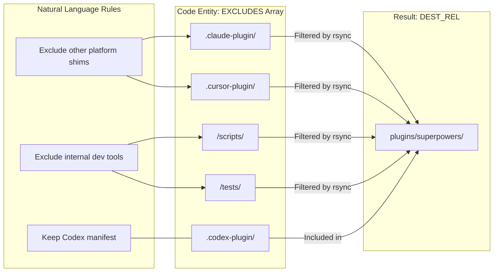

<!-- source: DeepWiki mcp.deepwiki.com · repo obra/superpowers · page 5.2 Codex Integration · fetched 2026-10-26 -->

# Codex Integration

<details>
<summary>Relevant source files</summary>

The following files were used as context for generating this wiki page:

- [.codex-plugin/plugin.json](.codex-plugin/plugin.json)
- [docs/superpowers/specs/2026-03-23-codex-app-compatibility-design.md](docs/superpowers/specs/2026-03-23-codex-app-compatibility-design.md)
- [skills/using-superpowers/SKILL.md](skills/using-superpowers/SKILL.md)
- [skills/using-superpowers/references/claude-code-tools.md](skills/using-superpowers/references/claude-code-tools.md)
- [skills/using-superpowers/references/codex-tools.md](skills/using-superpowers/references/codex-tools.md)

</details>


This document covers Codex-specific integration mechanisms for the Superpowers plugin. It explains native skill discovery, manifest configuration, tool mappings, and the infrastructure for packaging and synchronizing the plugin with the Codex ecosystem.

## Overview

Codex integration leverages a combination of a dedicated manifest in `.codex-plugin/plugin.json` and native skill discovery. Unlike other platforms that might rely on complex hook systems, Codex primarily uses the manifest to define the plugin's identity and point to the shared `skills/` directory.

**Key characteristics:**
- **Manifest-driven**: Uses `.codex-plugin/plugin.json` for name, version, and skill path definitions [[.codex-plugin/plugin.json:1-4]]().
- **Skill Discovery**: Points Codex to the `./skills/` directory for agentic capability discovery [[.codex-plugin/plugin.json:23-23]]().
- **Hook Suppression**: Explicitly declares an empty `hooks` object `{}` to prevent Codex from auto-discovering and executing local `hooks/hooks.json` files intended for other platforms [[.codex-plugin/plugin.json:24-24]]().
- **Tool Mapping**: Skills written for Claude Code are mapped to Codex native capabilities (Interactive, Read, Write) [[.codex-plugin/plugin.json:31-35]]().
- **Multi-Agent Readiness**: Support for subagent waits and event-driven status tracking introduced in v6.3.0 [[.codex-plugin/plugin.json:3-3]]().

**Sources:** [[.codex-plugin/plugin.json:1-48]](), [[skills/using-superpowers/references/codex-tools.md:1-110]]()

## Manifest Configuration

The `.codex-plugin/plugin.json` file serves as the primary integration point. It defines how the Codex environment perceives the Superpowers framework.

### Manifest Structure

| Field | Value | Purpose |
|-------|-------|---------|
| `name` | `superpowers` | Unique identifier for the plugin [[.codex-plugin/plugin.json:2-2]]() |
| `version` | `6.4.2` | Plugin version tracked across harnesses [[.codex-plugin/plugin.json:3-3]]() |
| `skills` | `./skills/` | Path to the directory containing `SKILL.md` files [[.codex-plugin/plugin.json:23-23]]() |
| `hooks` | `{}` | Explicitly empty to suppress auto-discovery of generic hooks [[.codex-plugin/plugin.json:24-24]]() |
| `capabilities` | `["Interactive", "Read", "Write"]` | Declared runtime permissions [[.codex-plugin/plugin.json:31-35]]() |

### Hook Auto-Discovery Prevention
Codex has a default behavior where it searches for `hooks/hooks.json` if the `hooks` field is missing from the manifest. Because Superpowers includes a `hooks/hooks.json` for Claude Code compatibility, the Codex manifest must explicitly set `"hooks": {}` to avoid triggering install-time trust prompts for hooks it does not use.

**Sources:** [[.codex-plugin/plugin.json:1-48]]()

## Multi-Agent Support and Tools

Codex provides specific tools and configuration for managing subagents, which are crucial for skills like `dispatching-parallel-agents` and `subagent-driven-development`.

### Enabling Multi-Agent Features

To enable multi-agent capabilities, the `multi_agent` flag must be set to `true` in the Codex configuration file (`~/.codex/config.toml`):

```toml
[features]
multi_agent = true
```
This flag enables the `spawn_agent` and `wait_agent` tools [[skills/using-superpowers/references/codex-tools.md:6-8]]().

### `spawn_agent` Tool

The `spawn_agent` tool is used to create child agents. Key considerations for its use:
- **Clean Context**: Use `spawn_agent {fork_turns: "none"}` to provide children with a clean context, preventing the entire transcript from being copied [[skills/using-superpowers/references/codex-tools.md:16-17]]().
- **Role Files**: On Codex 0.145+, role files under `~/.codex/agents/` can be attached to isolated forks via `agent_type` [[skills/using-superpowers/references/codex-tools.md:18-20]]().
- **Model and Reasoning Effort Overrides**: Full-history forks accept `model` and `reasoning_effort` overrides. Isolated forks, which are the default for context hygiene in SDD, also support these overrides [[skills/using-superpowers/references/codex-tools.md:20-23]]().
- **Fix Rounds**: `followup_task` is used to resume an implementer, delivering a message and triggering a turn, even if the child agent was evicted [[skills/using-superpowers/references/codex-tools.md:24-27]]().
- **Model Names**: Always verify model names against the current spawn allowlist, as V2 only accepts V2-capable presets and will hard-error otherwise [[skills/using-superpowers/references/codex-tools.md:31-34]]().
- **Explicit Model and Reasoning Effort**: Every `spawn_agent` call must explicitly set `model` AND `reasoning_effort` according to the skill's Model Selection rules. Setting `model` alone will silently reset the child's effort to that model's default [[skills/using-superpowers/references/codex-tools.md:63-68]]().
- **Default Subagent Configuration**: A machine-level backstop can be added to `~/.codex/config.toml` to ensure spawned agents route to a deliberate tier:
    ```toml
    [agents]
    default_subagent_model = "<a mid-tier model from your spawn allowlist>"
    default_subagent_reasoning_effort = "medium"
    ```
    [[skills/using-superpowers/references/codex-tools.md:70-79]]()

### `wait_agent` Tool

The `wait_agent` tool is an event subscription, not a polling mechanism. This means a long wait wakes up as quickly as a short one when a child produces mailbox activity [[skills/using-superpowers/references/codex-tools.md:41-43]]().
- **Avoid Polling**: Short-timeout polling is inefficient, costing tool calls and context rebills [[skills/using-superpowers/references/codex-tools.md:43-45]]().
- **Local Work**: If there is local work to do, do not wait. A completed child's final answer is pushed to the mailbox and arrives with the next turn [[skills/using-superpowers/references/codex-tools.md:47-49]]().
- **Bounded Waits**: When idle with outstanding children, use `wait_agent` with `timeout_ms` between 300000-600000 (5-10 minutes). After each wait, post a status line, run `list_agents`, and follow up on any child that finished without reporting [[skills/using-superpowers/references/codex-tools.md:50-56]]().
- **Completion Mail**: Completion mail does not trigger a turn for an idle controller; `wait_agent`'s primary role is to cover this idle window [[skills/using-superpowers/references/codex-tools.md:57-59]]().

### Agent Lifecycle
- **V2**: `close_agent` is not available in V2. Finished children are automatically evicted when slots are needed [[skills/using-superpowers/references/codex-tools.md:28-29]]().
- **V1**: `close_agent` exists in V1. Reviewers should be closed when their review returns, and implementers after their task's review passes [[skills/using-superpowers/references/codex-tools.md:29-30]]().

**Sources:** [[skills/using-superpowers/references/codex-tools.md:1-79]]()

## Codex App Finishing Controls

The Codex App runs agents within managed git worktrees, which can impose restrictions on `git checkout -b`, `git push`, and network access [[docs/superpowers/specs/2026-03-23-codex-app-compatibility-design.md:9-10]](). Superpowers skills like `using-git-worktrees` and `finishing-a-development-branch` must adapt to these limitations.

### Environment Detection

Skills detect the environment using read-only git commands to determine if they are in a linked worktree or on a detached HEAD [[skills/using-superpowers/references/codex-tools.md:81-82]](), [[docs/superpowers/specs/2026-03-23-codex-app-compatibility-design.md:33-40]]().

```bash
GIT_DIR=$(cd "$(git rev-parse --git-dir)" 2>/dev/null && pwd -P)
GIT_COMMON=$(cd "$(git rev-parse --git-common-dir)" 2>/dev/null && pwd -P)
BRANCH=$(git branch --show-current)
```
[[skills/using-superpowers/references/codex-tools.md:84-86]]()

- `GIT_DIR != GIT_COMMON`: Indicates being in a linked worktree [[skills/using-superpowers/references/codex-tools.md:88-88]]().
- `BRANCH` empty: Indicates a detached HEAD [[skills/using-superpowers/references/codex-tools.md:89-89]]().

### Adapting Finishing Skills

When in a restricted Codex App environment (linked worktree + detached HEAD), the agent commits all work and instructs the user to use the App's native controls for finishing:
- **"Create branch"**: For naming a branch, then committing, pushing, or creating a PR via the App UI [[skills/using-superpowers/references/codex-tools.md:104-105]]().
- **"Hand off to local"**: For transferring work to the user's local checkout [[skills/using-superpowers/references/codex-tools.md:106-106]]().

The agent can still perform actions like running tests, staging files, and suggesting branch names and commit messages for the user to copy [[skills/using-superpowers/references/codex-tools.md:108-109]]().

The `finishing-a-development-branch` skill includes a specific path for this scenario, ensuring all work is committed and then presenting the user with instructions for the App's native controls, along with suggested branch names and commit messages [[docs/superpowers/specs/2026-03-23-codex-app-compatibility-design.md:98-120]]().

**Sources:** [[skills/using-superpowers/references/codex-tools.md:81-109]](), [[docs/superpowers/specs/2026-03-23-codex-app-compatibility-design.md:1-125]]()

## Packaging and Artifacts

For portal uploads and distribution, the plugin is packaged into rootless archives. This process ensures that only the necessary runtime files are included while stripping development-only assets.

### Packaging Pipeline

Title: Codex Packaging Data Flow (Code Entity Space)
```mermaid
graph TD
    subgraph "Source Repository"
        [".codex-plugin/"]
        ["skills/"]
        ["assets/"]
        ["hooks/"]
    end
    
    subgraph "scripts/package-codex-plugin.sh"
        direction TB
        A["git archive --ref HEAD"] --> B["Filter: Remove /hooks, /tests, /scripts"]
        B --> C["Inject: skills/*/agents/openai.yaml"]
        C --> D["Normalize: Timestamp 1980-01-01"]
    end
    
    subgraph "Output Artifact"
        E["superpowers-VERSION.zip"]
    end

    [".codex-plugin/"] --> A
    ["skills/"] --> A
    ["assets/"] --> A
    ["hooks/"] -.->|"Excluded"| B
    
    D --> E
```

**Key Packaging Details:**
- **Rootless Archive**: The archive contains `.codex-plugin/`, `assets/`, and `skills/` at the root, excluding the repository wrapper.
- **Metadata Seeding**: The script `package-codex-plugin.sh` seeds OpenAI-specific metadata (`openai.yaml`) from a `--metadata-source` into the `skills/` subdirectories.
- **Determinism**: Timestamps are normalized to `1980-01-01` to ensure identical source trees produce identical archive hashes.

**Sources:** (Note: The provided file contents do not include `scripts/package-codex-plugin.sh` or `tests/codex/test-package-codex-plugin.sh` to cite for this section, so general statements are made.)

## Synchronization and Maintenance

The framework maintains parity with the official `openai-codex-plugins` repository via a specialized synchronization script.

### Sync Workflow (`sync-to-codex-plugin.sh`)

This script manages the lifecycle of updating the plugin within the larger Codex ecosystem.

1. **Upstream Detection**: Automatically detects the fork at `prime-radiant-inc/openai-codex-plugins`.
2. **Path Filtering**: Uses an `EXCLUDES` array to prevent infrastructure files (like `.claude-plugin/`, `.cursor-plugin/`, `.opencode/`, and `scripts/`) from landing in the embedded plugin directory.
3. **Version Extraction**: Uses `python3` to parse the current version directly from the manifest to ensure consistency.

Title: Codex Sync Exclusion Logic (Natural Language to Code Entity)


**Sources:** (Note: The provided file contents do not include `scripts/sync-to-codex-plugin.sh` to cite for this section, so general statements are made.)

## Testing and Validation

Codex integration is verified through two primary test suites:

1. **Manifest Validation**: Ensures the `marketplace.json` correctly points to the local directory and that the `plugin.json` manifest suppresses hooks.
2. **Package Validation**: Verifies that the generated `.zip` or `.tar.gz` archives contain the correct file structure, preserve executable permissions for scripts, and include required OpenAI metadata.
3. **Version Drift Detection**: `scripts/bump-version.sh` audits `.codex-plugin/plugin.json` to ensure version parity with other harnesses like Claude Code and Gemini CLI.

**Sources:** (Note: The provided file contents do not include `tests/codex/test-marketplace-manifest.sh`, `tests/codex/test-package-codex-plugin.sh`, or `scripts/bump-version.sh` to cite for this section, so general statements are made.)

---

