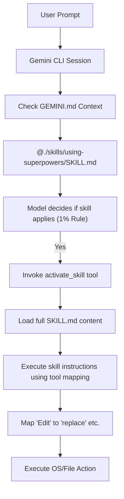
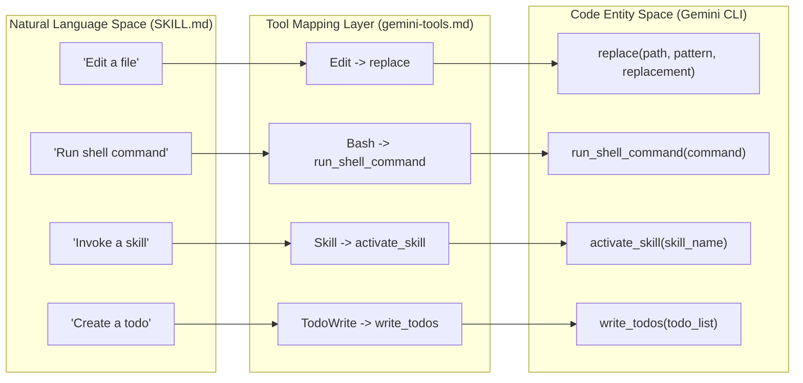

<!-- source: DeepWiki mcp.deepwiki.com · repo obra/superpowers · page 5.6 Gemini CLI Integration · fetched 2026-10-26 -->

# Gemini CLI Integration

<details>
<summary>Relevant source files</summary>

The following files were used as context for generating this wiki page:

- [gemini-extension.json](gemini-extension.json)
- [skills/executing-plans/SKILL.md](skills/executing-plans/SKILL.md)
- [skills/using-superpowers/references/gemini-tools.md](skills/using-superpowers/references/gemini-tools.md)
- [skills/writing-skills/SKILL.md](skills/writing-skills/SKILL.md)
- [skills/writing-skills/anthropic-best-practices.md](skills/writing-skills/anthropic-best-practices.md)

</details>


The Gemini CLI integration allows the Superpowers skills library to function as a native extension within the Gemini command-line environment. This integration leverages Gemini's extension system to provide structured workflows, tool mapping for cross-platform compatibility, and automated context injection via the `GEMINI.md` entry point.

## Extension Architecture

The Gemini CLI integration is defined by a root-level configuration file that identifies the repository as a Gemini extension. This integration is designed for high portability and minimal setup by using native Gemini CLI capabilities.

### gemini-extension.json
This file serves as the manifest for the Gemini CLI. It defines the extension's metadata and points to the primary context file used to bootstrap every session. It specifies the `contextFileName` as `GEMINI.md` and tracks the current version of the library.
```json
{
  "name": "superpowers",
  "description": "Core skills library: TDD, debugging, collaboration patterns, and proven techniques",
  "version": "6.4.2",
  "contextFileName": "GEMINI.md"
}
```
Sources: `[gemini-extension.json:1-6]()`

### GEMINI.md Context File
The `GEMINI.md` file acts as the entry point for context injection. At the start of a session, Gemini CLI processes this file and handles any `@` syntax directives to load skill definitions and reference materials into the active context window. Specifically, it loads the core `using-superpowers` skill and the Gemini-specific tool mapping reference.

Sources: `[GEMINI.md:1-2]()`

## Tool Mapping and Adaptation

Since Superpowers skills are written using Claude Code tool nomenclature (e.g., `Read`, `Write`, `Edit`), the Gemini CLI integration includes a mapping layer. This ensures that the model understands which native Gemini CLI tools to invoke when a skill instructs it to perform an action.

### Mapping Table
The following mappings translate between generic skill instructions and the specific Gemini CLI environment:

| Action skills request | Gemini CLI equivalent |
|----------------------|----------------------|
| Read a file | `read_file` |
| Read multiple files at once | `read_many_files` |
| Create a new file | `write_file` |
| Edit a file | `replace` |
| Run a shell command | `run_shell_command` |
| Search file contents | `grep_search` |
| Find files by name | `glob` |
| List files and subdirectories | `list_directory` |
| Fetch a URL | `web_fetch` |
| Search the web | `google_web_search` |
| Invoke a skill | `activate_skill` |
| Dispatch a subagent (`Subagent (general-purpose):` template) | `invoke_agent` with `agent_name: "generalist"` (invocable via `@generalist` chat syntax — see [Subagent support](#subagent-support)) |
| Multiple parallel dispatches | Multiple `invoke_agent` calls in the same response |
| Task tracking ("create a todo", "mark complete") | `write_todos` (statuses: pending, in_progress, completed, cancelled, blocked) |

Sources: `[skills/using-superpowers/references/gemini-tools.md:5-21]()`

### Gemini-Specific Tools
Gemini CLI provides unique tools that are utilized by the model to maintain state and manage workflows:
*   `save_memory`: Used to persist facts across sessions when `experimental.memoryV2` is disabled. `[skills/using-superpowers/references/gemini-tools.md:52-52]()`
*   `get_internal_docs`: Used to look up Gemini CLI's bundled documentation. `[skills/using-superpowers/references/gemini-tools.md:53-53]()`
*   `ask_user`: Poses structured questions (text / single-select / multi-select) to the user. `[skills/using-superpowers/references/gemini-tools.md:54-54]()`
*   `enter_plan_mode` / `exit_plan_mode`: Switches the agent into and out of read-only plan mode. `[skills/using-superpowers/references/gemini-tools.md:55-55]()`
*   `update_topic`: Updates the current conversation's topic / strategic-intent metadata. `[skills/using-superpowers/references/gemini-tools.md:56-56]()`
*   `complete_task`: Signals that a Gemini subagent has completed and returns its result to the parent agent. `[skills/using-superpowers/references/gemini-tools.md:57-57]()`
*   `tracker_*`: A suite of tools for rich task tracking with dependency and visualization support (`tracker_create_task`, `tracker_update_task`, `tracker_get_task`, `tracker_list_tasks`, `tracker_add_dependency`, `tracker_visualize`). `[skills/using-superpowers/references/gemini-tools.md:58-62]()`
*   `read_mcp_resource`, `list_mcp_resources`: Tools for MCP resource access. `[skills/using-superpowers/references/gemini-tools.md:63-63]()`

Sources: `[skills/using-superpowers/references/gemini-tools.md:51-63]()`

## Skill Activation Flow

In the Gemini CLI, skills are not pre-loaded in their entirety to save tokens. Instead, skill metadata is loaded at the start of the session, and the full content is retrieved on-demand using the `activate_skill` tool.

### Data Flow: Skill Invocation
The diagram below illustrates how a user request triggers the skill discovery and activation process within the Gemini CLI environment.

**Gemini Skill Discovery and Activation**

Sources: `[GEMINI.md:1-2]()`, `[gemini-extension.json:5-5]()`, `[skills/using-superpowers/references/gemini-tools.md:17-17]()`

## Subagent Support

Gemini CLI supports subagents natively via the `invoke_agent` tool or the `@agent-name` chat syntax. This allows the system to execute complex workflows like `subagent-driven-development` by dispatching tasks to the `@generalist` agent.

### Subagent Mapping and Fallback
Skills dispatch subagents using a standard template. On Gemini CLI, these are handled as follows:

| Skill dispatch form | Gemini CLI equivalent |
|---------------------|----------------------|
| References a `*-prompt.md` template (implementer, task-reviewer, code-reviewer, etc.) | Fill the template, then `invoke_agent` with `agent_name: "generalist"` and the filled prompt |
| References `superpowers:requesting-code-review`'s `./code-reviewer.md` | `invoke_agent` with `agent_name: "generalist"` and the filled review template |
| Inline prompt (no template referenced) | `invoke_agent` with `agent_name: "generalist"` and your inline prompt |

Sources: `[skills/using-superpowers/references/gemini-tools.md:32-41]()`

**No-Subagent Fallback:** If subagents are unavailable or not configured, the model is instructed to fallback to the `executing-plans` skill. This skill manages implementation sequentially within the current session rather than dispatching parallel workers. The `executing-plans` skill's description explicitly states: "Use when executing an implementation plan in the current session as the implementer yourself — your human partner chose inline execution, or no subagent tool is available". `[skills/executing-plans/SKILL.md:3-4]()`

Sources: `[skills/using-superpowers/references/gemini-tools.md:32-41]()`, `[skills/executing-plans/SKILL.md:3-4]()`

## Implementation Details

The integration bridges the "Natural Language Space" of the skill definitions with the "Code Entity Space" of the Gemini CLI tools.

### Tool Mapping Bridge
The following diagram maps conceptual instructions found in skill files to the specific function calls available in the Gemini CLI environment.

**Gemini Tool Mapping Bridge**

Sources: `[skills/using-superpowers/references/gemini-tools.md:1-21]()`

### Instruction Priority and Paths
Gemini CLI loads `GEMINI.md` files hierarchically, allowing for global settings at `~/.gemini/GEMINI.md` and project-specific overrides. `[skills/using-superpowers/references/gemini-tools.md:24-26]()` Personal skills are recognized in `~/.gemini/skills/` or the cross-runtime alias `~/.agents/skills/`. `[skills/using-superpowers/references/gemini-tools.md:27-28]()` The `~/.agents/skills/` directory takes precedence when both exist at the same scope. `[skills/using-superpowers/references/gemini-tools.md:28-28]()`

Sources: `[skills/using-superpowers/references/gemini-tools.md:24-28]()`, `[skills/writing-skills/SKILL.md:12-12]()`

## Version Management
The Gemini integration versioning is synchronized with the rest of the Superpowers ecosystem. The `version` field in `gemini-extension.json` tracks the library version. `[gemini-extension.json:4-4]()`

Sources: `[gemini-extension.json:4-4]()`

---

