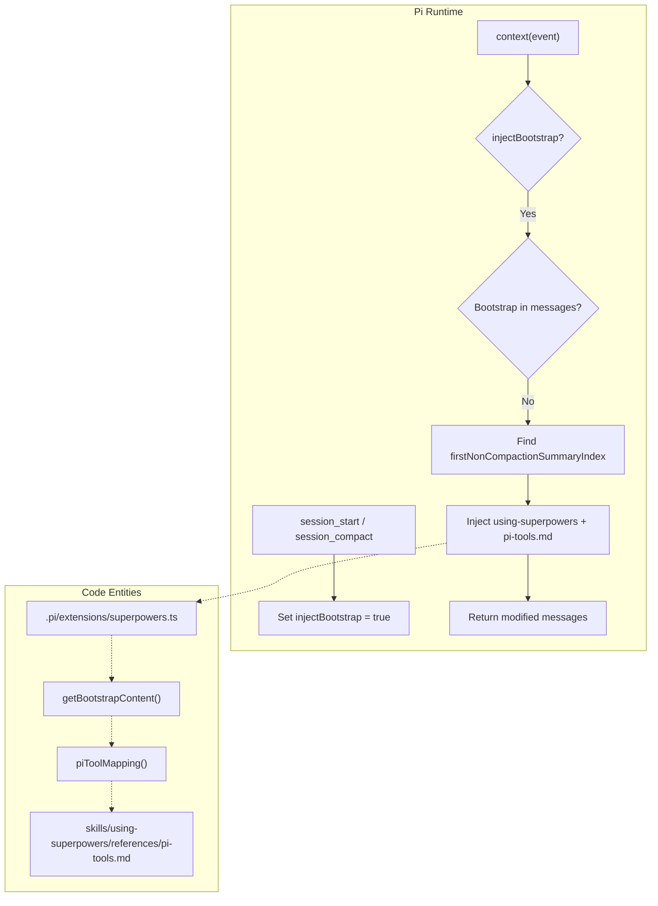
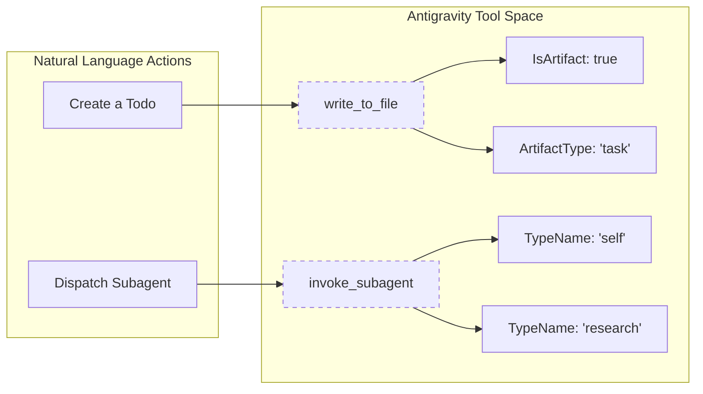

<!-- source: DeepWiki mcp.deepwiki.com · repo obra/superpowers · page 5.7 Hermes, Pi, and Antigravity Integration · fetched 2026-10-26 -->

# Hermes, Pi, and Antigravity Integration

Relevant source files

The following files were used as context for generating this wiki page:

- [.devin-plugin/plugin.json](.devin-plugin/plugin.json)
- [.hermes-plugin/plugin.yaml](.hermes-plugin/plugin.yaml)
- [.kimi-plugin/plugin.json](.kimi-plugin/plugin.json)
- [.pi/extensions/superpowers.ts](.pi/extensions/superpowers.ts)
- [skills/using-superpowers/references/antigravity-tools.md](skills/using-superpowers/references/antigravity-tools.md)
- [skills/using-superpowers/references/pi-tools.md](skills/using-superpowers/references/pi-tools.md)
- [tests/antigravity/run-tests.sh](tests/antigravity/run-tests.sh)
- [tests/antigravity/test-antigravity-tools.sh](tests/antigravity/test-antigravity-tools.sh)
- [tests/pi/test-pi-extension.mjs](tests/pi/test-pi-extension.mjs)

This page documents the integration architecture for Hermes Agent, Pi, and Antigravity (agy) harnesses, introduced or expanded in Superpowers v6.x. These integrations leverage native lifecycle hooks, extension systems, and specialized tool-mapping layers to provide a consistent agentic workflow across diverse AI environments.

## Hermes Agent Integration

Hermes Agent integration is driven by a Python-based plugin located in `.hermes-plugin/`. It utilizes Hermes' native skill registration and the `pre_llm_call` hook for context injection.

### Plugin Architecture and Lifecycle
The Hermes plugin registers itself via `plugin.yaml` [.hermes-plugin/plugin.yaml:1-6](), declaring the `pre_llm_call` hook. The core logic resides in `.hermes-plugin/__init__.py`.

1.  **Skill Discovery**: During `register(ctx)`, the plugin iterates through the `skills/` directory and registers each `SKILL.md` file using `ctx.register_skill(name, Path(skill_md))` [.hermes-plugin/__init__.py:74-85]().
2.  **Bootstrap Construction**: It builds a bootstrap message by reading `using-superpowers/SKILL.md` and the Hermes-specific tool mapping from `hermes-tools.md` [.hermes-plugin/__init__.py:40-72]().
3.  **Context Injection**: The `pre_llm_call` hook is triggered before every LLM interaction. If `is_first_turn` is true, it returns the bootstrap content in a `context` dictionary, which Hermes appends to the initial user message [.hermes-plugin/__init__.py:91-104]().

### Hermes Tool Mapping
Hermes-specific actions are mapped to native tools in `skills/using-superpowers/references/hermes-tools.md`.

| Action | Hermes Tool |
| :--- | :--- |
| Dispatch a subagent | `delegate_task(goal=..., role="leaf")` |
| Task tracking | `todo` tool |
| Invoke a skill | `skill_view("skill-name")` |
| Run shell command | `terminal` |

**Sources:**
- [.hermes-plugin/__init__.py:8-104]()
- [.hermes-plugin/plugin.yaml:1-6]()
- [skills/using-superpowers/references/hermes-tools.md:1-56]()
- [tests/hermes/test_bootstrap.py:11-98]()

---

## Pi Integration

Pi integration uses a TypeScript extension system. Unlike other harnesses, Pi requires specialized handling for "compaction" (summarization of long histories) to ensure the Superpowers bootstrap remains in context.

### Extension Hooks and Injection
The Pi extension registers several lifecycle handlers via the `ExtensionAPI` [.pi/extensions/superpowers.ts:16-57]().

*   **`resources_discover`**: Informs Pi of the `skills/` directory location [.pi/extensions/superpowers.ts:19-21](). This is verified by `test('resources_discover contributes the bundled skills directory', ...)` [tests/pi/test-pi-extension.mjs:63-70]().
*   **`session_start` / `session_compact`**: Resets the `injectBootstrap` flag to `true`, ensuring the instructions are re-inserted after a session starts or history is compacted [.pi/extensions/superpowers.ts:23-29](). The `session_compact` behavior is tested by `test('session_compact injects bootstrap after compaction summaries, not before compaction', ...)` [tests/pi/test-pi-extension.mjs:103-119]().
*   **`agent_end`**: Sets `injectBootstrap` to `false` to prevent further bootstrap injection after an agent session concludes [tests/pi/test-pi-extension.mjs:98-101]().
*   **`context`**: This hook intercepts the message list. It finds the `firstNonCompactionSummaryIndex` (skipping past system-generated summaries) and injects the Superpowers bootstrap as a `user` message [.pi/extensions/superpowers.ts:35-56](). The `startup context` injection is verified by `test('startup context injects the bootstrap as one user message until agent_end', ...)` [tests/pi/test-pi-extension.mjs:72-101]().

### Pi Data Flow
Title: Pi Context Injection Flow

**Sources:**
- [.pi/extensions/superpowers.ts:1-121]()
- [tests/pi/test-pi-extension.mjs:45-119]()
- [skills/using-superpowers/references/pi-tools.md:1-16]()

---

## Antigravity (agy) Integration

Antigravity utilizes the standard Superpowers `SessionStart` hook for bootstrapping. Its integration primarily focuses on a strict tool-mapping protocol to handle Antigravity's unique "Artifact" system.

### Session Start Hook
Antigravity loads the Superpowers plugin directly, which includes the bundled skills and runs the `SessionStart` hook for bootstrap injection [tests/antigravity/test-antigravity-tools.sh:3-6](). This means there is no Antigravity-specific scaffold to test beyond the tool mapping.

### Task Tracking via Artifacts
Antigravity does not have a native `todo` tool. Instead, skills are instructed to use **Task Artifacts**. A task list is maintained as a markdown file and marked with `IsArtifact: true` and `ArtifactType: "task"` during `write_to_file` calls [skills/using-superpowers/references/antigravity-tools.md:10-23](). This mechanism is explicitly documented in `antigravity-tools.md` [skills/using-superpowers/references/antigravity-tools.md:10-23]() and verified by `test-antigravity-tools.sh` [tests/antigravity/test-antigravity-tools.sh:39-41]().

### Subagent Invocation
Subagents in Antigravity are dispatched using `invoke_subagent`. The integration specifies two primary `TypeName` values:
*   `self`: For full-capability recursive work [skills/using-superpowers/references/antigravity-tools.md:7]().
*   `research`: For read-only information gathering [skills/using-superpowers/references/antigravity-tools.md:7]().
These subagent types are verified to be documented in the mapping [tests/antigravity/test-antigravity-tools.sh:33-37]().

### System Mapping Diagram
Title: Antigravity Code Entity Mapping

**Sources:**
- [skills/using-superpowers/references/antigravity-tools.md:1-23]()
- [tests/antigravity/test-antigravity-tools.sh:1-46]()

---

## Technical Comparison of Harness Hooks

The following table compares how the three harnesses handle the Superpowers bootstrap injection.

| Feature | Hermes Agent | Pi | Antigravity |
| :--- | :--- | :--- | :--- |
| **Language** | Python | TypeScript | Bash / Shell |
| **Hook Used** | `pre_llm_call` | `pi.on("context")` | `session-start` |
| **Injection Point** | First turn `context` | Post-compaction user message | Session initialization |
| **Skill Loading** | `ctx.register_skill` | `resources_discover` | Filesystem discovery |
| **Configuration** | `plugin.yaml` [.hermes-plugin/plugin.yaml:1-6]() | `package.json` (`pi` key) [tests/pi/test-pi-extension.mjs:45-52]() | Standard `hooks.json` |

**Sources:**
- [.hermes-plugin/__init__.py:74-104]()
- [.pi/extensions/superpowers.ts:19-56]()
- [tests/pi/test-pi-extension.mjs:45-52]()
- [tests/antigravity/test-antigravity-tools.sh:2-7]()

---

