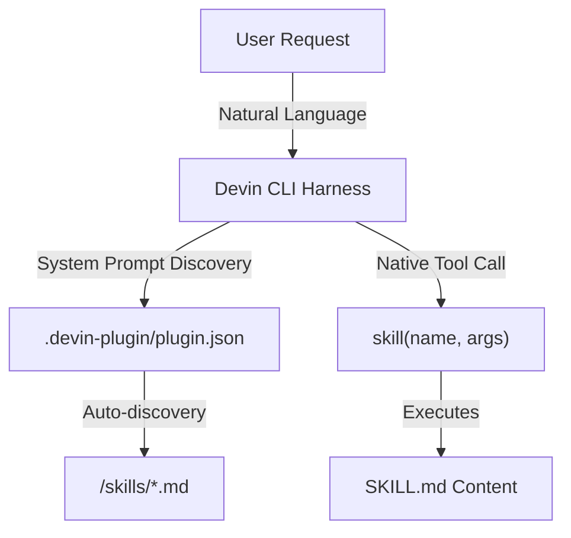
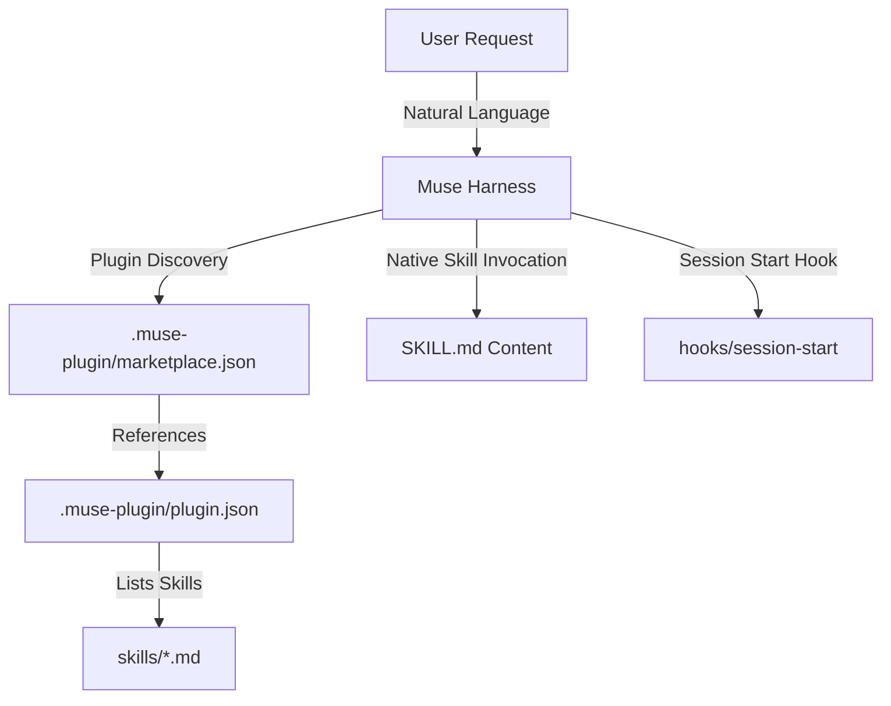
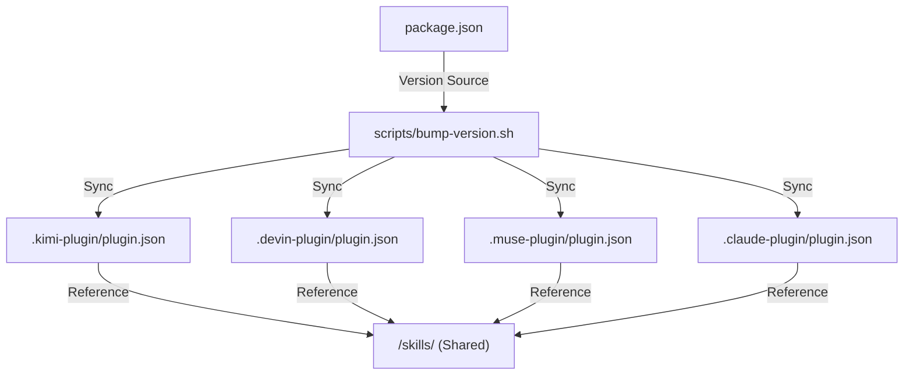

<!-- source: DeepWiki mcp.deepwiki.com · repo obra/superpowers · page 5.8 Devin, Kimi, Muse, and Other Harnesses · fetched 2026-10-26 -->

# Devin, Kimi, Muse, and Other Harnesses

Relevant source files

The following files were used as context for generating this wiki page:

- [.devin-plugin/plugin.json](.devin-plugin/plugin.json)
- [.hermes-plugin/plugin.yaml](.hermes-plugin/plugin.yaml)
- [.kimi-plugin/plugin.json](.kimi-plugin/plugin.json)
- [.muse-plugin/marketplace.json](.muse-plugin/marketplace.json)
- [.muse-plugin/plugin.json](.muse-plugin/plugin.json)
- [docs/README.kimi.md](docs/README.kimi.md)
- [tests/kimi/run-tests.sh](tests/kimi/run-tests.sh)
- [tests/kimi/test-plugin-manifest.sh](tests/kimi/test-plugin-manifest.sh)

This section documents the integration and architectural implementation for the newer AI harnesses added in v6.3.0, including Devin CLI, Kimi Code, Muse, Qwen Code, GitHub Copilot CLI, Grok Build CLI, and Factory Droid. These integrations leverage the Superpowers core skills library while adapting to the unique plugin manifests and toolsets of each platform.

## Devin CLI Integration

Devin CLI integration is designed for zero-runtime overhead. The harness uses a native plugin discovery mechanism that identifies skills directly from the repository structure.

### Implementation and Discovery
Devin CLI plugins are installed via `devin plugins install obra/superpowers` [RELEASE-NOTES.md:7-7](). The harness reads the `.devin-plugin/plugin.json` manifest [tests/devin/test-devin-plugin.sh:17-17](). Unlike other harnesses, Devin CLI does not require a `sessionStart` hook or a `skills` path definition in the manifest, as it automatically discovers the co-located `skills/` directory [tests/devin/test-devin-plugin.sh:2-8](). The `plugin.json` for Devin is minimal, containing only metadata like `name`, `version`, `description`, `author`, `homepage`, `repository`, `license`, and `keywords` [.devin-plugin/plugin.json:1-22]().

### Data Flow: Devin Skill Invocation
The following diagram illustrates how Devin CLI bridges the natural language request for a skill to the execution of the skill markdown.

**Devin Skill Execution Flow**

Sources: [tests/devin/test-devin-plugin.sh:2-8](), [RELEASE-NOTES.md:7-7](), [.devin-plugin/plugin.json:1-22]()

## Kimi Code Integration

Kimi Code integration uses a structured manifest to map Superpowers' abstract tool requirements (like `TodoWrite` or `Task`) to Kimi's specific agentic tools.

### Plugin Manifest
The Kimi manifest is located at `.kimi-plugin/plugin.json` [docs/README.kimi.md:33-33](). It defines three primary integration points:
1.  **Skills Path**: Points the Kimi runtime to the `./skills/` directory [.kimi-plugin/plugin.json:21-21]().
2.  **Session Start**: Automatically triggers the `using-superpowers` meta-skill at the beginning of every session [.kimi-plugin/plugin.json:22-24]().
3.  **Skill Instructions**: A mapping layer that translates Superpowers terminology into Kimi Code tool calls [.kimi-plugin/plugin.json:25-25]().

### Tool Mapping Table
Superpowers skills are written to be platform-agnostic. The `skillInstructions` field in the Kimi manifest performs the following translations:

| Superpowers Abstract Requirement | Kimi Code Tool |
| :--- | :--- |
| `Ask the user` / `ask clarifying questions` | `AskUserQuestion` |
| `TodoWrite` | `TodoList` |
| `Task tool` / `dispatch subagent` | `Agent` (with `subagent_type`) |
| `Invoke a skill` | Native `Skill` tool |
| `Read a file` / `write a file` / `edit a file` | `Read`, `Write`, `Edit` |
| `Run a shell command` | `Bash` |
| `Search file contents` | `Grep` |
| `Find files by path` | `Glob` |
| `Fetch a URL` | `FetchURL` |
| `Search the web` | `WebSearch` |

Sources: [.kimi-plugin/plugin.json:25-25](), [docs/README.kimi.md:45-56]()

### Kimi Subagent Dispatch Logic
When a skill requests a subagent dispatch (e.g., for SDD), the mapping layer directs Kimi to use the `Agent` tool with specific types:
*   **Implementation/Review**: `subagent_type: "coder"` [.kimi-plugin/plugin.json:25-25]().
*   **Codebase Exploration**: `subagent_type: "explore"` [.kimi-plugin/plugin.json:25-25]().
*   **Planning/Architecture**: `subagent_type: "plan"` [.kimi-plugin/plugin.json:25-25]().

Sources: [.kimi-plugin/plugin.json:25-25]()

## Muse Integration

Muse integration involves both a plugin manifest and a marketplace manifest to enable skill discovery and execution.

### Plugin Manifest
The Muse plugin manifest, `.muse-plugin/plugin.json`, defines the plugin's metadata and capabilities [.muse-plugin/plugin.json:1-89](). Key fields include:
*   `schemaVersion`, `name`, `displayName`, `version`, `description`.
*   `compat`: Specifies `source: "native"` and `manifestDir: ".muse-plugin"` [.muse-plugin/plugin.json:8-10]().
*   `capabilities`: Lists all Superpowers skills by `id` and `path` to their `SKILL.md` files, enabling native skill discovery within Muse [.muse-plugin/plugin.json:11-72]().
*   `hooks`: Defines a `session-start` hook that executes `hooks/session-start` script at `SessionStart` event [.muse-plugin/plugin.json:75-85]().

### Marketplace Manifest
The `.muse-plugin/marketplace.json` file describes the Superpowers plugin for the Muse marketplace [.muse-plugin/marketplace.json:1-20](). It includes:
*   `name`, `description`, `owner` information.
*   `plugins` array: Contains an entry for the `superpowers` plugin, referencing its `source: "./"` (relative to the marketplace manifest) and providing metadata like `description`, `version`, and `author` [.muse-plugin/marketplace.json:8-17]().

### Data Flow: Muse Skill Discovery and Execution
**Muse Skill Discovery and Execution**

Sources: [.muse-plugin/plugin.json:1-89](), [.muse-plugin/marketplace.json:1-20]()

## Additional Harnesses

### Qwen Code
Qwen Code integration is supported, leveraging the core skills library. Specific details on its plugin manifest or tool mapping are not explicitly provided in the current documentation, but it adheres to the general principle of adapting the shared `skills/` library.

### GitHub Copilot CLI
Support for GitHub Copilot CLI includes specific backgrounding guidance for Windows environments [RELEASE-NOTES.md:35-35](). The integration focuses on ensuring that long-running tasks or subagent processes do not hang the terminal session.

### Grok Build CLI
Grok Build CLI is supported via standard installation documentation [RELEASE-NOTES.md:9-9](). It follows the "Natural Language Space" to "Code Entity Space" mapping by utilizing the shared `skills/` library through the harness's native extension loader.

### Factory Droid
Factory Droid support was added to provide automated agentic workflows within the Factory ecosystem, utilizing the same core skill definitions found in the `skills/` directory.

## Maintenance and Versioning

All manifests across these harnesses are kept in sync via the `scripts/bump-version.sh` utility. This script ensures that the `version` field in `.devin-plugin/plugin.json`, `.kimi-plugin/plugin.json`, `.muse-plugin/plugin.json`, and `.claude-plugin/plugin.json` matches the root `package.json` [tests/devin/test-devin-plugin.sh:51-58](), [tests/kimi/test-plugin-manifest.sh:52-66]().

### Cross-Harness Validation
The repository includes specific test suites to ensure manifest integrity:
*   `tests/devin/test-devin-plugin.sh`: Validates that the Devin manifest contains no unsupported fields like `hooks` or `inject` [tests/devin/test-devin-plugin.sh:46-49]().
*   `tests/kimi/test-plugin-manifest.sh`: Ensures Kimi-specific tool tokens (e.g., `AskUserQuestion`, `TodoList`) are present in the instructions [tests/kimi/test-plugin-manifest.sh:36-50]().

**Harness Manifest Hierarchy**

Sources: [tests/devin/test-devin-plugin.sh:38-42](), [tests/kimi/test-plugin-manifest.sh:52-66](), [RELEASE-NOTES.md:36-36]()

---

