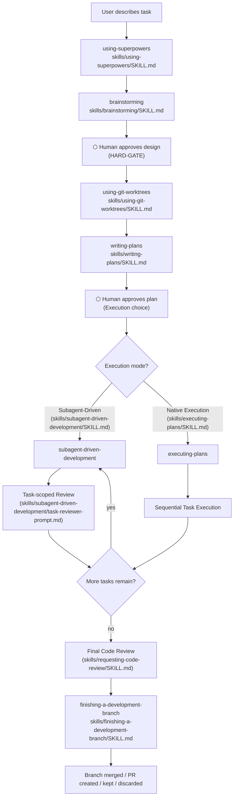

<!-- source: DeepWiki mcp.deepwiki.com · repo obra/superpowers · page 6 Development Workflows · fetched 2026-10-26 -->

# Development Workflows

<details>
<summary>Relevant source files</summary>

The following files were used as context for generating this wiki page:

- [docs/superpowers/specs/2026-06-09-sdd-task-scoped-review-dispatch-design.md](docs/superpowers/specs/2026-06-09-sdd-task-scoped-review-dispatch-design.md)
- [skills/brainstorming/SKILL.md](skills/brainstorming/SKILL.md)
- [skills/brainstorming/spec-document-reviewer-prompt.md](skills/brainstorming/spec-document-reviewer-prompt.md)
- [skills/subagent-driven-development/SKILL.md](skills/subagent-driven-development/SKILL.md)
- [skills/subagent-driven-development/implementer-prompt.md](skills/subagent-driven-development/implementer-prompt.md)
- [skills/subagent-driven-development/re-review-prompt.md](skills/subagent-driven-development/re-review-prompt.md)
- [skills/subagent-driven-development/task-reviewer-prompt.md](skills/subagent-driven-development/task-reviewer-prompt.md)
- [skills/writing-plans/SKILL.md](skills/writing-plans/SKILL.md)

</details>


This page provides an overview of the structured development pipeline that Superpowers enforces through its skill system. It describes the sequence of skills that activate during a development session and how they connect together to ensure high-quality, tested, and reviewed code.

Superpowers is built on a set of composable "skills" and initial instructions that ensure your agent uses them [README.md:3-5](). The system enforces a step-back approach: before writing code, the agent teases out a spec, presents it in digestible chunks, creates an implementation plan, and then launches a subagent-driven development process [README.md:33-43]().

For details on individual stages, see the sub-pages:
- [Complete Workflow Pipeline](#6.1) — Overview of the pipeline: brainstorming → writing-plans → subagent-driven or native execution → review → finishing
- [Brainstorming and Design](#6.2) — Detail the brainstorming skill's spike/bounded/architectural classification, HARD-GATE, spec review loop, and design documentation
- [Visual Brainstorming Companion](#6.3) — Explain the browser-based visual companion, events-file architecture, and non-blocking interaction model from the agent's perspective
- [Using Git Worktrees](#6.4) — Document the worktree isolation requirement, directory selection policy, safety verification, and clean baseline setup
- [Writing Implementation Plans](#6.5) — Explain the writing-plans skill, file structure mapping, task right-sizing, Review Focus section, and plan review loops
- [Subagent-Driven Development](#6.6) — Comprehensive documentation of the SDD workflow: plan-scoped workspace, ledger, dispatching, rulings, task-scoped review, fix loop, model selection, status protocol
- [Native Execution with executing-plans](#6.7) — Document the executing-plans skill: sequential inline task execution, task-start/task-done scripts, ledger, and whole-branch final review
- [Code Review Process](#6.8) — Explain requesting-code-review and receiving-code-review: spec compliance vs code quality, reviewer prompt, BASE_SHA/HEAD_SHA protocol
- [Finishing Development Branches](#6.9) — Document the finishing-a-development-branch skill: test verification, safe worktree removal, integration options, cleanup

---

## The Development Pipeline at a Glance

The full pipeline covers a project from initial idea to merged branch. There are two explicit human approval gates: one after the design is presented in `brainstorming`, and one before implementation execution begins after `writing-plans` [skills/brainstorming/SKILL.md:38-56](), [skills/writing-plans/SKILL.md:56-60]().

| Stage | Skill Name | Human Gate? | Purpose |
|---|---|---|---|
| Design exploration | `brainstorming` | ✅ Approve design | Refine rough ideas, classify path (spike/bounded/architectural), save design document [skills/brainstorming/SKILL.md:58-84](). |
| Isolated workspace | `using-git-worktrees` | — | Create isolated branch, run setup, verify clean test baseline. |
| Task breakdown | `writing-plans` | ✅ Approve plan | Break work into 2-5 minute tasks with exact file paths and code [skills/writing-plans/SKILL.md:34-43](). |
| Subagent execution | `subagent-driven-development` | — | Dispatch fresh subagent per task with two-stage review [skills/subagent-driven-development/SKILL.md:8](). |
| Native execution (alt) | `executing-plans` | Between batches | Execute tasks in current session with checkpoints. |
| Inter-task review | `requesting-code-review` | — | Review against plan; report issues by severity. |
| Branch completion | `finishing-a-development-branch` | ✅ Choose outcome | Verify tests, merge/PR, and clean up worktree. |

Sources: [README.md:33-43](), [skills/brainstorming/SKILL.md:38-84](), [skills/writing-plans/SKILL.md:34-43](), [skills/writing-plans/SKILL.md:56-60](), [skills/subagent-driven-development/SKILL.md:8]()

---

## Pipeline Flow

The following diagram bridges the high-level workflow concepts to the specific skill files and human interaction points.

**Workflow Pipeline: Skill Sequence**



Sources: [README.md:33-43](), [skills/brainstorming/SKILL.md:38-56](), [skills/writing-plans/SKILL.md:56-60](), [skills/subagent-driven-development/SKILL.md:60-92](), [skills/subagent-driven-development/task-reviewer-prompt.md:1-207]()

---

## Human Approval Gates

The pipeline contains two mandatory human approval gates that prevent forward progress without explicit confirmation.

**1. Design approval gate** — enforced by the `brainstorming` skill via a `<HARD-GATE>`. The agent is prohibited from jumping into code or implementation skills until the user has approved the presented design [skills/brainstorming/SKILL.md:38-56]().

**2. Plan approval gate** — enforced by `writing-plans`. Once the design is approved and a plan is written to `docs/superpowers/plans/`, the agent offers an execution choice. Execution only begins once the user selects an execution mode [skills/writing-plans/SKILL.md:56-60]().

---

## Execution Mode Choice

After a plan is approved, the agent selects between two primary execution modes [skills/writing-plans/SKILL.md:56-60]():

| Mode | Skill | Behavior |
|---|---|---|
| **Subagent-Driven Development (SDD)** | `subagent-driven-development` | Dispatches a fresh implementer subagent per task, followed by a task-scoped review (spec compliance + code quality). This process includes a fix loop and model selection based on task complexity and review findings. Recommended for fast iteration and high quality [skills/subagent-driven-development/SKILL.md:8](), [skills/subagent-driven-development/SKILL.md:54-58](). |
| **Native Execution** | `executing-plans` | Executes tasks sequentially within the current session. This mode is suitable when subagent overhead is not desired or when the harness does not support subagent dispatch. It includes task-start/task-done scripts and a whole-branch final review. |

Both modes follow the task granularity defined in the plan, which enforces a **RED-GREEN-REFACTOR** cycle: write failing test, verify failure, write minimal code to pass, verify pass, and commit [skills/writing-plans/SKILL.md:44-51](), [skills/writing-plans/SKILL.md:108-137]().

Sources: [skills/writing-plans/SKILL.md:44-51](), [skills/writing-plans/SKILL.md:56-60](), [skills/writing-plans/SKILL.md:108-137](), [skills/subagent-driven-development/SKILL.md:8](), [skills/subagent-driven-development/SKILL.md:54-58]()

---

## Review Loops and Verification

The workflow emphasizes rigorous verification through automated and manual review processes.

**SDD Review Process**

```mermaid
graph TD
    A[Task Implemented by Implementer Subagent] --> B{Generate Review Package};
    B --> C[Dispatch Task Reviewer Subagent\n(skills/subagent-driven-development/task-reviewer-prompt.md)];
    C --> D{Spec & Quality Approved?};
    D -- No --> E{Finding Conflicts with Plan?};
    E -- Yes --> F[Rule on Conflict, Ledger Ruling];
    E -- No --> G[Fix Round R of 5];
    F --> G;
    G --> H[Dispatch Scoped Re-review\n(skills/subagent-driven-development/re-review-prompt.md)];
    H --> I{All Findings Addressed?};
    I -- No --> J{R = 5?};
    J -- No --> G;
    J -- Yes --> K[Adjudicate Each Open Finding];
    K --> L{Any Load-Bearing Finding?};
    L -- Yes --> M[Rule and Continue];
    L -- No --> N[Park Findings in Ledger];
    M --> N;
    N --> O[Append Completion to Ledger, Mark Todo Complete];
    I -- Yes --> O;
    D -- Yes --> O;
    O --> P{More Tasks Remain?};
    P -- Yes --> A;
    P -- No --> Q[Dispatch Final Code Reviewer];
    Q --> R[Final Findings? Fix, Re-review, Adjudicate];
    R --> S[Final Review Clean: Delete Plan Workspace];
    S --> T[Use superpowers:finishing-a-development-branch];
```

Sources: [skills/subagent-driven-development/SKILL.md:60-111](), [skills/subagent-driven-development/task-reviewer-prompt.md:1-207](), [skills/subagent-driven-development/re-review-prompt.md:1-115]()

- **Worktree Isolation**: Development is isolated in git worktrees to ensure a clean baseline [skills/writing-plans/SKILL.md:14]().
- **Task Granularity**: Plans must be "bite-sized" (2-5 minutes per task) to ensure they are worth a fresh reviewer's gate and can be easily rolled back [skills/writing-plans/SKILL.md:34-43]().
- **Task-Scoped Review**: In SDD, each task undergoes a review for spec compliance and code quality. This review is scoped to the task's diff to make it cheaper and faster, while a broad whole-branch review happens at the end [skills/subagent-driven-development/task-reviewer-prompt.md:1-207](), [docs/superpowers/specs/2026-06-09-sdd-task-scoped-review-dispatch-design.md:1-32]().
- **Fix Loop**: If issues are found during a task review, a fix loop is initiated. The implementer subagent is resumed to address findings, and a scoped re-review verifies the fixes [skills/subagent-driven-development/SKILL.md:75-79](), [skills/subagent-driven-development/re-review-prompt.md:1-115]().
- **Rulings**: To prevent stalls, the agent is instructed to make "rulings" on conflicts, ambiguities, or plan defects, recording them in the ledger and continuing execution [skills/subagent-driven-development/SKILL.md:19-25]().
- **Final Code Review**: After all tasks are complete, a final code review is dispatched to ensure overall quality and spec compliance for the entire branch [skills/subagent-driven-development/SKILL.md:88]().
- **Branch Finalization**: The `finishing-a-development-branch` skill verifies tests and handles cleanup of the worktree before merging or creating a PR.

Sources: [skills/writing-plans/SKILL.md:14](), [skills/writing-plans/SKILL.md:34-43](), [skills/subagent-driven-development/SKILL.md:19-25](), [skills/subagent-driven-development/SKILL.md:75-79](), [skills/subagent-driven-development/SKILL.md:88](), [skills/subagent-driven-development/task-reviewer-prompt.md:1-207](), [skills/subagent-driven-development/re-review-prompt.md:1-115](), [docs/superpowers/specs/2026-06-09-sdd-task-scoped-review-dispatch-design.md:1-32]()

---

