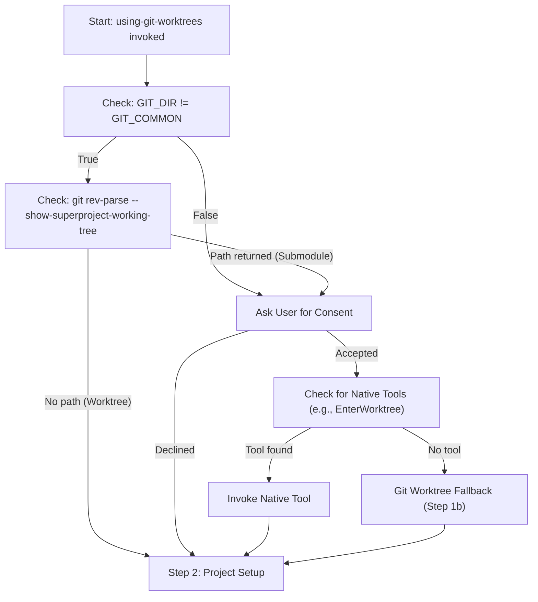
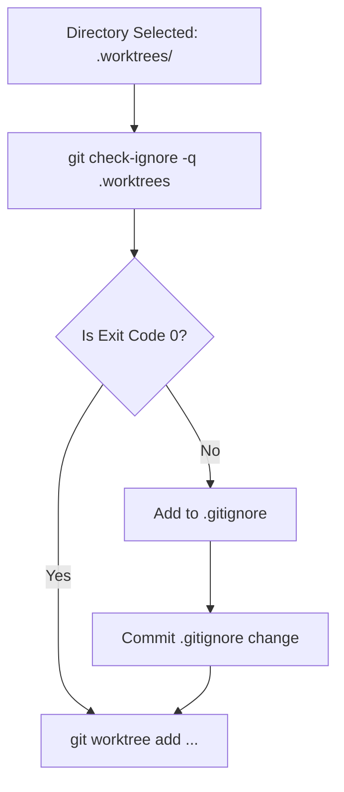
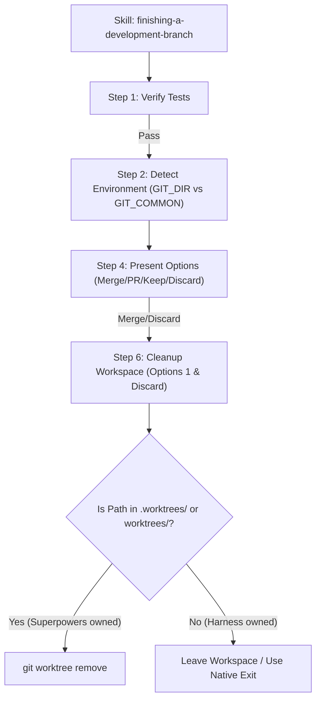

<!-- source: DeepWiki mcp.deepwiki.com · repo obra/superpowers · page 6.4 Using Git Worktrees · fetched 2026-10-26 -->

# Using Git Worktrees

Relevant source files

The following files were used as context for generating this wiki page:

- [docs/superpowers/plans/2026-04-06-worktree-rototill.md](docs/superpowers/plans/2026-04-06-worktree-rototill.md)
- [docs/superpowers/specs/2026-04-06-worktree-rototill-design.md](docs/superpowers/specs/2026-04-06-worktree-rototill-design.md)
- [skills/finishing-a-development-branch/SKILL.md](skills/finishing-a-development-branch/SKILL.md)
- [skills/using-git-worktrees/SKILL.md](skills/using-git-worktrees/SKILL.md)
- [tests/claude-code/test-worktree-path-policy.sh](tests/claude-code/test-worktree-path-policy.sh)

## Purpose and Scope

This document covers the `using-git-worktrees` skill, which ensures feature development occurs in an isolated workspace. The system enforces a "Detect-and-Defer" strategy: it prioritizes platform-native isolation tools (like Claude Code's `EnterWorktree`), detects existing worktree environments to avoid duplication, and implements a manual `git worktree` fallback with strict safety verification.

This skill is a mandatory prerequisite for implementation workflows like `subagent-driven-development` and `executing-plans` to prevent pollution of the main project workspace [docs/superpowers/specs/2026-04-06-worktree-rototill-design.md:1-7]().

**Sources:** [skills/using-git-worktrees/SKILL.md:1-15](), [docs/superpowers/specs/2026-04-06-worktree-rototill-design.md:1-7]()

---

## Workspace Isolation Strategy

The core principle of the skill is: **Detect existing isolation first, use native tools second, and fall back to git worktrees last.** It is designed to never "fight the harness" by creating nested worktrees where isolation already exists [skills/using-git-worktrees/SKILL.md:10-12]().

### Isolation Detection Flow

**Sources:** [skills/using-git-worktrees/SKILL.md:16-101]()

### Environment Detection Logic
Before creating any workspace, the skill verifies if it is already running in a linked worktree by comparing `GIT_DIR` and `GIT_COMMON` [skills/using-git-worktrees/SKILL.md:20-24]().

| Condition | Meaning | Action |
|-----------|---------|--------|
| `GIT_DIR != GIT_COMMON` (No submodule) | Already in a linked worktree | Skip creation; Proceed to setup [skills/using-git-worktrees/SKILL.md:33-34]() |
| `GIT_DIR == GIT_COMMON` | Normal repository checkout | Ask user for consent to create worktree [skills/using-git-worktrees/SKILL.md:39-43]() |
| `git rev-parse --show-superproject` | Inside a git submodule | Treat as normal repo; Ask for consent [skills/using-git-worktrees/SKILL.md:28-31]() |

**Sources:** [skills/using-git-worktrees/SKILL.md:16-46](), [docs/superpowers/specs/2026-04-06-worktree-rototill-design.md:57-83]()

---

## Directory Selection Algorithm (Git Fallback)

If no native tool is available and the user provides consent, the skill follows a strict priority order for directory selection. Explicit user preference always overrides observed filesystem state.

### Priority Order for Manual Worktrees

| Priority | Location | Logic |
|----------|----------|-------|
| 1 | Declared Preference | User's specific instructions in the prompt or project files [skills/using-git-worktrees/SKILL.md:67]() |
| 2 | `.worktrees/` | Preferred project-local hidden directory [skills/using-git-worktrees/SKILL.md:71]() |
| 3 | `worktrees/` | Alternative project-local directory [skills/using-git-worktrees/SKILL.md:72]() |
| 4 | Default | `.worktrees/` at project root [skills/using-git-worktrees/SKILL.md:76]() |

**Sources:** [skills/using-git-worktrees/SKILL.md:63-77](), [tests/claude-code/test-worktree-path-policy.sh:50-53]()

---

## Safety Verification System

For project-local directories (`.worktrees/` or `worktrees/`), the skill **must** verify the directory is gitignored before creation to prevent committing worktree state to the repository [skills/using-git-worktrees/SKILL.md:78-81]().

### Verification Implementation

**Sources:** [skills/using-git-worktrees/SKILL.md:78-89](), [docs/superpowers/specs/2026-04-06-worktree-rototill-design.md:165-166]()

---

## Project Setup and Baseline Testing

Once the workspace is active, the skill performs automated environment preparation and validation.

### Setup Auto-Detection
The skill inspects the filesystem to run appropriate package managers:
*   **Node.js:** `npm install` if `package.json` exists [skills/using-git-worktrees/SKILL.md:107-108]().
*   **Rust:** `cargo build` if `Cargo.toml` exists [skills/using-git-worktrees/SKILL.md:110-111]().
*   **Python:** `pip install -r requirements.txt` or `poetry install` [skills/using-git-worktrees/SKILL.md:113-115]().
*   **Go:** `go mod download` if `go.mod` exists [skills/using-git-worktrees/SKILL.md:117-118]().

**Sources:** [skills/using-git-worktrees/SKILL.md:102-119]()

### Baseline Validation
The skill runs the project's test suite (e.g., `npm test`, `cargo test`, `pytest`, `go test ./...`) to ensure the workspace starts in a clean state [skills/using-git-worktrees/SKILL.md:121-128]().

*   **If tests fail:** The agent reports the failures and asks the user whether to proceed or investigate [skills/using-git-worktrees/SKILL.md:130]().
*   **If tests pass:** The agent reports "Ready to implement" with the count of passing tests [skills/using-git-worktrees/SKILL.md:132-140]().

**Sources:** [skills/using-git-worktrees/SKILL.md:121-140](), [docs/superpowers/specs/2026-04-06-worktree-rototill-design.md:167]()

---

## Integration and Cleanup

### Workflow Context
The `using-git-worktrees` skill is typically paired with `finishing-a-development-branch` for the end-of-life cycle of the workspace.

| Skill | Role | Cleanup Behavior |
|-------|------|------------------|
| `using-git-worktrees` | Creation | Detects `GIT_DIR` and creates if needed |
| `finishing-a-development-branch` | Disposal | Only cleans up worktrees inside `.worktrees/` or `worktrees/` [skills/finishing-a-development-branch/SKILL.md:169-175]() |

**Provenance-based cleanup:** `finishing-a-development-branch` will **not** remove worktrees created by the harness or external tools (anything outside the specific Superpowers-managed paths) [skills/finishing-a-development-branch/SKILL.md:200-201]().

### Worktree Disposal Flow

**Sources:** [skills/finishing-a-development-branch/SKILL.md:14-175](), [docs/superpowers/specs/2026-04-06-worktree-rototill-design.md:47-50]()

### Error Handling: Sandbox Fallback
If `git worktree add` fails due to environment restrictions (e.g., a restricted container or sandbox permission error), the skill provides a **Sandbox Fallback**: it notifies the user of the denial and proceeds to work in the current directory instead of failing the task [skills/using-git-worktrees/SKILL.md:100]().

**Sources:** [skills/using-git-worktrees/SKILL.md:100]()

---

## Quick Reference Summary

| Situation | Action |
|-----------|--------|
| **Already in worktree** | Skip creation; use current path [skills/using-git-worktrees/SKILL.md:146](). |
| **Native tool available** | Use platform-specific tool (e.g. `EnterWorktree`, `WorktreeCreate`) [skills/using-git-worktrees/SKILL.md:148](). |
| **No native tool** | Use `git worktree add` into `.worktrees/` [skills/using-git-worktrees/SKILL.md:149](). |
| **Directory not ignored** | Add to `.gitignore` and commit first [skills/using-git-worktrees/SKILL.md:154](). |
| **Detached HEAD** | Proceed, but note that branch creation is needed at finish [skills/using-git-worktrees/SKILL.md:37](). |
| **Permission Error** | Fall back to working in the current directory [skills/using-git-worktrees/SKILL.md:155](). |

**Sources:** [skills/using-git-worktrees/SKILL.md:142-158]()

---

