<!-- source: DeepWiki mcp.deepwiki.com · repo obra/superpowers · page 6.6 Subagent-Driven Development · fetched 2026-10-26 -->

# Subagent-Driven Development

<details>
<summary>Relevant source files</summary>

The following files were used as context for generating this wiki page:

- [docs/superpowers/plans/2026-07-15-sdd-fix-loop-redesign.md](docs/superpowers/plans/2026-07-15-sdd-fix-loop-redesign.md)
- [docs/superpowers/specs/2026-06-09-sdd-task-scoped-review-dispatch-design.md](docs/superpowers/specs/2026-06-09-sdd-task-scoped-review-dispatch-design.md)
- [docs/superpowers/specs/2026-06-10-strict-cost-sdd-design.md](docs/superpowers/specs/2026-06-10-strict-cost-sdd-design.md)
- [skills/brainstorming/spec-document-reviewer-prompt.md](skills/brainstorming/spec-document-reviewer-prompt.md)
- [skills/subagent-driven-development/SKILL.md](skills/subagent-driven-development/SKILL.md)
- [skills/subagent-driven-development/implementer-prompt.md](skills/subagent-driven-development/implementer-prompt.md)
- [skills/subagent-driven-development/re-review-prompt.md](skills/subagent-driven-development/re-review-prompt.md)
- [skills/subagent-driven-development/task-reviewer-prompt.md](skills/subagent-driven-development/task-reviewer-prompt.md)

</details>


## Purpose and Scope

This page documents the subagent-driven development (SDD) workflow, which executes implementation plans by dispatching fresh subagents per task with mandatory two-stage review. The controller agent orchestrates implementer subagents and reviewer subagents, managing the task queue and ensuring quality gates pass before marking tasks complete.

The SDD workflow is the final execution phase of the Superpowers pipeline, following brainstorming and plan writing. It ensures high-quality output through isolated contexts, plan-scoped workspaces, and specialized model selection.

**Sources:** [skills/subagent-driven-development/SKILL.md:1-12](), [skills/subagent-driven-development/SKILL.md:40-60]()

## When to Use This Workflow

```mermaid
graph TD
    "Have implementation plan?"[Have implementation plan?] --> "Tasks mostly independent?"[Tasks mostly independent?]
    "Have implementation plan?" --> "Manual execution or brainstorm first"[Manual execution or brainstorm first]
    "Tasks mostly independent?" --> "Partner chose inline, or no subagent tool?"[Partner chose inline, or no subagent tool?]
    "Tasks mostly independent?" --> "Manual execution or brainstorm first"
    "Partner chose inline, or no subagent tool?" --> "executing-plans"[executing-plans]
    "Partner chose inline, or no subagent tool?" --> "subagent-driven-development"[subagent-driven-development]
```

**Decision criteria:**

| Criterion | Required for SDD |
|---|---|
| Implementation plan exists | Yes - from `writing-plans` skill |
| Tasks are independent | Yes - can be implemented in any order |
| Subagent support | Yes - harness must support `Task` tool (Claude Code, Codex) |
| Session continuity | Yes - work continues in current session |

SDD is the preferred execution method when subagents are available because it prevents context pollution and allows for specialized review loops. If subagents are not available, the system falls back to the `executing-plans` skill.

**Sources:** [skills/subagent-driven-development/SKILL.md:33-50]()

## Core Architecture

The SDD architecture separates the "Controller" (which maintains the global plan state) from "Subagents" (which perform isolated units of work).

```mermaid
graph TD
    Controller["Controller Agent<br/>(current session)"]
    
    subgraph "Per Task Cycle"
        Implementer["Implementer Subagent<br/>(fresh context)"]
        TaskReviewer["Task Reviewer Subagent<br/>(fresh context)"]
        ReReviewer["Re-Reviewer Subagent<br/>(fresh context)"]
    end
    
    Plan["docs/superpowers/plans/<br/>YYYY-MM-DD-feature.md"]
    Workspace["sdd-workspace<br/>(.superpowers/sdd/PLAN_NAME/)"]
    Ledger["Ledger<br/>(in Workspace)"]
    
    Controller -->|"Read once at start"| Plan
    Controller -->|"Extract tasks via task-brief"| Workspace
    Controller -->|"Dispatch with Task tool"| Implementer
    
    Implementer -->|"Write to REPORT_FILE"| Workspace
    Implementer -->|"Status: DONE/CONCERNS/BLOCKED"| Controller
    
    Controller -->|"Generate review-package"| Workspace
    Controller -->|"Dispatch with Task tool"| TaskReviewer
    TaskReviewer -->|"Spec + Quality verdicts"| Controller
    
    Controller -->|"Dispatch with Task tool"| ReReviewer
    ReReviewer -->|"Findings Addressed?"| Controller

    Controller --> Ledger: "Record Rulings, Status"
    Implementer --> Ledger: "Record Progress"
    TaskReviewer --> Ledger: "Record Verdicts"
    ReReviewer --> Ledger: "Record Re-Review Verdicts"
```

**Key architectural decisions:**

- **Plan-Scoped Workspace:** Workspaces are now specific to the plan being executed. `sdd-workspace` requires a plan file and resolves to `.superpowers/sdd/<plan-basename>/`. This prevents "ledger contamination" where a new plan reads the progress of a previous one [docs/superpowers/plans/2026-07-15-sdd-fix-loop-redesign.md:29-29]().
- **Rulings Over Stalls:** Controllers are instructed to settle conflicts and ambiguities with a recorded `Ruling` in the ledger rather than stopping for human input, unless the action is destructive or security-sensitive [skills/subagent-driven-development/SKILL.md:19-25]().
- **Integrated Task Review:** Spec compliance and code quality reviews are merged into a single `task-reviewer-prompt.md` dispatch [docs/superpowers/specs/2026-06-09-sdd-task-scoped-review-dispatch-design.md:54-59]().
- **Fix Loop:** The process includes a fix loop with re-review and a circuit breaker for persistent issues [skills/subagent-driven-development/SKILL.md:75-82]().

**Sources:** [skills/subagent-driven-development/SKILL.md:19-25](), [skills/subagent-driven-development/SKILL.md:75-82](), [docs/superpowers/specs/2026-06-09-sdd-task-scoped-review-dispatch-design.md:54-59](), [docs/superpowers/plans/2026-07-15-sdd-fix-loop-redesign.md:29-29]()

## The Complete Process

```mermaid
graph TD
    Setup["Setup: worktree, ledger check, read plan, pre-flight review"]
    MoreTasks{"More tasks remain?"}
    DispatchImplementer["Dispatch implementer subagent (./implementer-prompt.md)"]
    ImplementerAsksQuestions{"Implementer asks questions?"}
    AnswerQuestions["Answer questions, provide context"]
    ImplementerImplements["Implementer implements, tests, commits, self-reviews"]
    GenerateReviewPackage["Generate review package, dispatch task reviewer (./task-reviewer-prompt.md)"]
    SpecAndQualityApproved{"Spec ✅ and quality approved?"}
    FindingConflicts{"Finding conflicts with plan text?"}
    RuleOnConflict["Rule on the conflict, ledger the ruling"]
    FixRound["Fix round R of 5: R≤3 resume implementer; R≥4 fresh implementer, more capable model"]
    DispatchReReview["Dispatch scoped re-review (./re-review-prompt.md)"]
    AllFindingsAddressed{"All findings addressed?"}
    RIs5{"R = 5?"}
    AdjudicateOpenFinding["Adjudicate each open finding"]
    AnyLoadBearingFinding{"Any load-bearing finding?"}
    RuleAndContinue["Rule and continue; stop only if every path forward is a guess"]
    ParkFindings["Park findings in ledger with rulings"]
    AppendCompletion["Append completion to ledger, mark todo complete"]
    DispatchFinalReview["Dispatch final code reviewer (../requesting-code-review/code-reviewer.md)"]
    FinalFindings{"Final findings? ONE fix dispatch, one scoped re-review, adjudicate residuals"}
    FinalReviewClean["Final review clean: delete this plan's workspace"]
    FinishingBranch["Use superpowers:finishing-a-development-branch"]

    Setup --> MoreTasks
    MoreTasks -- "yes" --> DispatchImplementer
    MoreTasks -- "no" --> DispatchFinalReview

    DispatchImplementer --> ImplementerAsksQuestions
    ImplementerAsksQuestions -- "yes" --> AnswerQuestions
    AnswerQuestions --> ImplementerImplements
    ImplementerAsksQuestions -- "no" --> ImplementerImplements

    ImplementerImplements --> GenerateReviewPackage
    GenerateReviewPackage --> SpecAndQualityApproved

    SpecAndQualityApproved -- "yes" --> AppendCompletion
    SpecAndQualityApproved -- "no" --> FindingConflicts

    FindingConflicts -- "yes" --> RuleOnConflict
    RuleOnConflict --> FixRound
    FindingConflicts -- "no" --> FixRound

    FixRound --> DispatchReReview
    DispatchReReview --> AllFindingsAddressed

    AllFindingsAddressed -- "yes" --> AppendCompletion
    AllFindingsAddressed -- "no" --> RIs5

    RIs5 -- "no - next round" --> FixRound
    RIs5 -- "yes - breaker trips" --> AdjudicateOpenFinding

    AdjudicateOpenFinding --> AnyLoadBearingFinding
    AnyLoadBearingFinding -- "yes" --> RuleAndContinue
    RuleAndContinue --> ParkFindings
    AnyLoadBearingFinding -- "no" --> ParkFindings
    ParkFindings --> AppendCompletion

    AppendCompletion --> MoreTasks

    DispatchFinalReview --> FinalFindings
    FinalFindings --> FinalReviewClean
    FinalReviewClean --> FinishingBranch
```



**Critical Process Features:**

1.  **Pre-Flight Conflict Scan:** The controller scans the plan for conflicts and records these checks in the ledger [skills/subagent-driven-development/SKILL.md:87]().
2.  **Fix Loop Redesign:** The lifecycle uses "resume-the-implementer" semantics for the first three fix rounds. If the loop trips a five-round circuit breaker, the controller must adjudicate the open findings [skills/subagent-driven-development/SKILL.md:75-82]().
3.  **Spec as Binding Authority:** Plans carry a `Spec:` pointer. SDD reads the design spec at setup so conflicts are resolved against the original design rather than guessed [skills/subagent-driven-development/SKILL.md:20-21]().
4.  **Workspace Cleanup:** Once the final review is clean, the plan-specific workspace is deleted; git history serves as the durable record [skills/subagent-driven-development/SKILL.md:90]().

**Sources:** [skills/subagent-driven-development/SKILL.md:63-111]()

## Model Selection Strategy

SDD utilizes different model tiers to balance cost and reasoning capability.

| Task Type | Model Tier | Complexity Signals |
|---|---|---|
| **Mechanical** | Cheap / Fast | Isolated functions, clear specs, 1-2 files. Plan contains complete code [skills/subagent-driven-development/SKILL.md:103](). |
| **Standard** | Mid-tier | Multi-file coordination, pattern matching, debugging [skills/subagent-driven-development/SKILL.md:105](). |
| **Judgment** | Most Capable | Design judgment, broad final review, complex concurrency, or fix rounds R >= 4 [skills/subagent-driven-development/SKILL.md:107-109](). |

**Key Principle:** "Turn count beats token price." Cheaper models taking 2-3x more turns on multi-step work can cost more than mid-tier models [docs/superpowers/specs/2026-06-09-sdd-task-scoped-review-dispatch-design.md:47-49]().

**Sources:** [skills/subagent-driven-development/SKILL.md:99-125](), [docs/superpowers/specs/2026-06-09-sdd-task-scoped-review-dispatch-design.md:47-49]()

## Implementation Artifacts

| Script | Purpose | Output Path |
|---|---|---|
| `sdd-workspace` | Resolves a per-plan working-tree directory. | `.superpowers/sdd/<plan-basename>/` |
| `task-brief` | Extracts Task N text into a file for subagent reading. | `.../task-N-brief.md` |
| `review-package` | Generates a combined diff/stat/log file for reviewers. | `.../review-BASE..HEAD.diff` |

For details, see [SDD Helper Scripts](#6.6.1).

**Sources:** [docs/superpowers/plans/2026-07-15-sdd-fix-loop-redesign.md:25-25]()

## Task Reviewer Protocol

The task reviewer (`task-reviewer-prompt.md`) provides a unified gate for each task.

### Verdicts and Calibration
- **Critical/Important:** Findings that mandate a fix loop (incorrect behavior, maintainability damage like swallowed errors) [skills/subagent-driven-development/task-reviewer-prompt.md:148-151]().
- **Minor:** Polish or style suggestions that do not block completion [skills/subagent-driven-development/task-reviewer-prompt.md:152]().

### Evidence Handling
Reviewers must re-read evidence they find illegible instead of re-running the test suite [skills/subagent-driven-development/task-reviewer-prompt.md:85-93](). They are prohibited from spawning their own subagents for second opinions [skills/subagent-driven-development/task-reviewer-prompt.md:55-62]().

For details on the prompt templates, see [SDD Subagent Prompt Templates](#6.6.2).

**Sources:** [skills/subagent-driven-development/task-reviewer-prompt.md:55-62](), [skills/subagent-driven-development/task-reviewer-prompt.md:85-93](), [skills/subagent-driven-development/task-reviewer-prompt.md:148-152]()

## Status Protocol Handling

Implementer subagents report one of four statuses:

| Status | Meaning | Controller Action |
|---|---|---|
| **DONE** | Task complete | Proceed to task review [skills/subagent-driven-development/implementer-prompt.md:141](). |
| **DONE_WITH_CONCERNS** | Work complete but implementer has doubts | Address concerns; proceed to review [skills/subagent-driven-development/implementer-prompt.md:152](). |
| **NEEDS_CONTEXT** | Missing information | Provide context and re-dispatch [skills/subagent-driven-development/implementer-prompt.md:153](). |
| **BLOCKED** | Cannot complete task | Upgrade model, break down task, or escalate [skills/subagent-driven-development/implementer-prompt.md:80-89](). |

For details on the prompt templates, see [SDD Subagent Prompt Templates](#6.6.2).

**Sources:** [skills/subagent-driven-development/implementer-prompt.md:80-89](), [skills/subagent-driven-development/implementer-prompt.md:141-154]()

---

