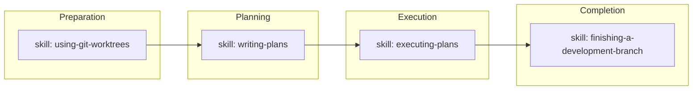

<!-- source: DeepWiki mcp.deepwiki.com · repo obra/superpowers · page 6.7 Native Execution with executing-plans · fetched 2026-10-26 -->

# Native Execution with executing-plans

<details>
<summary>Relevant source files</summary>

The following files were used as context for generating this wiki page:

- [docs/superpowers/specs/2026-06-09-sdd-task-scoped-review-dispatch-design.md](docs/superpowers/specs/2026-06-09-sdd-task-scoped-review-dispatch-design.md)
- [skills/brainstorming/spec-document-reviewer-prompt.md](skills/brainstorming/spec-document-reviewer-prompt.md)
- [skills/executing-plans/SKILL.md](skills/executing-plans/SKILL.md)
- [skills/subagent-driven-development/SKILL.md](skills/subagent-driven-development/SKILL.md)
- [skills/subagent-driven-development/implementer-prompt.md](skills/subagent-driven-development/implementer-prompt.md)
- [skills/subagent-driven-development/re-review-prompt.md](skills/subagent-driven-development/re-review-prompt.md)
- [skills/subagent-driven-development/task-reviewer-prompt.md](skills/subagent-driven-development/task-reviewer-prompt.md)
- [skills/using-superpowers/references/gemini-tools.md](skills/using-superpowers/references/gemini-tools.md)
- [skills/writing-skills/SKILL.md](skills/writing-skills/SKILL.md)
- [skills/writing-skills/anthropic-best-practices.md](skills/writing-skills/anthropic-best-practices.md)

</details>


## Purpose and Scope

This document describes the `executing-plans` skill, which enables sequential inline task execution of an implementation plan. This skill is used when a human partner chooses inline execution or when subagent tools are unavailable. It details the process of executing tasks, managing task-start/task-done scripts, maintaining a ledger, and performing a whole-branch final review.

For executing plans with automated subagent review, see [Subagent-Driven Development (6.6)](). For creating the implementation plan that this skill executes, see [Writing Implementation Plans (6.5)](). For completing the work after all tasks are done, see [Finishing Development Branches (6.9)]().

Sources: [skills/executing-plans/SKILL.md:1-4]()

---

## Overview

The `executing-plans` skill facilitates direct, task-by-task execution of an implementation plan within the current session. Unlike `subagent-driven-development`, it does not dispatch fresh subagents or reviewers for each task. Instead, the primary agent (you) performs all implementation steps and a single, fresh-context review of the entire branch at the end.

**Key characteristics:**
- **Inline Execution:** All tasks are performed by the current agent in the current session, minimizing context switching overhead [skills/executing-plans/SKILL.md:7-8]().
- **Cost Efficiency:** Reduces the cost associated with dispatching multiple subagents and reviewers, as it uses one context for implementation and one for the final review [skills/executing-plans/SKILL.md:12-14]().
- **Continuous Execution:** The agent proceeds through all tasks without pausing for human check-ins, unless a critical stop condition is met [skills/executing-plans/SKILL.md:27-30]().
- **Rulings and Ledger:** Conflicts, ambiguities, or plan defects are resolved by the agent, with each decision recorded in a ledger to maintain an auditable record [skills/executing-plans/SKILL.md:32-37]().
- **Final Review:** A single, comprehensive review of the entire branch is performed at the end, often by a more capable model if available [skills/executing-plans/SKILL.md:59-60]().

Sources: [skills/executing-plans/SKILL.md:1-43]()

---

## When to Use This Skill

### Choosing Between Execution Modes

The following diagram bridges the **Natural Language Decision Space** to the **Code Skill Space**.

**Execution Strategy Selection**
```mermaid
graph TD
    "Have_implementation_plan"["Have implementation plan?"]:::skill_decision
    "Tasks_mostly_independent"["Tasks mostly independent?"]:::skill_decision
    "Partner_chose_inline_or_no_subagent_tool"["Partner chose inline, or no subagent tool?"]:::skill_decision
    "subagent-driven-development"["skill: subagent-driven-development"]:::skill_action
    "executing-plans"["skill: executing-plans"]:::skill_action
    "Manual_execution_or_brainstorm_first"["Manual execution or brainstorm first"]:::skill_action
    
    "Have_implementation_plan" -- "yes" --> "Tasks_mostly_independent"
    "Have_implementation_plan" -- "no" --> "Manual_execution_or_brainstorm_first"
    "Tasks_mostly_independent" -- "yes" --> "Partner_chose_inline_or_no_subagent_tool"
    "Tasks_mostly_independent" -- "no - tightly coupled" --> "Manual_execution_or_brainstorm_first"
    "Partner_chose_inline_or_no_subagent_tool" -- "yes" --> "executing-plans"
    "Partner_chose_inline_or_no_subagent_tool" -- "no" --> "subagent-driven-development"

    classDef skill_decision fill:#add8e6,stroke:#333,stroke-width:2px;
    classDef skill_action fill:#90ee90,stroke:#333,stroke-width:2px;
```

**Use `executing-plans` when:**
- You have a plan from `superpowers:writing-plans` and your human partner explicitly chose inline execution [skills/executing-plans/SKILL.md:47-48]().
- Your current harness (e.g., Gemini CLI without `invoke_agent` tool) does not support subagent dispatch [skills/executing-plans/SKILL.md:49-51]().
- Tasks within the plan are mostly independent, similar to the precondition for `superpowers:subagent-driven-development` [skills/executing-plans/SKILL.md:52-53]().
- The plan is well-specified, allowing for transcription-plus-testing execution on a mid-tier model, with the most capable model reserved for the final review [skills/executing-plans/SKILL.md:55-57]().

**Prefer `superpowers:subagent-driven-development` when:**
- Your human partner desires a review gate after every task [skills/executing-plans/SKILL.md:61-62]().
- The plan is long, and later tasks might suffer from context compaction in an inline execution, as `sdd` provides fresh contexts per task [skills/executing-plans/SKILL.md:62-64]().

Sources: [skills/executing-plans/SKILL.md:46-64](), [skills/subagent-driven-development/SKILL.md:35-50](), [skills/using-superpowers/references/gemini-tools.md:18-20]()

---

## The Execution Process

### Process Flow

The `executing-plans` skill follows a structured process for task execution, emphasizing TDD, continuous progress, and a final whole-branch review.

```mermaid
graph TD
    A[Setup: worktree, workspace + ledger, read plan + spec, pre-flight scan] --> B{More tasks remain?};
    B -- Yes --> C[task-start: brief + BASE; read the brief];
    C --> D[Work the steps in order: TDD, run every verification, read every output];
    D --> E{Step output matches plan's Expected?};
    E -- No --> F[Plan wrong? Rule and ledger. Code wrong? systematic-debugging];
    F --> D;
    E -- Yes, last step --> G[Commit as the plan's commit steps say];
    G --> H{Completion contract met?};
    H -- No - finish the task --> D;
    H -- Yes --> I[task-done: run tests, ledger the result; mark todo complete];
    I --> B;
    B -- No --> J[Final whole-branch review (fresh reviewer if you have one)];
    J --> K[Re-grade, then: Critical/Important -> ONE fix pass, each fix RED->GREEN + green suite; Minor -> ledger];
    K --> L[Final review clean: delete this plan's workspace];
    L --> M[Use superpowers:finishing-a-development-branch];

    classDef box_node fill:#add8e6,stroke:#333,stroke-width:2px;
    classDef diamond_node fill:#ffcccb,stroke:#333,stroke-width:2px;
    classDef final_node fill:#90ee90,stroke:#333,stroke-width:2px;

    A, C, D, F, G, I, J, K, L, M call box_node;
    B, E, H call diamond_node;
    M call final_node;
```

Sources: [skills/executing-plans/SKILL.md:67-105]()

### Setup

Before starting task execution, the agent performs critical setup steps to ensure an isolated and traceable environment.

1.  **Worktree Isolation:** Ensure the work is done in an isolated workspace using `superpowers:using-git-worktrees`. This prevents accidental modifications to main branches [skills/executing-plans/SKILL.md:110-112]().
2.  **Workspace Initialization:** Each plan gets its own git-ignored workspace directory (`<repo-root>/.superpowers/sdd/<plan-basename>/`). This is initialized by running `../subagent-driven-development/scripts/sdd-workspace PLAN_FILE` [skills/executing-plans/SKILL.md:125-128]().
3.  **Ledger Management:** Progress is tracked in a ledger file within the workspace, not just in harness todos. The ledger serves as a persistent record, crucial for recoverability if context is lost [skills/executing-plans/SKILL.md:115-118](). The ledger format is shared with `superpowers:subagent-driven-development`, allowing seamless transitions between execution modes [skills/executing-plans/SKILL.md:121-123]().
4.  **Plan and Spec Review:** The agent reads the plan and associated specification, performing a pre-flight scan to identify any immediate issues [skills/executing-plans/SKILL.md:83]().

Sources: [skills/executing-plans/SKILL.md:108-128]()

### Per-Task Execution

Each task in the plan is executed sequentially, following a strict TDD-like cycle and recording progress.

1.  **`task-start` Script:** Before beginning a task, the agent executes a `task-start` script. This script typically sets up the task's context, reads the task brief, and records the `BASE_SHA` for the task [skills/executing-plans/SKILL.md:130-132]().
2.  **Work Steps:** The agent works through the steps outlined in the plan, applying Test-Driven Development (TDD) principles. This involves writing tests, watching them fail (RED), implementing the code, and watching tests pass (GREEN) [skills/executing-plans/SKILL.md:133-134]().
3.  **Verification:** Every verification step specified in the plan must be run, and its output carefully read to ensure it matches the plan's `Expected` outcome [skills/executing-plans/SKILL.md:134-135]().
4.  **Commit:** Code changes are committed as specified by the plan's commit steps [skills/executing-plans/SKILL.md:137]().
5.  **`task-done` Script:** Upon completing a task, a `task-done` script is executed. This script typically runs final tests for the task, records the results in the ledger, and marks the task as complete in the todo list [skills/executing-plans/SKILL.md:139-140]().

Sources: [skills/executing-plans/SKILL.md:129-140]()

### Rulings and Continuous Execution

The agent is expected to maintain continuous execution, making rulings on ambiguities or conflicts rather than stalling.

-   **Rulings, Not Stalls:** If conflicts, ambiguities, or plan defects arise, the agent must make a decision and record it in the ledger. The format for a ruling is `Ruling: <what you decided> — <why> — <what it costs if wrong>` [skills/executing-plans/SKILL.md:32-37]().
-   **Continuous Execution:** The agent should not pause to check in with the human partner between tasks. The expectation is to execute all tasks without stopping, unless one of the four critical stop conditions is met [skills/executing-plans/SKILL.md:27-30]().

Sources: [skills/executing-plans/SKILL.md:27-37]()

### Whole-Branch Final Review

After all tasks are completed, a final review of the entire development branch is conducted.

1.  **Dispatch Final Reviewer:** A final code reviewer is dispatched. This reviewer should ideally be a fresh context, potentially using a more capable model, to provide an unbiased assessment of the entire branch [skills/executing-plans/SKILL.md:85]().
2.  **Review and Re-grade:** The reviewer assesses the entire branch for quality and spec compliance. Findings are categorized (Critical/Important/Minor) [skills/executing-plans/SKILL.md:86]().
3.  **Fix Pass:** For Critical/Important findings, a single fix pass is allowed. Each fix must follow a RED→GREEN TDD cycle and ensure the entire test suite remains green [skills/executing-plans/SKILL.md:86](). Minor findings are simply logged in the ledger [skills/executing-plans/SKILL.md:86]().
4.  **Cleanup:** Once the final review is clean, the plan's workspace is deleted [skills/executing-plans/SKILL.md:87]().
5.  **Handoff to Finishing:** The process concludes by invoking `superpowers:finishing-a-development-branch` [skills/executing-plans/SKILL.md:88]().

Sources: [skills/executing-plans/SKILL.md:85-88]()

---

## When to Stop and Ask for Help

The `executing-plans` skill defines strict conditions under which the agent *must* stop and ask for human intervention. These are designed to prevent irreversible errors or wasted effort.

| Trigger | Description | Action |
|:---|:---|:---|
| **Irreversible/Destructive Operation** | Any action that cannot be undone or would cause data loss [skills/executing-plans/SKILL.md:41-42](). | STOP and ask. |
| **Security-Sensitive Action** | Operations with security implications [skills/executing-plans/SKILL.md:42](). | STOP and ask. |
| **Side Effect Outside Worktree** | Actions like merging, pushing to a shared branch, or publishing that affect areas outside the current isolated worktree [skills/executing-plans/SKILL.md:42-44](). | STOP and ask. |
| **Plan So Broken** | A plan where every path forward is a guess due to severe defects or ambiguities [skills/executing-plans/SKILL.md:44-45](). | STOP and ask. |

Sources: [skills/executing-plans/SKILL.md:40-45]()

---

## Integration with Workflow Skills

The `executing-plans` skill is part of a broader structured development workflow.

**Required Skill Chain**


| Skill | Role in `executing-plans` Workflow |
|:---|:---|
| `superpowers:using-git-worktrees` | **REQUIRED:** Used to set up an isolated workspace before starting implementation, ensuring a clean and safe environment [skills/executing-plans/SKILL.md:110-112](). |
| `superpowers:writing-plans` | This skill produces the implementation plan that `executing-plans` consumes and executes task by task [skills/executing-plans/SKILL.md:47](). |
| `superpowers:finishing-a-development-branch` | **REQUIRED:** After all tasks are completed and the final review is clean, `executing-plans` hands off to this skill to finalize the development branch, including test verification and integration options [skills/executing-plans/SKILL.md:88](). |

Sources: [skills/executing-plans/SKILL.md:47](), [skills/executing-plans/SKILL.md:88](), [skills/executing-plans/SKILL.md:110-112]()

---

