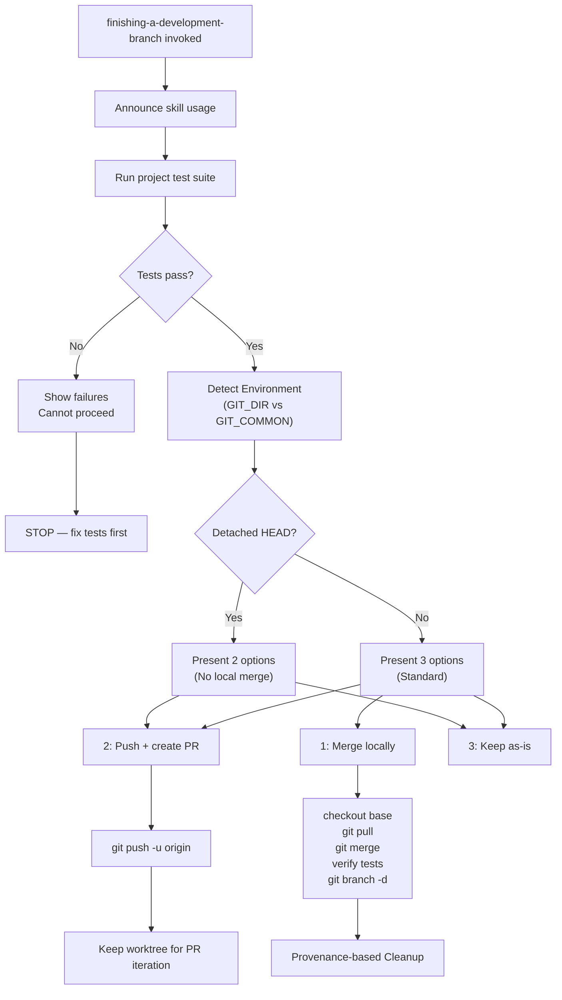
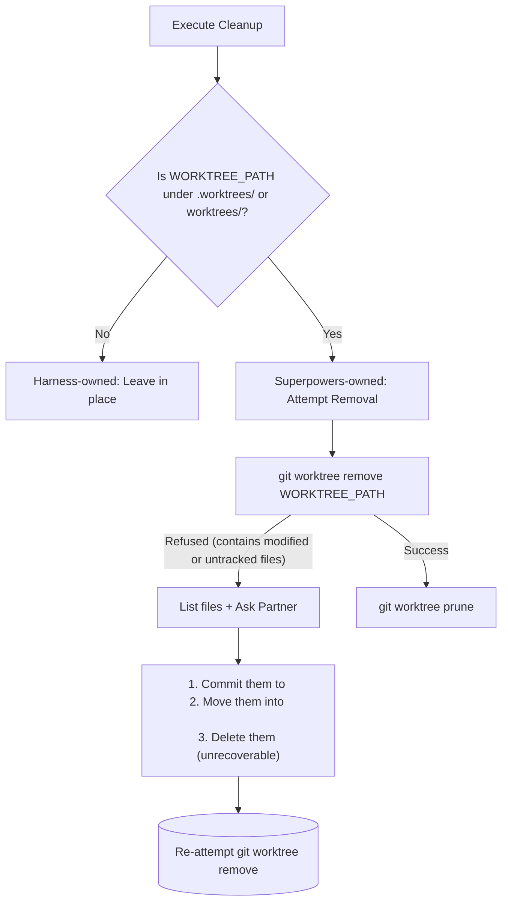

<!-- source: DeepWiki mcp.deepwiki.com · repo obra/superpowers · page 6.9 Finishing Development Branches · fetched 2026-10-26 -->

# Finishing Development Branches

<details>
<summary>Relevant source files</summary>

The following files were used as context for generating this wiki page:

- [skills/finishing-a-development-branch/SKILL.md](skills/finishing-a-development-branch/SKILL.md)
- [skills/using-git-worktrees/SKILL.md](skills/using-git-worktrees/SKILL.md)

</details>


This page documents the `finishing-a-development-branch` skill: how it gates completion on test verification, environment detection for isolated workspaces, integration options, and provenance-based worktree cleanup. For the earlier phase of setting up an isolated workspace, see [Using Git Worktrees (6.4)]().

---

## Purpose and Position in the Workflow

The `finishing-a-development-branch` skill is the final step in the development pipeline. It runs after all implementation tasks are complete and handles the transition from a feature branch back into the main codebase, a Pull Request, or deliberate abandonment of the work.

**Skill file:** [skills/finishing-a-development-branch/SKILL.md:1-225]()

**Core principle:** Verify tests → Detect environment → Present options → Execute choice → Clean up [skills/finishing-a-development-branch/SKILL.md:10-10]().

Sources: [skills/finishing-a-development-branch/SKILL.md:1-13]()

---

## Process Flow

The workflow transitions from verification to environment-aware decision making.

**Diagram: finishing-a-development-branch Execution Flow**



Sources: [skills/finishing-a-development-branch/SKILL.md:14-158]()

---

## Step 1: Test Verification Gate

Before any option is presented, the skill runs the project's test suite. This is a hard gate — failing tests block all merge and PR operations [skills/finishing-a-development-branch/SKILL.md:14-24]().

```bash
# Run project's test suite
npm test / cargo test / pytest / go test ./...
```

If tests fail, the agent must report the failures and stop. It cannot proceed with the integration menu until the suite is green [skills/finishing-a-development-branch/SKILL.md:18-24]().

Sources: [skills/finishing-a-development-branch/SKILL.md:14-26]()

---

## Step 2: Environment Detection

The skill determines the workspace state to customize the menu and cleanup logic. It captures `WORKTREE_PATH` while still inside the workspace to ensure accurate cleanup later [skills/finishing-a-development-branch/SKILL.md:28-36]().

| State | Menu | Cleanup Logic |
|-------|------|---------------|
| `GIT_DIR == GIT_COMMON` (Normal repo) | Standard 3 options | No worktree to clean up |
| `GIT_DIR != GIT_COMMON`, Named branch | Standard 3 options | Provenance-based cleanup |
| `GIT_DIR != GIT_COMMON`, Detached HEAD | Reduced 2 options | Externally managed — leave in place |

Sources: [skills/finishing-a-development-branch/SKILL.md:28-45]()

---

## Step 3: Determine Base Branch

The base branch is the branch from which the current work forked. The skill attempts to determine this from the plan, conversation, or upstream. If uncertain, it will ask for confirmation to prevent incorrect merges [skills/finishing-a-development-branch/SKILL.md:47-52]().

Sources: [skills/finishing-a-development-branch/SKILL.md:47-52]()

---

## Step 4: Present Options

Based on Step 2, the agent presents structured choices. Note that "Discard" is no longer a standard menu option and is only triggered by explicit human request.

### Standard Menu (Normal Repo or Named Branch)
```
Implementation complete. What would you like to do?

1. Merge back to <base-branch> locally
2. Push and create a Pull Request
3. Keep the branch as-is (I'll handle it later)

Which option?
```
[skills/finishing-a-development-branch/SKILL.md:55-65]()

### Detached HEAD Menu
```
Implementation complete. You're on a detached HEAD (externally managed workspace).

1. Push as new branch and create a Pull Request
2. Keep as-is (I'll handle it later)

Which option?
```
[skills/finishing-a-development-branch/SKILL.md:68-76]()

Sources: [skills/finishing-a-development-branch/SKILL.md:53-82]()

---

## Step 5: Execute Choice

### Option 1: Merge Locally
The agent switches to the main repository root, checks out the base branch, pulls the latest changes, and merges the feature branch [skills/finishing-a-development-branch/SKILL.md:89-96](). It must **verify tests on the merged result** before removing the worktree and deleting the local branch [skills/finishing-a-development-branch/SKILL.md:98-111]().

```bash
# Get main repo root for CWD safety
MAIN_ROOT=$(git -C "$(git rev-parse --git-common-dir)/.." rev-parse --show-toplevel)
cd "$MAIN_ROOT"

# Merge first — verify success before removing anything
git checkout <base-branch>
git pull
git merge <feature-branch>

# Verify tests on merged result
<test command>
```
[skills/finishing-a-development-branch/SKILL.md:88-100]()

### Option 2: Push and Create PR
The branch is pushed to `origin`. For detached HEADs, it names the new branch on the remote [skills/finishing-a-development-branch/SKILL.md:115-119](). The agent then guides the user to create a pull/merge request and reports the URL [skills/finishing-a-development-branch/SKILL.md:121-125](). **Worktrees are preserved for Option 2**, as the user needs the workspace to iterate on PR feedback [skills/finishing-a-development-branch/SKILL.md:126-126]().

```bash
git push -u origin <feature-branch>
# From a detached HEAD, name the new branch on the remote:
# git push origin HEAD:refs/heads/<new-branch>
```
[skills/finishing-a-development-branch/SKILL.md:115-119]()

### Option 3: Keep As-Is
The agent reports that the branch and worktree are preserved [skills/finishing-a-development-branch/SKILL.md:130-130]().

### Explicit Discard Request
If the partner asks to discard work, the agent must list the branch and commits and wait for the partner to type `discard` to confirm [skills/finishing-a-development-branch/SKILL.md:132-145](). After confirmation, it changes to the main repo root, cleans up the worktree (Step 6), and force-deletes the branch [skills/finishing-a-development-branch/SKILL.md:148-157]().

```bash
This will permanently delete:
- Branch <name>
- All commits: <commit-list>
- Worktree at <path>

Type 'discard' to confirm.
```
[skills/finishing-a-development-branch/SKILL.md:138-144]()

Sources: [skills/finishing-a-development-branch/SKILL.md:84-158]()

---

## Step 6: Provenance-Based Cleanup

Cleanup only runs for **Option 1 and confirmed discards**. Options 2 and 3 always preserve the worktree [skills/finishing-a-development-branch/SKILL.md:159-160](). The agent must `cd` to the main repository root before removal, and use the `GIT_DIR`/`GIT_COMMON`/`WORKTREE_PATH` values captured in Step 2 [skills/finishing-a-development-branch/SKILL.md:161-165]().

**Diagram: Safe Worktree Removal Logic**



**Critical Safety Rules:**
- **No Force:** If `git worktree remove` refuses because of untracked files, the agent must list them and ask for instructions [skills/finishing-a-development-branch/SKILL.md:177-182](). It must never use `--force` on its own initiative [skills/finishing-a-development-branch/SKILL.md:178-178]().
- **CWD Safety:** The agent must `cd` to the main repository root before removal [skills/finishing-a-development-branch/SKILL.md:161-165]().
- **Ownership:** Only worktrees located in `.worktrees/` or `worktrees/` are removed, as these are assumed to be Superpowers-created [skills/finishing-a-development-branch/SKILL.md:169-175](). Otherwise, the host environment owns the workspace, and it is left in place [skills/finishing-a-development-branch/SKILL.md:200-201]().

Sources: [skills/finishing-a-development-branch/SKILL.md:159-201]()

---

## Quick Reference Table

This table summarizes the outcomes for each option:

| Option | Merge | Push | Keep Worktree | Cleanup Branch |
|--------|-------|------|---------------|----------------|
| 1. Merge locally | yes | - | - | yes |
| 2. Create PR | - | yes | yes | - |
| 3. Keep as-is | - | - | yes | - |
| Discard (explicit request only) | - | - | - | yes (force) |

Sources: [skills/finishing-a-development-branch/SKILL.md:204-210]()

---

## Common Mistakes and Red Flags

| Excuse | Reality |
|:---|:---|
| "Tests passed earlier this session" | Run the suite on the tree you are about to integrate. A green run only proves the tree it ran on. [skills/finishing-a-development-branch/SKILL.md:215-216]() |
| "`git worktree remove --force` is quicker" | Never `--force` on your own initiative. The worktree holds files that exist nowhere else — uncommitted plans, notes, or scratch work. Show your human partner what is at stake and ask. [skills/finishing-a-development-branch/SKILL.md:177-182]() |

**Never:**
- Merge without verifying tests on the merged result [skills/finishing-a-development-branch/SKILL.md:98-100]().
- Delete work without the typed `discard` confirmation ritual [skills/finishing-a-development-branch/SKILL.md:132-145]().
- Run `git worktree remove` from inside the directory being removed [skills/finishing-a-development-branch/SKILL.md:161-165]().

Sources: [skills/finishing-a-development-branch/SKILL.md:212-224]()

---

