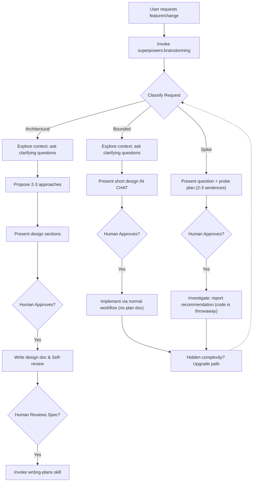
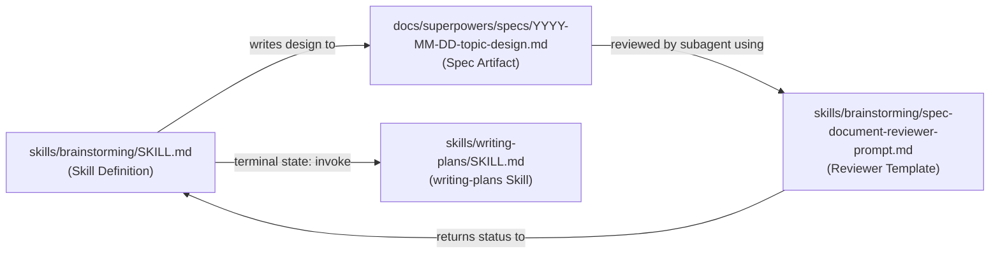

<!-- source: DeepWiki mcp.deepwiki.com · repo obra/superpowers · page 7.2 brainstorming · fetched 2026-10-26 -->

# brainstorming

Relevant source files

The following files were used as context for generating this wiki page:

- [skills/brainstorming/SKILL.md](skills/brainstorming/SKILL.md)
- [skills/writing-plans/SKILL.md](skills/writing-plans/SKILL.md)

This page is the full reference for the `brainstorming` skill ([skills/brainstorming/SKILL.md]()), which governs how agents explore and design work before writing any code. It covers invocation rules, the three-path classification system, the sequential checklist, key principles, anti-patterns, and spec review protocols.

For the broader workflow context in which brainstorming sits — including how it connects to `writing-plans`, `subagent-driven-development`, and branch finishing — see [§6.1](). For the meta-skill rule that mandates checking for applicable skills before any action (including before brainstorming), see [§7.1]().

---

## What the Skill Does

The `brainstorming` skill converts a raw idea into a documented design through structured collaborative dialogue. It enforces a **HARD-GATE** that prohibits any implementation action until the user has explicitly approved a design. As of v6.3.0, the ceremony scales to the task through a classification system, but the approval requirement remains absolute [skills/brainstorming/SKILL.md:38-56]().

The skill lives at [skills/brainstorming/SKILL.md:1-4]() and is accessible via the `superpowers:brainstorming` namespace.

---

## Invocation

| Platform | How to invoke |
|---|---|
| Claude Code | `Skill` tool with `superpowers:brainstorming` |
| Cursor | `superpowers:brainstorming` via skill tool |
| OpenCode | `@superpowers:brainstorming` mention |
| Codex | Automatic on name/description match, or explicit request |
| Gemini CLI | `activate_skill` tool with `brainstorming` |

Sources: [skills/brainstorming/SKILL.md:1-4]()

---

## The HARD-GATE

The most important enforcement mechanism in this skill is the `<HARD-GATE>` block:

> Before taking any implementation action, including invoking an
> implementation skill, writing product code, scaffolding, installing
> product dependencies, or creating an external project, complete the
> selected path's prerequisites:
>
> - Spike: the human partner approves the question and probe.
> - Bounded: the human partner approves the short in-chat design.
> - Architectural: the human partner reviews and approves the written spec,
>   then reviews the written implementation plan and selects its execution
>   method. Conversational design approval only permits writing the spec;
>   written-spec approval only permits invoking writing-plans.
>
> A reply approves the stage actually presented. Approval of an idea or
> feature scope does not approve artifacts that do not exist yet. Resume
> at the earliest incomplete stage; do not turn one approval into permission
> to skip the rest of the selected path. Read-only project exploration is
> allowed while those prerequisites remain incomplete.
[skills/brainstorming/SKILL.md:38-56]()

Sources: [skills/brainstorming/SKILL.md:38-56]()

---

## Three Paths of Classification

Before starting, the agent must classify the request and announce the path [skills/brainstorming/SKILL.md:58-63]().

| Path | Criteria | Deliverable |
|---|---|---|
| **Spike** | A feasibility question ("can we...", "is it possible...", "quick and dirty is fine") whose output is an answer, not code you keep. [skills/brainstorming/SKILL.md:65-71]() | An answer/recommendation. Code is labeled throwaway. No design doc, no spec file. |
| **Bounded** | A well-scoped change to code that already exists in this repo: a new flag, a small endpoint, a one-file fix. [skills/brainstorming/SKILL.md:72-80]() | Short design IN CHAT (a few sentences to a few short paragraphs). No spec file, no implementation plan document. |
| **Architectural** | New projects, new subsystems, changes that restructure how components fit together or alter interfaces others depend on. [skills/brainstorming/SKILL.md:81-85]() | Full process: questions, approaches, sectioned design, written spec, then the `writing-plans` skill. |

**Path Ratchet:** When in doubt between two paths, take the heavier one. The ratchet is one-way: hidden complexity discovered mid-task upgrades the path — stop, say so, and step up. Nothing downgrades mid-task [skills/brainstorming/SKILL.md:87-89]().

Sources: [skills/brainstorming/SKILL.md:58-89]()

---

## Anti-Pattern: "Too Simple To Need Approval"

The skill explicitly names and rejects common rationalizations for skipping design:

| Thought | Reality |
|---|---|
| "This is too simple to need a design" | Follow the selected path: a bounded change gets a short chat design; an architectural change gets the written spec and planning handoffs. [skills/brainstorming/SKILL.md:102]() |
| "I'll call it bounded and skip the spec" | Reaching for a label to skip work IS the doubt — take the heavier path. [skills/brainstorming/SKILL.md:103]() |
| "It's bounded and the design is obvious — I'll start while they read it" | The gate is the approval, not the design's length. Present, then stop until you hear yes. [skills/brainstorming/SKILL.md:104]() |
| "I understand this kind of app, so it's bounded" | Bounded measures the repo, not your familiarity. A new project has no existing flow — it is architectural. [skills/brainstorming/SKILL.md:105]() |
| "The spike works, so I'll keep the code" | A spike's output is an answer. Keeping the code is a new request — classify it. [skills/brainstorming/SKILL.md:106]() |
| "It grew, but I'm almost done — no need to re-classify" | Hidden complexity upgrades the path mid-task. Stop and say so. [skills/brainstorming/SKILL.md:107]() |
| "They approved the spike, so the follow-up change is approved too" | Each task gets its own classification and its own approval. [skills/brainstorming/SKILL.md:108]() |

Sources: [skills/brainstorming/SKILL.md:90-109]()

---

## The Sequential Checklist

The skill mandates that the agent create a task for each step and complete them in order based on the path [skills/brainstorming/SKILL.md:111-113]().

### Spike Path
| # | Step | Key Constraint |
|---|---|---|
| 1 | **Explore project context** | Enough to frame the probe [skills/brainstorming/SKILL.md:116]() |
| 2 | **Present question + probe plan** | 2-3 sentences [skills/brainstorming/SKILL.md:117]() |
| 3 | **Get approval** | A nod is enough [skills/brainstorming/SKILL.md:118]() |
| 4 | **Investigate** | As cheaply as correctness allows [skills/brainstorming/SKILL.md:119]() |
| 5 | **Report findings** | A recommendation; label anything built as throwaway [skills/brainstorming/SKILL.md:120]()

### Bounded Path
| # | Step | Key Constraint |
|---|---|---|
| 1 | **Explore project context** | Check files, docs, recent commits [skills/brainstorming/SKILL.md:123]() |
| 2 | **Ask clarifying questions** | One at a time, the ones that matter [skills/brainstorming/SKILL.md:124]() |
| 3 | **Present short design in chat** | Approach, files touched, testing [skills/brainstorming/SKILL.md:125]() |
| 4 | **Get approval** | STOP and wait for an explicit yes; presenting the design and starting in the same breath is skipping the gate [skills/brainstorming/SKILL.md:126]() |
| 5 | **Implement** | Proceed with the normal development workflow (TDD applies); no plan document [skills/brainstorming/SKILL.md:127]()

### Architectural Path
| # | Step | Key Constraint |
|---|---|---|
| 1 | **Explore project context** | Check files, docs, recent commits [skills/brainstorming/SKILL.md:130]() |
| 2 | **Offer visual companion** | Just-in-time; only if a question would be clearer shown [skills/brainstorming/SKILL.md:131]() |
| 3 | **Ask clarifying questions** | One at a time; understand purpose/constraints [skills/brainstorming/SKILL.md:132]() |
| 4 | **Propose 2–3 approaches** | Include trade-offs and recommendation [skills/brainstorming/SKILL.md:133]() |
| 5 | **Present design sections** | Scale to complexity; get approval after each section [skills/brainstorming/SKILL.md:134]() |
| 6 | **Write design doc** | Save to `docs/superpowers/specs/YYYY-MM-DD-<topic>-design.md` [skills/brainstorming/SKILL.md:135]() |
| 7 | **Spec self-review** | Quick inline check for placeholders and ambiguity [skills/brainstorming/SKILL.md:136]() |
| 8 | **User reviews spec** | Human sign-off on the written file [skills/brainstorming/SKILL.md:137]() |
| 9 | **Transition** | Invoke `writing-plans` skill [skills/brainstorming/SKILL.md:138]()

Sources: [skills/brainstorming/SKILL.md:114-138]()

---

## Process Flow

**Brainstorming skill control flow and path selection**

Sources: [skills/brainstorming/SKILL.md:114-138]()

---

## Visual Brainstorming Companion

The Visual Companion is a browser-based tool for showing mockups and diagrams. It is offered "just-in-time" when a question would be clearer shown than described [skills/brainstorming/SKILL.md:131]().

### Interaction Model
1. **Server Initialization:** The server is started via a script. It generates a `SESSION_ID` and directory.
2. **Push Screens:** The agent writes HTML fragments to the `screen_dir`. The server wraps fragments in a frame template.
3. **Capture Events:** User interactions (clicks, selections) are written as JSON lines to an `.events` file.
4. **Cleanup:** Ephemeral directories are cleaned up upon closing.

Sources: [skills/brainstorming/SKILL.md:131]()

---

## Spec Review and Validation

Once the design is written to a file, it undergoes two levels of review:

### 1. Spec Self-Review
The agent performs a "fresh eyes" check of the document:
- **Placeholder scan:** Searching for "TBD", "TODO", or vague requirements [skills/brainstorming/SKILL.md:186]().
- **Internal consistency:** Ensuring architecture matches feature descriptions [skills/brainstorming/SKILL.md:187]().
- **Scope check:** Confirming the spec is focused and not describing multiple independent subsystems [skills/brainstorming/SKILL.md:188]().
- **Ambiguity check:** Picking a specific path for requirements that could be interpreted two ways [skills/brainstorming/SKILL.md:189]().

### 2. External Spec Review (Subagent)
For complex designs, a subagent can be dispatched using the `Spec Document Reviewer Prompt Template` [skills/brainstorming/spec-document-reviewer-prompt.md:1-47]().
- **Purpose:** Verify the spec is complete, consistent, and ready for implementation planning [skills/brainstorming/spec-document-reviewer-prompt.md:5]().
- **Criteria:** Completeness, Consistency, Clarity, Scope, and YAGNI [skills/brainstorming/spec-document-reviewer-prompt.md:19-25]().

Sources: [skills/brainstorming/SKILL.md:183-193](), [skills/brainstorming/spec-document-reviewer-prompt.md:1-49]()

---

## Code Entity Mapping

**How brainstorming transitions from natural language design to code artifacts and tools**

Sources: [skills/brainstorming/SKILL.md:135-138](), [skills/brainstorming/spec-document-reviewer-prompt.md:1-16](), [skills/writing-plans/SKILL.md:1-4]()

---

## Key Principles

| Principle | Meaning |
|---|---|
| **One question at a time** | Multiple questions in one message overwhelm; split them across turns. [skills/brainstorming/SKILL.md:154]() |
| **Multiple choice preferred** | Reduces cognitive load; open-ended only when necessary. [skills/brainstorming/SKILL.md:153]() |
| **Isolation & Clarity** | Break systems into units with clear purposes and well-defined interfaces. [skills/brainstorming/SKILL.md:163-167]() |
| **Explore alternatives** | Always propose 2–3 approaches; never present a single option as the only path. [skills/brainstorming/SKILL.md:149]() |
| **Incremental validation** | Present design section by section, get approval at each step. [skills/brainstorming/SKILL.md:155-157]() |

Sources: [skills/brainstorming/SKILL.md:148-173]()

---

