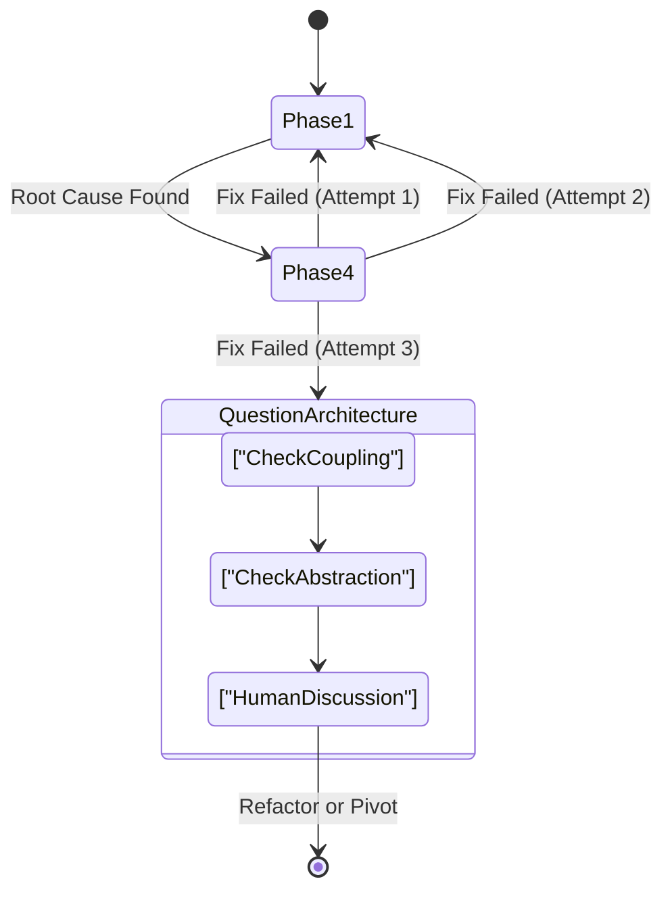

<!-- source: DeepWiki mcp.deepwiki.com · repo obra/superpowers · page 7.6 systematic-debugging · fetched 2026-10-26 -->

# systematic-debugging

<details>
<summary>Relevant source files</summary>

The following files were used as context for generating this wiki page:

- [docs/superpowers/specs/2026-05-05-platform-neutral-prose-design.md](docs/superpowers/specs/2026-05-05-platform-neutral-prose-design.md)
- [skills/dispatching-parallel-agents/SKILL.md](skills/dispatching-parallel-agents/SKILL.md)
- [skills/systematic-debugging/SKILL.md](skills/systematic-debugging/SKILL.md)
- [skills/systematic-debugging/condition-based-waiting-example.ts](skills/systematic-debugging/condition-based-waiting-example.ts)
- [skills/systematic-debugging/condition-based-waiting.md](skills/systematic-debugging/condition-based-waiting.md)
- [skills/systematic-debugging/defense-in-depth.md](skills/systematic-debugging/defense-in-depth.md)
- [skills/systematic-debugging/find-polluter.sh](skills/systematic-debugging/find-polluter.sh)
- [skills/systematic-debugging/root-cause-tracing.md](skills/systematic-debugging/root-cause-tracing.md)
- [tests/systematic-debugging/test-find-polluter.sh](tests/systematic-debugging/test-find-polluter.sh)

</details>


This page documents the `systematic-debugging` skill: its Iron Law, four mandatory phases, supporting techniques, and integration with the TDD and verification workflows. This skill governs how an agent approaches any bug, test failure, or unexpected behavior — it defines the *investigation process*, not the fix itself.

---

## Purpose

The `systematic-debugging` skill enforces a structured, evidence-first approach to resolving technical issues. Its premise: random fixes waste time, mask root causes, and introduce new bugs. The skill replaces guess-and-check behavior with a four-phase protocol that must be completed in order. [skills/systematic-debugging/SKILL.md:8-14]()

**Skill location:** [skills/systematic-debugging/SKILL.md:1-4]()

**Trigger description:** `Use when encountering any bug, test failure, or unexpected behavior, before proposing fixes` [skills/systematic-debugging/SKILL.md:2-3]()

---

## The Iron Law

[skills/systematic-debugging/SKILL.md:16-20]()

```
NO FIXES WITHOUT ROOT CAUSE INVESTIGATION FIRST
```

Phase 1 (Root Cause Investigation) is a hard gate. An agent cannot propose any fix until Phase 1 is complete. Violating the letter of the process is defined as violating the spirit of it. [skills/systematic-debugging/SKILL.md:14-22]()

---

## When the Skill Applies

This skill applies to **any** technical issue, including test failures, production bugs, performance problems, and build failures. [skills/systematic-debugging/SKILL.md:26-32]()

### High-Pressure Scenarios
The skill is explicitly required when the temptation to skip is greatest:

| Situation | Why Skipping Is Tempting | Why You Must Not |
|---|---|---|
| Time pressure / emergency | Guessing feels faster | Systematic is faster than thrashing [skills/systematic-debugging/SKILL.md:42-42]() |
| "Just one quick fix" | Fix seems obvious | Simple bugs have root causes too [skills/systematic-debugging/SKILL.md:40-40]() |
| Already tried multiple fixes | Exhaustion / sunk cost | Signals architectural problem [skills/systematic-debugging/SKILL.md:199-205]() |
| Previous fix didn't work | Frustration | New info requires re-analysis [skills/systematic-debugging/SKILL.md:194-195]() |
| Don't fully understand issue | Uncertainty | Rushing guarantees rework [skills/systematic-debugging/SKILL.md:41-41]() |

Sources: [skills/systematic-debugging/SKILL.md:34-45]()

---

## The Four Phases

Agents MUST complete each phase before proceeding to the next. [skills/systematic-debugging/SKILL.md:46-46]()

### Phase 1: Root Cause Investigation
**Goal:** Understand the failure before touching code. [skills/systematic-debugging/SKILL.md:48-50]()

1.  **Read Error Messages Carefully:** Don't skip past errors; they often contain the exact solution. Read stack traces completely, noting line numbers and file paths. [skills/systematic-debugging/SKILL.md:52-56]()
2.  **Reproduce Consistently:** Identify exact steps to trigger the issue reliably. If not reproducible, gather more data rather than guessing. [skills/systematic-debugging/SKILL.md:58-62]()
3.  **Check Recent Changes:** Review `git diff` and recent commits for code, dependency, or configuration changes. [skills/systematic-debugging/SKILL.md:64-68]()
4.  **Gather Evidence in Multi-Component Systems:** Before proposing fixes in complex systems (e.g., CI → build → signing), add diagnostic instrumentation at component boundaries to log entering/exiting data and verify environment propagation. [skills/systematic-debugging/SKILL.md:70-85]()
5.  **Trace Data Flow:** Use the backward tracing technique to find where a bad value originates. [skills/systematic-debugging/SKILL.md:108-119]()

### Phase 2: Pattern Analysis
**Goal:** Identify the delta between working and broken states. [skills/systematic-debugging/SKILL.md:120-122]()

*   **Find Working Examples:** Locate similar code in the codebase that functions correctly. [skills/systematic-debugging/SKILL.md:124-126]()
*   **Compare Against References:** Read reference implementations completely; do not skim. [skills/systematic-debugging/SKILL.md:128-131]()
*   **Identify Differences:** List every difference, no matter how small, and don't assume they "can't matter." [skills/systematic-debugging/SKILL.md:133-137]()

### Phase 3: Hypothesis and Testing
**Goal:** Verify the theory with minimal intervention. [skills/systematic-debugging/SKILL.md:143-145]()

*   **Form Single Hypothesis:** State clearly: "I think X is the root cause because Y." [skills/systematic-debugging/SKILL.md:147-150]()
*   **Test Minimally:** Make the smallest possible change to test the hypothesis (one variable at a time). [skills/systematic-debugging/SKILL.md:152-155]()
*   **Verify:** If it fails, form a NEW hypothesis; do not layer fixes on top of each other. [skills/systematic-debugging/SKILL.md:157-160]()

### Phase 4: Implementation
**Goal:** Apply the permanent fix. [skills/systematic-debugging/SKILL.md:168-170]()

1.  **Create Failing Test Case:** Use `superpowers:test-driven-development` to write a reproduction test. [skills/systematic-debugging/SKILL.md:172-177]()
2.  **Implement Single Fix:** Address the root cause; no "while I'm here" refactoring or bundled improvements. [skills/systematic-debugging/SKILL.md:179-183]()
3.  **Verify Fix:** Ensure the test passes and no other tests are broken using `superpowers:verification-before-completion`. [skills/systematic-debugging/SKILL.md:185-189]()

---

## Code Entity Mapping: Debugging Workflow

This diagram maps the natural language phases to specific code-level actions and utility scripts provided in the skill directory.

```mermaid
graph TD
    subgraph "NaturalLanguageSpace"
        ["P1: Root Cause Investigation"]
        ["P2: Pattern Analysis"]
        ["P3: Hypothesis and Testing"]
        ["P4: Implementation"]
    end

    subgraph "CodeEntitySpace"
        RC_TRACING["root-cause-tracing.md"]
        FIND_POLLUTER["find-polluter.sh"]
        COND_WAITING_MD["condition-based-waiting.md"]
        DEFENSE_IN_DEPTH_MD["defense-in-depth.md"]
        TDD_SKILL["superpowers:test-driven-development (Skill)"]
        WAIT_FOR_EVENT_COUNT["waitForEventCount()"]
        COND_WAITING_TS["condition-based-waiting-example.ts"]
    end

    ["P1: Root Cause Investigation"] -- "Trace backward through stack" --> RC_TRACING
    ["P1: Root Cause Investigation"] -- "Identify state-leaking test" --> FIND_POLLUTER
    ["P3: Hypothesis and Testing"] -- "Replace flaky sleep with poll" --> COND_WAITING_MD
    COND_WAITING_MD -- "Implementation helper" --> COND_WAITING_TS
    COND_WAITING_TS -- "Specific utility" --> WAIT_FOR_EVENT_COUNT
    ["P4: Implementation"] -- "Write failing test" --> TDD_SKILL
    ["P4: Implementation"] -- "Add multi-layer validation" --> DEFENSE_IN_DEPTH_MD
```

Sources: [skills/systematic-debugging/SKILL.md:112-114](), [skills/systematic-debugging/root-cause-tracing.md:1-8](), [skills/systematic-debugging/find-polluter.sh:1-4](), [skills/systematic-debugging/defense-in-depth.md:7-8](), [skills/systematic-debugging/condition-based-waiting-example.ts:152-152]()

---

## Advanced Techniques

### Root Cause Tracing
When errors appear deep in the call stack (e.g., `git init` in the wrong directory), agents must trace backward through the call chain until the original trigger is found. [skills/systematic-debugging/root-cause-tracing.md:5-7]()

**Instrumentation Pattern:**
```typescript
// Add to problematic operation to see call chain
const stack = new Error().stack;
console.error('DEBUG context:', { 
  directory, 
  cwd: process.cwd(),
  stack 
});
```
Sources: [skills/systematic-debugging/root-cause-tracing.md:72-79]()

### Defense-in-Depth
Instead of a single validation check, the skill encourages "Defense-in-Depth" by validating at every layer data passes through to make bugs structurally impossible. [skills/systematic-debugging/defense-in-depth.md:7-8]()

1.  **Layer 1: Entry Point Validation:** Reject invalid input at API boundaries (e.g., checking if `workingDirectory` exists). [skills/systematic-debugging/defense-in-depth.md:22-38]()
2.  **Layer 2: Business Logic Validation:** Ensure data makes sense for the specific operation. [skills/systematic-debugging/defense-in-depth.md:40-49]()
3.  **Layer 3: Environment Guards:** Prevent dangerous operations in specific contexts (e.g., refusing `git init` outside temp dirs in `NODE_ENV === 'test'`). [skills/systematic-debugging/defense-in-depth.md:52-70]()
4.  **Layer 4: Debug Instrumentation:** Capture context for forensics via logging or stack traces. [skills/systematic-debugging/defense-in-depth.md:72-84]()

Sources: [skills/systematic-debugging/defense-in-depth.md:20-86]()

### Condition-Based Waiting
To eliminate flaky tests, agents must replace arbitrary `setTimeout` or `sleep` calls with polling for specific conditions. [skills/systematic-debugging/condition-based-waiting.md:5-7]()

The `condition-based-waiting-example.ts` file provides concrete implementations of `waitForEvent`, `waitForEventCount`, and `waitForEventMatch` utilities. [skills/systematic-debugging/condition-based-waiting.md:81-82]()

**Code Pattern:**
```typescript
// Use domain-specific helpers from condition-based-waiting-example.ts
await waitForEventCount(threadManager, threadId, 'TOOL_CALL', 2);
```
Sources: [skills/systematic-debugging/condition-based-waiting-example.ts:152-152](), [skills/systematic-debugging/condition-based-waiting.md:61-80]()

### Identifying Test Pollution
When tests fail due to side effects from previous tests, the `find-polluter.sh` script can be used to isolate the specific file causing the issue by running tests one-by-one and checking for the appearance of "pollution" (unwanted files/state). [skills/systematic-debugging/find-polluter.sh:1-5]()

The script takes two arguments: the file or directory to check for pollution, and a test pattern. For example:
```bash
bash ./find-polluter.sh '.git' 'src/**/*.test.ts'
```
This command will search for tests matching `src/**/*.test.ts` and identify which one creates a `.git` directory. [skills/systematic-debugging/root-cause-tracing.md:101-104]()

The `test-find-polluter.sh` script provides tests for `find-polluter.sh`, ensuring it correctly identifies polluters and handles various test patterns. [tests/systematic-debugging/test-find-polluter.sh:65-77]()

Sources: [skills/systematic-debugging/find-polluter.sh:1-72](), [tests/systematic-debugging/test-find-polluter.sh:1-90]()

---

## Architectural Escalation: The 3-Fix Rule

If three or more fix attempts fail, the agent MUST stop and question the fundamental architecture. [skills/systematic-debugging/SKILL.md:192-198]()



**Signals of Architectural Failure:**
*   Each fix reveals new shared state or coupling issues. [skills/systematic-debugging/SKILL.md:201-201]()
*   Fixes require "massive refactoring" just to apply. [skills/systematic-debugging/SKILL.md:202-202]()
*   Each fix creates new symptoms elsewhere. [skills/systematic-debugging/SKILL.md:203-203]()

Sources: [skills/systematic-debugging/SKILL.md:198-213]()

---

## Red Flags

Agents must immediately STOP and return to Phase 1 if they detect these behaviors:
*   "Quick fix for now, investigate later." [skills/systematic-debugging/SKILL.md:217-217]()
*   "Just try changing X and see if it works." [skills/systematic-debugging/SKILL.md:218-218]()
*   "I don't fully understand but this might work." [skills/systematic-debugging/SKILL.md:222-222]()
*   Proposing solutions before tracing data flow. [skills/systematic-debugging/SKILL.md:225-225]()
*   Attempting a 4th fix without architectural discussion. [skills/systematic-debugging/SKILL.md:196-198]()

Sources: [skills/systematic-debugging/SKILL.md:214-230]()

---

