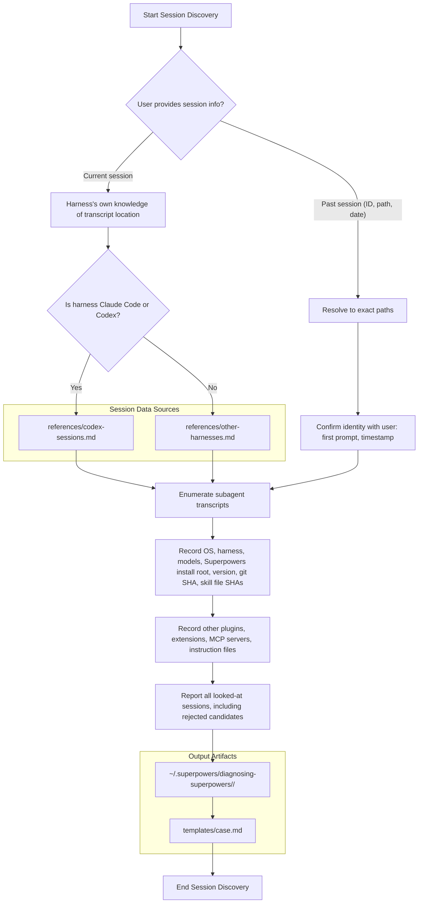

<!-- source: DeepWiki mcp.deepwiki.com · repo obra/superpowers · page 7.9 diagnosing-superpowers · fetched 2026-10-26 -->

# diagnosing-superpowers

<details>
<summary>Relevant source files</summary>

The following files were used as context for generating this wiki page:

- [docs/superpowers/specs/2026-08-27-diagnosing-superpowers-design.md](docs/superpowers/specs/2026-08-27-diagnosing-superpowers-design.md)
- [skills/diagnosing-superpowers/SKILL.md](skills/diagnosing-superpowers/SKILL.md)
- [skills/diagnosing-superpowers/prompts/analyst-common.md](skills/diagnosing-superpowers/prompts/analyst-common.md)
- [skills/diagnosing-superpowers/references/session-discovery.md](skills/diagnosing-superpowers/references/session-discovery.md)
- [skills/diagnosing-superpowers/templates/report.md](skills/diagnosing-superpowers/templates/report.md)

</details>


This page provides a detailed reference for the `diagnosing-superpowers` skill. This skill is designed to help users understand why a Superpowers session might have gone wrong, providing a structured approach to session discovery, analysis, and reporting. It includes a suite of analytical prompts for various diagnostic dimensions, outlines redaction policies for sensitive information, and defines templates for reports and GitHub issues.

Sources:
- [docs/superpowers/specs/2026-08-27-diagnosing-superpowers-design.md:8-20]()
- [skills/diagnosing-superpowers/SKILL.md:9-14]()

## Purpose and Scope

The `diagnosing-superpowers` skill is invoked when a Superpowers session deviates from expectations. Its primary goal is to work with the user to pinpoint the problem, examine session transcripts, and report findings with concrete evidence. It can also generate scrubbed bundles for remote analysis by Superpowers maintainers and identify similar past sessions. The skill reports facts and evidence; it explicitly avoids diagnosing Superpowers itself or proposing changes, leaving that to the remote triager [docs/superpowers/specs/2026-08-27-diagnosing-superpowers-design.md:16-18]().

The skill's design emphasizes:
*   **Prose-driven analysis (v1):** The initial version relies on the model and subagents for analysis, with deterministic tooling as a potential future enhancement [docs/superpowers/specs/2026-08-27-diagnosing-superpowers-design.md:22-24]().
*   **Harness coverage:** Detailed reference documentation exists for Claude Code and Codex, with a discovery procedure for other harnesses [docs/superpowers/specs/2026-08-27-diagnosing-superpowers-design.md:25-30]().
*   **Problem intake first:** The skill begins by clarifying the user's problem statement [docs/superpowers/specs/2026-08-27-diagnosing-superpowers-design.md:31-33]().
*   **Process evidence:** Quality is judged against the session's agreed-upon plan and transcript evidence, not code review of the diff [docs/superpowers/specs/2026-08-27-diagnosing-superpowers-design.md:34-38]().
*   **User-controlled redaction:** The user determines the level of redaction for exported bundles [docs/superpowers/specs/2026-08-27-diagnosing-superpowers-design.md:39-41]().
*   **Precise Superpowers identity:** Records the loaded install root, version, git SHA, and SHA1 of every skill file used [docs/superpowers/specs/2026-08-27-diagnosing-superpowers-design.md:42-45]().
*   **Skill triggering analysis:** Tracks when skills were triggered, in response to what, and identifies missed or late triggers [docs/superpowers/specs/2026-08-27-diagnosing-superpowers-design.md:46-48]().

Sources:
- [docs/superpowers/specs/2026-08-27-diagnosing-superpowers-design.md:16-18]()
- [docs/superpowers/specs/2026-08-27-diagnosing-superpowers-design.md:22-24]()
- [docs/superpowers/specs/2026-08-27-diagnosing-superpowers-design.md:25-30]()
- [docs/superpowers/specs/2026-08-27-diagnosing-superpowers-design.md:31-33]()
- [docs/superpowers/specs/2026-08-27-diagnosing-superpowers-design.md:34-38]()
- [docs/superpowers/specs/2026-08-27-diagnosing-superpowers-design.md:39-41]()
- [docs/superpowers/specs/2026-08-27-diagnosing-superpowers-design.md:42-45]()
- [docs/superpowers/specs/2026-08-27-diagnosing-superpowers-design.md:46-48]()

## Skill Layout and Structure

The `diagnosing-superpowers` skill follows a modular structure, similar to `subagent-driven-development` [docs/superpowers/specs/2026-08-27-diagnosing-superpowers-design.md:80-81]().

```
skills/diagnosing-superpowers/
  SKILL.md
  references/
    claude-code-sessions.md
    codex-sessions.md
    other-harnesses.md
    context-safety.md
    github-issues.md
  prompts/
    analyst-common.md
    skill-timeline.md
    plan-adherence.md
    repeated-work.md
    stumbles.md
    quality-evidence.md
    request-conflicts.md
    cost-and-time.md
    scrub.md
    scrub-audit.md
    similar-session.md
  templates/
    case.md
    report.md
    bundle-README.md
    issue.md
tests/diagnosing-superpowers/
  test-skill-structure.sh
```

The main `SKILL.md` file [skills/diagnosing-superpowers/SKILL.md]() contains the workflow, hard rules, and Red Flags, keeping its content concise (under 1,000 words) [docs/superpowers/specs/2026-08-27-diagnosing-superpowers-design.md:97-100](). Detailed instructions for subagents, references, and templates are stored in separate files within the `prompts/`, `references/`, and `templates/` directories.

The `SKILL.md` frontmatter defines the skill's name and description [skills/diagnosing-superpowers/SKILL.md:2-4]():
```yaml
name: diagnosing-superpowers
description: Use when a superpowers session went wrong and your human partner wants to know why — repeated work, ignored plans, stumbles, poor results, a skill that didn't fire, "it took too long", "why is it so expensive", "what is it doing" — or wants to build a bug report for the superpowers maintainers, for the current session or a past one identified by id or path, on any harness.
```

Sources:
- [docs/superpowers/specs/2026-08-27-diagnosing-superpowers-design.md:80-81]()
- [docs/superpowers/specs/2026-08-27-diagnosing-superpowers-design.md:97-100]()
- [skills/diagnosing-superpowers/SKILL.md:2-4]()
- [skills/diagnosing-superpowers/SKILL.md]()

## Workflow and Session Discovery

The `diagnosing-superpowers` skill follows a seven-step workflow, with each step represented as a todo item during execution [skills/diagnosing-superpowers/SKILL.md:20-22]().

### 1. Problem Intake

The skill begins by asking the user a series of questions to formulate a concrete problem statement. This involves identifying the session(s), the expected outcome, what actually happened, and the observable metric of concern (e.g., wall-clock time, tokens, repeated actions). This statement is recorded in the case file [docs/superpowers/specs/2026-08-27-diagnosing-superpowers-design.md:107-117]().

### 2. Locate Sessions

This step involves resolving all named sessions to their exact paths on disk.

#### Session Discovery Process

The `references/session-discovery.md` file [skills/diagnosing-superpowers/references/session-discovery.md]() guides the process of locating session transcripts.


**Diagram: Session Discovery Flow**

Sources:
- [docs/superpowers/specs/2026-08-27-diagnosing-superpowers-design.md:119-153]()
- [skills/diagnosing-superpowers/SKILL.md:29-35]()
- [skills/diagnosing-superpowers/references/session-discovery.md]()

#### Key Aspects of Session Location:
*   **Current Session:** The model leverages the harness's knowledge of transcript locations. For Claude Code and Codex, specific reference files (`claude-code-sessions.md`, `codex-sessions.md`) detail directory layouts, how to identify the current session, subagent transcript locations, and fields for model, harness version, skill attribution, compaction, and errors. For other harnesses, `other-harnesses.md` provides guidance on finding the session store and reporting confidence [docs/superpowers/specs/2026-08-27-diagnosing-superpowers-design.md:123-131]().
*   **Past Session:** If the user provides an ID, path, or description, the skill resolves it to exact paths and confirms identity by quoting the first prompt and timestamp [docs/superpowers/specs/2026-08-27-diagnosing-superpowers-design.md:132-135]().
*   **Subagents:** All subagent/sidechain transcripts belonging to a session are enumerated and treated as part of it [docs/superpowers/specs/2026-08-27-diagnosing-superpowers-design.md:136-137]().
*   **Live Sessions:** If a session is ongoing, the skill reads the available content, records the line count and modification time, and notes that the session was in progress [docs/superpowers/specs/2026-08-27-diagnosing-superpowers-design.md:138-141]().
*   **Host and Superpowers Identity:** Records OS and version, harness and version, all model IDs seen, the loaded Superpowers install root, its version, git SHA (if a checkout), and a SHA1 of every skill file read or injected. It also lists other configured plugins, extensions, MCP servers, and instruction files (e.g., `CLAUDE.md`, `GEMINI.md`) by path only [docs/superpowers/specs/2026-08-27-diagnosing-superpowers-design.md:142-150]().
*   **Reporting:** Every session ID and path, including rejected candidates and reasons, is reported [docs/superpowers/specs/2026-08-27-diagnosing-superpowers-design.md:151-153]().

Sources:
- [docs/superpowers/specs/2026-08-27-diagnosing-superpowers-design.md:123-131]()
- [docs/superpowers/specs/2026-08-27-diagnosing-superpowers-design.md:132-135]()
- [docs/superpowers/specs/2026-08-27-diagnosing-superpowers-design.md:136-137]()
- [docs/superpowers/specs/2026-08-27-diagnosing-superpowers-design.md:138-141]()
- [docs/superpowers/specs/2026-08-27-diagnosing-superpowers-design.md:142-150]()
- [docs/superpowers/specs/2026-08-27-diagnosing-superpowers-design.md:151-153]()

### 3. Triage and Analyst Prompt Suite

After locating sessions, the skill performs an initial triage by reading the region around the reported problem. Then, it dispatches one analyst subagent per diagnostic dimension in parallel [skills/diagnosing-superpowers/SKILL.md:36-42]().

Each subagent receives:
*   The case file path.
*   `prompts/analyst-common.md` [skills/diagnosing-superpowers/prompts/analyst-common.md](), which defines the subagent's role, inputs, context safety rules, and output format.
*   One dimension-specific prompt file from `prompts/`, such as `skill-timeline.md`, `plan-adherence.md`, `repeated-work.md`, `stumbles.md`, `quality-evidence.md`, `request-conflicts.md`, or `cost-and-time.md` [skills/diagnosing-superpowers/SKILL.md:39-42]().

Findings without a `path:line` citation are discarded [skills/diagnosing-superpowers/SKILL.md:42]().

#### Analyst Subagent Prompt (`prompts/analyst-common.md`)

The `analyst-common.md` prompt [skills/diagnosing-superpowers/prompts/analyst-common.md]() instructs subagents on their behavior and expected output.

```mermaid
graph TD
    A[Analyst Subagent Dispatch] --> B{Inputs: CASE_FILE_PATH, RANGE (optional)};
    B --> C[Read CASE_FILE_PATH first];
    C --> D[Follow context-safety.md rules];
    D --> E[Extract fields using recorded commands/queries];
    E --> F{Is RANGE present?};
    F -- Yes --> G[Analyze only specified turn/line range];
    F -- No --> H[Analyze full session];
    G --> I[Identify human prompts vs. hook output, system reminders, tool results];
    H --> I;
    I --> J[Generate findings with evidence: path:line, quote, turns, confidence];
    J --> K[Return findings in specified Markdown format];
    K --> L{No path:line?};
    L -- Yes --> M[Discard finding];
    L -- No --> N[Keep finding];
    N --> O[End Analyst Subagent];

    subgraph "Analyst Subagent Role"
        C["Read case file, understand sources and record meanings"]
        D["Adhere to context-safety.md"]
        E["Extract fields precisely"]
        I["Distinguish human prompts"]
    end
    subgraph "Output Requirements"
        J["Markdown format: ## <Dimension> findings, - finding, evidence, turns, confidence"]
        M["Discard findings without path:line"]
    end
```
**Diagram: Analyst Subagent Workflow**

The subagent's output format is strictly defined:
```markdown
## <Dimension> findings

- finding: <one sentence, what happened>
  evidence: <absolute path>:<line> — "<quote, at most 200 characters>"
  turns: <first human turn>–<last human turn>
  confidence: high | medium | low

Checked: <what you examined: files, line ranges, commands used>
```
If no findings are made, it returns `- none found` and the `Checked` line [skills/diagnosing-superpowers/prompts/analyst-common.md:25-38]().

Sources:
- [skills/diagnosing-superpowers/SKILL.md:36-42]()
- [skills/diagnosing-superpowers/prompts/analyst-common.md]()
- [skills/diagnosing-superpowers/prompts/analyst-common.md:25-38]()

### 4. Report Generation

All findings are compiled into a comprehensive report using `templates/report.md` [skills/diagnosing-superpowers/templates/report.md](). This report is written to the workspace (`~/.superpowers/diagnosing-superpowers/<session-id>/report.md`) and presented to the user [skills/diagnosing-superpowers/SKILL.md:43-46]().

The report includes:
*   **Problem statement:** Copied from the case file [skills/diagnosing-superpowers/templates/report.md:7-9]().
*   **Triage verdict:** Prose summary of evidence, with `path:line` citations for every claim [skills/diagnosing-superpowers/templates/report.md:11-15]().
*   **Environment:** Details on OS, harness, models, Superpowers install root, skill files, other plugins, and instruction files [skills/diagnosing-superpowers/templates/report.md:17-29]().
*   **Sessions examined:** Table of session IDs, paths, lines, and bytes, including rejected candidates [skills/diagnosing-superpowers/templates/report.md:31-36]().
*   **Timeline:** One row per human-typed prompt, listing events like skill invocations, subagent dispatches, compaction, errors, etc. [skills/diagnosing-superpowers/templates/report.md:38-44]().
*   **Findings:** Subsections for each diagnostic dimension (skill timeline, plan adherence, repeated work, stumbles, quality evidence, request conflicts, cost and time, other plugins/skills used), each containing detailed findings with evidence [skills/diagnosing-superpowers/templates/report.md:46-64]().
*   **Superpowers involvement:** States whether Superpowers involvement is "not indicated," "possible," or "likely," with evidence lines, but explicitly avoids naming defects or proposing changes [skills/diagnosing-superpowers/templates/report.md:65-70]().
*   **Coverage notes:** Lists unread ranges/files, unavailable harness features, whether the session was in progress, and items for the user to double-check [skills/diagnosing-superpowers/templates/report.md:72-78]().

Sources:
- [skills/diagnosing-superpowers/templates/report.md]()
- [skills/diagnosing-superpowers/SKILL.md:43-46]()
- [skills/diagnosing-superpowers/templates/report.md:7-9]()
- [skills/diagnosing-superpowers/templates/report.md:11-15]()
- [skills/diagnosing-superpowers/templates/report.md:17-29]()
- [skills/diagnosing-superpowers/templates/report.md:31-36]()
- [skills/diagnosing-superpowers/templates/report.md:38-44]()
- [skills/diagnosing-superpowers/templates/report.md:46-64]()
- [skills/diagnosing-superpowers/templates/report.md:65-70]()
- [skills/diagnosing-superpowers/templates/report.md:72-78]()

### 5. GitHub Issues

If the report indicates possible or likely Superpowers involvement, or if the user requests it, the skill can assist with GitHub issues. It searches open and closed issues based on `references/github-issues.md` [skills/diagnosing-superpowers/SKILL.md:47-49](). If no matches are found, it fills `templates/issue.md` [skills/diagnosing-superpowers/SKILL.md:51]() and creates the issue only after user approval. If a bundle exists, the user is given its path to attach manually [skills/diagnosing-superpowers/SKILL.md:53-55]().

Sources:
- [skills/diagnosing-superpowers/SKILL.md:47-49]()
- [skills/diagnosing-superpowers/SKILL.md:51]()
- [skills/diagnosing-superpowers/SKILL.md:53-55]()

### 6. Export (Redaction Policy)

A scrubbed bundle is created only when explicitly requested by the user. The skill offers three redaction levels [skills/diagnosing-superpowers/SKILL.md:56-59]():
*   **Skeleton:** No tool-result bodies.
*   **Evidence:** Bodies only for cited events.
*   **Full:** All content.

The bundle is built according to `templates/bundle-README.md` [skills/diagnosing-superpowers/SKILL.md:60](), and `prompts/scrub.md` and `prompts/scrub-audit.md` are dispatched repeatedly until the audit returns CLEAN. The bundle template's evidence check and reconciliation are completed before showing the final scrub log, file list, and privacy/evidence outcomes. The archive is created (`zip -r` or `tar -czf`) only after user approval, with a warning that scrubbing might miss things and the user must review every file before sharing [skills/diagnosing-superpowers/SKILL.md:60-67]().

Sources:
- [skills/diagnosing-superpowers/SKILL.md:56-59]()
- [skills/diagnosing-superpowers/SKILL.md:60]()
- [skills/diagnosing-superpowers/SKILL.md:60-67]()

### 7. Similar Sessions

Upon request, the skill identifies similar sessions. It turns confirmed findings into a signature, lists candidate sessions by modification time and size, finds marker line numbers, dispatches `prompts/similar-session.md` for each candidate in parallel, and appends the results to report §9 [skills/diagnosing-superpowers/SKILL.md:68-71]().

Sources:
- [skills/diagnosing-superpowers/SKILL.md:68-71]()

## Hard Rules and Red Flags

The `diagnosing-superpowers` skill operates under strict "Hard Rules" and identifies "Red Flags" to ensure accuracy, safety, and adherence to its defined scope [skills/diagnosing-superpowers/SKILL.md:86-120]().

### Hard Rules
*   **Context safety:** Always follow `references/context-safety.md` due to potentially large transcript lines [skills/diagnosing-superpowers/SKILL.md:88-89]().
*   **Read-only:** Never modify, move, or delete session files [skills/diagnosing-superpowers/SKILL.md:90]().
*   **Exact paths to subagents:** Subagents treat their own transcript as their "current session"; absolute paths and IDs must be passed [skills/diagnosing-superpowers/SKILL.md:91-92]().
*   **Human prompts only:** Hook output, system reminders, and tool results are not considered human prompts [skills/diagnosing-superpowers/SKILL.md:93-95]().
*   **No Superpowers diagnosis:** The skill reports involvement but never names defects or proposes changes to Superpowers itself [skills/diagnosing-superpowers/SKILL.MS:96-100]().
*   **Approval gates:** No archive or issue/comment before explicit user approval [skills/diagnosing-superpowers/SKILL.md:101-103]().
*   **Intake before analysis:** Analysis steps 2-7 do not start until the user has provided a concrete problem statement [skills/diagnosing-superpowers/SKILL.md:104-110]().

### Red Flags
Common pitfalls and incorrect assumptions are highlighted as "Red Flags" [skills/diagnosing-superpowers/SKILL.md:111-120]():
*   Assuming the problem is obvious and skipping intake.
*   Attempting to reconstruct the problem statement if the user is away.
*   Performing an unscoped sweep before clarifying the problem.
*   Building a bundle unprompted, even if the goal is a bug report.
*   Making "small, targeted edits" or restructuring without reporting evidence for the triager to decide.
*   Citing numbers not computed directly from the transcript.

Sources:
- [skills/diagnosing-superpowers/SKILL.md:86-120]()
- [skills/diagnosing-superpowers/SKILL.md:88-89]()
- [skills/diagnosing-superpowers/SKILL.md:90]()
- [skills/diagnosing-superpowers/SKILL.md:91-92]()
- [skills/diagnosing-superpowers/SKILL.md:93-95]()
- [skills/diagnosing-superpowers/SKILL.MS:96-100]()
- [skills/diagnosing-superpowers/SKILL.md:101-103]()
- [skills/diagnosing-superpowers/SKILL.md:104-110]()
- [skills/diagnosing-superpowers/SKILL.md:111-120]()

---

