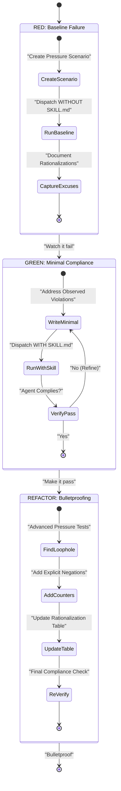
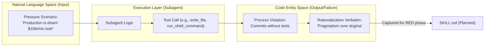
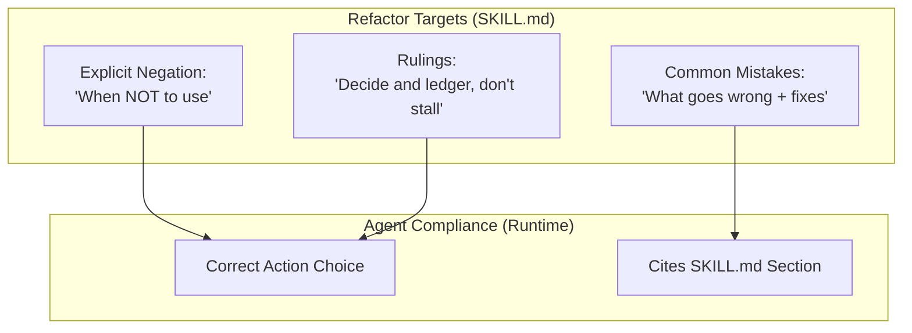

<!-- source: DeepWiki mcp.deepwiki.com · repo obra/superpowers · page 8.1 Test-Driven Development for Skills · fetched 2026-10-26 -->

# Test-Driven Development for Skills

Relevant source files

The following files were used as context for generating this wiki page:

- [skills/executing-plans/SKILL.md](skills/executing-plans/SKILL.md)
- [skills/using-superpowers/references/gemini-tools.md](skills/using-superpowers/references/gemini-tools.md)
- [skills/writing-skills/SKILL.md](skills/writing-skills/SKILL.md)
- [skills/writing-skills/anthropic-best-practices.md](skills/writing-skills/anthropic-best-practices.md)

**Purpose:** This page explains how Test-Driven Development (TDD) principles are adapted for creating and editing skills within the Superpowers system. Skills are process documentation that guides AI agents; creating them follows a structured RED-GREEN-REFACTOR cycle where agent behavior is the "test subject" and skill documentation is the "code under test." [skills/writing-skills/SKILL.md:10-14]()

**Scope:** This page covers the conceptual framework, the implementation of the three-phase cycle, and the data flow between "Natural Language Space" (instructions) and "Code Entity Space" (agent actions).

**Note:** This methodology is most critical for skills that enforce discipline or rules that agents might rationalize away under pressure, such as `subagent-driven-development` or `systematic-debugging`. [skills/writing-skills/SKILL.md:16-17]()

## Overview: TDD Applied to Documentation

Creating skills is formalized as TDD applied to process documentation [skills/writing-skills/SKILL.md:10-14](). The system treats **agent behavior** as the runtime environment and **SKILL.md** files as the source code [skills/writing-skills/SKILL.md:32-35]().

- **Test Case:** A "Pressure scenario with subagent" [skills/writing-skills/SKILL.md:34]().
- **Production Code:** The `SKILL.md` document [skills/writing-skills/SKILL.md:35]().
- **Test Failure (RED):** An agent violates a rule without the skill (baseline) [skills/writing-skills/SKILL.md:36]().
- **Test Pass (GREEN):** The agent complies with the skill present [skills/writing-skills/SKILL.md:37]().

The core principle is: **If you didn't watch an agent fail without the skill, you don't know if the skill teaches the right thing** [skills/writing-skills/SKILL.md:16-17]().

**Sources:** [skills/writing-skills/SKILL.md:10-44]()

## TDD Concept Mapping

The following table maps software engineering TDD concepts to the Superpowers skill creation workflow:

| TDD Concept | Skill Creation Equivalent | Description |
| :--- | :--- | :--- |
| **Test case** | Pressure scenario with subagent | A scenario designed to elicit a specific behavior from the agent [skills/writing-skills/SKILL.md:34]() |
| **Production code** | Skill document (`SKILL.md`) | The markdown file containing the skill's instructions and guidance [skills/writing-skills/SKILL.md:35]() |
| **Test fails (RED)** | Agent violates rule without skill (baseline) | The agent fails to follow the desired process when the skill is not present [skills/writing-skills/SKILL.md:36]() |
| **Test passes (GREEN)** | Agent complies with skill present | The agent successfully follows the desired process when the skill is present [skills/writing-skills/SKILL.md:37]() |
| **Refactor** | Close loopholes while maintaining compliance | Iteratively refining the skill to prevent new rationalizations or misinterpretations [skills/writing-skills/SKILL.md:38]() |

**Sources:** [skills/writing-skills/SKILL.md:30-44]()

## The RED-GREEN-REFACTOR Cycle for Skills

The workflow moves from observing natural agent failure to minimal instruction writing, and finally to "bulletproofing" via iterative loophole closure.

**Diagram: The Skill TDD Lifecycle**

**Sources:** [skills/writing-skills/SKILL.md:44-46]()

## RED Phase: Baseline Testing (Natural Language Space to Code Entity Space)

The RED phase identifies how an agent behaves in the "Code Entity Space" (executing tools, writing files) when it lacks the constraints of a skill. A valid test requires a **Pressure Scenario** that forces a choice between a "fast/wrong" path and a "slow/right" path.

**Diagram: Mapping Baseline Failures to Skill Requirements**

In this phase, the developer must capture **rationalizations** verbatim. For example, if an agent says "I'm skipping TDD because the fix is simple," this specific excuse becomes a target for the skill's "Common Mistakes" or "When NOT to use" sections [skills/writing-skills/SKILL.md:121-133]().

**Sources:** [skills/writing-skills/SKILL.md:40-43]()

## GREEN Phase: Minimal Skill Writing

Once failures are documented, the developer writes the minimal content required to achieve compliance [skills/writing-skills/SKILL.md:41]().

### Data Flow: Instruction Injection
When a skill is active, the system injects the `SKILL.md` content into the subagent's context.

1.  **Frontmatter Parsing:** The `description` field in `SKILL.md` is used for discovery [skills/writing-skills/SKILL.md:95-103]().
2.  **Skill Discovery Optimization (SDO):** Descriptions must describe **when to use**, NOT what the skill does. Testing shows summarizing the workflow causes agents to skip the full skill content and follow the summary instead [skills/writing-skills/SKILL.md:150-158]().
3.  **Constraint Injection:** The "Core Pattern" and "When to Use" sections are provided as high-priority instructions [skills/writing-skills/SKILL.md:116-124]().
4.  **Verification:** The subagent is re-run through the same scenario to see if it now chooses the correct action (e.g., deleting code that wasn't TDD'd) [skills/writing-skills/SKILL.md:42]().

**Sources:** [skills/writing-skills/SKILL.md:93-138](), [skills/writing-skills/SKILL.md:140-158](), [skills/writing-skills/SKILL.md:41-42]()

## REFACTOR Phase: Bulletproofing and Loopholes

The REFACTOR phase is where the skill is hardened against "spirit vs. letter" arguments [skills/writing-skills/SKILL.md:38](). This involves adding explicit counters to the `SKILL.md`.

### Implementation of Loophole Closure
Developers use specific code-like structures in documentation to prevent regressions:

1.  **Explicit Negation:** Adding "When NOT to use" sections or "Common Mistakes" to block specific rationalizations [skills/writing-skills/SKILL.md:120-133]().
2.  **Rationalization Tables:** While not explicitly defined in `skills/writing-skills/SKILL.md`, the concept of documenting "What goes wrong + fixes" in "Common Mistakes" serves a similar purpose [skills/writing-skills/SKILL.md:132-133]().
3.  **No Easy Outs:** Ensuring scenarios force a concrete choice rather than allowing the agent to defer to a human. For example, the `executing-plans` skill explicitly lists only four conditions under which an agent should stop and ask a human, otherwise, they must make a ruling and continue [skills/executing-plans/SKILL.md:39-44]().

**Diagram: Loophole Closure Mechanisms**

**Sources:** [skills/writing-skills/SKILL.md:120-133](), [skills/executing-plans/SKILL.md:32-44]()

## Skill Discovery Optimization (SDO)

A critical component of the "Green" phase is ensuring the skill is actually discoverable by the harness.

1.  **Rich Description Field:** The agent reads the frontmatter `description` to decide which skills to load. This field must focus on triggering conditions ("Use when...") rather than summarizing the workflow [skills/writing-skills/SKILL.md:144-152]().
2.  **The Trap of Summarization:** If a description summarizes the process (e.g., "Use for TDD - write test first..."), agents often follow the short summary and skip the detailed `SKILL.md` body, leading to process stalls or skipped steps [skills/writing-skills/SKILL.md:154-159]().
3.  **Harness Mapping:** On platforms like Gemini CLI, the `activate_skill` tool is the primary mechanism for moving a skill from discovery into the active context window [skills/using-superpowers/references/gemini-tools.md:17]().

**Sources:** [skills/writing-skills/SKILL.md:140-172](), [skills/using-superpowers/references/gemini-tools.md:1-20]()

## The Iron Law of Skill Creation

The system enforces a strict protocol: **If you didn't watch an agent fail without the skill, you don't know if the skill teaches the right thing** [skills/writing-skills/SKILL.md:16-17]().

This applies to:
- **New Skills:** Must have a baseline RED run [skills/writing-skills/SKILL.md:39]().
- **Edits:** Adding a section requires a new pressure scenario that proves the section is necessary.
- **Refactoring:** Moving content between files requires re-verifying that agents still comply with the same pressure tests [skills/writing-skills/SKILL.md:38]().

**Sources:** [skills/writing-skills/SKILL.md:10-18]()

## Summary of TDD Functions and Files

| Component | File Path | Role |
| :--- | :--- | :--- |
| **TDD Logic** | `skills/writing-skills/SKILL.md` | Defines the RED-GREEN-REFACTOR cycle for documentation [skills/writing-skills/SKILL.md:1-46](). |
| **Best Practices** | `skills/writing-skills/anthropic-best-practices.md` | Anthropic's official guidance on concise skill authoring, complementing the TDD approach [skills/writing-skills/anthropic-best-practices.md:1-20](). |

**Sources:** [skills/writing-skills/SKILL.md:1-46](), [skills/writing-skills/anthropic-best-practices.md:1-20]()

---

