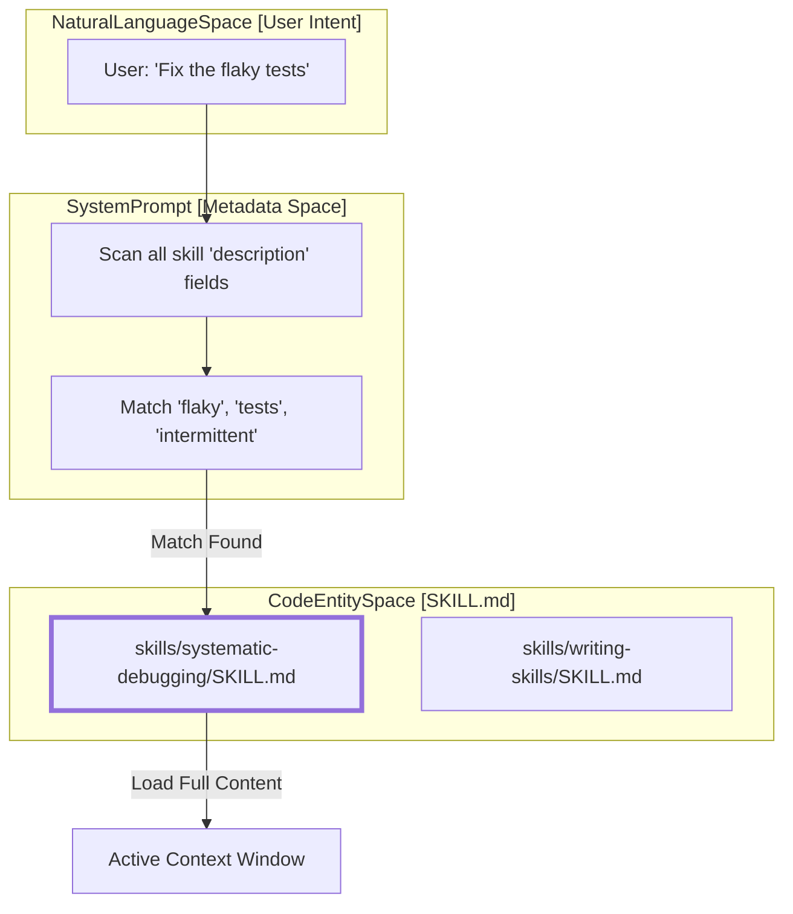
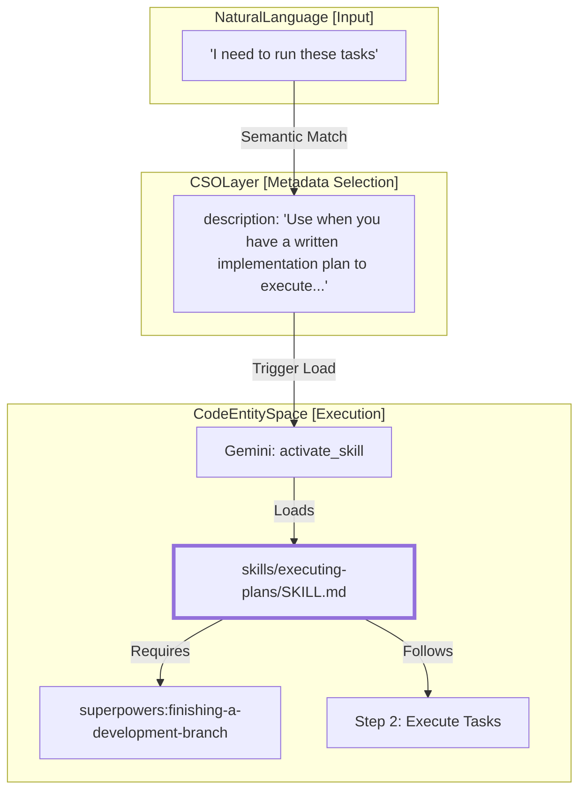

<!-- source: DeepWiki mcp.deepwiki.com · repo obra/superpowers · page 8.4 Skill Discovery Optimization (CSO) · fetched 2026-10-26 -->

# Skill Discovery Optimization (CSO)

Relevant source files

The following files were used as context for generating this wiki page:

- [skills/executing-plans/SKILL.md](skills/executing-plans/SKILL.md)
- [skills/using-superpowers/references/gemini-tools.md](skills/using-superpowers/references/gemini-tools.md)
- [skills/writing-skills/SKILL.md](skills/writing-skills/SKILL.md)
- [skills/writing-skills/anthropic-best-practices.md](skills/writing-skills/anthropic-best-practices.md)

Skill Discovery Optimization (CSO) is the technical discipline of structuring skill metadata and content to ensure AI agents correctly discover, load, and execute specialized workflows. CSO primarily focuses on the `description` field in the `SKILL.md` frontmatter, as this field acts as the gatekeeper for the entire skill.

## How Agents Discover Skills

Agents do not ingest every skill in the repository at the start of a session. Instead, they perform a multi-stage discovery process. At startup, only the metadata (name and description) of all skills is pre-loaded into the system prompt [skills/writing-skills/anthropic-best-practices.md:13-20](). The full content of a `SKILL.md` is only pulled into the active context window when the agent determines the skill is relevant based on its description [skills/writing-skills/anthropic-best-practices.md:20-21]().

On Gemini CLI, this discovery is facilitated by the `activate_skill` tool, which leverages the metadata to bridge the gap between user intent and skill execution [skills/using-superpowers/references/gemini-tools.md:17-17]().

### The Discovery Data Flow

Sources: [skills/writing-skills/SKILL.md:140-150](), [skills/writing-skills/anthropic-best-practices.md:13-20](), [skills/using-superpowers/references/gemini-tools.md:17-17]()

---

## The Description Field Requirements

The `description` field is the most critical component of CSO. It must follow strict formatting and conceptual rules to prevent "description short-circuiting."

### Technical Constraints
*   **Format:** Must be valid YAML frontmatter [skills/writing-skills/SKILL.md:95-96]().
*   **Size:** Total frontmatter (`name` + `description`) must be under 1024 characters [skills/writing-skills/SKILL.md:97-98]().
*   **Prefix:** Must start with "Use when..." to focus the agent on triggering conditions [skills/writing-skills/SKILL.md:100-101]().
*   **Voice:** Must be written in the **third person** because it is injected into the system prompt [skills/writing-skills/anthropic-best-practices.md:189-195]().

### The "No Workflow" Rule
The description must define **triggering conditions** (symptoms, situations, contexts) and **never** summarize the workflow or steps of the skill [skills/writing-skills/SKILL.md:102-103]().

**Why this matters:** Testing revealed that if a description summarizes the process (e.g., "Use when executing plans by dispatching subagents"), the agent may follow that one-sentence summary as its instruction set and skip reading the complex logic, flowcharts, and constraints inside the `SKILL.md` body [skills/writing-skills/SKILL.md:154-158]().

| Aspect | Requirement | Example |
| :--- | :--- | :--- |
| **Trigger** | Specific symptoms/situations | `Use when encountering any bug or test failure` [skills/writing-skills/SKILL.md:171-172]() |
| **Constraint** | No process summaries | ❌ `...and then fix it using TDD` [skills/writing-skills/SKILL.md:165-166]() |
| **Perspective** | Third person | ❌ `I can help you debug...` [skills/writing-skills/anthropic-best-practices.md:193-194]() |

Sources: [skills/writing-skills/SKILL.md:150-180](), [skills/writing-skills/anthropic-best-practices.md:189-200]()

---

## Keyword Coverage and Token Efficiency

Effective CSO requires balancing "findability" with "token frugality."

### Keyword Strategy
Since agents use semantic search and keyword matching to find skills, descriptions should include:
1.  **Technical Synonyms:** (e.g., "race condition", "timing dependency", "flaky") [skills/writing-skills/SKILL.md:175-177]().
2.  **Actionable Triggers:** Words like "implementing", "refactoring", "debugging" [skills/writing-skills/SKILL.md:168-172]().
3.  **Specific Symptoms:** Concrete issues like "test failure" or "unexpected behavior" [skills/writing-skills/SKILL.md:101-102]().

### Token Efficiency Patterns
The context window is a limited resource. Every token in a loaded skill competes with conversation history [skills/writing-skills/anthropic-best-practices.md:13-20]().
*   **Assume Intelligence:** Do not explain basic concepts (e.g., what a PDF is) [skills/writing-skills/anthropic-best-practices.md:22-29]().
*   **Reference Help:** Use external files for heavy reference data (100+ lines) instead of inlining it [skills/writing-skills/SKILL.md:84-86]().
*   **Concise Examples:** Use minimal code snippets for "Before/After" comparisons [skills/writing-skills/SKILL.md:122-123]().

Sources: [skills/writing-skills/anthropic-best-practices.md:9-29](), [skills/writing-skills/SKILL.md:84-130]()

---

## Persuasion Principles in Skill Design

Beyond search optimization, the content of the skill must be optimized for agent compliance using persuasion principles. These patterns ensure that once a skill is loaded, the agent adheres to its constraints even under pressure.

### High vs. Low Degrees of Freedom
*   **High Freedom:** Use for context-dependent tasks like code reviews [skills/writing-skills/anthropic-best-practices.md:63-80]().
*   **Low Freedom:** Use for fragile operations like database migrations where specific sequences must be followed [skills/writing-skills/anthropic-best-practices.md:105-125]().

### Implementation Discipline
Skills like `executing-plans` enforce strict compliance by requiring the agent to announce usage: "I'm using the executing-plans skill to implement this plan" [skills/executing-plans/SKILL.md:12](). This verbal commitment prevents the agent from deviating from the bite-sized steps defined in the plan [skills/executing-plans/SKILL.md:28]().

Sources: [skills/writing-skills/anthropic-best-practices.md:59-131](), [skills/executing-plans/SKILL.md:10-30]()

---

## Bridging Natural Language to Code Entities

The following diagram illustrates how CSO principles transform a vague user request into the execution of specific code entities within the Superpowers system, utilizing tools like `activate_skill` or `invoke_agent` [skills/using-superpowers/references/gemini-tools.md:17-18]().

Sources: [skills/executing-plans/SKILL.md:1-4](), [skills/executing-plans/SKILL.md:35-37](), [skills/using-superpowers/references/gemini-tools.md:17-17]()

---

## CSO Implementation Checklist

When creating or auditing a skill for search optimization, verify against these criteria:

1.  **Name Format:** Letters, numbers, and hyphens only (e.g., `writing-skills`) [skills/writing-skills/SKILL.md:98]().
2.  **Gerund Naming:** Use "-ing" forms for process-oriented skills (e.g., `executing-plans`) [skills/writing-skills/anthropic-best-practices.md:157-166]().
3.  **Trigger Focus:** Description starts with "Use when..." [skills/writing-skills/SKILL.md:100]().
4.  **No "How":** Description contains zero information about the steps inside the skill [skills/writing-skills/SKILL.md:152-153]().
5.  **Technology Scope:** Triggers are technology-agnostic unless the skill is specifically for a library [skills/writing-skills/SKILL.md:177-178]().

Sources: [skills/writing-skills/SKILL.md:96-103](), [skills/writing-skills/anthropic-best-practices.md:155-170]()

---

