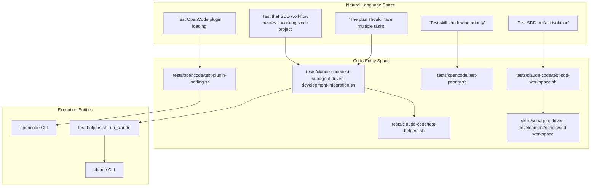
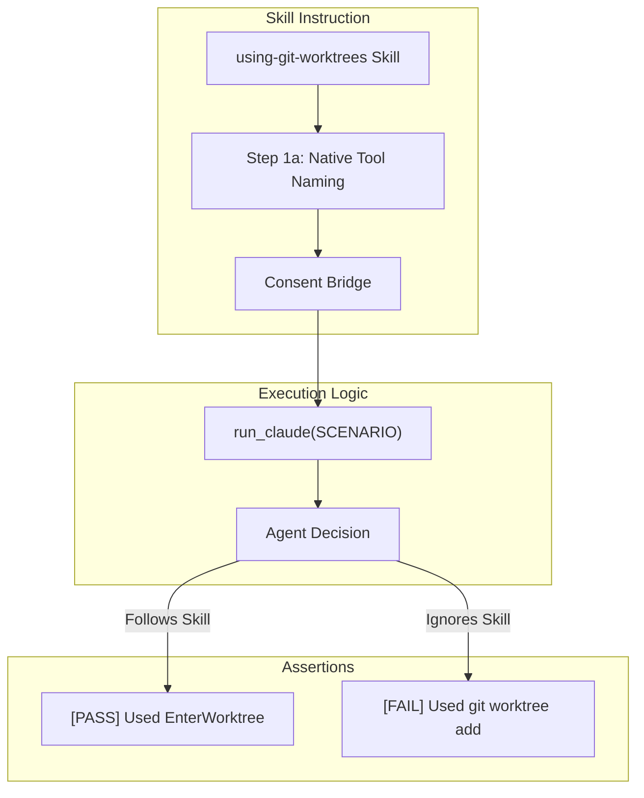

<!-- source: DeepWiki mcp.deepwiki.com · repo obra/superpowers · page 9.3 Integration Tests · fetched 2026-10-26 -->

# Integration Tests

Relevant source files

The following files were used as context for generating this wiki page:

- [skills/subagent-driven-development/scripts/review-package](skills/subagent-driven-development/scripts/review-package)
- [skills/subagent-driven-development/scripts/sdd-workspace](skills/subagent-driven-development/scripts/sdd-workspace)
- [skills/subagent-driven-development/scripts/task-brief](skills/subagent-driven-development/scripts/task-brief)
- [tests/claude-code/analyze-token-usage.py](tests/claude-code/analyze-token-usage.py)
- [tests/claude-code/test-sdd-workspace.sh](tests/claude-code/test-sdd-workspace.sh)
- [tests/claude-code/test-subagent-driven-development-integration.sh](tests/claude-code/test-subagent-driven-development-integration.sh)
- [tests/claude-code/test-worktree-native-preference.sh](tests/claude-code/test-worktree-native-preference.sh)

## Purpose and Scope

This page documents the end-to-end integration test cases that verify complete workflow execution in Superpowers. These tests scaffold actual projects, execute implementation plans using the `subagent-driven-development` skill, and verify that the resulting code is functional, tested, and follows the specified workflow. Integration tests typically take between 10 and 30 minutes to complete as they involve real AI interactions and multi-step development cycles [tests/claude-code/test-subagent-driven-development-integration.sh:24-32]().

Additionally, this suite includes platform-specific integration tests for environments like **Claude Code** and **OpenCode**, verifying plugin loading, tool functionality, and skill priority resolution in isolated environments. It also covers the behavior of specific subagents, such as the code reviewer, by planting bugs and verifying detection.

For unit tests of individual skills without full execution, see [9.1 Test Suite Overview](). For the token usage analysis tools used by these tests, see [9.4 Testing Tools and Helpers]().

---

## Integration Test Architecture

Integration tests differ from unit tests by executing actual AI-driven workflows rather than just verifying skill content. Each integration test follows a pattern: scaffold a project, execute the target logic via the platform CLI (Claude Code or OpenCode), verify results through assertions, and analyze consumption or protocol compliance.

### Test Execution Pipeline

The following diagram bridges the natural language requirements of a test into the code entities that manage the execution flow.

**Natural Language Space to Code Entity Space**

**Sources:** [tests/claude-code/test-subagent-driven-development-integration.sh:1-18](), [tests/claude-code/test-sdd-workspace.sh:1-10](), [tests/claude-code/test-helpers.sh:1-18]()

---

## Claude Code Integration Tests

Claude Code integration tests verify the tool resolution logic and the `subagent-driven-development` (SDD) workflow in an isolated environment.

### Isolated Environment Setup

The `test-subagent-driven-development-integration.sh` script creates a temporary project using `create_test_project` [tests/claude-code/test-subagent-driven-development-integration.sh:36]().
- **Project Structure**: Initializes a minimal Node.js project with `package.json`, `src/`, `test/`, and `docs/superpowers/plans/` [tests/claude-code/test-subagent-driven-development-integration.sh:45-56]().
- **Implementation Plan**: Creates a multi-task plan at `docs/superpowers/plans/implementation-plan.md` to test task isolation and subagent dispatch [tests/claude-code/test-subagent-driven-development-integration.sh:59-116]().
- **Git Initialization**: Configures a local git repository to provide a clean baseline for the AI [tests/claude-code/test-subagent-driven-development-integration.sh:119-123]().

### Workflow Verification

The test executes `claude` with a specific prompt forcing the use of the SDD skill [tests/claude-code/test-subagent-driven-development-integration.sh:149-158](). It uses the following flags for automation:
- `--allowed-tools=all`: Enables tool usage in headless mode [tests/claude-code/test-subagent-driven-development-integration.sh:167]().
- `--permission-mode bypassPermissions`: Prevents interactive prompts during the test run [tests/claude-code/test-subagent-driven-development-integration.sh:167]().

### SDD Workspace and Artifact Isolation

Integration testing includes verifying that the SDD workflow correctly manages its internal workspace to prevent cross-contamination between plans and worktrees [tests/claude-code/test-sdd-workspace.sh:2-4]().

| Script | Purpose | Implementation Detail |
| :--- | :--- | :--- |
| `sdd-workspace` | Resolves a per-plan directory | Creates `.superpowers/sdd/<plan-slug>/` and a self-ignoring `.gitignore` [skills/subagent-driven-development/scripts/sdd-workspace:6-15, 36-39]() |
| `task-brief` | Extracts task text | Uses `awk` to extract a specific task heading into the plan's workspace [skills/subagent-driven-development/scripts/task-brief:2-9, 28-34]() |
| `review-package` | Packages changes for review | Generates a combined commit log, stat, and diff with `-U10` context [skills/subagent-driven-development/scripts/review-package:2-9, 32-43]() |

The `test-sdd-workspace.sh` script specifically asserts that linked worktrees resolve to distinct, isolated workspaces [tests/claude-code/test-sdd-workspace.sh:84-91]() and that the `.superpowers` directory is ignored by Git [tests/claude-code/test-sdd-workspace.sh:93-119]().

**Sources:** [tests/claude-code/test-subagent-driven-development-integration.sh:1-167](), [tests/claude-code/test-sdd-workspace.sh:1-180](), [skills/subagent-driven-development/scripts/sdd-workspace:1-40]()

---

## Token Usage Analysis

To monitor resource consumption and cost of integration tests, the script `analyze-token-usage.py` parses session transcripts [tests/claude-code/analyze-token-usage.py:1-6]().

### Analysis Metrics

The script distinguishes between:
- **Main Session Usage**: Token counts and messages from the primary coordinator session [tests/claude-code/analyze-token-usage.py:14-20]().
- **Subagent Usage**: Token counts per dispatched subagent, keyed by `agentId` and including prompt descriptions for identification [tests/claude-code/analyze-token-usage.py:23-30, 49-60]().
- **Cache Efficiency**: Tracks input tokens devoted to cache creation and cache reads separately [tests/claude-code/analyze-token-usage.py:43-44, 65-66]().

### Cost Estimation

It computes estimated costs in USD using common rates ($3 per million input tokens, $15 per million output tokens), assisting developers in optimizing test prompt designs [tests/claude-code/analyze-token-usage.py:76-81]().

**Sources:** [tests/claude-code/analyze-token-usage.py:1-81]()

---

## Worktree Native Preference Tests

This integration test verifies that the AI correctly identifies and prefers native platform tools (like `EnterWorktree`) over generic shell commands (like `git worktree add`) when the skill provides explicit guidance [tests/claude-code/test-worktree-native-preference.sh:1-19]().

**Tool Preference Resolution**

**Sources:** [tests/claude-code/test-worktree-native-preference.sh:28-37, 72-98]()

---

## Running Integration Tests

### Command Reference

| Command | Purpose |
| :--- | :--- |
| `./tests/claude-code/test-subagent-driven-development-integration.sh` | Executes full SDD workflow integration test [tests/claude-code/test-subagent-driven-development-integration.sh:1-15]() |
| `./tests/claude-code/test-sdd-workspace.sh` | Verifies workspace isolation and script functionality [tests/claude-code/test-sdd-workspace.sh:1-10]() |
| `./tests/claude-code/test-worktree-native-preference.sh all` | Verifies preference for native tools in worktree workflows [tests/claude-code/test-worktree-native-preference.sh:143-178]() |
| `python3 tests/claude-code/analyze-token-usage.py <session.jsonl>` | Analyzes token usage and cost of a session [tests/claude-code/analyze-token-usage.py:84-88]()

### Output and Debugging

Integration tests output results to the console, with failures providing snippets of the session logs. For the SDD integration test, the script automatically attempts to locate the most recent Claude session JSONL file in `~/.claude/projects/` to perform post-run analysis [tests/claude-code/test-subagent-driven-development-integration.sh:184-195]().

**Sources:** 
[tests/claude-code/test-subagent-driven-development-integration.sh:1-32](), 
[tests/claude-code/test-sdd-workspace.sh:1-200](),
[tests/claude-code/analyze-token-usage.py:83-168](), 
[tests/claude-code/test-worktree-native-preference.sh:1-20]()

---

