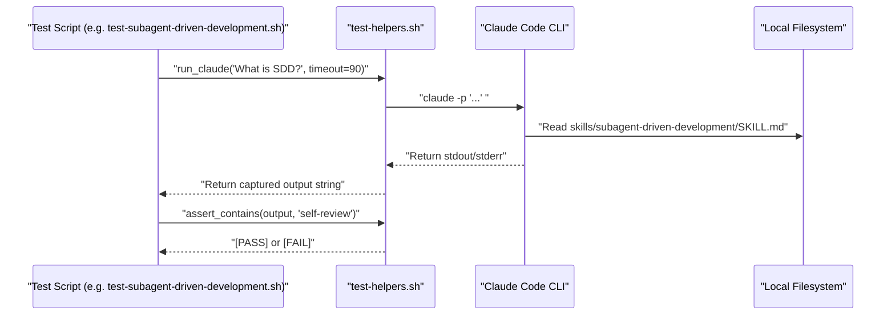
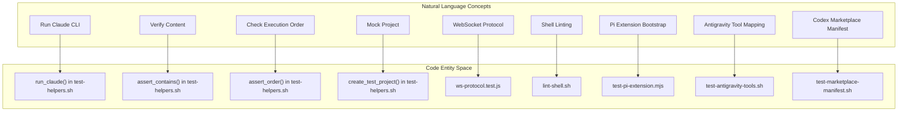

<!-- source: DeepWiki mcp.deepwiki.com · repo obra/superpowers · page 9.5 Testing Tools, Helpers, and Lint · fetched 2026-10-26 -->

# Testing Tools, Helpers, and Lint

Relevant source files

The following files were used as context for generating this wiki page:

- [.agents/plugins/marketplace.json](.agents/plugins/marketplace.json)
- [.pi/extensions/superpowers.ts](.pi/extensions/superpowers.ts)
- [scripts/lint-shell.sh](scripts/lint-shell.sh)
- [skills/using-superpowers/references/antigravity-tools.md](skills/using-superpowers/references/antigravity-tools.md)
- [skills/using-superpowers/references/pi-tools.md](skills/using-superpowers/references/pi-tools.md)
- [tests/antigravity/run-tests.sh](tests/antigravity/run-tests.sh)
- [tests/antigravity/test-antigravity-tools.sh](tests/antigravity/test-antigravity-tools.sh)
- [tests/claude-code/README.md](tests/claude-code/README.md)
- [tests/claude-code/run-skill-tests.sh](tests/claude-code/run-skill-tests.sh)
- [tests/claude-code/test-helpers.sh](tests/claude-code/test-helpers.sh)
- [tests/claude-code/test-subagent-driven-development.sh](tests/claude-code/test-subagent-driven-development.sh)
- [tests/codex/test-marketplace-manifest.sh](tests/codex/test-marketplace-manifest.sh)
- [tests/pi/test-pi-extension.mjs](tests/pi/test-pi-extension.mjs)
- [tests/shell-lint/test-lint-shell.sh](tests/shell-lint/test-lint-shell.sh)

This page provides a technical reference for the testing utilities found in `test-helpers.sh` and the supporting infrastructure for validating AI skills and workflows. These tools are designed to validate AI skill behavior by executing the Claude Code CLI in a headless environment and performing assertions on the resulting output, as well as providing specialized runners for other components like the Brainstorm server and shell scripts.

## Overview

The testing infrastructure relies on a set of Bash helper functions located at [tests/claude-code/test-helpers.sh](). These functions abstract the complexity of invoking the AI model, managing timeouts, and parsing terminal output. By using these helpers, developers can write "Fast Tests" that verify skill instructions or "Integration Tests" that execute full software development workflows.

Sources: [tests/claude-code/test-helpers.sh:1-5](), [tests/claude-code/README.md:5-13]()

## Core Helper Functions

### run_claude
The primary entry point for interacting with the AI during tests. It wraps the `claude` CLI command.

| Parameter | Type | Description |
| :--- | :--- | :--- |
| `prompt` | String | The instruction or query sent to Claude. |
| `timeout` | Integer | Maximum seconds to wait (default: 60). |
| `allowed_tools` | String | Comma-separated list of tools Claude is permitted to use. |

**Implementation Detail:** The function creates a temporary file using `mktemp` to capture output, executes `claude -p "$prompt"`, and returns the content of the output file [tests/claude-code/test-helpers.sh:6-16](). It runs Claude in headless mode with a timeout; if the command times out or fails, it outputs the captured text to `stderr` and returns the exit code [tests/claude-code/test-helpers.sh:18-28]().

Sources: [tests/claude-code/test-helpers.sh:6-29]()

### Assertion Functions
These functions validate the strings returned by `run_claude`. Matching is case-insensitive to account for model variations in capitalization [tests/claude-code/test-helpers.sh:33-35]().

*   **`assert_contains`**: Verifies that a specific regex pattern exists in the output [tests/claude-code/test-helpers.sh:33-48]().
*   **`assert_not_contains`**: Verifies that a pattern is absent, useful for checking negative constraints [tests/claude-code/test-helpers.sh:52-67]().
*   **`assert_count`**: Counts occurrences of a pattern and compares against an expected integer [tests/claude-code/test-helpers.sh:71-90]().
*   **`assert_order`**: Ensures that `pattern_a` appears chronologically before `pattern_b` in the text. This is used in `test-subagent-driven-development.sh` to verify that "Spec compliance" is discussed before "code quality" [tests/claude-code/test-helpers.sh:94-123](), [tests/claude-code/test-subagent-driven-development.sh:42-50]().

Sources: [tests/claude-code/test-helpers.sh:33-123](), [tests/claude-code/test-subagent-driven-development.sh:42-50]()

### Project Lifecycle Helpers
Used primarily in integration tests to simulate real-world development environments.

*   **`create_test_project`**: Generates a unique temporary directory using `mktemp -d` [tests/claude-code/test-helpers.sh:127-130]().
*   **`cleanup_test_project`**: Recursively removes the temporary project directory [tests/claude-code/test-helpers.sh:134-139]().
*   **`create_test_plan`**: Generates a standard implementation plan inside `docs/superpowers/plans/` to test plan-following behavior [tests/claude-code/test-helpers.sh:143-192]().

Sources: [tests/claude-code/test-helpers.sh:127-192]()

## Brainstorm Server Testing

The repository includes a comprehensive Node.js-based test suite for the Brainstorming Visual Companion server [tests/brainstorm-server/package.json:1-10](). These tests verify protocol compliance, security, and platform-specific behaviors.

### WebSocket Protocol Verification
The `ws-protocol.test.js` file validates the zero-dependency implementation of RFC 6455.
*   **`computeAcceptKey`**: Verifies the SHA-1 handshake computation against RFC 6455 Section 4.2.2 examples [tests/brainstorm-server/ws-protocol.test.js:50-56]().
*   **`encodeFrame`**: Tests encoding of small (<126 bytes), medium (16-bit length), and large (64-bit length) frames [tests/brainstorm-server/ws-protocol.test.js:72-123]().
*   **`decodeFrame`**: Validates the decoding of masked client frames, ensuring XOR-unmasking works correctly [tests/brainstorm-server/ws-protocol.test.js:146-188]().

Sources: [tests/brainstorm-server/ws-protocol.test.js:1-190](), [docs/superpowers/specs/2026-03-11-zero-dep-brainstorm-server-design.md:16-36]()

### Server Integration Tests
The `server.test.js` file performs end-to-end testing of the HTTP and WebSocket server using the `ws` package as a test client [tests/brainstorm-server/server.test.js:7-13]().
*   **Startup Verification**: Checks that the server outputs the `server-started` JSON and writes connection info to the state directory [tests/brainstorm-server/server.test.js:150-168]().
*   **HTTP Serving**: Validates that the server serves HTML documents, injects `helper.js`, and correctly wraps fragments in the frame template [tests/brainstorm-server/server.test.js:173-205]().

Sources: [tests/brainstorm-server/server.test.js:1-205]()

### Browser Launcher Verification
The `browser-launcher.test.js` verifies that the server correctly identifies the host OS to open the visual companion in a browser without introducing shell injection vulnerabilities. It specifically checks that the Windows launcher uses `rundll32.exe` and does not route through `cmd.exe /c` [tests/brainstorm-server/browser-launcher.test.js:24-37]().

Sources: [tests/brainstorm-server/browser-launcher.test.js:1-66]()

## Shell Script Linting

The repository includes a dedicated linter and test suite for shell scripts to ensure cross-platform compatibility and code quality.

*   **`scripts/lint-shell.sh`**: A wrapper around `shellcheck` and `shfmt`. It automatically identifies shell files by extension or shebang [scripts/lint-shell.sh:26-40](). It supports `--all` to check the full baseline or `--format` to apply formatting [scripts/lint-shell.sh:148-158]().
*   **`tests/shell-lint/test-lint-shell.sh`**: A meta-test suite that verifies the linter itself. It uses stub tools to ensure the linter correctly identifies changed files, follows external sources, and ignores non-shell files like Markdown [tests/shell-lint/test-lint-shell.sh:128-156]().

Sources: [scripts/lint-shell.sh:1-211](), [tests/shell-lint/test-lint-shell.sh:1-179]()

## Per-Harness Test Runners

The Superpowers project includes specific test runners and validation scripts for various AI harnesses to ensure proper integration and skill behavior across platforms.

### Pi (Earendil)
The Pi extension is tested by `test-pi-extension.mjs`. This Node.js test suite verifies the extension's lifecycle hooks and resource discovery.

*   **`package.json` Declaration**: Asserts that `package.json` correctly declares `pi-package` keywords, skill paths, and extension paths [tests/pi/test-pi-extension.mjs:45-52]().
*   **Lifecycle Hooks**: Verifies that the extension registers handlers for `resources_discover`, `session_start`, `session_compact`, `context`, and `agent_end` events [tests/pi/test-pi-extension.mjs:54-60]().
*   **Resource Discovery**: Confirms that `resources_discover` handler correctly contributes the `skills` directory [tests/pi/test-pi-extension.mjs:62-69]().
*   **Bootstrap Injection**: Tests that the `session_start` and `session_compact` hooks correctly inject the `using-superpowers` bootstrap message into the context, ensuring it's a user message, contains the `BOOTSTRAP_MARKER`, and is inserted after any compaction summaries [tests/pi/test-pi-extension.mjs:71-119]().
*   **Tool Mapping Documentation**: Checks that `skills/using-superpowers/references/pi-tools.md` exists and documents Pi-specific tool mappings for subagent dispatch and task tracking [tests/pi/test-pi-extension.mjs:121-137]().

Sources: [tests/pi/test-pi-extension.mjs:1-137](), [.pi/extensions/superpowers.ts:1-121](), [skills/using-superpowers/references/pi-tools.md:1-16]()

### Antigravity (agy)
Antigravity integration is validated by `test-antigravity-tools.sh`. This script focuses on the tool mapping documentation, as Antigravity directly installs the plugin.

*   **Mapping File Existence**: Confirms that `skills/using-superpowers/references/antigravity-tools.md` exists [tests/antigravity/test-antigravity-tools.sh:23]().
*   **Core Tool Documentation**: Verifies that essential Antigravity tools like `write_to_file`, `replace_file_content`, and `invoke_subagent` are documented in the mapping [tests/antigravity/test-antigravity-tools.sh:26-29]().
*   **Subagent Types**: Asserts that the mapping documents the built-in `self` and `research` subagent types [tests/antigravity/test-antigravity-tools.sh:32-37]().
*   **Task Tracking Mechanism**: Checks for documentation of the "task artifact" mechanism for task tracking [tests/antigravity/test-antigravity-tools.sh:40-42]().
*   **`SKILL.md` Reference**: Ensures that the main `using-superpowers/SKILL.md` links to `antigravity-tools.md` [tests/antigravity/test-antigravity-tools.sh:45-46]().

Sources: [tests/antigravity/test-antigravity-tools.sh:1-46](), [skills/using-superpowers/references/antigravity-tools.md:1-23]()

### Codex
Codex integration is tested by `test-marketplace-manifest.sh`. This Python-based script validates the structure and content of the `marketplace.json` and `plugin.json` files.

*   **`marketplace.json` Structure**: Asserts the `name`, `displayName`, and `plugins` list structure within `.agents/plugins/marketplace.json` [tests/codex/test-marketplace-manifest.sh:20-30]().
*   **`superpowers` Plugin Entry**: Verifies the `superpowers` plugin entry's `source` (must be `./`), `policy`, and `category` [tests/codex/test-marketplace-manifest.sh:32-47]().
*   **`plugin.json` Consistency**: Checks that the `name` in `.codex-plugin/plugin.json` matches the marketplace entry [tests/codex/test-marketplace-manifest.sh:49-53]().
*   **Hooks Suppression**: Critically, it asserts that `plugin.json` explicitly declares an empty `hooks` object (`{}`) to suppress Codex's auto-discovery of `hooks/hooks.json`, which is intended for Claude Code's SessionStart hook [tests/codex/test-marketplace-manifest.sh:55-73]().

Sources: [tests/codex/test-marketplace-manifest.sh:1-76](), [.agents/plugins/marketplace.json:1-20]()

## Data Flow and Architecture

The following diagram illustrates how a test script uses the helper library to communicate with the Claude CLI and the local filesystem.

### Test Execution Flow

Sources: [tests/claude-code/test-helpers.sh:1-203](), [tests/claude-code/test-subagent-driven-development.sh:23-35]()

## Natural Language to Code Entity Mapping

This diagram bridges conceptual test requirements to specific code entities in the testing suite.

Sources: [tests/claude-code/test-helpers.sh:6-123](), [tests/brainstorm-server/ws-protocol.test.js:1-15](), [scripts/lint-shell.sh:1-10](), [tests/pi/test-pi-extension.mjs:1-137](), [tests/antigravity/test-antigravity-tools.sh:1-46](), [tests/codex/test-marketplace-manifest.sh:1-76]()

## Test Runners and Configuration

The primary runner for skill tests is `run-skill-tests.sh`. It supports several flags to control execution:

| Flag | Purpose |
| :--- | :--- |
| `--verbose` | Shows full Claude output for debugging [tests/claude-code/run-skill-tests.sh:33-36](). |
| `--test` | Runs a specific test file instead of the whole suite [tests/claude-code/run-skill-tests.sh:37-40](). |
| `--integration` | Enables slow, full-workflow execution tests [tests/claude-code/run-skill-tests.sh:45-48](). |
| `--timeout` | Sets the per-test timeout (default 900s) [tests/claude-code/run-skill-tests.sh:28-29](). |

Sources: [tests/claude-code/run-skill-tests.sh:26-72]()

---

