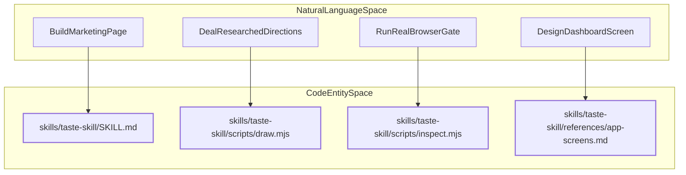

<!-- source: DeepWiki mcp.deepwiki.com · repo Leonxlnx/taste-skill · page 1 Overview · fetched 2026-10-26 -->

# Overview

Relevant source files

The following files were used as context for generating this wiki page:

- [CHANGELOG.md](CHANGELOG.md)
- [README.md](README.md)
- [assets/sponsors/vercel-logo.svg](assets/sponsors/vercel-logo.svg)
- [assets/vercel-oss-program-badge.svg](assets/vercel-oss-program-badge.svg)
- [skills/taste-skill/SKILL.md](skills/taste-skill/SKILL.md)

**Taste Skill** (`design-taste-frontend`) is an agent skill and anti-slop art direction toolkit designed to force coding agents (such as Claude Code and Codex) to design high-agency websites and app screens instead of generating generic, uninspired UI templates [README.md:61](), [skills/taste-skill/SKILL.md:2-13](). 

The repository features the v2/v2.1 pipeline, shifting from heuristic prompts to deterministic composition scripts (`draw.mjs`, `assets.mjs`), open-collection real imagery integration, scroll scenes, app-screen modes for dashboards, and a rigorous real-browser quality gate [README.md:123-139](), [CHANGELOG.md:37-61](). Classic style skills have been separated into dedicated repositories [README.md:121](), [CHANGELOG.md:15]().

## The v2 and v2.1 Pipeline Architecture

AI agents traditionally default to uniform layouts, low-contrast gradients, hairlines, and AI tells [CHANGELOG.md:32](). Taste Skill mitigates this via a deterministic pipeline:
1. **Inventory**: Cataloging unique assets, metrics, and domain specifics [README.md:127]().
2. **Draw**: Dealing directions, type systems, and palettes from a researched library using `scripts/draw.mjs` [CHANGELOG.md:29]().
3. **Idea**: Establishing a core concept tethered directly to the client's material [README.md:129]().
4. **Build**: Constructing the frontend using open-collection images and localized styling [README.md:130]().
5. **Gate**: Executing static linting and CDP-driven browser inspections via `scripts/inspect.mjs` [README.md:131]().
6. **Look**: Self-critiquing screenshots against an award-level visual rubric [README.md:132]().

v2.1 expands this machinery to support app screens, dashboards, admin views, and sticky scroll scenes [README.md:136](), [CHANGELOG.md:39-61]().

### Natural Language Space to Code Entity Space

The following diagram maps high-level user intents to specific execution scripts and core modules inside the codebase.

Sources: [README.md:61-137](), [skills/taste-skill/SKILL.md:1-56]()

---

## Child Guides & Detailed Documentation

This parent wiki page introduces the high-level architecture. For complete technical details, consult the child pages below:

*   **[Getting Started & Installation](#1.1)** — Installing via `npx skills add --skill design-taste-frontend`, Claude Code and Codex plugin marketplaces, local symlinking, runtime prerequisites (Node 22+, Chrome/Edge/Chromium), and agent setup.
*   **[Repository Structure](#1.2)** — Directory maps for `skills/taste-skill/`, including `scripts/`, `scripts/lib/`, `library/`, `references/`, `assets/`, `evals/`, and the relocation details for classic skills.
*   **[Plugin Manifests & Distribution](#1.3)** — Configuration details for `.claude-plugin/plugin.json`, marketplace registries, `.codex-plugin/plugin.json`, versioning via `CHANGELOG.md`, and sponsorship assets.
*   **[Release History & Version Evolution](#1.4)** — Chronological review of `CHANGELOG.md`, tracking the v1 to v2 transition, the scroll-scene engine, v2.1 app screens, and CDP browser profile sweep mechanisms.

Sources: [README.md:78-122](), [CHANGELOG.md:7-61]()

---

