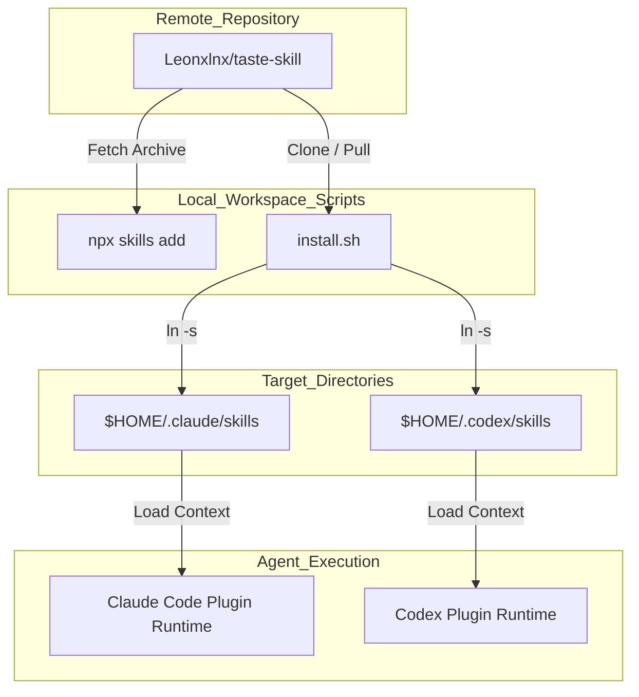
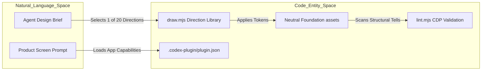

<!-- source: DeepWiki mcp.deepwiki.com · repo Leonxlnx/taste-skill · page 1.1 Getting Started & Installation · fetched 2026-10-26 -->

# Getting Started & Installation

<details>
<summary>Relevant source files</summary>

The following files were used as context for generating this wiki page:

- [.codex-plugin/plugin.json](.codex-plugin/plugin.json)
- [README.md](README.md)
- [assets/sponsors/vercel-logo.svg](assets/sponsors/vercel-logo.svg)
- [assets/vercel-oss-program-badge.svg](assets/vercel-oss-program-badge.svg)
- [install.sh](install.sh)

</details>


This page covers the technical integration of the **Taste Skill** collection into AI-assisted development environments. It details installation via the `npx skills` CLI [README.md:80-82](), marketplace plugins for Claude Code [README.md:89-100]() and Codex [README.md:102-112](), symlink deployment via `install.sh` [install.sh:1-135](), runtime prerequisites [README.md:86](), and agent configuration.

Sources:
- [README.md:80-122]()
- [install.sh:1-135]()

---

## Installation Methods

The repository supports multiple installation strategies depending on your agent environment and workflow requirements.

### Quick Start via CLI
To install the skill into your project using the Vercel Labs `agent-skills` CLI standard, run [README.md:80-82]():

```bash
npx skills add https://github.com/Leonxlnx/taste-skill --skill "design-taste-frontend"
```

### Claude Code Plugin Marketplace
If you are operating inside Claude Code, you can add the plugin repository and install namespaced skills [README.md:89-100]():

```
/plugin marketplace add Leonxlnx/taste-skill
/plugin install taste-skill@taste-skill
```

Updates are managed via `/plugin update` [README.md:98](). Every skill is namespaced under `taste-skill:` to prevent collision with other skills [README.md:91]().

### Codex Plugin Marketplace
For Codex environments, use the corresponding plugin marketplace commands [README.md:102-112]():

```bash
codex plugin marketplace add Leonxlnx/taste-skill
codex plugin add taste-skill@taste-skill
```

Start a new Codex session afterwards to ensure the skill is loaded [README.md:110]().

Sources:
- [README.md:78-122]()

---

## Local Symlinking (`install.sh`)

For local development and continuous synchronization via `git pull`, the repository provides a shell utility script: `install.sh` [install.sh:1-15]().

Rather than copying files, `install.sh` creates symbolic links into your agent skill directories (`$HOME/.claude/skills` or `$HOME/.codex/skills`) [install.sh:8-30]().

Key implementation functions in `install.sh`:
- `resolve_link()`: Resolves absolute and relative symlinks against the link's directory to verify their origin [install.sh:44-51]().
- `owned_by_repo()`: Validates that an existing symlink resolves directly inside `$SKILLS_DIR` [install.sh:53-58]().
- `install_name()`: Parses frontmatter `name:` fields from `SKILL.md`, falling back to the directory name [install.sh:60-67]().

Usage flags:
```bash
./install.sh                          # link all skills into Claude Code
./install.sh --codex                  # link into Codex instead
./install.sh --all-agents             # link into both
./install.sh design-taste-frontend    # link specific install name by name
./install.sh --list                   # show install name -> folder mapping
./install.sh --uninstall              # remove links pointing at this repo
```

Sources:
- [install.sh:1-135]()

---

## Runtime Prerequisites

The `design-taste-frontend` skill executes local scripts (such as `draw.mjs`, `assets.mjs`, and `lint.mjs`) during its build and validation pipeline. 

- **Node.js**: Requires **Node 22+** to support native ESM modules and modern JavaScript features utilized in the scripts [README.md:86]().
- **Browser Runtime**: Requires an installed instance of **Chrome, Edge, or Chromium** for CDP-driven headless browser validation and measurement [README.md:86]().
- **Network Access**: Required for open-collection asset discovery across Wikimedia Commons, Openverse, and art archives [README.md:86](). No API keys are required [README.md:86]().

Sources:
- [README.md:78-87]()

---

## Data Flow & Architecture

The following diagrams illustrate how installation mechanisms and natural language inputs translate into runtime agent behavior and code structures.

### Diagram 1: Installation Data Flow and Agent Binding
This diagram maps the remote repository distribution channels and local symlink resolution to agent execution environments.

Title: "Installation Data Flow and Agent Binding"


Sources:
- [README.md:78-120]()
- [install.sh:26-40]()

### Diagram 2: Natural Language Brief to Code Entity Space
This diagram links high-level agent design inputs and configuration parameters to concrete codebase entities and runtime validation logic.

Title: "Natural Language Brief to Code Entity Space"


Sources:
- [README.md:123-136]()
- [.codex-plugin/plugin.json:20-33]()

---

