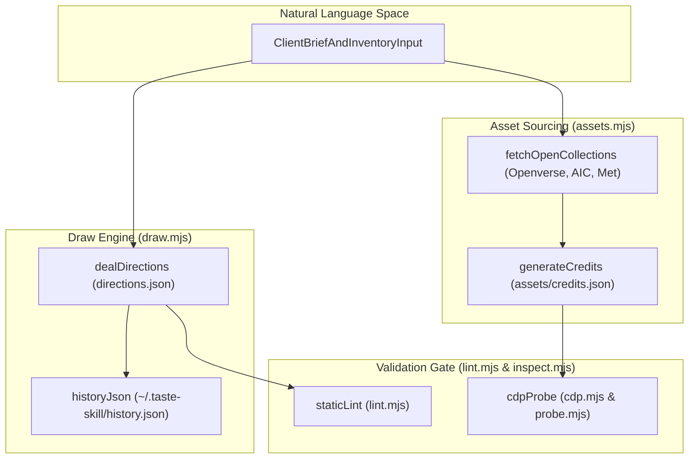
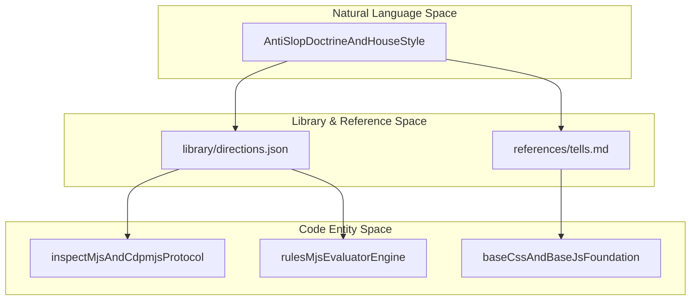

<!-- source: DeepWiki mcp.deepwiki.com · repo Leonxlnx/taste-skill · page 1.2 Repository Structure · fetched 2026-10-26 -->

# Repository Structure

<details>
<summary>Relevant source files</summary>

The following files were used as context for generating this wiki page:

- [.gitignore](.gitignore)
- [README.md](README.md)
- [assets/sponsors/vercel-logo.svg](assets/sponsors/vercel-logo.svg)
- [assets/vercel-oss-program-badge.svg](assets/vercel-oss-program-badge.svg)
- [skills/taste-skill/README.md](skills/taste-skill/README.md)
- [skills/taste-skill/library/directions.json](skills/taste-skill/library/directions.json)
- [skills/taste-skill/scripts/assets.mjs](skills/taste-skill/scripts/assets.mjs)

</details>


This page provides a technical map of the `taste-skill` repository (`https://github.com/Leonxlnx/taste-skill`). It details the organizational layout of canonical skill definitions, the internal structure of `skills/taste-skill/` (including `SKILL.md`, scripts, libraries, references, assets, and evals), plugin distribution manifests, test suites, example galleries, static assets, and the standalone repositories where legacy skills now reside.

Sources: [README.md:61-143](), [skills/taste-skill/README.md:35-51]()

## 1. Top-Level Directory Overview

The repository root houses distribution manifests for agent marketplaces, core skill source files, test suites, visual examples, and branding assets.

| Directory / File | Technical Purpose |
| :--- | :--- |
| `skills/` | Canonical container for skill definitions, housing the v2/v2.1 default skill `taste-skill` (`design-taste-frontend`) [skills/taste-skill/README.md:1-2]() |
| `examples/` | Visual outputs, screenshot demonstrations (`coffee-storefront.webp`, `night-dates.webp`), and media provenance records [README.md:67-76]() |
| `assets/` | Repository branding assets, wordmarks, README imagery, and sponsor graphics [README.md:1-57]() |
| `tests/` | Automated test suites including frontmatter validation (`frontmatter.mjs`) and browser profile sweep tests (`profile-cleanup.mjs`) |
| `.claude-plugin/`, `.codex-plugin/`, `.agents/` | Agent plugin distribution manifests and marketplace configurations |
| `install.sh` | Local development script for symlinking the skill into agent runtimes (`--codex`, `--all-agents`) [README.md:117-118]() |

Sources: [README.md:67-118](), [skills/taste-skill/README.md:35-51]()

## 2. The `skills/taste-skill/` Subtree Anatomy

The default v2 skill implementation resides within `skills/taste-skill/`, bundling deterministic generation scripts, analytical references, and design data libraries [skills/taste-skill/README.md:35-51]().

```
skills/taste-skill/
├── SKILL.md                 # Run protocol, 10-step pipeline, house rules, and laws
├── references/              # Analytical references: copy, type, colour, layout, imagery, motion, critique, tells, research
├── scripts/
│   ├── draw.mjs             # Direction dealing engine (--alternatives, --photos, --site)
│   ├── assets.mjs           # Open-collection media sourcing (Openverse, Wikimedia, AIC, Met)
│   ├── lint.mjs             # Static source linter for banned patterns and stock phrases
│   └── inspect.mjs          # CDP-driven headless browser render, measure, and capture
├── scripts/lib/             # Zero-dependency Chrome DevTools client (cdp.mjs), in-page probe (probe.mjs), rules engine (rules.mjs)
├── library/                 # 20 directions, heroes, sections, type systems, palettes, photographs, studied sites, motions
├── assets/                  # Optional neutral foundation (base.css, base.js) and generated credits.json
└── evals/                   # Test briefs for baseline comparison (evals.json)
```

Sources: [skills/taste-skill/README.md:37-51]()

## 3. Pipeline Scripts and Data Flow Architecture

The skill enforces deterministic art direction through discrete Node.js execution scripts (`scripts/*.mjs`) that bridge natural language requirements with strict automated compliance gates.

**Diagram: Pipeline Execution Flow & Code Mapping**

Sources: [skills/taste-skill/README.md:10-30](), [skills/taste-skill/README.md:40-46](), [skills/taste-skill/scripts/assets.mjs:1-50]()

### Key Script Modules & Data Handlers
*   **`scripts/draw.mjs`**: Manages direction dealing from the 20-item JSON library (`library/directions.json`), recording state in `~/.taste-skill/history.json` to prevent repetition [skills/taste-skill/README.md:40-40](), [skills/taste-skill/README.md:78-79]().
*   **`scripts/assets.mjs`**: Zero-dependency media client querying Openverse, Wikimedia Commons, the Art Institute of Chicago, and the Met, outputting provenance metadata to `assets/credits.json` [skills/taste-skill/README.md:41-43](), [skills/taste-skill/scripts/assets.mjs:24-45]().
*   **`scripts/lint.mjs`**: Static source code linter enforcing anti-slop rule sets, scanning for banned stock phrases, gradients, and resting shadows [skills/taste-skill/README.md:24-26](), [skills/taste-skill/README.md:44-44]().
*   **`scripts/inspect.mjs`**: CDP-driven headless Chrome client managing throwaway profiles, viewports at 1440px/768px/390px, and screenshot capture for the Look critique loop [skills/taste-skill/README.md:24-30](), [skills/taste-skill/README.md:45-46]().

Sources: [skills/taste-skill/README.md:24-46](), [skills/taste-skill/scripts/assets.mjs:24-53]()

## 4. Natural Language to Code Entity Mapping

The architecture directly associates abstract aesthetic principles with concrete automation functions and data structures.

**Diagram: Aesthetic Directive Translation**

Sources: [README.md:61-76](), [skills/taste-skill/README.md:38-49]()

Sources: [README.md:61-76](), [skills/taste-skill/README.md:38-49]()

## 5. Moved Skills and Distribution Registry

While this repository hosts `design-taste-frontend` (`skills/taste-skill/`), legacy and auxiliary skills have been migrated to dedicated external repositories while retaining their original install names [README.md:121-143](). Users can continue installation via standard agent registry flows or local checkout symlinking (`install.sh`) [README.md:80-118]().

Sources: [README.md:80-143]()

---

