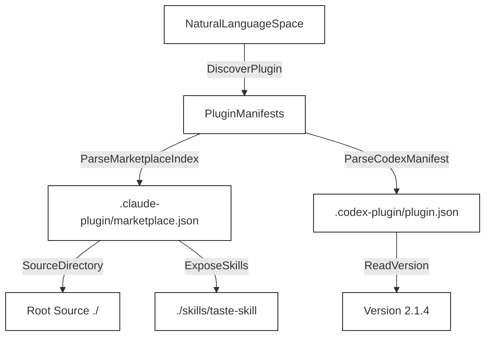
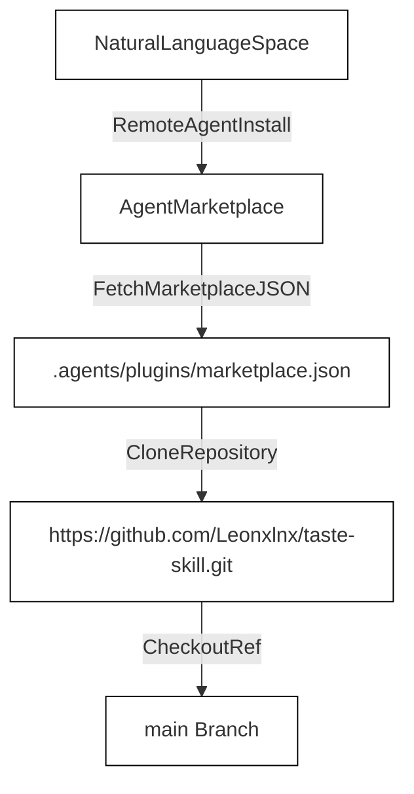
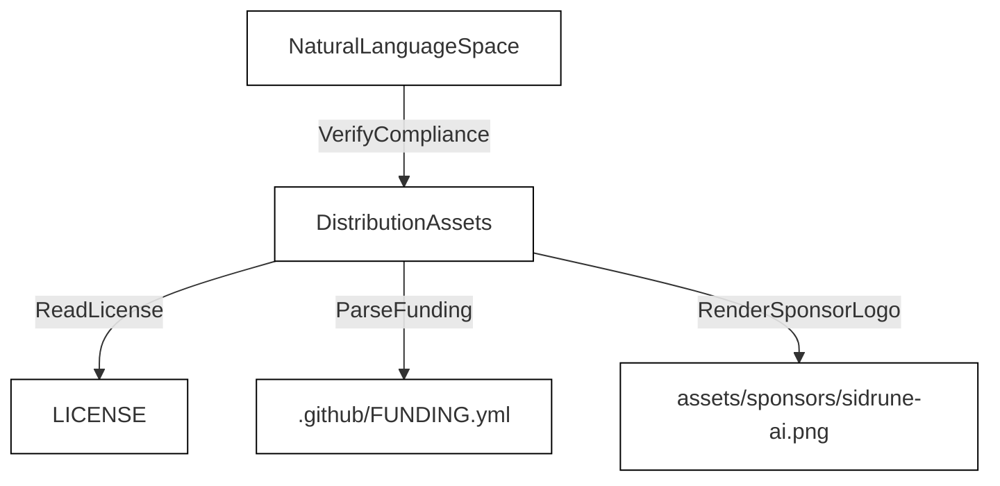

<!-- source: DeepWiki mcp.deepwiki.com · repo Leonxlnx/taste-skill · page 1.3 Plugin Manifests & Distribution · fetched 2026-10-26 -->

# Plugin Manifests & Distribution

Relevant source files

The following files were used as context for generating this wiki page:

- [.agents/plugins/marketplace.json](.agents/plugins/marketplace.json)
- [.claude-plugin/marketplace.json](.claude-plugin/marketplace.json)
- [.codex-plugin/plugin.json](.codex-plugin/plugin.json)
- [.github/FUNDING.yml](.github/FUNDING.yml)
- [LICENSE](LICENSE)
- [assets/sponsors/sidrune-ai.png](assets/sponsors/sidrune-ai.png)

## Purpose and Scope
This page details the multi-platform distribution architecture of the `taste-skill` repository. It covers how canonical skill definitions inside `skills/` are packaged, registered, and published for AI coding assistants and CLI runners using agent-specific plugin manifests (`.claude-plugin/marketplace.json`, `.codex-plugin/plugin.json`, `.agents/plugins/marketplace.json`), version synchronization (`2.1.4`), licensing, and sponsorship assets.

---

## 1. Claude Code and Codex Plugin Manifests
The repository provides dedicated manifest files for different agent ecosystems. These files declare plugin metadata, versioning (synchronized at `2.1.4`), author attribution, keywords, and exposed skill directories so that platforms like Claude Code and Codex can automatically discover and ingest the skill modules.

- **Claude Marketplace Index**: Declared in `.claude-plugin/marketplace.json` [.claude-plugin/marketplace.json:1-25](), mapping the root source `./` and exposing skills under `./skills/taste-skill`.
- **Codex Plugin**: Declared in `.codex-plugin/plugin.json` [.codex-plugin/plugin.json:1-34](), providing detailed interface configurations, display names, capabilities, and default prompt suggestions for the Codex environment.

*Sources: [.claude-plugin/marketplace.json:1-25](), [.codex-plugin/plugin.json:1-34]()*

---

## 2. Remote Agent Marketplaces and Registries
For distributed agent orchestrators that pull packages directly via Git URLs, the `.agents/plugins/marketplace.json` manifest acts as the remote registry descriptor. It defines the source repository URL, git reference (`main`), installation policy (`AVAILABLE`), and authentication hooks.

- **Registry File**: `.agents/plugins/marketplace.json` [.agents/plugins/marketplace.json:1-21]()
- **Remote Source**: Pointed at `https://github.com/Leonxlnx/taste-skill.git` with authentication policy set to `ON_INSTALL`.

*Sources: [.agents/plugins/marketplace.json:1-21]()*

---

## 3. Licensing, Sponsorship and Versioning Assets
The repository maintains open-source compliance and sponsorship branding assets at the root level and within dedicated asset directories:

- **License**: Distributed under the MIT License, defined in `LICENSE` [LICENSE:1-21]().
- **Funding & Sponsorship**: Configured via `.github/FUNDING.yml` [.github/FUNDING.yml:1](), referencing sponsor assets like `assets/sponsors/sidrune-ai.png` [assets/sponsors/sidrune-ai.png:1-46]().
- **Version Tracking**: Releases across `.claude-plugin/marketplace.json` and `.codex-plugin/plugin.json` are synchronized to version `2.1.4`.

*Sources: [LICENSE:1-21](), [.github/FUNDING.yml:1](), [assets/sponsors/sidrune-ai.png:1-46]() *

---

