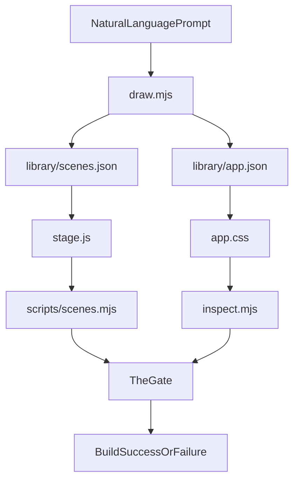
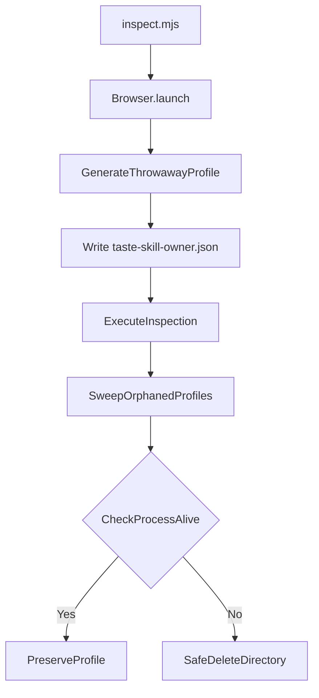

<!-- source: DeepWiki mcp.deepwiki.com · repo Leonxlnx/taste-skill · page 1.4 Release History & Version Evolution · fetched 2026-10-26 -->

# Release History & Version Evolution

Relevant source files

The following files were used as context for generating this wiki page:

- [CHANGELOG.md](CHANGELOG.md)

## Purpose & Scope

This page provides a technical walkthrough of `CHANGELOG.md`, tracing the evolution of the codebase from experimental v1 setups to the deterministic v2 pipeline and v2.1 feature sets. It details architectural shifts such as the transition from manual styling dials to deterministic composition generation via `draw.mjs`, the integration of the scroll-scene engine, app-screen support, and critical infrastructural fixes like safe browser profile cleanup.

Sources: `CHANGELOG.md:1-61`

---

## 1. The v1 to v2 Shift: From Dials to Deterministic Draw & Gate

The transition from v1 to v2 marks a fundamental architectural shift in how `taste-skill` handles design generation. In v1, agents relied on manual stylistic "dials" and subjective adjustments during execution, which frequently led to inconsistent output quality and unpredictable design "slop." 

Version 2 introduces a deterministic pipeline governed by rigid constraints and automated gates:
- **Deterministic Composition (`draw.mjs`)**: Instead of ad-hoc styling, agents deal predefined parameters from locked libraries (`library/directions.json`, `library/palettes.json`, `library/type.json`) [CHANGELOG.md:37-61].
- **The Gate (`inspect.mjs`, `lint.mjs`)**: Outputs are no longer trusted implicitly. Every build passes through automated static analysis and real-browser inspection probes that enforce anti-slop rules before completion [CHANGELOG.md:37-61].

Sources: `CHANGELOG.md:37-61`

---

## 2. Version 2.1: Scroll-Scene Engine, App Screens, and Product Page Integration

Version 2.1 expands the codebase from static marketing pages into dynamic scroll-driven experiences and dense functional application interfaces.

### The Scroll-Scene Engine
Version 2.1 establishes the foundation for cinematic scroll interactions:
- **`assets/scenes/stage.js` and `stage.css`**: Implements a sticky stage scrubbed by native scroll using pinned GSAP ScrollTrigger integrations, alongside conditional Lenis smoothing that automatically deactivates on touch devices and reduced-motion environments [CHANGELOG.md:43].
- **`scripts/scenes.mjs` and `inspect.mjs --film`**: Programmatically captures snapshots of every scene at 0% to 100% hold states across desktop, mobile, and reduced-motion viewports, failing builds if scenes fail to initialize or rest properly [CHANGELOG.md:44].

### App Screens and Dashboards
Unlike marketing pages, app screens (dashboards, admin panels, settings, inboxes) require strict data density and neutral structural shells:
- **`references/app-screens.md`**: Defines specific design laws for application interfaces, including quiet panels, KPIs, tabular numeric formatting, and structured data tables [CHANGELOG.md:57-61].
- **`app.css` & `charts.js`**: Shipped dependencies for rendering real-data visualizations within generated app views [CHANGELOG.md:50].

### Diagram: v2.1 Execution and Inspection Pipeline

Sources: `CHANGELOG.md:39-61`

---

## 3. Version 2.1.1 to 2.1.4: Refactoring, Validation Hardening, and Browser Profile Cleanup

The subsequent patch releases of v2.1 focused on repository decoupling, strict automated validation, and concurrency safety in browser diagnostics.

### Monorepo Splitting and Opt-in Classics
- **Classic Skills Separation**: Classic skills (`high-end-visual-design`, `minimalist-ui`, `industrial-brutalist-ui`, `gpt-taste`, `stitch-design-taste`, etc.) were moved to `Leonxlnx/taste-skill-classics`, making them strictly opt-in (`disable-model-invocation: true`) [CHANGELOG.md:16-31].
- **Image Generation Skills**: Moved to `Leonxlnx/imagegen-skills` [CHANGELOG.md:17-33].

### Strict Frontmatter Validation
To prevent parsing failures (such as issue `#151` where an unquoted colon in YAML descriptions caused skills to be silently dropped), validation was automated [CHANGELOG.md:24-25]:
- **`tests/frontmatter.mjs`**: Strictly parses every `SKILL.md` frontmatter and `agents/openai.yaml` configuration [CHANGELOG.md:25].
- **`check-skills.yml`**: GitHub Actions workflow executing frontmatter checks, registry checks, and script syntax verification on every push [CHANGELOG.md:25].

### Browser Profile Cleanup and Concurrency Fixes
Issue `#157` highlighted a race condition where concurrent inspector runs on Linux/macOS (which lack Chrome profile `lockfile` primitives) deleted active browser profiles based solely on file age [CHANGELOG.md:9-10]. Version 2.1.4 (`#158`) resolved this:
- **`taste-skill-owner.json`**: Every throwaway Chrome profile now writes an ownership manifest recording the machine ID and process IDs of the active test run and its corresponding Chrome instance [CHANGELOG.md:10].
- **Safe Sweeping Logic**: Subsequent runs verify the ownership manifest. Profiles are only deleted if the owning process is dead; unmanaged profiles are left untouched [CHANGELOG.md:10].

### Diagram: Browser Profile Concurrency Management

Sources: `CHANGELOG.md:7-36`

---

