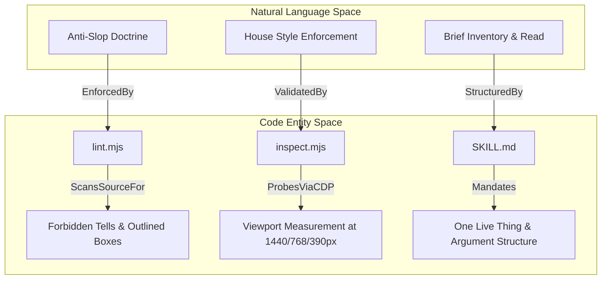

<!-- source: DeepWiki mcp.deepwiki.com · repo Leonxlnx/taste-skill · page 2 Core Design Philosophy · fetched 2026-10-26 -->

# Core Design Philosophy

<details>
<summary>Relevant source files</summary>

The following files were used as context for generating this wiki page:

- [skills/taste-skill/SKILL.md](skills/taste-skill/SKILL.md)
- [skills/taste-skill/assets/base.css](skills/taste-skill/assets/base.css)
- [skills/taste-skill/references/tells.md](skills/taste-skill/references/tells.md)

</details>


Overview of the 'Taste Standard' — the shared aesthetic and engineering principles behind every skill in the `taste-skill` repository. The Taste Standard provides a rigorous engineering and aesthetic framework designed to override the statistical biases inherent in Large Language Models (LLMs), moving away from generic templates ("slop") toward curated, agency-tier web design.

This parent page summarizes the core pillars of the philosophy and links to its detailed child pages:
- [AI Tells & Anti-Patterns](#2.1) — Comprehensive references for banned UI signatures, typography rules, and structural anti-patterns sourced from `references/tells.md`.
- [Motion & Animation System](#2.2) — Animation budgets, transform/opacity constraints, and canonical motion tokens from `references/motion.md` and `library/motions.json`.
- [Typography, Colour & Layout Standards](#2.3) — Concrete type scales, palette proportions, grid systems, and copy constraints from `references/type.md`, `references/colour.md`, `references/layout.md`, and `references/copy.md`.
- [Research Base: 247 Studied Sites](#2.4) — The statistical study of gallery sites underpinning the rules from `references/research.md` and `library/sites.json`.

Sources: [`skills/taste-skill/SKILL.md:4-38`](), [`skills/taste-skill/references/tells.md:1-12`](), [`skills/taste-skill/assets/base.css:1-41`]()

---

## The Anti-Slop Doctrine

Large Language Models naturally tend toward statistical averages: centered headlines over three lines, small category labels, rows of identical icon cards, subtle CSS gradients, thin hairlines, and monospace captions. The **Taste Standard** rejects these defaults via systematic checks and strict architectural guardrails.

Every build begins with Brief Inference and Subject Inventory (listing what uniquely belongs to the client, such as street names, local materials, and specific constraints) rather than resorting to category defaults [`skills/taste-skill/SKILL.md:76-99`]().

### Natural Language Space to Code Enforcement

The following diagram bridges abstract anti-slop principles to concrete code entities and validation scripts within the repository.

**Diagram: Mapping Anti-Slop Principles to Code Validation**


Sources: [`skills/taste-skill/SKILL.md:76-99`](), [`skills/taste-skill/references/tells.md:1-11`]()

---

## AI Tells & Anti-Patterns

A tell is a device that makes a page read as generated. While individual tells may seem harmless, their cumulative presence signals generic AI output. The skill maintains a dated registry of banned patterns—including violet/indigo gradients, eyebrows, 01/02/03 index numbering, monospace micro-labels, hairline borders, and generic color palettes—enforced automatically by static linting and real-browser inspection [`skills/taste-skill/references/tells.md:1-11`]().

For detailed rules, banned device categories, and proper alternatives, see [AI Tells & Anti-Patterns](#2.1).

Sources: [`skills/taste-skill/references/tells.md:1-80`]()

---

## Motion & Animation System

Motion within the Taste Standard adheres to a strict motion budget and physical easing tokens defined in `library/motions.json` and `assets/base.css`. Animations are restricted to transform, opacity, and clip-path properties to ensure zero layout thrashing, and all movements respect user accessibility settings via reduced-motion fallbacks [`skills/taste-skill/assets/base.css:29-41`]().

### Natural Language Space to Motion Execution

The following diagram links qualitative motion philosophy to the underlying CSS tokens and DOM hooks.

**Diagram: Motion Philosophy to Code Implementation**
```mermaid
graph LR
    subgraph "Natural Language Space"
        M1[""Motion Discipline""]
        M2[""Single Signature Move""]
    end

    subgraph "Code Entity Space"
        E1[""base.css""] -->|DefinesTokens| T1[""--ease-expo & --t-reveal""]
        E2[""base.css""] -->|ProvidesHooks| T2[""[data-rise] & [data-reveal]""]
        E3[""stages.js""] -->|DrivesScenes| T3[""GSAP ScrollTrigger Pinned Scenes""]
    end

    M1 -->|EnforcedVia| E1
    M2 -->|ExecutedBy| E3
```

For detailed timing curves, motion budgets, and view transitions, see [Motion & Animation System](#2.2).

Sources: [`skills/taste-skill/assets/base.css:29-41`](), [`skills/taste-skill/assets/base.css:90-105`]()

---

## Typography, Colour & Layout Standards

Design-system laws are derived from rigorous statistical studies of gallery sites. Type systems rely on distinct fluid scales (`--step-small` to `--step-display`), while colour palettes emphasize low-chroma stones, deep inks, and tonal surface steps rather than high-chroma AI gradients [`skills/taste-skill/assets/base.css:18-28`](). Layouts discard stock section orders in favor of an argument-driven structure [`skills/taste-skill/SKILL.md:100-105`]().

For concrete type scales, font loading rules, palette proportions, contrast laws, and copy constraints, see [Typography, Colour & Layout Standards](#2.3).

Sources: [`skills/taste-skill/assets/base.css:7-41`](), [`skills/taste-skill/SKILL.md:100-105`]()

---

## Research Base: 247 Studied Sites

The engineering principles and stylistic guardrails of `taste-skill` are underpinned by a statistical study of 247 curated gallery sites (such as One Page Love and Awwwards Sites of the Day). The data collected from these sites informs how `draw.mjs` deals directions, compositions, and palettes, and how per-site notes are surfaced [`skills/taste-skill/SKILL.md:4-13`]().

For deep dives into the statistical analysis and how specific gallery benchmarks shape output generation, see [Research Base: 247 Studied Sites](#2.4).

Sources: [`skills/taste-skill/SKILL.md:4-13`]()

---

### Related Child Pages
* [AI Tells & Anti-Patterns](#2.1)
* [Motion & Animation System](#2.2)
* [Typography, Colour & Layout Standards](#2.3)
* [Research Base: 247 Studied Sites](#2.4)

---

