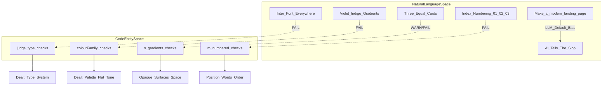
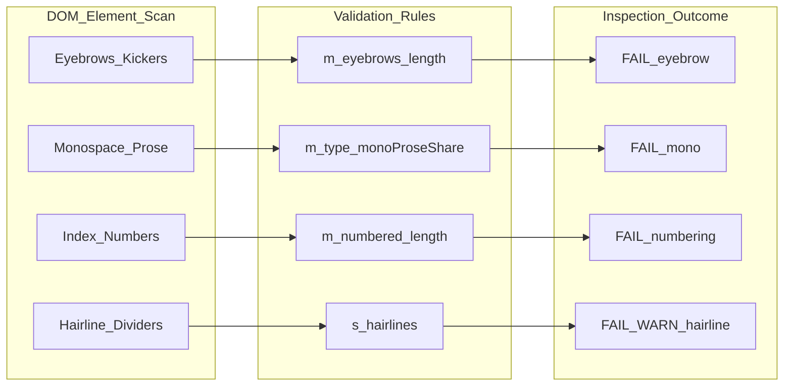

<!-- source: DeepWiki mcp.deepwiki.com · repo Leonxlnx/taste-skill · page 2.1 AI Tells & Anti-Patterns · fetched 2026-10-26 -->

# AI Tells & Anti-Patterns

Relevant source files

The following files were used as context for generating this wiki page:

- [skills/taste-skill/assets/base.css](skills/taste-skill/assets/base.css)
- [skills/taste-skill/references/tells.md](skills/taste-skill/references/tells.md)
- [skills/taste-skill/scripts/lib/rules.mjs](skills/taste-skill/scripts/lib/rules.mjs)

This page serves as a comprehensive technical reference of forbidden UI patterns, known as "AI Tells," that the Taste Standard actively bans. These patterns represent the statistical biases and "slop" typically generated by LLMs when left to their default configurations. Sourced from `references/tells.md` [skills/taste-skill/references/tells.md:1-112]() and the automated lint rules implemented in `skills/taste-skill/scripts/lib/rules.mjs` [skills/taste-skill/scripts/lib/rules.mjs:1-78](), this reference catalogs first-, second-, and third-wave tells, gallery fashions, copy violations, and structural anti-patterns. By identifying and systematically replacing these signatures, the codebase ensures high-agency, premium-tier frontend outputs.

## The Anti-Slop Philosophy & The Tell Registry

A tell is a device that makes a page read as generated. Tells are not bad design in themselves; most began as good ideas on good sites. They became tells by being produced by default, everywhere, without a reason [skills/taste-skill/references/tells.md:3-6](). 

The registry is dated and prescriptive: replacements are procedures (drawing from the library, deriving from the subject) rather than hardcoded product substitutes, because every published "use this instead" list rapidly becomes the next wave of tells [skills/taste-skill/references/tells.md:5-7](). Scripts like `scripts/inspect.mjs` and `scripts/lint.mjs` detect most entries with strict enforcement levels: **banned** means the inspector fails the page, while **warned** flags the element requiring explicit justification [skills/taste-skill/references/tells.md:9-10]().

### System Mapping: From Natural Language to Code Entities

The following diagram illustrates how the system identifies "AI Tells" in natural language requests or existing code and maps them to specific corrective logic within `skills/taste-skill/scripts/lib/rules.mjs`.

**Figure 1: Anti-Pattern Detection and Correction Flow**

Sources: [skills/taste-skill/references/tells.md:9-11](), [skills/taste-skill/scripts/lib/rules.mjs:8-15](), [skills/taste-skill/scripts/lib/rules.mjs:58-61]()

---

## 1. First & Second Wave Tells (2023–2025)

The early waves of AI design output established predictable visual signatures that automated validators now flag instantly.

### First Wave (2023–2024)
* **Violet / Indigo Gradients:** Hero sections, buttons, and glows utilizing violet/indigo fades are **banned** and replaced by the dealt palette or flat color [skills/taste-skill/references/tells.md:27-27]().
* **Gradient-Filled Headline Text:** Text filled with linear gradients is **banned** in favor of solid ink [skills/taste-skill/references/tells.md:28-28]().
* **Glass Panels:** Backdrop blur and translucent cards are **warned** when two or more appear (`s.blurred > 1`) [skills/taste-skill/references/tells.md:29-29](), [skills/taste-skill/scripts/lib/rules.mjs:77-77](); prefer opaque surfaces one tone step from the ground.
* **Generic Soft Shadows:** Soft grey drop shadows under every card are **banned** (`s.shadowStatic`) and replaced with tone steps or unboxed structures [skills/taste-skill/references/tells.md:31-31](), [skills/taste-skill/scripts/lib/rules.mjs:70-70]().
* **Three Identical Feature Cards:** Three identical feature cards each with an icon in a rounded square are **banned** [skills/taste-skill/references/tells.md:32-32]().
* **Emoji Icons/Bullets:** Using emoji as icons or bullet points is **banned** (`m.page.emoji`) [skills/taste-skill/references/tells.md:33-33](), [skills/taste-skill/scripts/lib/rules.mjs:64-64]().

### Second Wave (2025)
* **Eyebrows & Kickers:** Tiny tracked uppercase labels above headings (`m.eyebrows.length`) are **banned** [skills/taste-skill/references/tells.md:41-41](), [skills/taste-skill/scripts/lib/rules.mjs:50-53]().
* **Pill Badges:** Pill badges above hero headlines ("New", "Beta", "Introducing") are **banned** [skills/taste-skill/references/tells.md:42-42]().
* **Bento Grid Overuse:** Bento grids of rounded tiles used as default feature sections are **warned** as card rows; tiles are restricted to dense-tiles directions with strict sizes [skills/taste-skill/references/tells.md:44-44]().
* **Decorative Status Dots:** Pulsing "live" indicators or "Available for work" dots are flagged by lint rules and removed [skills/taste-skill/references/tells.md:48-48]().

Sources: [skills/taste-skill/references/tells.md:23-50](), [skills/taste-skill/scripts/lib/rules.mjs:50-77]()

---

## 2. Third Wave & Gallery Fashion Tells

The third wave encompasses "fixes" that became overused stylistic tropes, alongside award-site gallery fashions that carry no informational value.

### The Third Wave (2025–2026): The "Fix" That Became the Look
* **Cream Ground & Terracotta:** Yellow-cream grounds combined with terracotta/rust/clay accents are **banned** together (terracotta alone is banned; cream is warned) via `colourFamily()` [skills/taste-skill/references/tells.md:58-58](), [skills/taste-skill/scripts/lib/rules.mjs:8-15]().
* **Broadsheet Cosplay:** Hairline rules everywhere with zero radius and dense columns are **banned** via hairline inspection rules (`s.hairlines`) [skills/taste-skill/references/tells.md:61-61](), [skills/taste-skill/scripts/lib/rules.mjs:73-73]().
* **Performative Labels:** Labels like "Field notes", "Quietly trusted by", or "On our desks" are flagged by copy linters [skills/taste-skill/references/tells.md:62-62]().

### Gallery Fashion Banned as House Style
Checked rigorously by `skills/taste-skill/scripts/lib/rules.mjs`, these common award-site tropes are prohibited:
* **Monospace Micro-Labels:** Monospace type outside of literal `<pre>/<code>` blocks (checked via `m.type.monoProseShare`) is **banned** [skills/taste-skill/scripts/lib/rules.mjs:54-57](), [skills/taste-skill/references/tells.md:74-74]().
* **Index Numbering:** Decorative sequence markers like `01 / 02 / 03`, `(001)`, or `Step 02` (`m.numbered.length`) are **banned** [skills/taste-skill/scripts/lib/rules.mjs:58-61](), [skills/taste-skill/references/tells.md:75-75]().
* **Thin Rules & Hairlines:** Hairline dividers, ruled grids, and 1px outlined boxes (`s.hairlines`, `s.outlinedBoxes`) are **banned** when exceeding thresholds [skills/taste-skill/scripts/lib/rules.mjs:73-75](), [skills/taste-skill/references/tells.md:76-76]().
* **Design-Tool Chrome:** Crosshairs, crop marks, selection handles, dashed guides, and rulers are **banned** [skills/taste-skill/references/tells.md:77-77]().
* **Agency Micro-Meta:** Local time, coordinates, weather, version stamps, and middle-dot strings are flagged by copy and micro-label linters (`m.type.microLabels`) [skills/taste-skill/references/tells.md:78-78](), [skills/taste-skill/scripts/lib/rules.mjs:62-63]().

**Figure 2: Validator Inspection Logic for Banned Furniture**

Sources: [skills/taste-skill/references/tells.md:51-83](), [skills/taste-skill/scripts/lib/rules.mjs:50-75]()

---

## 3. Structural, Copy & Motion Tells

Beyond visual elements, structural layouts, copywriting patterns, and animation behaviors are systematically restricted.

### Structural Tells
* **Over-length Headlines:** Headlines running past two lines (`h.lines > 2`) at display size are **banned** [skills/taste-skill/scripts/lib/rules.mjs:36-40](), [skills/taste-skill/references/tells.md:88-88]().
* **Center Alignment Overuse:** Centering content across more than 72% of sections is **warned** [skills/taste-skill/references/tells.md:91-91]().
* **Uniform Border Radius:** Applying a single medium radius (12-16px) universally is prohibited in favor of explicit architectural choices [skills/taste-skill/references/tells.md:92-92]().
* **Invented Social Proof:** Fake logos, fabricated customer quotes, and generic star rows are **banned** [skills/taste-skill/references/tells.md:94-94]().

### Copy Tells
Flagged by `skills/taste-skill/scripts/lib/rules.mjs` and copy guidelines, forbidden copy elements include:
* **Buzzwords & Genre Verbs:** Terms like *unlock*, *supercharge*, *seamless*, *elevate*, *effortless*, *cutting-edge*, and *all-in-one* [skills/taste-skill/references/tells.md:99-100]().
* **Structural Cliques:** "Not just X, it's Y" formulations, tricolon headlines, and excessive em-dashes [skills/taste-skill/references/tells.md:100-101]().
* **Generic Call-to-Actions:** Buttons labeled "Get started" or "Learn more" without action context [skills/taste-skill/references/tells.md:101-101]().

### Motion Tells
Identical fade-up animations on every block, dozens of staggered hero entrances, hover lift on every card, bounce easing, and broken infinite loops are strictly prohibited [skills/taste-skill/references/tells.md:106-107](), matching the motion budget principles defined in `skills/taste-skill/assets/base.css` [skills/taste-skill/assets/base.css:94-103]().

Sources: [skills/taste-skill/references/tells.md:84-108](), [skills/taste-skill/scripts/lib/rules.mjs:36-40](), [skills/taste-skill/assets/base.css:94-103]()

---

## 4. Why Removal Is Not Enough

Removing every tell without substituting intentional design yields an empty page with good manners—an "avoidance aesthetic" that is itself a recognized tell [skills/taste-skill/references/tells.md:109-112](). 

The system mandates that eliminating slop must be paired with positive composition: drawing from the direction library, utilizing verified open-collection imagery, establishing a rigorous typographic hierarchy, and enforcing strict layout variation through `skills/taste-skill/scripts/lib/rules.mjs`.

Sources: [skills/taste-skill/references/tells.md:109-115](), [skills/taste-skill/scripts/lib/rules.mjs:1-137]()

---

