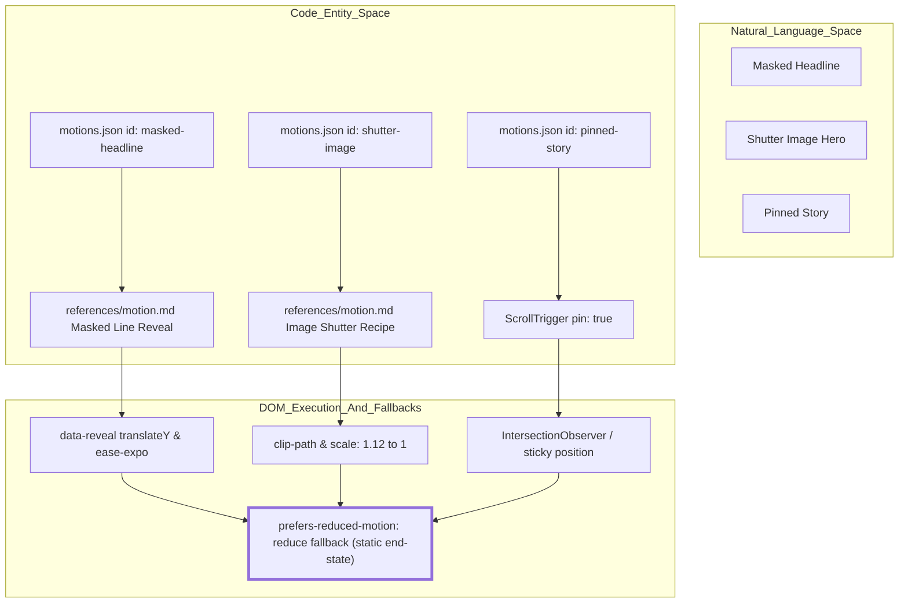
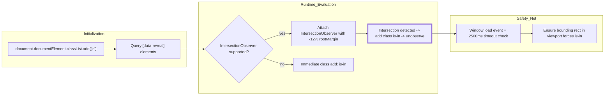

<!-- source: DeepWiki mcp.deepwiki.com · repo Leonxlnx/taste-skill · page 2.2 Motion & Animation System · fetched 2026-10-26 -->

# Motion & Animation System

<details>
<summary>Relevant source files</summary>

The following files were used as context for generating this wiki page:

- [skills/taste-skill/assets/base.js](skills/taste-skill/assets/base.js)
- [skills/taste-skill/library/motions.json](skills/taste-skill/library/motions.json)
- [skills/taste-skill/references/motion.md](skills/taste-skill/references/motion.md)

</details>


This page details the shared motion philosophy and kinetic architecture across the `taste-skill` repository, drawing from `skills/taste-skill/references/motion.md` and `skills/taste-skill/library/motions.json`. It covers animation budgets, timing and easing tokens, transform/opacity/clip-path-only rules, data-attribute hooks, reduced-motion fallbacks, and scroll behaviors.

Sources: [skills/taste-skill/references/motion.md:1-161](), [skills/taste-skill/library/motions.json:1-79]()

## 1. Core Motion Philosophy & Animation Budgets

The motion layer transforms static digital mock-ups into tactile, high-agency experiences. Motion is treated as a final, considered layer—never as a crutch for a weak layout. A page that does not move reads as a static mock-up; however, over-animation is flagged as a primary generation tell.

The motion budget consists of five distinct parts:
*   **Two or Three Scroll Scenes:** Big, scroll-driven moments (such as type crossing a held stage, or cards dealing out) dealt from `library/scenes.json` via `references/scenes.md`. Everything else stays quiet so these moments land [skills/taste-skill/references/motion.md:24-28]().
*   **One Signature Moment:** The core memorable element specified by `draw.mjs` (e.g., a headline rising from a mask, a shutter-opening image, or a scaling wordmark). This is the only element permitted to be loud [skills/taste-skill/references/motion.md:30-33]().
*   **Section Entrances:** Choreographed per section in reading order (heading, text, image, details), staggered by 60–90ms, rising 16–32px with opacity exactly once [skills/taste-skill/references/motion.md:34-38]().
*   **Feedback Under the Hand:** Instant tactile responses—buttons that give on press, pointers that answer links, and hover-responsive cards and pictures [skills/taste-skill/references/motion.md:39-40]().
*   **One Moving Picture:** A muted background loop with a poster frame, a slow drift or scale on a photograph, or a scroll-linked move on the hero picture [skills/taste-skill/references/motion.md:41-42]().

Banned patterns include uniform fade-and-slide animations on every block, scripts hiding content without fallbacks, bounce/elastic easings, and animating layout properties [skills/taste-skill/references/motion.md:44-47]().

Sources: [skills/taste-skill/references/motion.md:1-48]()

## 2. Timing Tokens & Easing Curves

To prevent weak CSS keyword curves and inconsistent speeds, the system defines explicit cubic-bezier tokens and duration variables [skills/taste-skill/references/motion.md:103-125]().

```css
:root {
  --ease-out: cubic-bezier(0.22, 1, 0.36, 1);        /* entrances, moving hovers, UI under 600ms */
  --ease-expo: cubic-bezier(0.16, 1, 0.3, 1);        /* reveals of 800ms and longer, line rises, openings */
  --ease-in-out: cubic-bezier(0.76, 0, 0.24, 1);     /* wipes, panels, things that travel while visible */
}
```

*   **Easing Selection:** Entering or leaving uses `--ease-out` so movement starts immediately upon eye arrival. Moving between two places uses `--ease-in-out`. Colour changes use plain `ease` [skills/taste-skill/references/motion.md:96-99]().
*   **Durations:** Press feedback runs in 100–160ms, hover in 150–200ms, menus and popovers in 150–250ms, dialogs and drawers in 250–450ms, and section/hero reveals in 500–900ms (exiting is ~70% faster than arriving) [skills/taste-skill/references/motion.md:100-101]().

Sources: [skills/taste-skill/references/motion.md:96-125]()

## 3. Transform, Opacity & Clip-Path Rules & Performance

To prevent layout thrashing and maintain 60fps rendering, strict performance guardrails apply:
*   **Allowed Properties:** Only GPU-safe properties like `transform`, `opacity`, and `clip-path` are animated.
*   **Prohibited Properties:** Animating layout-triggering properties such as `height`, `width`, `margin`, `top`, or `left` is strictly banned because they force browser layout reflows.
*   **Scroll-Linked Motion:** Scroll-linked motion is locked directly to the scrollbar or lightly smoothed (0.1–3s), firing once when an element's top reaches 80–95% down the viewport [skills/taste-skill/references/motion.md:70-72]().

Sources: [skills/taste-skill/references/motion.md:70-72]()

## 4. Motion Library & Data-Attribute Hooks (`motions.json`, `base.js`)

The `skills/taste-skill/library/motions.json` registry catalogs distinct motion directions. These are hooked into the DOM via data attributes like `[data-reveal]` and `[data-ink]`, supported by runtime logic in `skills/taste-skill/assets/base.js` [skills/taste-skill/library/motions.json:1-79](), [skills/taste-skill/assets/base.js:1-37]().

### 4.1. Registry Overview (`motions.json`)
*   `masked-headline`: Baseline-rising line reveals [skills/taste-skill/library/motions.json:3-6]().
*   `shutter-image`: Edge-opening clip-path shutter with scale settling [skills/taste-skill/library/motions.json:8-11]().
*   `scaling-wordmark`: Scroll-linked monument scale travel under 8% [skills/taste-skill/library/motions.json:13-16]().
*   `pinned-story`: Sticky positioning (`position: sticky`) holding a frame while items scroll past [skills/taste-skill/library/motions.json:18-21]().
*   `index-preview`: Text rows triggering fixed frame crossfades on pointer hover [skills/taste-skill/library/motions.json:23-26]().
*   `curtain-footer`: Sheet-like slide-up uncovering a sticky footer [skills/taste-skill/library/motions.json:28-31]().
*   `slow-crossfade`: Light-shift crossfade across identical framing [skills/taste-skill/library/motions.json:33-36]().
*   `edge-marquee`: Linear continuous horizontal ticker paused on hover [skills/taste-skill/library/motions.json:38-41]().
*   `drag-row`: Native horizontal scroll snapping without carousel libraries [skills/taste-skill/library/motions.json:43-46]().
*   `colour-on-scroll`: Full-bleed palette changes per chapter boundary via `[data-ink]` [skills/taste-skill/library/motions.json:48-51](), [skills/taste-skill/assets/base.js:30-37]().
*   `stillness`: Zero-showpiece baseline with instant presence and precise feedback [skills/taste-skill/library/motions.json:53-56]().

Sources: [skills/taste-skill/library/motions.json:1-79](), [skills/taste-skill/assets/base.js:30-37]()

### 4.2. Runtime Implementation (`base.js`)
Content visibility is gated via `[data-reveal]` observed by an `IntersectionObserver`, featuring a built-in safety net timeout of 2.5 seconds to guarantee content is never permanently hidden if scripting or observer execution stalls [skills/taste-skill/assets/base.js:7-23]().

```js
// Reveal once when an element enters the viewport. Never replays, never leaves content hidden.
(() => {
  const targets = document.querySelectorAll('[data-reveal]');
  if (!targets.length) return;
  if (!('IntersectionObserver' in window)) { targets.forEach((el) => el.classList.add('is-in')); return; }
  const io = new IntersectionObserver((entries) => {
    for (const entry of entries) {
      if (!entry.isIntersecting) continue;
      entry.target.classList.add('is-in');
      io.unobserve(entry.target);
    }
  }, { rootMargin: '0px 0px -12% 0px', threshold: 0.1 });
  targets.forEach((el) => io.observe(el));
  // safety net: if anything is still hidden a few seconds after load, show it
  window.addEventListener('load', () => setTimeout(() => {
    targets.forEach((el) => { const r = el.getBoundingClientRect(); if (r.top < innerHeight && r.bottom > 0) el.classList.add('is-in'); });
  }, 2500));
})();
```

Sources: [skills/taste-skill/assets/base.js:7-23]()

## 5. Reduced-Motion & Fallback Enforcement

Animations must never impair usability for users requiring accessibility accommodation.
*   **Media Query Guardrails:** Kinetic CSS must respect user preferences. Every recipe keeps the finished state as the reduced state [skills/taste-skill/references/motion.md:83-86]().
*   **Behaviour:** Under `prefers-reduced-motion: reduce`, automated marquees, scroll scrubbing, and complex staging collapse to static end-states, ensuring 100% legibility without motion sickness triggers.

Sources: [skills/taste-skill/references/motion.md:83-86]()

## 6. Architecture & Data Flow Diagrams

### Diagram 1: Motion Resolution Pipeline (Natural Language to Code Entity Space)
This diagram maps abstract design goals from the direction library (`motions.json`) to concrete runtime implementations and DOM mutations.


Sources: [skills/taste-skill/library/motions.json:3-21](), [skills/taste-skill/references/motion.md:72-161]()

### Diagram 2: IntersectionObserver and Data-Attribute Lifecycle
This diagram illustrates how client-side runtime scripts (`base.js`) observe elements via `[data-reveal]` and apply GPU-safe transform and opacity transitions.


Sources: [skills/taste-skill/assets/base.js:1-23]()

---

