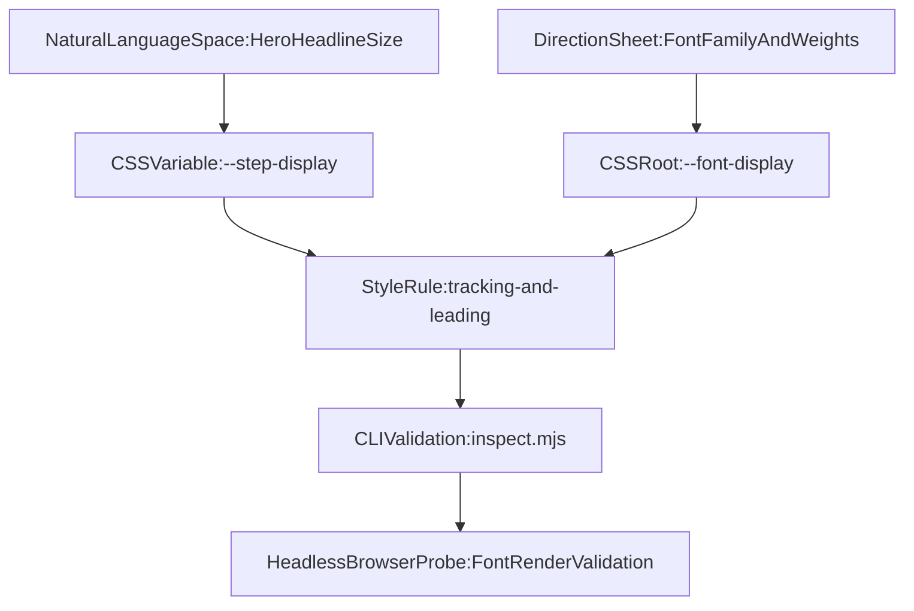
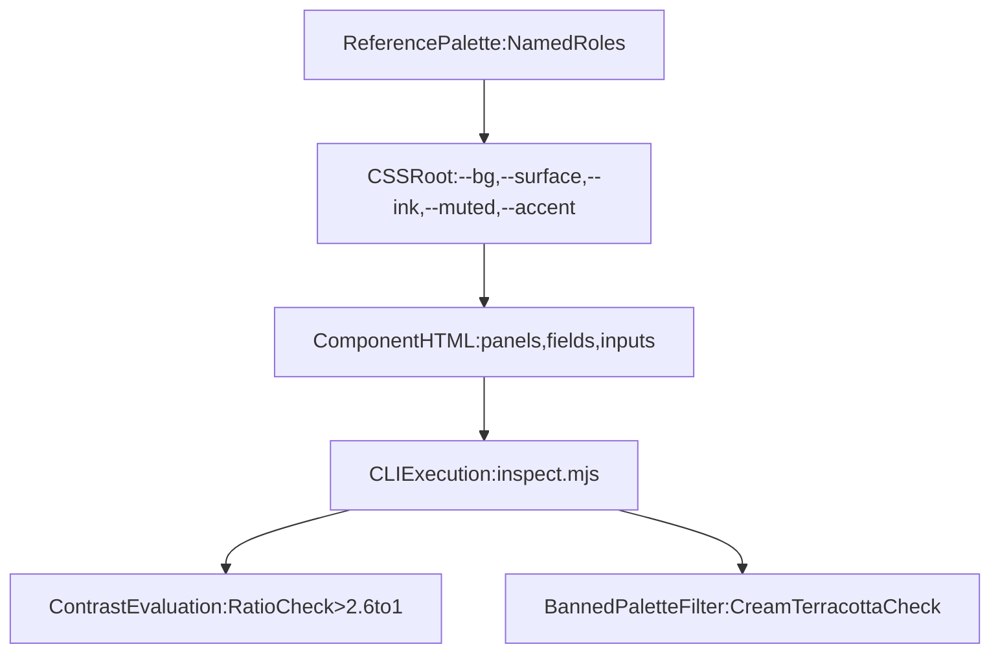

<!-- source: DeepWiki mcp.deepwiki.com · repo Leonxlnx/taste-skill · page 2.3 Typography, Colour & Layout Standards · fetched 2026-10-26 -->

# Typography, Colour & Layout Standards

<details>
<summary>Relevant source files</summary>

The following files were used as context for generating this wiki page:

- [skills/taste-skill/library/palettes.json](skills/taste-skill/library/palettes.json)
- [skills/taste-skill/library/type.json](skills/taste-skill/library/type.json)
- [skills/taste-skill/references/colour.md](skills/taste-skill/references/colour.md)
- [skills/taste-skill/references/copy.md](skills/taste-skill/references/copy.md)
- [skills/taste-skill/references/layout.md](skills/taste-skill/references/layout.md)
- [skills/taste-skill/references/type.md](skills/taste-skill/references/type.md)

</details>


This page documents the concrete design-system laws defined in `skills/taste-skill/references/` `[skills/taste-skill/references/colour.md:1-141]`. It covers type scales and font loading `[skills/taste-skill/references/type.md:1-145]`, palette proportions and contrast enforcement `[skills/taste-skill/references/colour.md:1-141]`, grid/margin/section-variety rules `[skills/taste-skill/references/layout.md:1-123]`, and copy constraints `[skills/taste-skill/references/copy.md:1-140]`.

---

## 1. Typographic Architecture & Font Loading Rules

Typography is the primary mechanism distinguishing designed interfaces from generated stubs `[skills/taste-skill/references/type.md:1-4]`. The reference specifications enforce strict size hierarchies, tracking adjustments, and proper font loading via CSS custom properties `[skills/taste-skill/references/type.md:40-138]`.

### Type Scale and Step Tokens
The design system rejects continuous or multi-step scales (e.g., 9 sizes near each other) in favor of a strict 5-step model where sizes are clearly separated `[skills/taste-skill/references/type.md:39-45]`. The tokens are defined as CSS custom properties using viewport-scaling `clamp()` functions `[skills/taste-skill/references/type.md:47-55]`:

* `--step-small`: 13–14px (`clamp(0.8125rem, 0.79rem + 0.1vw, 0.875rem)`) for captions and legal text `[skills/taste-skill/references/type.md:49]`.
* `--step-body`: 17–19px (`clamp(1.0625rem, 1rem + 0.25vw, 1.1875rem)`) for paragraphs `[skills/taste-skill/references/type.md:50]`.
* `--step-lead`: 20–26px (`clamp(1.25rem, 1.1rem + 0.7vw, 1.625rem)`) for supporting lines and large body text `[skills/taste-skill/references/type.md:51]`.
* `--step-head`: 32–64px (`clamp(2rem, 1.3rem + 3.2vw, 4rem)`) for section headings `[skills/taste-skill/references/type.md:52]`.
* `--step-display`: Set by the hero blueprint (`clamp(3rem, 1rem + 9vw, 9rem)`) `[skills/taste-skill/references/type.md:53]`.

Sources: `[skills/taste-skill/references/type.md:39-64]`, `[skills/taste-skill/library/type.json:1-49]`

### Display vs. Body Formatting
Display type (anything over 40px) exposes optical spacing anomalies that are invisible at body sizes `[skills/taste-skill/references/type.md:65-67]`. Implementations must apply strict tracking, tight leading, and optical alignment `[skills/taste-skill/references/type.md:70-89]`:
* **Tracking:** Must scale inversely with size (e.g., `-0.035em`) `[skills/taste-skill/references/type.md:73]`.
* **Leading:** Set between `0.85` and `1.05` for display type, verified against descender collisions `[skills/taste-skill/references/type.md:72,83-84]`.
* **Optical Alignment:** Glyphs with round or diagonal left edges (`O`, `C`, `A`, `T`, `W`) require manual margin offsets (`margin-left: -0.05em`) to align with left-edge columns `[skills/taste-skill/references/type.md:87-89]`.
* **Body Measure:** Paragraphs must maintain a measure of 45 to 75 characters using `max-width: 62ch` `[skills/taste-skill/references/type.md:99,105]`.

Sources: `[skills/taste-skill/references/type.md:65-113]`

### Font Loading & Fallback Stacks
The font configuration must match the direction sheet exactly `[skills/taste-skill/references/type.md:115-117]`. Preconnect tags and stylesheet links must be injected precisely `[skills/taste-skill/references/type.md:118-122]`, mapped to CSS variables with broad fallback families `[skills/taste-skill/references/type.md:124-129]`:

```css
:root {
  --font-display: "Family From Sheet", "Helvetica Neue", Arial, sans-serif;
  --font-text: "Family From Sheet", Georgia, serif;
}
```

If `inspect.mjs` reports unrendered fallback fonts due to failed asset loads, the layout evaluation is invalidated `[skills/taste-skill/references/type.md:135-138]`.

Sources: `[skills/taste-skill/references/type.md:114-139]`

Diagram: Typography to Code Mapping

Sources: `[skills/taste-skill/references/type.md:47-79]`, `[skills/taste-skill/references/type.md:114-138]`

---

## 2. Colour Systems, Proportions & Contrast Laws

Palettes must be applied via named roles to maintain a cohesive structure rather than a random assortment of tints `[skills/taste-skill/references/colour.md:1-4]`.

### Palette Roles & Tokenization
Every build must utilize standardized CSS custom property roles `[skills/taste-skill/references/colour.md:36-46]`:

```css
:root {
  --bg: …;          /* The ground: most of the surface */
  --surface: …;     /* One tone step from the ground: filled panels, form fields */
  --ink: …;         /* Main text and strongest marks */
  --muted: …;       /* Secondary text; passes contrast on --bg */
  --accent: …;      /* The single accent */
  --accent-ink: …;  /* Text on the accent */
}
```

Raw hex values inside components are prohibited; intermediate greys between `--muted` and `--ink` are forbidden `[skills/taste-skill/references/colour.md:48-50]`.

Sources: `[skills/taste-skill/references/colour.md:34-51]`, `[skills/taste-skill/library/palettes.json:1-30]`

### Surface Depth Without Lines or Shadows
Borders (1px divider lines) and box-shadows are banned from separating surfaces `[skills/taste-skill/references/colour.md:67-69]`. Depth and separation are achieved solely via tone and spacing `[skills/taste-skill/references/colour.md:77-84]`:
* **Tone Step:** Panels use `--surface`, offset by 2–6 lightness points from `--bg` `[skills/taste-skill/references/colour.md:72]`.
* **Nesting Prohibition:** Panels must never be nested inside other panels `[skills/taste-skill/references/colour.md:79]`.
* **Thick Graphic Bars:** Structural lines of 4px or more are permitted if mandated by the direction sheet; 1px dividing lines are rejected `[skills/taste-skill/references/colour.md:82-83]`.

Sources: `[skills/taste-skill/references/colour.md:67-84]`

### Colour Fields & Dark Page Rules
Sections that change the global ground colour act as major architectural moves `[skills/taste-skill/references/colour.md:85-88]`:
* **Edge-to-Edge:** Colour fields meet with hard lines; fades are prohibited `[skills/taste-skill/references/colour.md:90]`.
* **Dark Pages (`color-scheme: dark`):** The ground must be a deep tone with a subtle palette tint `[skills/taste-skill/references/colour.md:99-101]`. Secondary text (`--muted`) must maintain a minimum 4.5:1 contrast ratio against the dark ground `[skills/taste-skill/references/colour.md:102]`. Depth is established via lighter surface steps rather than glows `[skills/taste-skill/references/colour.md:103]`.

Sources: `[skills/taste-skill/references/colour.md:85-105]`

### Banned Palettes & Automated Contrast Enforcement
The automated inspector script `inspect.mjs` enforces contrast and rejects known AI-generated aesthetic tropes `[skills/taste-skill/references/colour.md:118-142]`:
* **Banned Combinations:** Yellow-cream grounds combined with terracotta/rust accents, as well as unmotivated violet/indigo themes, are flagged automatically `[skills/taste-skill/references/colour.md:126-134]`. Brand overrides require explicit flags such as `--allow palette-purple` `[skills/taste-skill/references/colour.md:139-141]`.
* **Contrast Ratios:** Body text requires a minimum 4.5:1 ratio (7:1 preferred for ink on ground), display type requires 3:1, and `inspect.mjs` fails ratios below 2.6:1 on flat grounds `[skills/taste-skill/references/colour.md:118-122]`.

Sources: `[skills/taste-skill/references/colour.md:118-142]`

Diagram: Colour System to Validation Pipeline

Sources: `[skills/taste-skill/references/colour.md:36-75]`, `[skills/taste-skill/references/colour.md:118-142]`

---

## 3. Grid, Margins & Section-Variety Rules

Layout structure governs rhythm, negative space, and viewports across breakpoints `[skills/taste-skill/references/layout.md:1-6]`.

### Margins and the 12-Column Grid
Strong pages avoid excessive centering in favour of edge-to-edge flow `[skills/taste-skill/references/layout.md:20-24]`:
```css
:root {
  --margin: clamp(1rem, 2.2vw, 2rem);   /* 16–32px: tight outer bounds */
  --gutter: clamp(0.75rem, 1.4vw, 1.5rem);
}
.wrap { padding-inline: var(--margin); }
.grid { display: grid; grid-template-columns: repeat(12, minmax(0, 1fr)); column-gap: var(--gutter); }
```
Global grid lines govern all content positioning; visible grid lines, crosshairs, or guide ornaments are strictly banned `[skills/taste-skill/references/layout.md:51-60]`.

Sources: `[skills/taste-skill/references/layout.md:40-61]`

### Section Arrangement & Anti-Template Patterns
To avoid predictable templates (such as icon cards followed by a three-up row), sections must adhere to strict variety mandates `[skills/taste-skill/references/layout.md:94-107]`:
* **No Neighbor Redundancy:** No two adjacent sections may share the same structural layout blueprint `[skills/taste-skill/references/layout.md:102-104]`.
* **Rhythm Control:** Dense blocks alternate with empty space, and light sections alternate with dark fields `[skills/taste-skill/references/layout.md:105]`.
* **Anchor Consistency:** Text elements across sections anchor to identical column offsets (e.g., column 5) `[skills/taste-skill/references/layout.md:63-65]`.

Sources: `[skills/taste-skill/references/layout.md:94-112]`

### Navigation and Viewport Handling
Navigation must be lightweight—typically a wordmark, three to five text links, and a single action `[skills/taste-skill/references/layout.md:115-116]`. Fixed navigation bars must never overlap underlying content, which is validated across viewports via screenshot inspection `[skills/taste-skill/references/layout.md:119-121]`.

Sources: `[skills/taste-skill/references/layout.md:113-123]`

---

## 4. Copy Constraints & Headline Budgets

Copy is treated as the foundational design decision; layout and typography cannot salvage poorly constructed text arguments `[skills/taste-skill/references/copy.md:1-5]`.

### Argument-First Authoring
Before drafting markup, pages must be structured as a sequence of concrete claims where each section carries a distinct, non-filler argument `[skills/taste-skill/references/copy.md:16-37]`. 

Sources: `[skills/taste-skill/references/copy.md:16-38]`

### Two-Line Headline Arithmetic
Hero headlines must fit within two lines or fewer at all viewports, a constraint verified by `inspect.mjs` `[skills/taste-skill/references/copy.md:39-44]`. Character limits are calculated using the formula `[skills/taste-skill/references/copy.md:46-54]`:

$$\text{Characters Per Line} \approx \frac{\text{Line Width (px)}}{\text{Font Size (px)} \times k}$$

Where $k \approx 0.50$ for standard grotesks and serifs `[skills/taste-skill/references/copy.md:52]`. At a desktop layout width with large display type, hero headlines are budgeted to approximately **32 characters or fewer** (four to six words) `[skills/taste-skill/references/copy.md:64]`.

Sources: `[skills/taste-skill/references/copy.md:39-88]`

### Banned Copy Patterns & Proof Rules
* **Banned Headline Shapes:** Mad-libs ("The AI-powered platform for..."), tricolons ("Fast. Simple. Secure."), corrections ("It's not just a tool..."), and unprompted questions are strictly prohibited `[skills/taste-skill/references/copy.md:101-110]`.
* **Proof Integrity:** Inventing customer quotes, unnamed press logos, metrics, or benchmarks is forbidden `[skills/taste-skill/references/copy.md:131-134]`. Proof must rely on verifiable construction details from the brief, such as pricing, dimensions, materials, or real demonstrations `[skills/taste-skill/references/copy.md:136-140]`.

Sources: `[skills/taste-skill/references/copy.md:101-140]`

---

