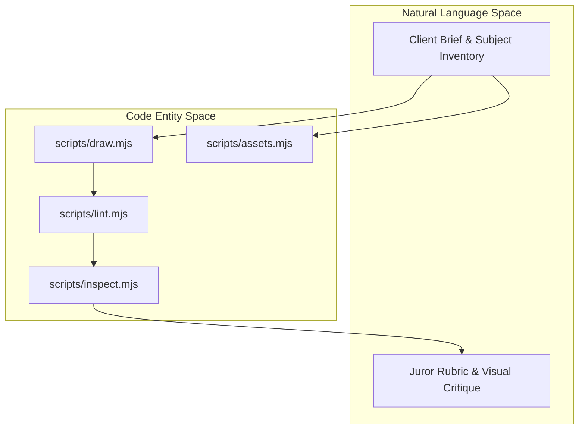
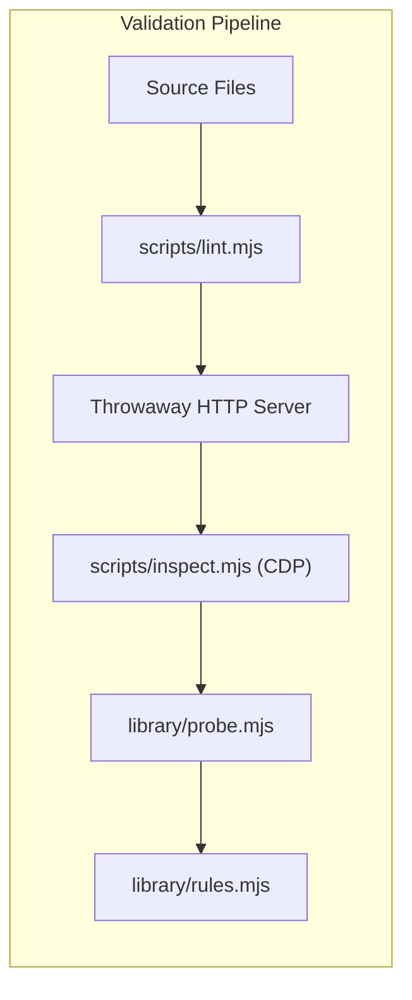

<!-- source: DeepWiki mcp.deepwiki.com · repo Leonxlnx/taste-skill · page 3 The taste-skill v2 Pipeline · fetched 2026-10-26 -->

# The taste-skill v2 Pipeline

Relevant source files

The following files were used as context for generating this wiki page:

- [skills/taste-skill/README.md](skills/taste-skill/README.md)
- [skills/taste-skill/SKILL.md](skills/taste-skill/SKILL.md)
- [skills/taste-skill/library/directions.json](skills/taste-skill/library/directions.json)
- [skills/taste-skill/scripts/assets.mjs](skills/taste-skill/scripts/assets.mjs)

The `design-taste-frontend` skill (v2) implements a deterministic, 10-step run defined in `SKILL.md` [skills/taste-skill/SKILL.md:1-14]() to replace generic model templates with rigorous art direction [skills/taste-skill/README.md:1-6](). The pipeline covers Inventory, Argument, Draw, Idea, Copy deck, Build, Gate, Look, Motion, and Report [skills/taste-skill/SKILL.md:76-130](). This page provides a high-level overview of the pipeline machinery. For detailed breakdowns of each stage, refer to the child pages linked below.

**Diagram: Pipeline Execution Bridge (Natural Language Space to Code Entity Space)**

*Sources: `[skills/taste-skill/SKILL.md:40-130](), [skills/taste-skill/README.md:8-31]()`*

---

## 3.1. draw.mjs & the Direction Library

The composition engine deals three out of 20 researched directions from a structured JSON library (`library/directions.json`) [skills/taste-skill/SKILL.md:15-17](). It processes command-line flags such as `--sector`, `--tone`, `--have`, `--keep`, `--redraw`, `--options`, and `--app`, manages seeded randomness, records draw history in `~/.taste-skill/history.json`, and outputs structured `direction.json` configuration files [skills/taste-skill/README.md:40,47](). 

For details, see [draw.mjs & the Direction Library](#3.1).

*Sources: `[skills/taste-skill/SKILL.md:15-17](), [skills/taste-skill/README.md:40,47]()`*

---

## 3.2. assets.mjs & Open-Collection Media Sourcing

Zero-dependency asset discovery queries Openverse, Wikimedia Commons, the Art Institute of Chicago, and the Met without requiring API keys [skills/taste-skill/scripts/assets.mjs:24-28](). It applies licensing filters, executes video searches, generates `assets/credits.json`, and adheres to the rules defined in `references/imagery.md` [skills/taste-skill/README.md:41-43]() [skills/taste-skill/scripts/assets.mjs:11-22]().

For details, see [assets.mjs & Open-Collection Media Sourcing](#3.2).

*Sources: `[skills/taste-skill/README.md:41-43](), [skills/taste-skill/scripts/assets.mjs:11-28]()`*

---

## 3.3. The Gate: Automated Compliance Checking

The validation phase combines static source linting (`scripts/lint.mjs`) and real-browser inspection (`scripts/inspect.mjs`) to enforce house style compliance [skills/taste-skill/README.md:24-30](). Any `FAIL` or `WARN` finding blocks the build until resolved [skills/taste-skill/README.md:24-30]().

**Diagram: Automated Validation Workflow**

*Sources: `[skills/taste-skill/README.md:44-46]()`*

### 3.3.1. lint.mjs: Static Source Linting
Scans source files statically for banned patterns, stock phrases, and structural tells, supporting `--app` mode and shared rule identifiers [skills/taste-skill/README.md:44]().

### 3.3.2. inspect.mjs: Real-Browser Inspection
Drives headless Chrome via CDP to launch a throwaway HTTP server, iterate viewports across 1440px, 768px, and 390px, capture film-strip scroll frames, and output inspection JSON to `.taste-skill/inspect/` [skills/taste-skill/README.md:24-30,45]().

### 3.3.3. probe.mjs & rules.mjs: Measurement and Judgment
Executes in-page measurement functions (`probe`, `frame`, `layout`, `app`, `colourShare`, `palette`) and evaluates rules (`judge`, `judgeLayout`, `judgeApp`, `APP_SKIP`, `RULE_IDS`) to generate structured finding objects [skills/taste-skill/README.md:46]().

### 3.3.4. cdp.mjs: Zero-Dependency Browser Driver
Implements a lightweight Chrome DevTools Protocol client (`findChrome`, `Browser.launch`, `Page` APIs, throwaway profiles, `taste-skill-owner.json` ownership markers, and profile cleanup routines tested in `tests/profile-cleanup.mjs`) [skills/taste-skill/README.md:46,55]().

### 3.3.5. Critique Loop & Evals
Leverages the `references/critique.md` rubric during the Look phase when agents review screenshots, executing up to three fix rounds against benchmark briefs in `evals/evals.json` [skills/taste-skill/README.md:29-32,50]().

For details, see [The Gate: Automated Compliance Checking](#3.3).

*Sources: `[skills/taste-skill/README.md:24-50]()`*

---

## 3.4. Scroll Scenes Engine

Governed by `references/scenes.md`, `scripts/scenes.mjs`, and `assets/scenes/stage.js` + `stage.css`, this engine delivers pinned GSAP ScrollTrigger scenes with optional Lenis smoothing, 0–100% hold-state photography across desktop, phone, and reduced-motion viewports, alongside specialized scene failure codes [skills/taste-skill/README.md:35-51]().

For details, see [Scroll Scenes Engine](#3.4).

*Sources: `[skills/taste-skill/README.md:35-51]()`*

---

## 3.5. Neutral Foundation Assets

Provides the unopinionated `base.css` and `base.js` foundation shipped with the skill, establishing clean defaults and layout primitives upon which specific direction tokens are layered [skills/taste-skill/README.md:49]().

For details, see [Neutral Foundation Assets](#3.5).

*Sources: `[skills/taste-skill/README.md:49]()`*

---

